# Лабораторная работа №3. SVM

В рамках лабораторной работы реализован SVM через решение двойственной задачи по лямбда (scipy.optimize.minimize), трюк с ядром (линейное, полиномиальное, RBF) и сравнение с эталонной реализацией sklearn.svm.SVC.

Код: data.py (загрузка, EDA, split), kernels.py (ядра), svm_dual.py (двойственная QP-задача, переход к прямой, KKT-проверка), cross_val.py (k-fold CV для подбора гиперпараметров). Весь код воспроизводится запуском model.py, графики сохраняются в plots/ и встроены в этот файл по порядку.

## 1. Датасет

Banknote Authentication (openml, data_id=1462), 1372 объекта, 4 числовых признака (variance, skewness, curtosis, entropy - статистики вейвлет-преобразования изображения банкноты), бинарная задача: поддельная/подлинная банкнота.

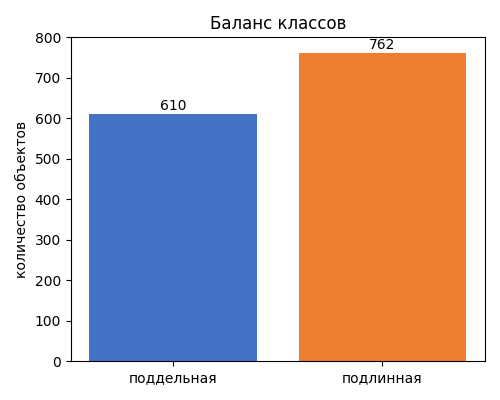

610 поддельных и 762 подлинных банкнот, дисбаланс небольшой.

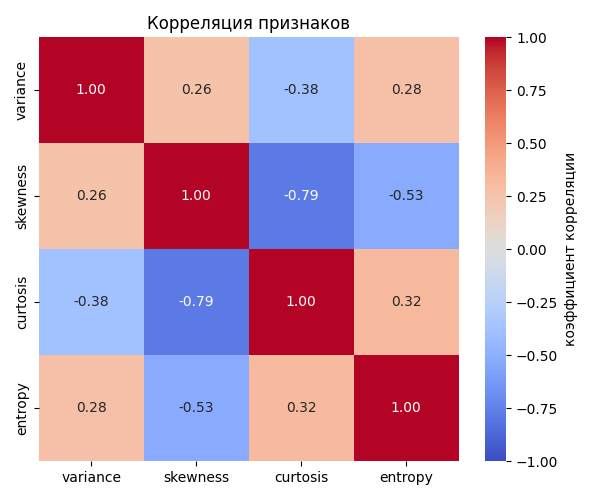

Сильнее всего коррелируют skewness и curtosis (-0.79), остальные пары - слабее.

Split 80/20 со стратификацией, random_state=42 (train=1097, test=275), StandardScaler по train. Полная матрица Грама 1097x1097 для scipy.optimize.minimize решается слишком медленно, поэтому собственный QP-решатель обучается на стратифицированной подвыборке train из 250 объектов (train_sub); sklearn для честного сравнения обучается на той же подвыборке, тестовая выборка для всех моделей одна и та же.

## 2. Двойственная задача

Двойственная задача решается через scipy.optimize.minimize (SLSQP) с аналитическим градиентом, ограничением равенства через LinearConstraint и ограничениями 0 <= лямбда <= C через bounds. Порог w0 усредняется по опорным векторам с 0 < лямбда < C.

| ядро | лямбда в [0,C] | abs(сумма лямбда*y) | доля опорных векторов | сошлось | значение функционала |
|---|---|---|---|---|---|
| linear, C=0.046 | да | 1.6e-13 | 0.38 | да | -2.843 |
| poly, C=0.1, degree=3, coef0=1 | да | 1.0e-11 | 0.10 | да | -0.881 |
| rbf, C=1, gamma=0.25 | да | 9.3e-15 | 0.20 | да | -24.662 |

Все три решения сошлись, ограничения на лямбда выполнены с точностью до вычислительной погрешности, доля опорных векторов в разумных пределах.

## 3. Ядра

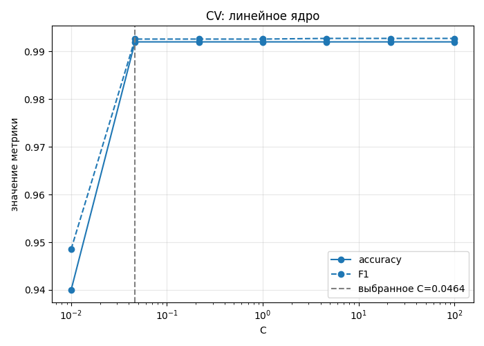

Accuracy выходит на плато 0.992 уже при C=0.046, дальше рост C ничего не дает - выбран минимальный C с максимальным accuracy.

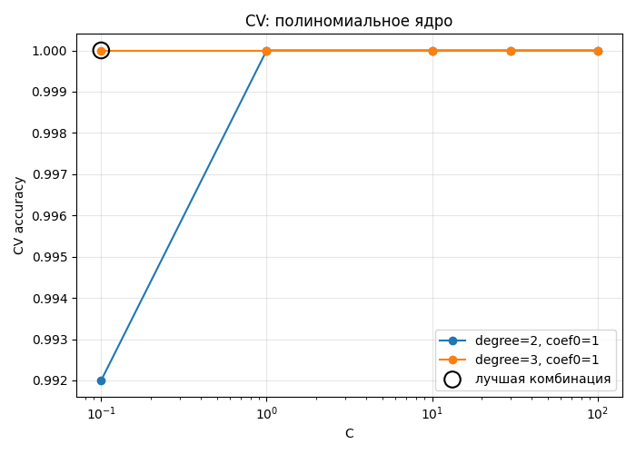

degree=3 с C от 0.1 дает CV accuracy 1.0, degree=2 на маленьком C заметно уступает.

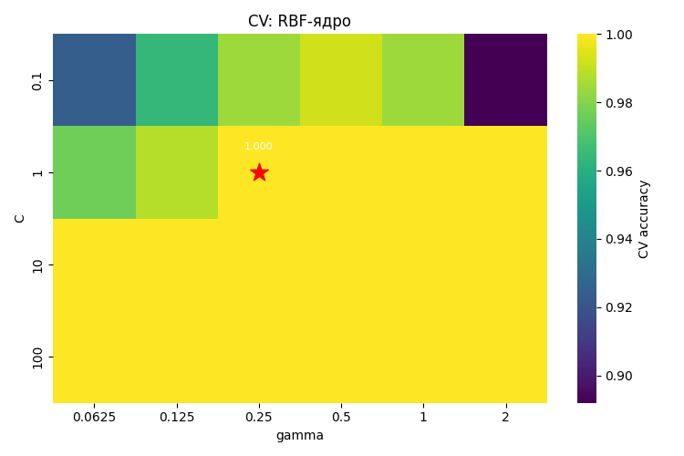

Лучшая точка - C=1, gamma=0.25 (accuracy 1.0); при маленьком C или слишком большом gamma accuracy падает.

| ядро | лучшие гиперпараметры | CV accuracy | CV F1 |
|---|---|---|---|
| linear | C=0.046 | 0.992 | 0.993 |
| poly | C=0.1, degree=3, coef0=1 | 1.000 | 1.000 |
| rbf | C=1, gamma=0.25 | 1.000 | 1.000 |

По CV лучшие poly и RBF, линейное ядро немного уступает - значит данные в исходном 4-мерном пространстве разделимы не полностью линейно.

## 4. Линейный классификатор

Явный переход к прямой задаче: w = сумма лямбда_i * y_i * x_i, классификатор a(x) = sign(<x,w> - w0).

| признак | w | abs(w) |
|---|---|---|
| variance | 1.166 | 1.166 |
| skewness | 0.892 | 0.892 |
| curtosis | 0.847 | 0.847 |
| entropy | -0.093 | 0.093 |

Наибольший вклад вносит variance, entropy почти не влияет на решение - вес на порядок меньше остальных.

| макс. отклонение a_primal от a_dual | совпадение знаков predict, % |
|---|---|
| 1.55e-15 | 100.0 |

Переход от двойственной задачи к прямой корректен: предсказания через явное w и через ядровую сумму совпадают с точностью до вычислительной погрешности.

## 5. Визуализация решения

Признаков 4, поэтому границы строятся на отдельной иллюстративной SVM, обученной прямо в проекции на 2 главные компоненты (PCA); метрики и таблицы выше и ниже относятся к моделям в исходном пространстве.

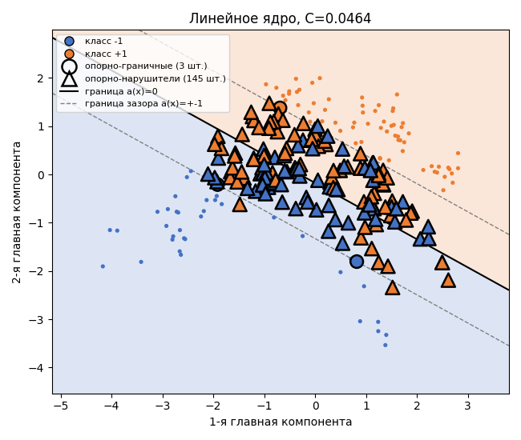

Разделяющая полоса прямая, опорных векторов много (148 из 250) - при маленьком C зазор широкий. Опорно-граничных (кружки, лежат ровно на краю полосы) всего 3, остальные 145 - опорно-нарушители (треугольники, внутри полосы или по чужую сторону).

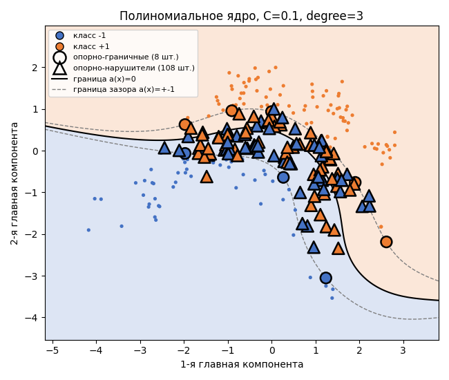

Граница изогнутая: там, где классы разделимы, похожа на линейную, но выгибается вокруг выбросов. Опорно-граничных 8 из 116 опорных, остальные - нарушители.

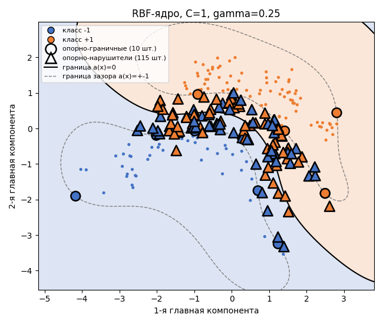

Граница самая гибкая, есть небольшой замкнутый контур вокруг плотной группы поддельных банкнот. Опорно-граничных 10 из 125 опорных, остальные - нарушители.

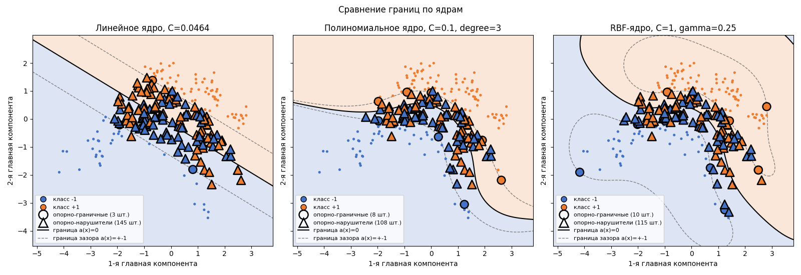

Все три границы на одной сетке: линейная грубее, полиномиальная и RBF подстраиваются под изгиб данных похожим образом. Во всех трёх случаях опорно-граничных объектов (кружки) намного меньше, чем опорно-нарушителей (треугольники) - на иллюстративной 2D-модели с подобранным по CV C зазор узкий, и почти все опорные объекты внутри него.

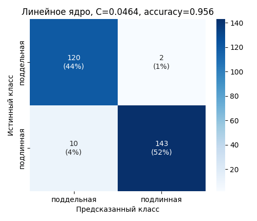

Линейное ядро путает классы чаще остальных: 2 подлинных приняты за поддельные, 10 поддельных за подлинные, accuracy 0.956.

0 ошибок на test, accuracy 1.0.

0 ошибок на test, accuracy 1.0.

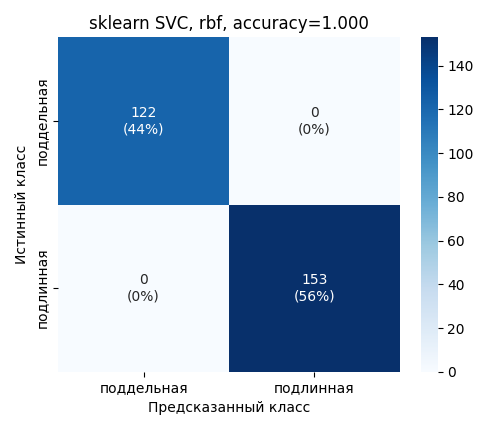

Лучшее по accuracy ядро у sklearn - тоже RBF, тоже 0 ошибок на test, полностью совпадает с собственной реализацией.

## 6. Сравнение с эталоном

| ядро | реализация | accuracy | precision | recall | F1 | SV | время, с |
|---|---|---|---|---|---|---|---|
| linear | своя | 0.956 | 0.986 | 0.935 | 0.960 | 95 | 0.54 |
| linear | sklearn | 0.956 | 0.986 | 0.935 | 0.960 | 95 | 0.00 |
| poly | своя | 1.000 | 1.000 | 1.000 | 1.000 | 25 | 1.16 |
| poly | sklearn | 0.975 | 1.000 | 0.954 | 0.977 | 62 | 0.00 |
| rbf | своя | 1.000 | 1.000 | 1.000 | 1.000 | 50 | 2.04 |
| rbf | sklearn | 1.000 | 1.000 | 1.000 | 1.000 | 51 | 0.00 |

На линейном и RBF-ядре собственная реализация и sklearn с одинаковыми гиперпараметрами дают идентичные метрики. На poly собственная реализация показала accuracy 1.0 против 0.975 у sklearn при тех же C, degree и coef0 - при маленькой подвыборке (250 объектов) и малой доле опорных векторов (10%) решение двойственной задачи не единственно, SLSQP и libsvm сходятся к разным допустимым точкам. sklearn на порядки быстрее за счет специализированного решателя libsvm вместо общего scipy.optimize.minimize.

## 7. Оценка качества

| модель | accuracy | F1 |
|---|---|---|
| DummyClassifier | 0.556 | 0.715 |
| линейный SVM | 0.956 | 0.960 |
| poly SVM | 1.000 | 1.000 |
| RBF SVM | 1.000 | 1.000 |

Все три модели значительно превосходят тривиальный baseline (accuracy 0.556, предсказание большинства класса).

Основное ограничение - собственный QP-решатель обучается на подвыборке из 250 объектов, потому что scipy.optimize.minimize (SLSQP) на полной выборке (1097 объектов, матрица Грама 1097x1097) решает задачу на порядки дольше. sklearn с теми же гиперпараметрами на полном train тоже дает accuracy 1.0, то есть задача легко решается специализированными методами на полной выборке, ограничение подвыборкой касается только собственной реализации. Poly и RBF ядра на маленькой подвыборке чувствительны к C и gamma/degree, что видно и по почти идеальному accuracy на train_sub, и по расхождению с sklearn на poly-ядре.
