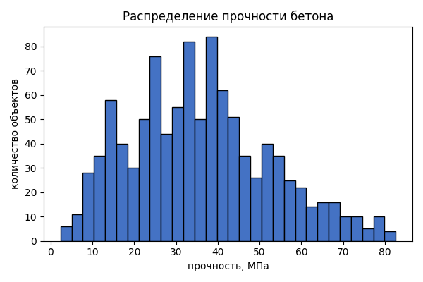
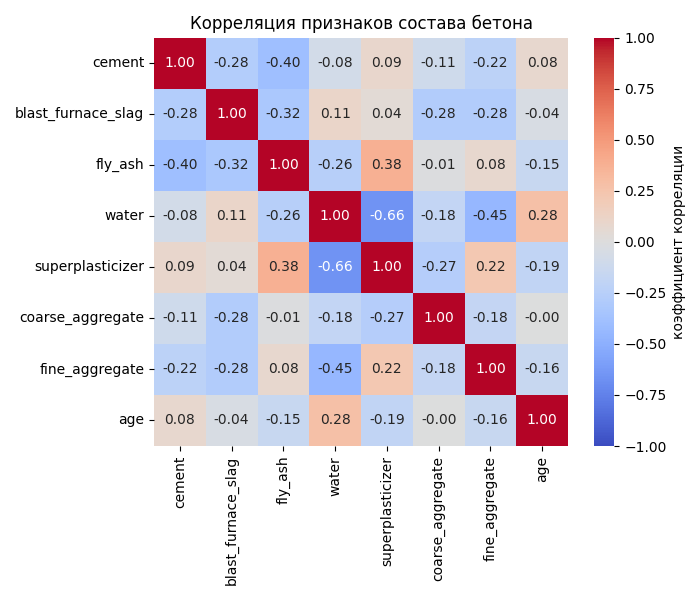
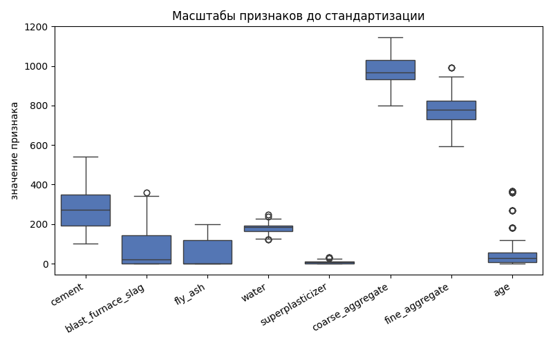
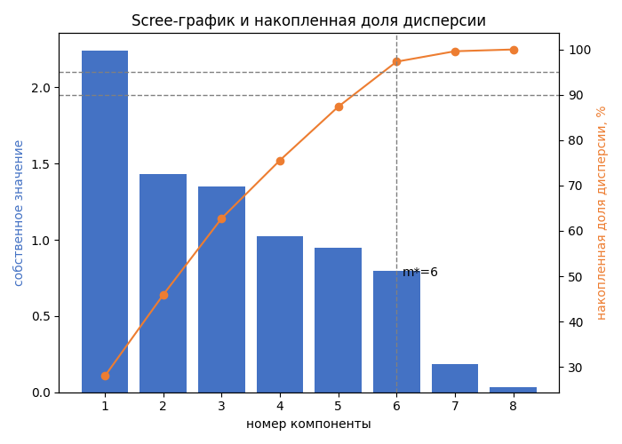
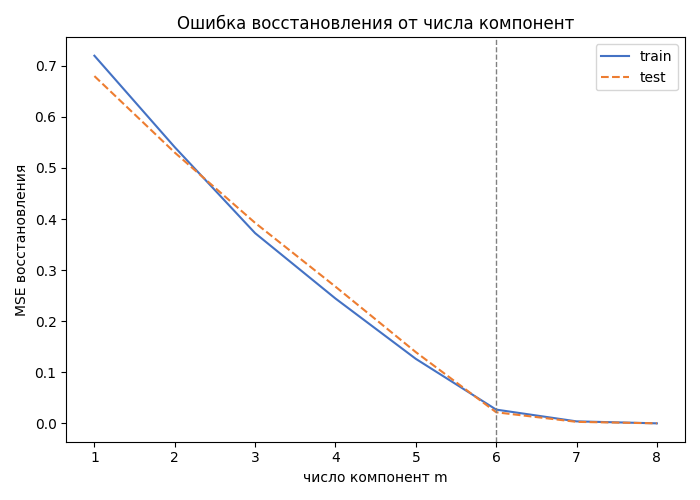
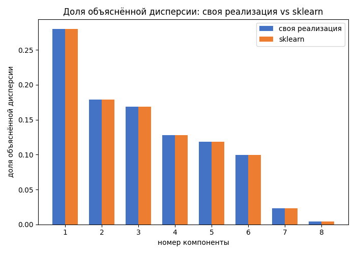
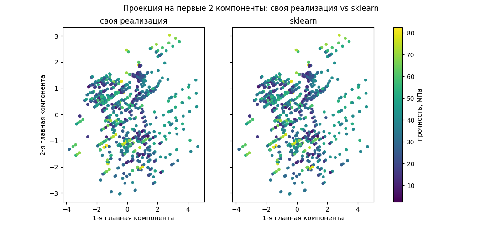

# Лабораторная работа №4. PCA

Датасет — Concrete Compressive Strength (OpenML, `data_id=44959`): 1030 строк, 8 числовых признаков состава бетонной смеси (`cement`, `blast_furnace_slag`, `fly_ash`, `water`, `superplasticizer`, `coarse_aggregate`, `fine_aggregate`, `age`), цель — прочность бетона на сжатие в МПа. Это регрессия. CSV в репозиторий не кладётся, загружается через `fetch_openml` в момент запуска.

Из каталога `lab4`:

```bash
pip install -r requirements.txt
python model.py
```

`data.py` загружает датасет и делает split со стандартизацией. `pca_svd.py` — собственная PCA через SVD. `dimensionality.py` оценивает эффективную размерность. `compare_sklearn.py` сверяет с `sklearn.decomposition.PCA`. `model.py` прогоняет всё по порядку и сохраняет графики в `plots/`.

## Данные

Пропусков нет. Прочность: среднее 35.8 МПа, медиана 34.4, диапазон 2.3–82.6. Сильнее всего с прочностью связаны `cement` (корреляция 0.50), `superplasticizer` (0.37) и `age` (0.33), `water` — заметно отрицательно (−0.29).



Между собой признаки тоже связаны: `water` и `superplasticizer` −0.66, `water` и `fine_aggregate` −0.45, `cement` и `fly_ash` −0.40 — колинеарности достаточно, чтобы PCA было чем сжимать.



`coarse_aggregate` и `fine_aggregate` измерены в кг/м³ и лежат в сотнях, `superplasticizer` — тоже кг/м³, но единицы, `age` — дни от 1 до 365. Без стандартизации первая ось PCA легла бы на `coarse_aggregate` просто из-за масштаба.



`split_and_scale` обучает `StandardScaler` только на train: матрица 824×8 на train и 206×8 на test (split 80/20, `random_state=42`). Таргет в матрицу не входит, SVD строится по train, test только проецируется.

## PCA через SVD

Центрируем столбцы `X` по train и раскладываем `X = U diag(s) Vᵀ` (`np.linalg.svd`). Строки `Vᵀ` — оси, дисперсия компоненты `λ = s² / (n − 1)`, доля дисперсии — `s² / Σs²`. Компоненты ортонормированы с точностью 8.9·10⁻¹⁶, восстановление при всех 8 компонентах точное (3.6·10⁻¹⁵), сумма долей дисперсии равна 1 с точностью 10⁻¹⁰ — реализация корректна.

Первая компонента берёт 28% дисперсии при равной доле 1/8 = 12.5%. Загружена она прежде всего `water` (0.545) и `superplasticizer` (−0.514), следом `fine_aggregate` (−0.400) и `fly_ash` (−0.395) — это та же связка признаков, что и в корреляциях выше, PCA собрал её в одну ось. С прочностью эта проекция почти не коррелирует (−0.03 на train), вторая компонента тоже (−0.07): PCA ищет дисперсию в `X` и ничего не знает про `y`.



Эффективная размерность зависит от критерия. По правилу Кайзера (`λ > 1`) — 4 компоненты, они держат 75.6% дисперсии. По порогу 95% накопленной дисперсии — 6 компонент (97.3%), и излом на scree-графике приходится туда же: после шестой компоненты собственные значения резко падают, седьмая и восьмая вместе дают меньше 3% дисперсии. Для дальнейшего анализа взято m=6 — здесь порог дисперсии и визуальный излом совпадают, а Кайзер в этот раз консервативнее.



Ошибка восстановления (MSE) убывает монотонно и почти не отличается на train и test на всём диапазоне m — выбор m=6 не подогнан под обучающую выборку. При m=6 MSE на train 0.027, на test 0.022, при m=8 восстановление точное на обеих выборках.

Сохранённая дисперсия признаков не значит сохранённую полезность для таргета: линейная регрессия (`np.linalg.lstsq`, не эталон, а иллюстрация) на проекции train на m компонент, предсказание на test. На 2 компонентах (46% дисперсии) R² на test около нуля — не лучше константного прогноза. На 6 компонентах (97% дисперсии) R² = 0.57. На всех 8 (это просто поворот базиса, эквивалент исходных признаков) — R² = 0.63.

## Сверка со sklearn

`compare_sklearn.py` сравнивает компоненты по модулю косинусного сходства (знак оси в SVD не определён — задача не различает `v` и `−v`), выравнивает знак и сравнивает проекции и восстановление.

При `svd_solver="full"` расхождение нулевое на долях дисперсии и 8.9·10⁻¹⁶ на проекциях и восстановлении — это тот же SVD. `PCA(n_components=8)` без явного `solver` сама выбирает `covariance_eigh`, потому что train 824×8 — это больше 10×(число признаков): там решают задачу на собственные векторы ковариационной матрицы, а не прямой SVD, и расхождение уже не нулевое, хотя и микроскопическое.

| | `svd_solver="full"` | `PCA()`, `covariance_eigh` |
|---|---:|---:|
| доля дисперсии | 0 | 2.2·10⁻¹⁶ |
| проекция train | 8.9·10⁻¹⁶ | 5.3·10⁻¹⁴ |
| восстановление (m=8) | 8.9·10⁻¹⁶ | 4.8·10⁻¹⁵ |




