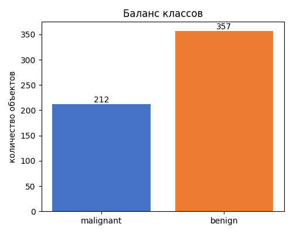
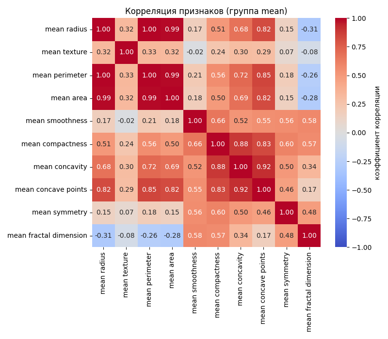
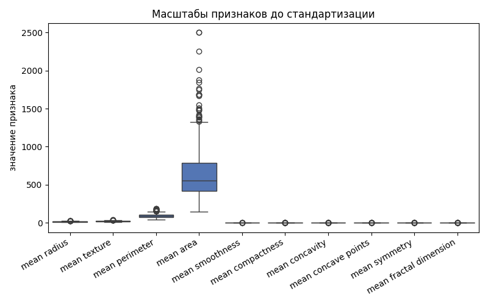
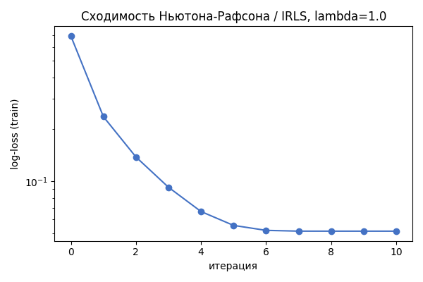
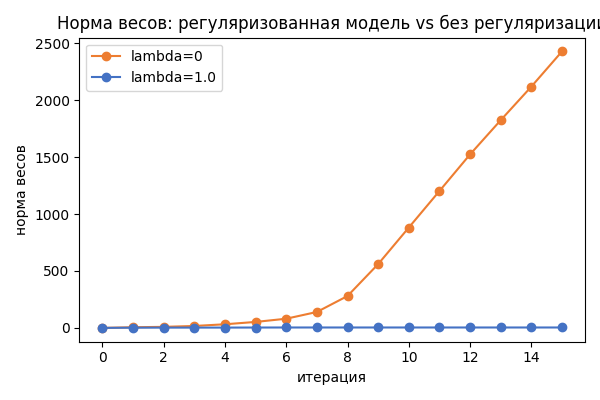
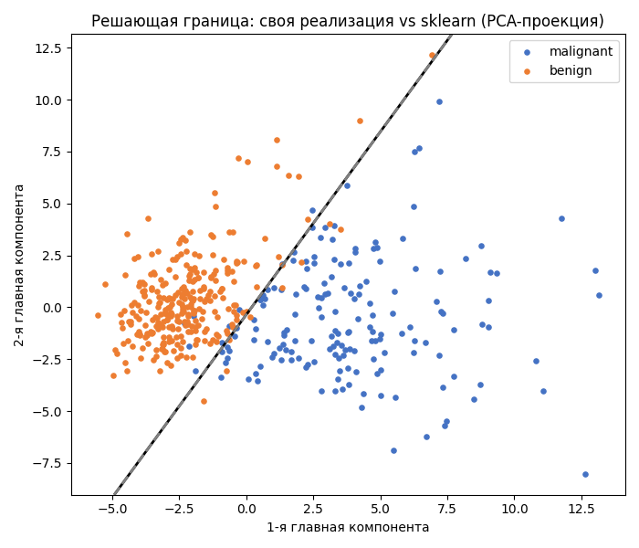
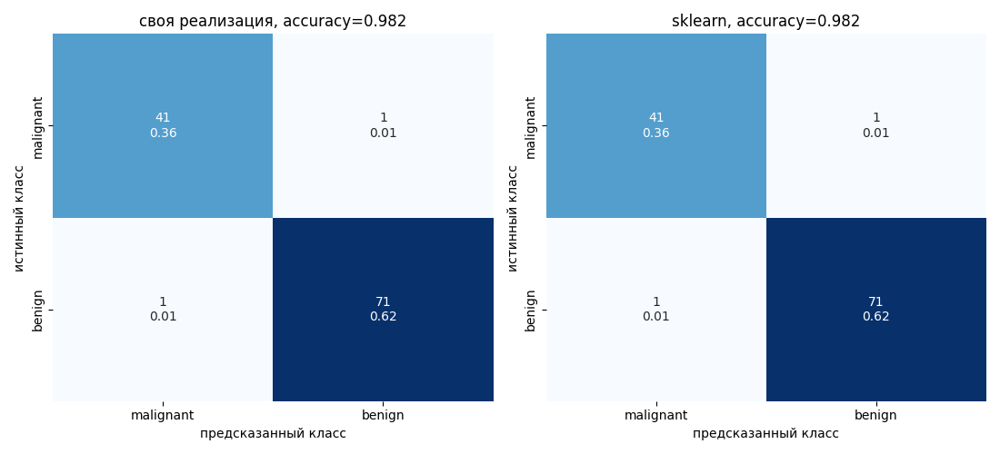
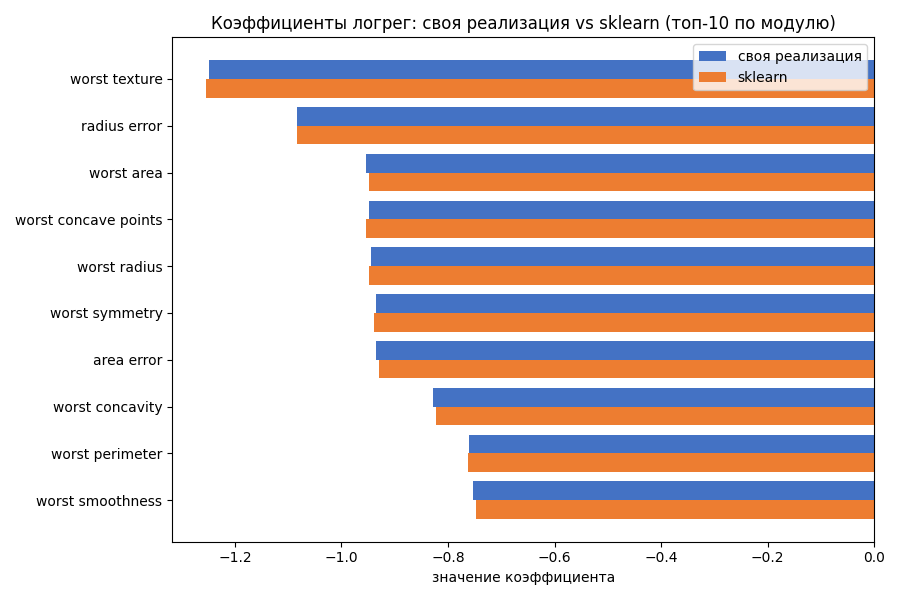

# Лабораторная работа №5. Логистическая регрессия

Датасет — Breast Cancer Wisconsin (Diagnostic), sklearn.datasets.load_breast_cancer: 569 объектов, 30 признаков, бинарная цель (0 — malignant, 212 объектов, 1 — benign, 357 объектов). Признаки сильно коррелируют, выборка почти линейно разделима — повод для L2-регуляризации.

Из каталога lab5:

pip install -r requirements.txt
python model.py

data.py — загрузка и split со стандартизацией. logreg_irls.py — своя логистическая регрессия (Ньютон-Рафсон / IRLS, L2). compare_sklearn.py — сравнение со sklearn.linear_model.LogisticRegression. model.py — пайплайн, графики в plots.

## Данные

Пропусков нет. Split 80/20, stratify=y, random_state=42, StandardScaler обучен на train.

radius, perimeter, area коррелируют на 0.99-1.00, compactness/concavity/concave points — на 0.83-0.92.

area — сотни-тысячи, smoothness и symmetry — доли единицы, нужна стандартизация.

## Ньютон-Рафсон и IRLS

p_i = sigmoid(w^T x_i), L2-штраф на веса без свободного члена. Ньютон: w_new = w - H^-1 grad, grad = X^T(y-p) - lambda*w, H = -(X^T W X + lambda*I). IRLS: z = Xw + W^-1(y-p), (X^T W X + lambda*I) w = X^T W z.

newton_step и irls_step на одном w расходятся не больше чем на 3.26e-14 — направление шага совпадает. Обучение (fit) использует только newton_step.

log-loss: 0.693 -> 0.051 за 10 итераций, сходимость квадратичная.

Без регуляризации (lambda=0) норма весов растёт без остановки (2428 за 15 итераций), с lambda=1.0 стабилизируется на 3.6 — неустойчивость на разделимой выборке.

## Сравнение со sklearn

LogisticRegression(penalty="l2", solver="lbfgs", C=1/lambda) — та же регуляризация.

max|w_mine - w_sklearn| = 1.52e-2, max|p_mine - p_sklearn| = 2.23e-3 (разница из-за критерия остановки lbfgs). accuracy на test 0.9825 у обеих, log-loss 0.0779 против 0.0777.

Граница на PCA-проекции (отдельная иллюстративная 2D-модель, не та, по которой считаются метрики) у своей реализации и sklearn почти совпадает.

Confusion matrix на test (30 признаков) совпадает поэлементно: 41/1 malignant, 1/71 benign.

Топ-10 коэффициентов — в основном группа worst, знак и величина у обеих реализаций совпадают.

Baseline (DummyClassifier) — accuracy 0.6316, обе логрег — 0.9825.
