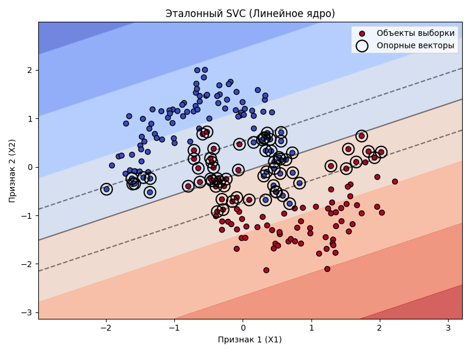
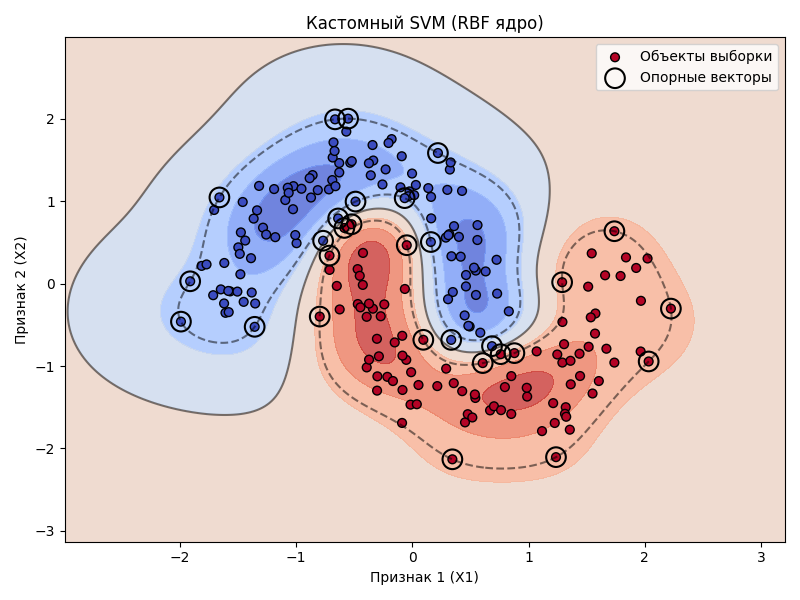

# Лабораторная работа №3. Метод опорных векторов

Реализация метода опорных векторов (SVM) через решение двойственной задачи квадратичного программирования, применение ядерного трюка (Kernel Trick) для построения нелинейного классификатора и сравнение с эталонной реализацией из `sklearn`.

## Датасет

В работе используется синтетический датасет `make_moons` (300 объектов, 2 признака, 2 класса) из `sklearn.datasets`.
Данный датасет представляет собой два переплетенных полумесяца, что делает его линейно неразделимым.
Добавлен шум (`noise=0.15`) для создания пересечений классов.

## Модель

### Двойственная задача SVM
Вместо прямой оптимизации весов $w$ и сдвига $w_0$, решается двойственная задача квадратичного программирования относительно множителей Лагранжа $\lambda_i$:

$$ -L(\lambda) = -\sum_{i=1}^{\ell} \lambda_i + \frac{1}{2} \sum_{i=1}^{\ell} \sum_{j=1}^{\ell} \lambda_i \lambda_j y_i y_j K(x_i, x_j) \to \min_{\lambda} $$

При ограничениях:
- $\sum_{i=1}^{\ell} \lambda_i y_i = 0$
- $0 \le \lambda_i \le C, \quad i = 1, \dots, \ell$

**Опорные векторы:**
Объекты, для которых $\lambda_i > 0$.
- **Опорные-граничные** ($0 < \lambda_i < C$): лежат строго на границе разделяющей полосы ($M_i = 1$).
- **Опорные-нарушители** ($\lambda_i = C$): лежат внутри разделяющей полосы или ошибочно классифицированы ($M_i < 1$).

**Ядерный трюк (Kernel Trick):**
Скалярное произведение $\langle x_i, x_j \rangle$ заменяется на ядро $K(x_i, x_j)$, что позволяет строить нелинейные разделяющие поверхности без явного перехода в пространство высшей размерности.

## Эксперименты

### 1. Линейный классификатор (Linear Kernel)

Использовалось линейное ядро $K(x, x') = \langle x, x' \rangle$. Параметр регуляризации $C = 1.0$.

| Модель | Accuracy (Test) | Опорных векторов |
| --- | :-: | :-: |
| Кастомный SVM (Linear) | 0.9000 | 68 |
| Эталонный SVC (Linear) | 0.9000 | 68 |

**Вывод:** Границы решений полностью совпадают. Количество опорных векторов и качество классификации идентичны.

### 2. Нелинейный классификатор (RBF Kernel)

Применен ядерный трюк с гауссовским ядром (RBF): $K(x, x') = \exp(-\gamma \|x - x'\|^2)$.
Параметры: $C = 10.0$, $\gamma = 2.0$.

| Модель | Accuracy (Test) | Опорных векторов |
| --- | :-: | :-: |
| Кастомный SVM (RBF) | 1.0000 | 29 |
| Эталонный SVC (RBF) | 1.0000 | 29 |

**Вывод:** Использование RBF-ядра позволило алгоритму построить нелинейную разделяющую границу, идеально повторяющую форму "лун". Качество классификации на тестовой выборке выросло с 90.0% до 100.0%. Количество опорных векторов сократилось с 68 до 29, что говорит о более компактном и устойчивом решении.

## Выводы

1. **Двойственная задача:** Решение двойственной задачи квадратичного программирования через `scipy.optimize.minimize` позволяет корректно идентифицировать опорные векторы и восстановить параметры классификатора. Результаты полностью совпадают с эталонной реализацией `sklearn.svm.SVC`.
2. **Ядерный трюк:** Замена скалярного произведения на нелинейное ядро (RBF) решает проблему линейной неразделимости данных, позволяя строить сложные разделяющие поверхности.
3. **Разреженность решения:** Нелинейное ядро при удачном выборе параметров приводит к более компактному решению (29 опорных векторов против 68 у линейного).