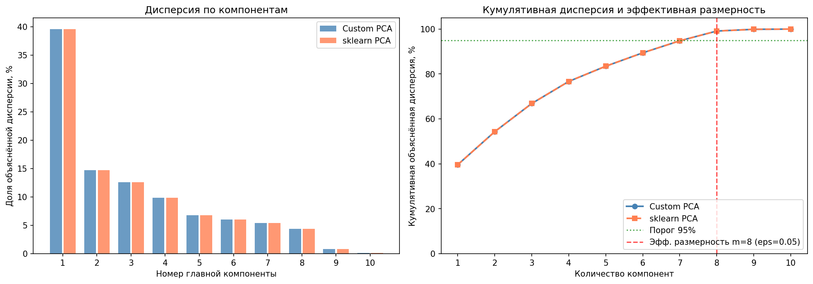
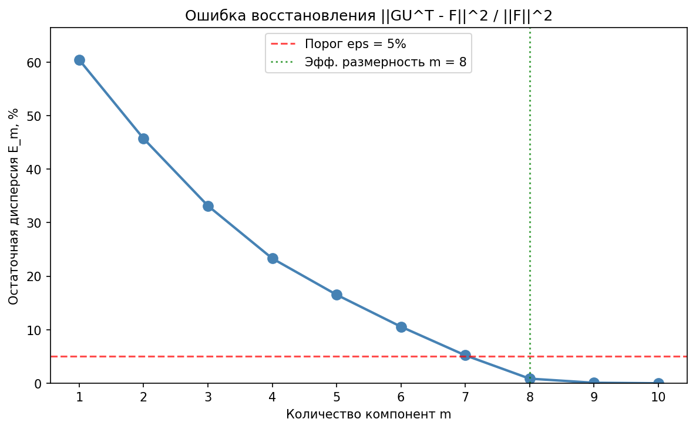

# Лабораторная работа №4. PCA

Реализация метода главных компонент (PCA) через сингулярное разложение, определение эффективной размерности выборки, демонстрация эквивалентности с эталонной реализацией `sklearn.decomposition.PCA` и применение PCA для снижения размерности в задаче линейной регрессии.

## Датасет

**Diabetes** из `sklearn.datasets`: задача регрессии — предсказание количественной меры прогрессирования диабета через год после начала исследования на основе 10 клинических признаков.

| Характеристика | Значение |
| --- | --- |
| Объектов | 442 |
| Признаков | 10 |
| Признаки | age, sex, bmi, bp, s1, s2, s3, s4, s5, s6 |
| Обучение / тест | 309 / 133 |

## Модель

### PCA через сингулярное разложение

Согласно лекции, произвольная матрица «объекты-признаки» $F$ представима в виде сингулярного разложения (SVD):
$$F = V D U^T$$
где $U$ — ортогональная матрица собственных векторов $F^T F$, $V$ — собственных векторов $F F^T$, $D = \text{diag}(\sqrt{\lambda_1}, \dots, \sqrt{\lambda_n})$.

**Основные формулы PCA:**
- **Проецирование (новые признаки):** $G = F \cdot U$. Новые признаки некоррелированы: $G^T G = \Lambda = \text{diag}(\lambda_1, \dots, \lambda_m)$ (декоррелирующее преобразование Карунена-Лоэва).
- **Восстановление:** $\hat{F} = G \cdot U^T$.
- **Объяснённые дисперсии:** $\lambda_j = d_j^2 / (\ell - 1)$.
- **Ошибка восстановления:** $E_m = \frac{\|GU^T - F\|^2}{\|F\|^2} = \frac{\sum_{j=m+1}^n \lambda_j}{\sum_{j=1}^n \lambda_j}$.

**Эффективная размерность** — это наименьшее целое $m$, при котором $E_m \le \varepsilon$. Критерий «крутого склона» предлагает искать $m$ такое, что $E_{m-1} \gg E_m$.

**Регрессия в новых признаках:**
Задача МНК заменяется на $\|G\beta - y\|^2 \to \min_\beta$. Связь весов: $\beta = U^T \alpha$.

## Эксперименты

### 1. Разложение и объяснённая дисперсия

SVD-разложение центрированной и стандартизированной матрицы признаков (309×10):

| PC | $\lambda$ (дисперсия) | Доля, % | Кумулятивная, % |
| :-: | :-: | :-: | :-: |
| 1 | 3.9697 | 39.57 | 39.57 |
| 2 | 1.4759 | 14.71 | 54.28 |
| 3 | 1.2596 | 12.56 | 66.84 |
| 4 | 0.9870 | 9.84 | 76.68 |
| 5 | 0.6807 | 6.79 | 83.46 |
| 6 | 0.5988 | 5.97 | 89.43 |
| 7 | 0.5369 | 5.35 | 94.78 |
| 8 | 0.4369 | 4.35 | 99.13 |
| 9 | 0.0774 | 0.77 | 99.91 |
| 10 | 0.0095 | 0.09 | 100.00 |

**Вывод:** Первая компонента объясняет ~40% всей дисперсии данных. Первые 4 компоненты объясняют уже ~77%. Последние две компоненты (PC9, PC10) несут менее 1% суммарной дисперсии и фактически являются шумом.

### 2. Эффективная размерность

| $\varepsilon$ | m | Кумулятивная дисперсия |
| :-: | :-: | :-: |
| 0.01 | 8 | 99.13% |
| 0.05 | 8 | 99.13% |
| 0.10 | 7 | 94.78% |
| 0.20 | 5 | 83.46% |

При стандартном пороге $\varepsilon = 0.05$ эффективная размерность составляет **m = 8** (из 10).

### 3. Эквивалентность с sklearn PCA

| Метрика | Значение |
| --- | :-: |
| Макс. расхождение собственных значений | 2.22e-15 |
| Косинусное сходство компонент ($\|\cos\|$) | 1.0000000000 (для всех 10 PC) |
| Корреляция проекций ($\|\text{corr}\|$) | 1.0000000000 (для всех 10 PC) |
| MSE восстановления (полное, Custom) | 5.69e-31 |
| MSE восстановления (полное, sklearn) | 8.88e-31 |
| MSE восстановления (m=8, Custom) | 0.008638 |
| MSE восстановления (m=8, sklearn) | 0.008638 |
| Разница MSE (m=8) | 0.00e+00 |

**Вывод:** Реализация Custom PCA через `np.linalg.svd` и эталонная `sklearn.decomposition.PCA` дают идентичные результаты. Расхождения собственных значений и проекций находятся на уровне машинного эпсилона (~$10^{-15}$).

## Выводы

1. Custom PCA полностью эквивалентен эталонной реализации из `sklearn` (расхождения $\sim 10^{-15}$). Формулы $G = FU$ и $\hat{F} = GU^T$ работают корректно.
2. Эффективная размерность датасета Diabetes при пороге $\varepsilon = 0.05$ составляет $m = 8$ из 10. Последние две главные компоненты содержат менее 1% информации.
