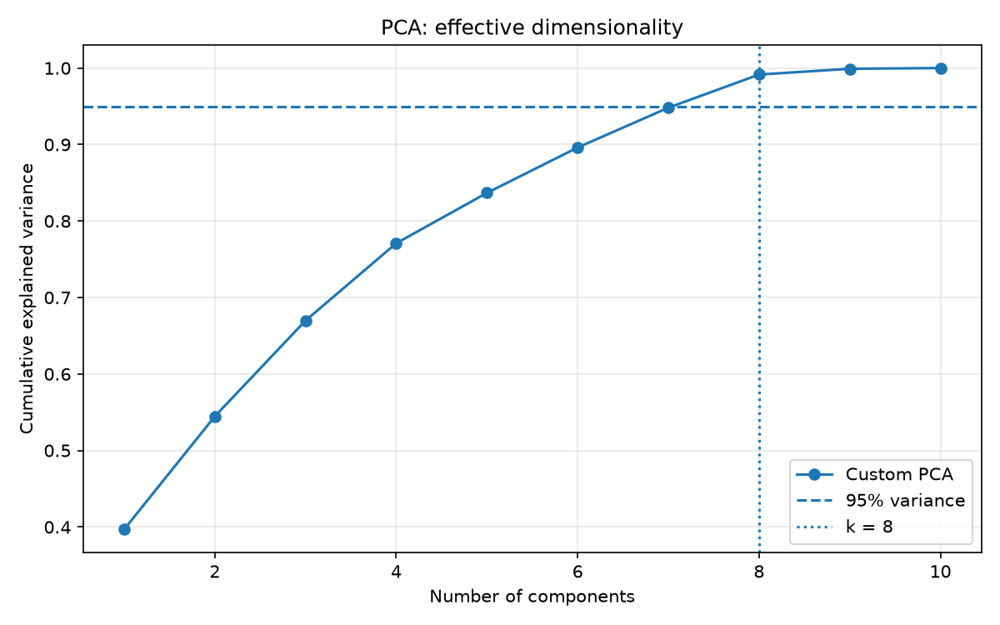
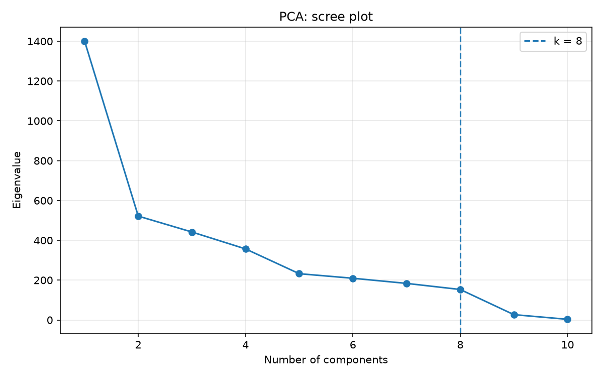
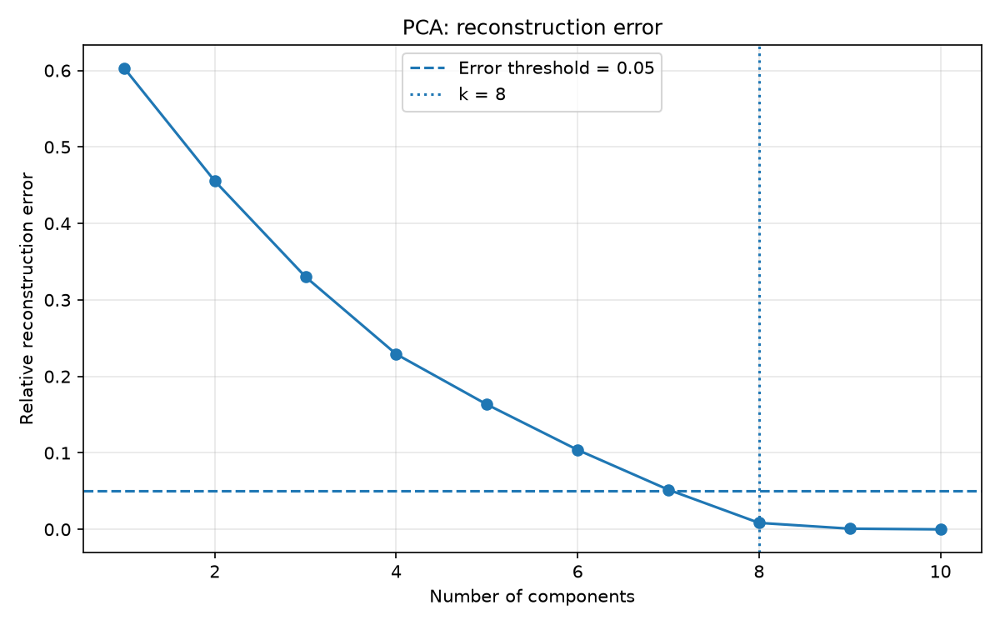

# Лабораторная работа №4. Метод главных компонент (PCA)

## 1. Цель работы

Реализовать метод главных компонент (PCA) через сингулярное разложение (SVD), определить эффективную размерность выборки и проверить эквивалентность собственной реализации с `sklearn.decomposition.PCA`.

Дополнительно исследовать влияние снижения размерности на качество линейной регрессии.

## 2. Датасет

Используется `Diabetes` из библиотеки `sklearn.datasets`.

- Количество объектов: 442.
- Количество признаков: 10.
- Целевая переменная: количественный показатель прогрессирования диабета.
- Задача: регрессия.

Данные разделены на обучающую (353 объекта) и тестовую (89 объектов) выборки в соотношении 80/20, `random_state=42`.

Признаки стандартизированы с помощью `StandardScaler`, обученного только на тренировочной выборке.

## 3. Теоретическая часть

### 3.1. Постановка задачи PCA

PCA преобразует исходные признаки в новые, позволяя уменьшить размерность данных с минимальной ошибкой восстановления.

В обозначениях лекции:

- F — исходная матрица признаков;
- G — матрица новых признаков;
- U — матрица главных направлений.

Минимизируется квадратичная ошибка восстановления:

$$
\|GU^T - F\|^2 \rightarrow \min_{G,U}
$$

Новые признаки вычисляются как:

$$
G = FU
$$

Приближённое восстановление исходной матрицы:

$$
\hat{F} = GU^T
$$

При использовании меньшего числа компонент получается приближённое восстановление исходной матрицы:

$$
\hat{F} = GU^T
$$

В реализации перед SVD признаки центрируются, поэтому формулы применяются к центрированной матрице. После обратного преобразования средние значения добавляются обратно.

### 3.2. PCA через сингулярное разложение

Матрица признаков представляется в виде:

$$
F = VDU^T
$$

где D содержит сингулярные значения, а столбцы U являются главными направлениями.

В NumPy сингулярное разложение вычисляется функцией `np.linalg.svd`.

Собственные значения матрицы $F^TF$:

$$
\lambda_i = \sigma_i^2
$$

Для снижения размерности выбираются направления, соответствующие наибольшим собственным значениям.

### 3.3. Эффективная размерность

По слайду 23 эффективная размерность определяется как минимальное число компонент \(m\), при котором относительная ошибка восстановления не превышает заданный порог:

$$
E_m = \frac{\lambda_{m+1} + \dots + \lambda_n}{\lambda_1 + \dots + \lambda_n} \leq \varepsilon
$$

В работе используется порог \(\varepsilon=0.05\), то есть требуется сохранить не менее 95% дисперсии.

## 4. Реализация

Собственная реализация `PCAFromSVD` находится в `source/pca.py`.

Реализованы методы:

- `fit`: центрирование, SVD, вычисление главных направлений и объяснённой дисперсии.
- `transform`: проекция объектов на главные компоненты.
- `fit_transform`: обучение и преобразование.
- `inverse_transform`: восстановление исходных признаков.
- `reconstruction_error`: относительная квадратичная ошибка восстановления.
- `effective_dimension`: определение эффективной размерности.

Для проверки используется эталонная реализация `sklearn.decomposition.PCA`.

## 5. Результаты экспериментов

### 5.1. Эффективная размерность

При сохранении не менее 95% дисперсии получена эффективная размерность:

**m = 8 из 10 исходных признаков.**

При этом фактически сохраняется примерно 99,15% дисперсии, а относительная ошибка восстановления составляет 0,00849.

На графике показано, как увеличивается доля сохранённой дисперсии при добавлении главных компонент.

### 5.2. Спектр собственных значений

Наиболее заметное снижение собственных значений наблюдается между первой и второй компонентами. Критерий «крутого склона» может приводить к выбору другого количества компонент, чем порог по сохранённой дисперсии.

### 5.3. Ошибка восстановления

Ошибка восстановления уменьшается с ростом числа компонент. При восьми компонентах она составляет приблизительно 0,85%.

### 5.4. Сравнение с эталонной реализацией

| Показатель | Максимальное отличие |
|---|---:|
| Доли объяснённой дисперсии | 1.39e-16 |
| Восстановленные признаки | 5.33e-15 |
| Проекции на главные компоненты | 1.95e-14 |

При сравнении проекций учитывается возможное различие знаков сингулярных векторов.

Полученные отличия находятся на уровне численной погрешности вычислений с плавающей точкой.

Таким образом, собственная реализация PCA численно эквивалентна эталонной на исследованном датасете.

### 5.5. Влияние PCA на линейную регрессию

Для дополнительного эксперимента обучена `LinearRegression` на исходных стандартизированных признаках и на восьми главных компонентах.

| Метрика | Исходные признаки | После PCA |
|---|---:|---:|
| MSE | 2900.1936 | 2883.4311 |
| R² | 0.4526 | 0.4558 |

После PCA качество линейной регрессии на тестовой выборке незначительно улучшилось. При этом число признаков уменьшилось с 10 до 8.

Результат получен на одном разбиении данных и не означает, что PCA всегда улучшает качество регрессии.

## 6. Выводы

В ходе лабораторной работы реализован PCA через сингулярное разложение матрицы признаков.

Установлено, что для датасета Diabetes при пороге ошибки восстановления 5% эффективная размерность составляет 8 компонент из 10.

Сравнение с `sklearn.PCA` показало численное совпадение объяснённой дисперсии, проекций и восстановленных признаков.

Дополнительный эксперимент показал, что снижение размерности до восьми компонент позволило сохранить и незначительно улучшить качество линейной регрессии на выбранной тестовой выборке.

Таким образом, реализованный алгоритм соответствует теоретической постановке PCA и корректно выполняет снижение размерности.

