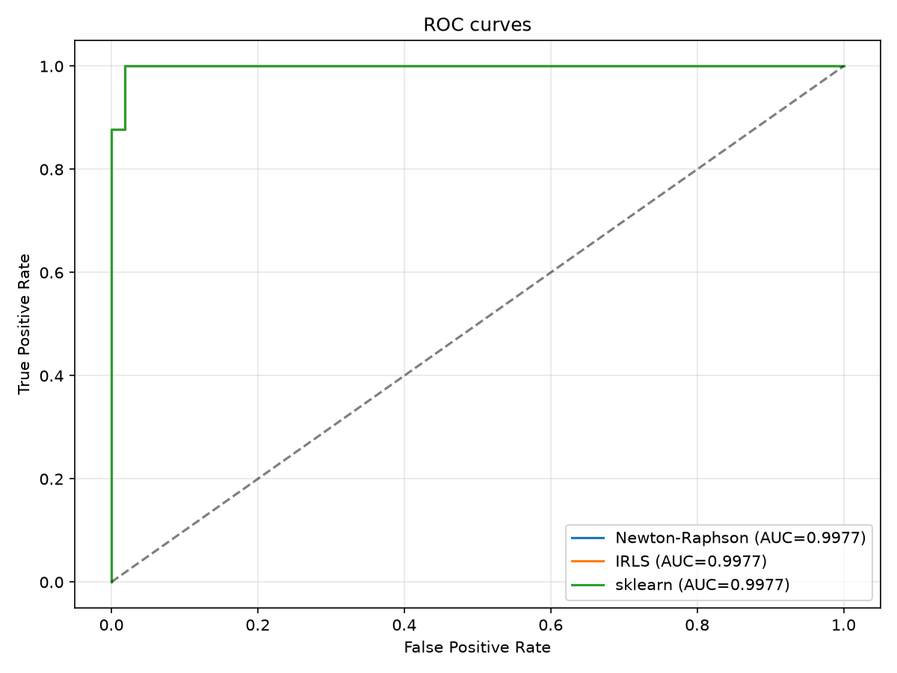
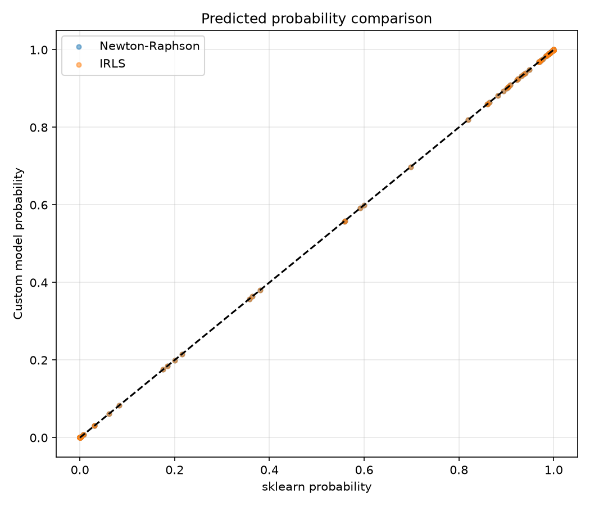

# Лабораторная работа №5. Логистическая регрессия

## Цель работы

Реализовать логистическую регрессию методами Ньютона–Рафсона
и IRLS, сравнить результаты с эталонной реализацией из scikit-learn.

## Датасет

Используется Breast Cancer Wisconsin из scikit-learn.

- 569 объектов
- 30 числовых признаков
- 2 класса: доброкачественная и злокачественная опухоль
- Разделение на обучающую и тестовую выборки: 75% / 25%
- Стандартизация признаков с помощью StandardScaler

## Реализация

Реализованы два метода оптимизации логистической регрессии.

### Метод Ньютона–Рафсона

На каждой итерации вычисляются градиент и гессиан
функции потерь, после чего обновляются коэффициенты модели:

$$
w_{t+1} = w_t - H(w_t)^{-1} \nabla L(w_t)
$$

### Метод IRLS

Iteratively Reweighted Least Squares решает последовательность
взвешенных задач наименьших квадратов.

На каждой итерации вычисляются веса наблюдений и
рабочая зависимая переменная, после чего находятся
новые коэффициенты модели.

## Эксперименты

Собственные реализации сравниваются с LogisticRegression
из scikit-learn.
Используются одинаковые обучающие и тестовые данные.
 Параметр регуляризации эталонной модели (C=1), для собственных реализаций alpha = 1 / (n * C), где n обозначает количество обучающих объектов.

Для оценки качества используются Accuracy, F1, ROC-AUC
и Log Loss.

## Результаты

| model          |   accuracy |       f1 |   roc_auc |   log_loss |
|:---------------|-----------:|---------:|----------:|-----------:|
| Newton-Raphson |   0.986014 | 0.988889 |  0.997694 |   0.067984 |
| IRLS           |   0.986014 | 0.988889 |  0.997694 |   0.067984 |
| sklearn        |   0.986014 | 0.988889 |  0.997694 |   0.067984 |

### ROC-кривые

### Сравнение предсказанных вероятностей

## Вывод

Реализованы два метода обучения логистической регрессии:
Ньютона–Рафсона и IRLS.

Оба метода решают одну задачу оптимизации и должны
давать близкие коэффициенты и предсказанные вероятности
при одинаковых параметрах регуляризации и достаточной
точности сходимости.

Полученные метрики позволяют сравнить собственные
реализации с эталонной моделью scikit-learn.
