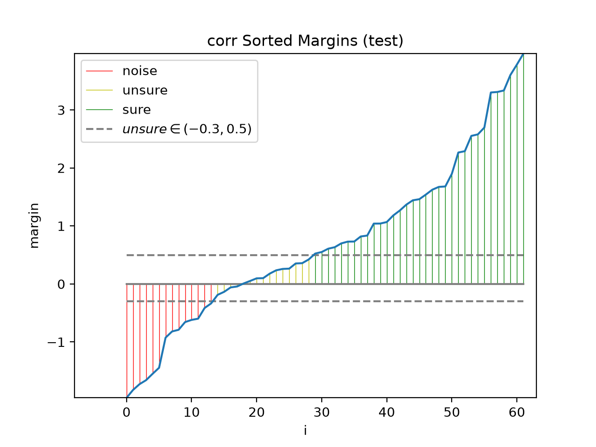
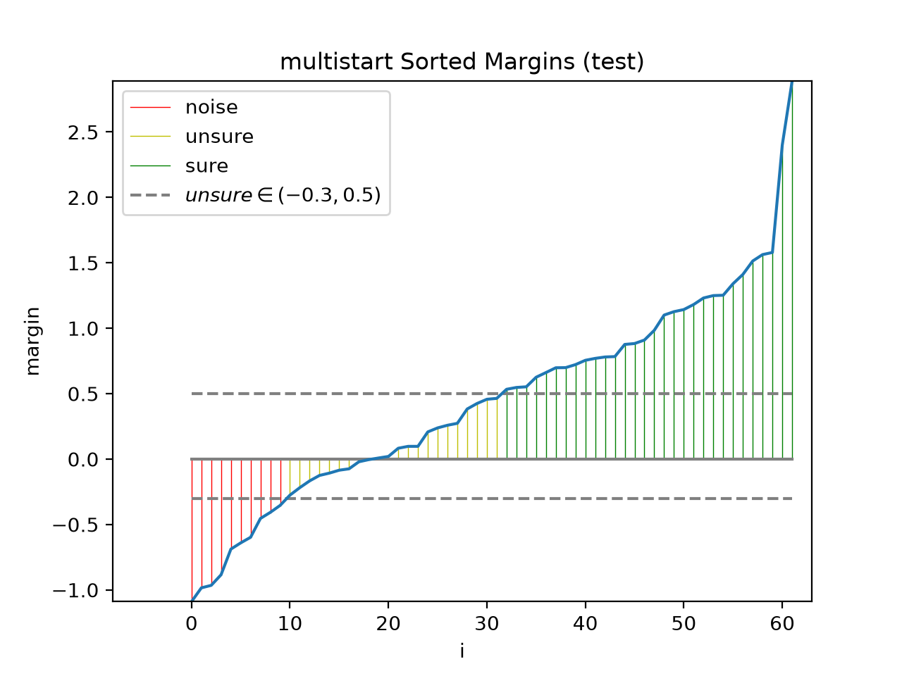
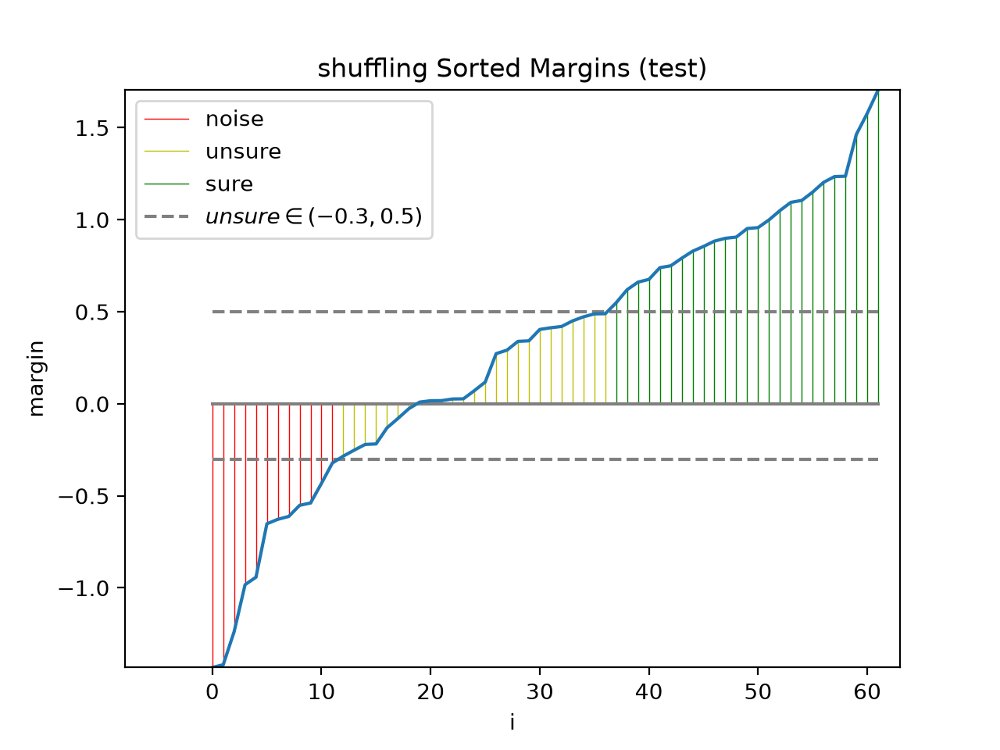
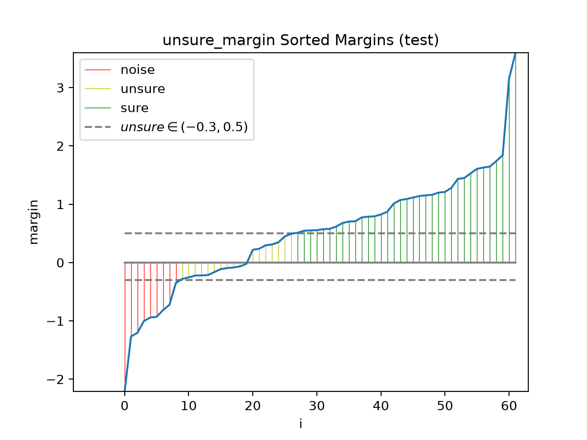
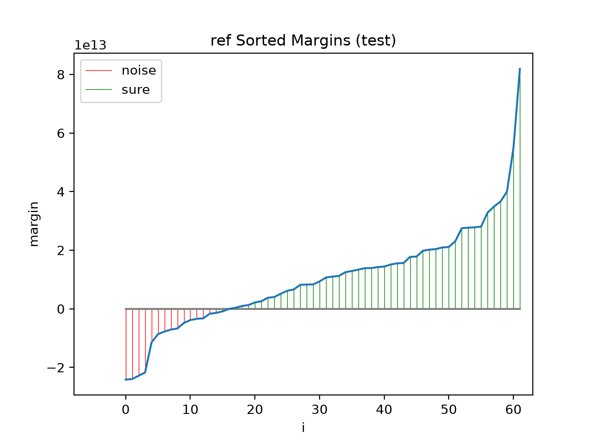
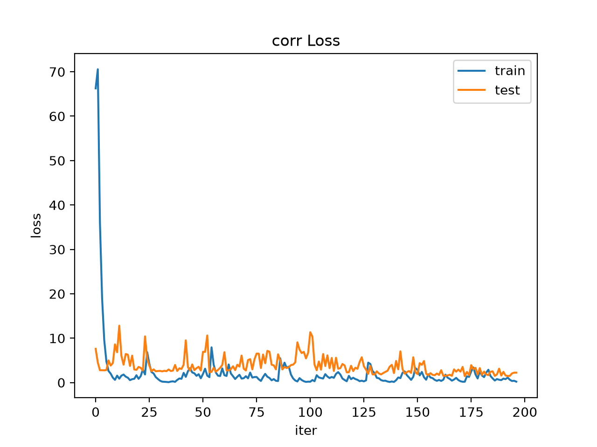
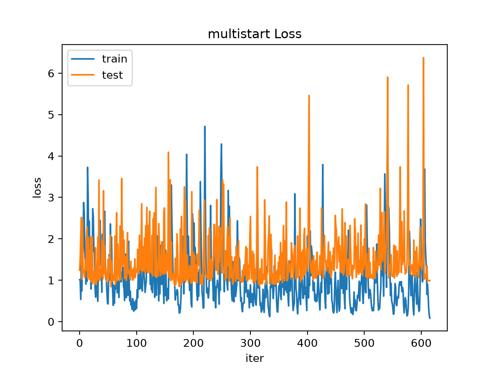
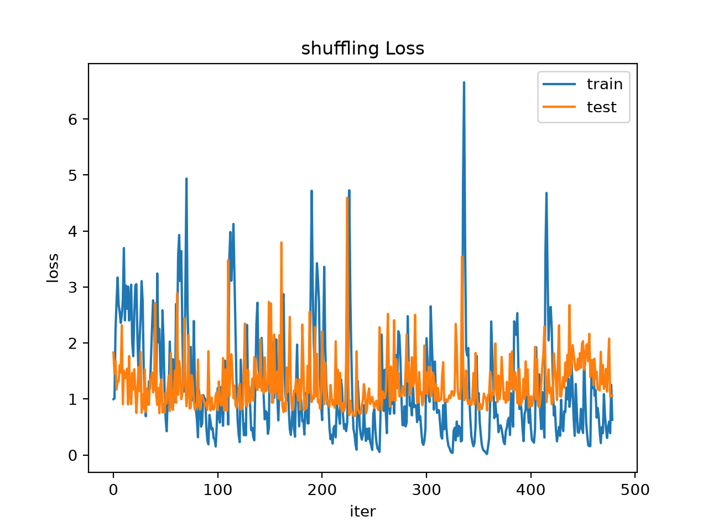
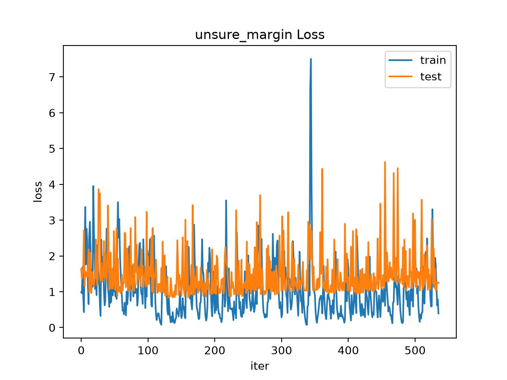

# Потапов Сергей Антонович. Лабораторная работа №1. Линейная классификация

## 1. Датасет

### 1.1 Информация о датасете

В качестве датасета для бинарной классификации был выбран [SONAR_MINE_DATASET](https://www.kaggle.com/datasets/mayurdalvi/sonar-mine-dataset).

Число признаков: 59 + 1 таргет.

Распределение классов сбалансированное (M - мина, R - камень):

- Положительный класс - 53%
- Отрицательный класс - 47%

```plaintext
R
M    111
R     96
Name: count, dtype: int64
```

### 1.2 Произведённые преобразования

- В качестве положительного класса была взята отметка `M`, в качестве отрицательного - `R`
- Значения 0 и 1 были преобразованы в 1 и -1

Метод подготовки датасета ([src/dataset.py:61](source/src/dataset.py#L61)):
```py
def _prepare_dataset(self, target: str) -> pd.DataFrame:
    df = self._load_dataset()
    df[target] = df[target] == 'M'
    df = df.astype({target: np.int16})
    df[target] -= 1 - df[target]
    cols_wo_target = df.columns.drop(target)
    return df
```

Также для каждой выборки (`train` и `test`) была произведена `min-max` нормализация всех признаков, кроме таргета ([src/dataset.py:104](source/src/dataset.py#L104)):
```py
def _scale(self, df: pd.DataFrame, *ignore: str) -> pd.DataFrame:
    for col in df.columns:
        if col in ignore:
            continue
        min_ = df[col].min()
        df[col] = (df[col] - min_) / (df[col].max() - min_)
    return df
```

## 2. Отступы объектов

Были построены графики отсортированных по возрастанию отступов.

- Красный цвет - выбросы
- Жёлтый цвет - неуверенные (малые по модулю) отступы
- Зелёный цвет - уверенные отступы

Лучшие графики отступов имеют модели `corr` и `ref`

### 2.1 Отступы модели с инициализацией весов через корреляцию (далее - `corr`)

График показывает хорошую линейную разделимость объектов без переобучения.



### 2.2 Отступы модели со случайной инициализацией весов через мультистарт (далее - `multistart`)



### 2.3 Отступы модели со случайным предъявлением объектов (далее - `shuffling`)



### 2.4 Отступы модели с предъявлением объектов по модулю отступа (далее - `unsure_margin`)



### 2.5 Отступы эталонной модели (`sklearn.linear_model.SGDClassifier`) (далее - `ref`)



## 3. Вычисление градиента функции потерь

$x$ - матрица признаков (выборка).

$y$ - вектор таргета.

$w$ - вектор весов (для учёта смещения положим его размерностью $n+1$).

$M = \langle w,x \rangle * y$ - отступы объектов x.

$L(M) = \left( 1-M \right)^2$ - квадратичная функция потерь.

Градиент - вектор частных производных вида:
$$ \nabla f(x) = \left[ \frac{\delta f}{\delta x_0}, \frac{\delta f}{\delta x_1}, ..., \frac{\delta f}{\delta x_n} \right] $$

Найдём градиент функции потерь относительно весов $w$.

$$ L(M) = \left( 1-M \right)^2 \\\space\\
L(x,w) = \left( 1 - y * \langle w,x \rangle \right)^2 \\\space\\
\nabla L(x,w) = \left[ \frac{\delta L(x,w)}{\delta w_0}, \frac{\delta L(x,w)}{\delta w_1}, ..., \frac{\delta L(x,w)}{\delta w_{n}} \right] = \left[ \frac{\delta L(x, w)}{\delta w_i} \right] \\\space\\
\frac{\delta L(x, w)}{\delta w_i} = \left( \left( 1 - y * \sum_{k=0}^n{w_k x_k} \right)^2 \right)'_{w_i} = 2 \left(1 - y * \sum_{k=0}^n{w_k x_k} \right) \cdot x_i * (-y) = \\\space\\ = -2y(1 - M)x_i $$
Итоговая формула градиента:
$$ \nabla L(x,w) = \left[ -2y(1-M)x_0, -2y(1-M)x_1, ..., -2y(1-M)x_n \right] \\\space\\ \nabla L(x,w) = \left[ -2y(1-M)x_i \right] $$

При введении L2-регуляризации (с коэффициентом регуляризации $\tau$):

- Функция потерь примет вид:
$$ \tilde{L}(x,w)=\left(1-y*\langle w,x \rangle\right)^2+\frac{\tau}{2}\sum_{j=1}^{n}w_j^2 $$

- Градиент функции потерь примет вид:
$$ \nabla \tilde{L}(x,w)=(-2y(1-M))x+\tau w $$


<hr>

В коде градиент рассчитывается в следующем месте: [src/linear_classificator.py:89](source/src/linear_classificator.py#L89)
```py
def loss_grad(
        self, X: np.ndarray, Y: np.ndarray, weights: Optional[np.ndarray] = None
) -> np.ndarray:
    w = weights if weights is not None else self._weights
    tau_w = np.concat([self.tau * w[:-1], np.array([0])])
    return (-2 * Y * (1 - self.calc_margins(X, Y, w))) @ X + tau_w
```

## 4. Реализация рекуррентной оценки функционала качества

Для рекуррентой оценки функционала качества было использовано экспоненциальное скользящее среднее:

$$
\overline{Q}_m = \lambda\xi_m + (1-\lambda)\lambda\xi_{m-1} + \left( 1-\lambda \right)^2 \lambda\xi_{m-2}+... \\\space\\
\overline{Q}_m = \lambda\xi_m + (1-\lambda)\overline{Q}_{m-1}
$$
где:
- $\xi_m = L(w,x_i)$ - значение функции потерь на $x_i$
- $\lambda$ - коэффициент забывания

Рекуррентная оценка функционала качества реализована следующим образом: [src/linear_classificator.py:176](source/src/linear_classificator.py#L176)
```py
new_q = (self.lmbd * xi + (1 - self.lmbd) * q)[0]
```

## 5. Реализация метода стохастического градиентного спуска с инерцией

**Алгоритм SGD**

- **Вход:** выборка $X^l$, темп обучения $h$, темп забывания $\lambda$
- **Выход:** вектор весов $w$

1. Инициализировать веса $w_j$, $j=0,...,n$ ([src/linear_classificator.py:52](source/src/linear_classificator.py#52)):
```py
def _init_weights(self, method: str, corr_sample: Optional[DataSample] = None) -> np.ndarray:
    if method == 'random':
        return np.random.uniform(
            -(1 / (2 * self.feature_count)),
            1 / (2 * self.feature_count),
            self.feature_count
        )
    if method == 'corr':
        if corr_sample is None:
            raise Exception(
                'X subsample should be provided in order to init weights using correlation'
            )
        X, Y = corr_sample.X_1.to_numpy(), corr_sample.Y.to_numpy()
        return np.array(
            [np.dot(Y, X[:, j]) / np.sum(X[:, j] ** 2) for j in range(self.feature_count)] # type: ignore
        )
    raise NotImplementedError
```

2. Инициализировать оценку функционала:
$$ Q := \text{среднее} \space L(w,x_i) \space \text{по случайному подмножеству} \space {x_i} $$

([src/linear_classificator.py:158](source/src/linear_classificator.py#L158))
```py
q = np.mean(self.loss(*self._get_subsample(ds.train)))
```

3. (повторять)
- 4. выбрать объект $x_i$ из $X^l$ случайным образом ([src/linear_classificator.py:169](source/src/linear_classificator.py#L169))
```py
    x, y = self.select_object(X_train, Y_train)
```
- 5. вычислить потерю $\xi_i := L(w,x_i)$ ([src/linear_classificator.py:171](source/src/linear_classificator.py#L171))
```py
    m = self.calc_margins(x, y)
    xi = self.loss_margin(m)
```
- 6. сделать градиентный шаг: $w := w - h \nabla L(w,x_i)$ ([src/linear_classificator.py:131](source/src/linear_classificator.py#L131))
```py
    self._weights -= h * v
```
- 7. оценить функционал: $Q := \lambda\xi_i + (1-\lambda)Q$ ([src/linear_classificator.py:176](source/src/linear_classificator.py#L176))
```py
    new_q = (self.lmbd * xi + (1 - self.lmbd) * q)[0] # new_q is a scalar
```
8. (пока) значение $Q$ и/или веса $w$ не сойдутся ([src/linear_classificator.py:167](source/src/linear_classificator.py#L167))
```py
while delta_q > self.epsilon and delta_w > self.epsilon:
```

**Инерция**

$$
v := \gamma v + (1-\gamma)L'(w-h\gamma v,x_i) \\\space\\
w := w - hv
$$

Реализация в коде ([src/linear_classificator.py:127](source/src/linear_classificator.py#L127)):
```py
def update_weights_nag(self, v: np.ndarray, x: np.ndarray, y: np.ndarray) -> np.ndarray:
    h = self._find_steepest_step(v, x, y)
    grad = self.loss_grad(x, y, self._weights - h * self.gamma * v)
    v = self.gamma * v + (1 - self.gamma) * grad
    self._weights -= h * v
    return v
```

## 6. Реализация L2-регуляризации

Штраф за увеличение нормы вектора весов:

$$ \tilde{L}(w,x_i)=L(w,x_i)+\frac{\tau}{2} ||x||^2 = L(w,x_i)+\frac{\tau}{2}\sum_{j=1}^n{w_j^2}\to \min_w $$

Градиент:

$$ \nabla\tilde{L}(w,x_i)=\nabla L(w,x_i) + \tau w $$

Реализация в коде ([src/linear_classificator.py:89](source/src/linear_classificator.py#L89)).

## 7. Реализация скорейшего градиентного спуска

Метод скорейшего градиентного спуска основан на поиске оптимального адаптивного шага $h^*$:

$$ L(w-h\nabla L(w,x_i),x_i) \to \min_h $$

Для нахождения оптимального шага в направлении антиградиента была выполнена задача одномерной оптимизации с помощью `scipy.optimize.minimze`. В минимизируемом функционале было учтено добавление инерции и L2-регуляризации в процесс обучения:

$$ h^* = \arg\min_{h\ge0}\tilde{L}(w-h[\gamma v+(1-\gamma)\nabla\tilde{L}(w-h\gamma v,x_i)],x_i) $$

Реализация в коде ([src/linear_classificator.py:109](source/src/linear_classificator.py#L109)):
```py
def _find_steepest_step(
        self, v: np.ndarray, x: np.ndarray, y: np.ndarray
) -> np.float64:
    w = self._weights
    res = minimize(
        lambda h: self.loss(
            x,
            y,
            w - h * (
                self.gamma * v
                + (1 - self.gamma) * self.loss_grad(x, y, w - h * self.gamma * v)
            ),
        ),
        x0=[0],
        bounds=[(0, None)],
    )
    return res.x[0]
```

## 8. Реализация предъявления объектов по модулю отступа

Предъявление объектов по модулю отступа заключается в том, чтобы чаще брать объекты, на которых уверенность модели меньше, т.е:

чем меньше $|M_i|$, тем больше вероятность взять объект.

Реализация в коде:
1. [src/linear_classificator.py:140](source/src/linear_classificator.py#L140)
```py
elif self.object_selection_method == 'unsure_first':
    batch_rand_idx = self.get_sorted_abs_margins_indices_sample(X, Y)
```
2. [src/linear_classificator.py:75](source/src/linear_classificator.py#L75)
```py
def get_sorted_abs_margins_indices_sample(self, X: np.ndarray, Y: np.ndarray, size: int = 1) -> np.ndarray:
    sorted_margins = pd.Series(np.abs(self.calc_margins(X, Y))).sort_values()
    sorted_margins_proba = self.softmin(sorted_margins.to_numpy())
    index = np.random.choice(sorted_margins.index.to_numpy(), size=size, p=sorted_margins_proba)
    return index
```
3. [src/linear_classificator.py:70](source/src/linear_classificator.py#L70)
```py
@staticmethod
def softmin(x: np.ndarray) -> np.ndarray:
    np_exp_x = np.exp(-x)
    return np_exp_x / np.sum(np_exp_x)
```

Таким образом, в соответствие отсортированному по возрастанию массиву модулей отступов `sorted_margins` ставится массив вероятностей `sorted_margins_proba` - чем меньше модуль отступа, тем больше вероятность.

Сумма массива вероятностей `sorted_margins_proba` всегда равна 1.

## 9. Обучение линейного классификатора на выбранном датасете

### 9.1 Обучение с инициализацией весов через корреляцию (модель `corr`)

**Иницализация весов через корреляцию**

$$ w_j := \frac{\langle y,f_j \rangle}{\langle f_j,f_j \rangle} $$

$f_j=\left( f_j(x_i) \right)_{i=1}^l$ - вектор значений признака.

Эта оценка $w$ оптимальна, если:
1. функция потерь квадратичная
2. признаки некоррелированы, $\langle f_j,f_k \rangle = 0, j \ne k$

Реализация в коде ([src/linear_classificator.py:59](source/src/linear_classificator.py#L59)):
```py
if method == 'corr':
    if corr_sample is None:
        raise Exception(
            'X subsample should be provided in order to init weights using correlation'
        )
    X, Y = corr_sample.X_1.to_numpy(), corr_sample.Y.to_numpy()
    return np.array(
        [np.dot(Y, X[:, j]) / np.sum(X[:, j] ** 2) for j in range(self.feature_count)] # type: ignore
    )
```

**Обучение модели и её метрики**

Реализация в коде ([main.py:14](source/main.py#L14)):

```py
def solution_corr(
        ds: DataSet,
        plot: bool = False
) -> LinearClassificator:
    model = LinearClassificator(
        ds.feature_count,
        name='corr',
        init_weights_method='corr',
        corr_sample=ds.train
    )
    model.fit(ds)
    if plot:
        plot_margins(model, ds.test, 'corr')
        plot_loss_history(model)
    return model
```

**Метрики на обучающей выборке**

```plaintext
Accuracy  Precision    Recall
0.868966   0.835165  0.950000
```

**График функции потерь на `train` и `test`**



### 9.2 Обучение со случайной инициализацией весов через мультистарт (модель `multistart`)

**Мультистарт** - многократные запуски из разных случайных
начальных приближений и выбор лучшего решения.

**Реализация в коде**:

1. Случайная инициализация весов ([src/linear_classificator.py:53](source/src/linear_classificator.py#L53)):
```py
if method == 'random':
    return np.random.uniform(
        -(1 / (2 * self.feature_count)),
        1 / (2 * self.feature_count),
        self.feature_count
    )
```
2. Обучение ([main.py:31](source/main.py#L31)):
```py
def solution_multistart(
        ds: DataSet,
        starts: int = 10,
        plot: bool = False
) -> LinearClassificator:
    best_model = None
    for _ in range(starts):
        model = LinearClassificator(
            ds.feature_count,
            name='multistart',
            init_weights_method='random'
        )
        model.fit(ds)
        if (
            best_model is None or
            model.metrics.train.accuracy > best_model.metrics.train.accuracy # type: ignore
        ):
            best_model = model
    if plot:
        plot_margins(best_model, ds.test, 'multistart') # type: ignore
        plot_loss_history(best_model) # type: ignore
    return best_model  # type: ignore
```

**Метрики на обучающей выборке**

```plaintext
Accuracy  Precision    Recall
0.889655   0.929577  0.857143
```

**График функции потерь на `train` и `test`**



### 9.3 Обучение со случайным предъявлением (модель `shuffling`)

**Перетасовка объектов (shuffling)** - попеременное предъявление объектов из разных классов.

Реализация в коде:

1. Реализация случайного предъявления объектов ([src/linear_classificator.py:135](source/src/linear_classificator.py#L135)):
```py
if self.object_selection_method == 'shuffling':
    cls = self.target_classes[self.shuffling_i]
    Y_ = pd.Series(Y)
    self.shuffling_i = (self.shuffling_i + 1) % len(self.target_classes)
    batch_rand_idx = Y_[Y_ == cls].sample(1).index.to_numpy()
```
2. Обучение ([main.py:55](source/main.py#L55)):
```py
def solution_shuffling(
        ds: DataSet, 
        plot: bool = False
) -> LinearClassificator:
    model = LinearClassificator(
        ds.feature_count,
        name='shuffling',
        object_selection_method='shuffling'
    )
    model.fit(ds)
    if plot:
        plot_margins(model, ds.test, 'shuffling')
        plot_loss_history(model)
    return model
```

**Метрики на обучающей выборке**

```plaintext
Accuracy  Precision    Recall
0.889655   0.855556  0.962500
```

**График функции потерь на `train` и `test`**



### 9.4 Обучение с предъявлением объектов по модулю отступа (модель `unsure_margin`)

см. [п. 8. Реализация предъявления объектов по модулю отступа](#8-реализация-предъявления-объектов-по-модулю-отступа)

Реализация в коде ([main.py:71](source/main.py#L71)):
```py
def solution_unsure_margin(
        ds: DataSet, 
        plot: bool = False
) -> LinearClassificator:
    model = LinearClassificator(
        ds.feature_count,
        name='unsure_margin',
        object_selection_method='unsure_first'
    )
    model.fit(ds)
    if plot:
        plot_margins(model, ds.test, 'unsure_margin.png')
        plot_loss_history(model)
    return model
```

**Метрики на обучающей выборке**

```plaintext
Accuracy  Precision    Recall
0.848276   0.823529  0.909091
```

**График функции потерь на `train` и `test`**



### 9.5 Эталонная реализация (модель `ref`)

В качестве эталонной реализации была взята `sklearn.linear_model.SGDClassifier` с параметрами:
- loss='squared_hinge'
- penalty='l2'

Реализация в коде ([main.py:87](source/main.py#L87)):
```py
def solution_reference(
        ds: DataSet, 
        plot: bool = False
) -> ReferenceSGDClassifier:
    model = ReferenceSGDClassifier(name='ref')
    model.fit(ds)
    if plot:
        plot_margins(model, ds.test, 'ref')
    return model
```

**Метрики на обучающей выборке**

```plaintext
Accuracy  Precision    Recall
0.972414   0.987500  0.963415
```

**График функции потерь на `train` и `test`**

Отсутствует, т.к. `sklearn.linear_model.SGDClassifier` не предоставляет возможность просматривать промежуточные значения функции потерь (метод `partial_fit` может значительно отличаться `fit`).

## 10. Оценка качества классификации

При числе запусков $N=100$ были получены следующие наилучшие метрики классификации (по `accuracy`) по каждой модели:
```plaintext
Best metrics (train):
               Accuracy  Precision    Recall
ref            0.972414   0.987500  0.963415
multistart     0.889655   0.929577  0.857143
shuffling      0.889655   0.855556  0.962500
corr           0.868966   0.835165  0.950000
unsure_margin  0.848276   0.823529  0.909091
```

Таким образом, лучшей самописной реализацией (по обучающей выборке `train`) оказалась модель со случайной инициализацией весов через мультистарт (`multistart`).

## 11. Сравнение лучшей реализации с эталонной

```plaintext
Best custom model is: multistart

multistart metrics:
       Accuracy  Precision    Recall
train  0.889655   0.929577  0.857143
test   0.693548   0.727273  0.705882

ref metrics:
       Accuracy  Precision    Recall
train  0.972414     0.9875  0.963415
test   0.725806     0.6875  0.758621

test metrics comp:
               Accuracy  Precision    Recall
multistart     0.693548   0.727273  0.705882
ref            0.725806     0.6875  0.758621
```

Сравнение метрик (на тестовой выборке `test`) лучшей самописной реализации `multistart` и эталонной реализации `ref`:

- По `accuracy`: эталонная на 4.7% лучше самописной
- По `precision`: самописная на 5.8% лучшей эталонной
- По `recall`: эталонная на 7.5% лучшей самописной
