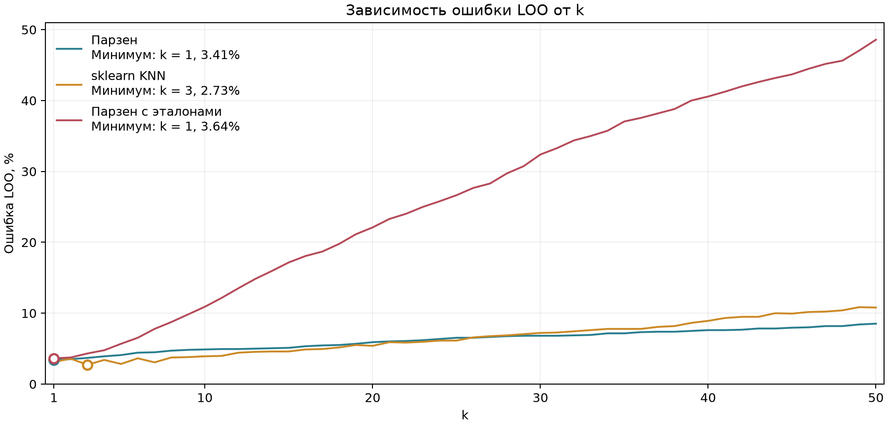
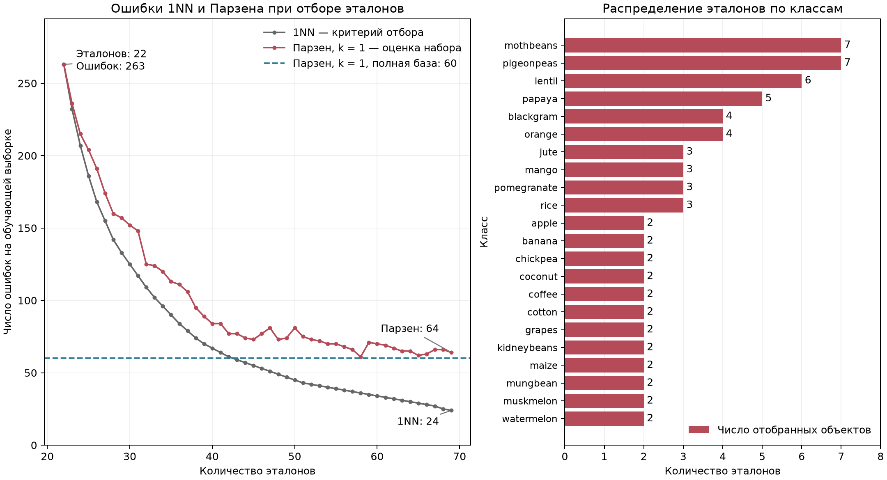
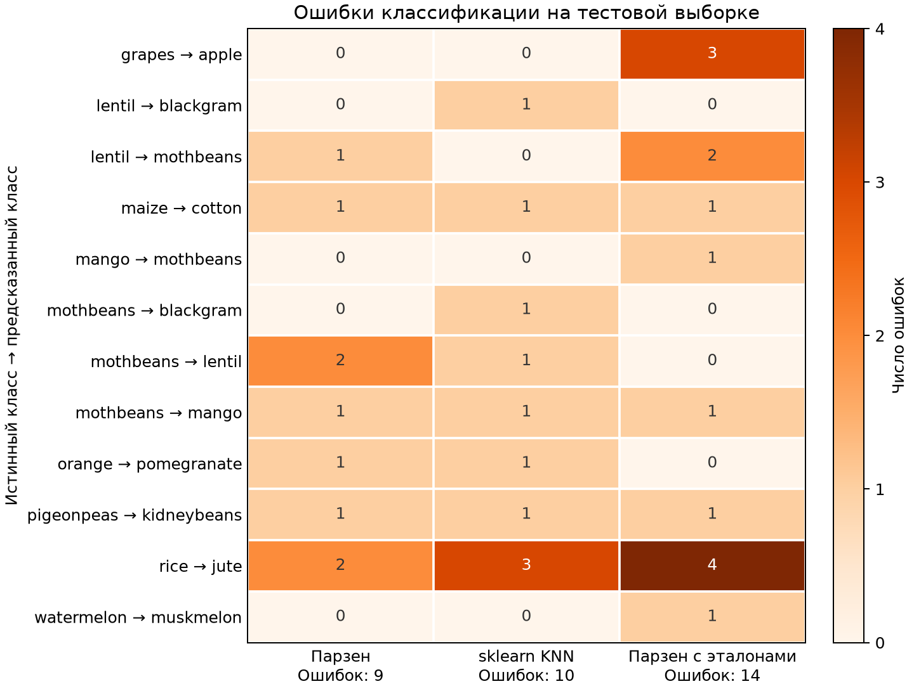

# Лабораторная №2. Метрическая классификация

[Crop Recommendation](https://www.kaggle.com/datasets/atharvaingle/crop-recommendation-dataset): 2200 объектов, 22 класса, 7 признаков — N, P, K, температура, влажность, pH и осадки. Обучающая/тестовая выборки — **1760/440**, стратификация, seed 42; параметры стандартизации рассчитаны на обучающей выборке.

## KNN и выбор k

В собственной реализации оценка класса — сумма весов гауссова ядра по объектам этого класса. Расстояние $\rho$ — евклидово; ширина окна $h$ равна расстоянию до $(k+1)$-го соседа:

$$
h(x)=\rho(x,x^{(k+1)}),\qquad K(r)=e^{-2r^2},\qquad r=\frac{\rho(x,x_i)}{h(x)}.
$$

Предсказывается класс с максимальной оценкой. Библиотечный `KNeighborsClassifier` использует голосование большинства среди k ближайших соседей.

Выбирали k от 1 до 50 по минимуму LOO-оценки риска — доли ошибок классификации. Проверяемый объект исключается из соседей; масштабирование и набор эталонов при этом фиксированы.



Минимумы: **k = 1 у Парзена**, **k = 3 у sklearn**, **k = 1 после отбора**. При увеличении k LOO-риск быстрее растёт для сокращённой базы: при k = 10 он равен 10.91% против 4.89% на полной базе.

## Отбор эталонов

Начальный набор — по одному объекту, ближайшему к среднему вектору своего класса. На каждом шаге добавляли объект с максимальным снижением числа ошибок **1NN**. Отбор завершался, когда ни одно добавление не уменьшало число ошибок. Оценка проводилась на всех 1760 обучающих объектах с исключением проверяемого объекта из соседей.

На тех же наборах отдельно оценивали **Парзена при фиксированном k = 1**. Эта оценка не участвовала в выборе эталонов.



Отобрано **69 объектов (3.92% обучающей выборки)**. При исходных 80 объектах каждого класса отбор оставил от 2 до 7 эталонов на класс. Максимум — у `mothbeans` и `pigeonpeas`. Число ошибок 1NN снизилось с 263 до 24.

Ошибки 1NN убывают на каждом шаге отбора, а ошибки Парзена могут возрастать. Итоговый набор дал 64 ошибки Парзена против 60 на полной базе.

## Качество на тестовой выборке

| Модель | k | Объектов в базе | Ошибки из 440 | Accuracy | Macro F1 | Время, мс |
|---|---:|---:|---:|---:|---:|---:|
| Парзен | 1 | 1760 | 9 | 0.9795 | 0.9794 | 30.56 |
| sklearn KNN | 3 | 1760 | 10 | 0.9773 | 0.9771 | 2.66 |
| Парзен с эталонами | 1 | 69 | 14 | 0.9682 | 0.9681 | 5.09 |

Время — медиана семи замеров классификации всей тестовой выборки после прогрева. Macro F1 усреднён по 22 классам.

Предсказания Парзена на полной базе и sklearn различаются на **4 объектах**: качество близко, время предсказания у библиотечной реализации меньше. Отбор сократил базу **в 25.5 раза** и время предсказания Парзена **в 6.0 раза**. После отбора 3 ранее ошибочных ответа стали верными, а 8 верных — ошибочными; итоговое число ошибок выросло с 9 до 14.



После отбора появились три ошибки `grapes → apple`; число ошибок `rice → jute` выросло с двух до четырёх.

## Запуск

```bash
python -m pip install -r requirements.txt
python source/main.py
```
