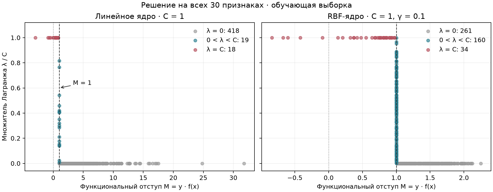
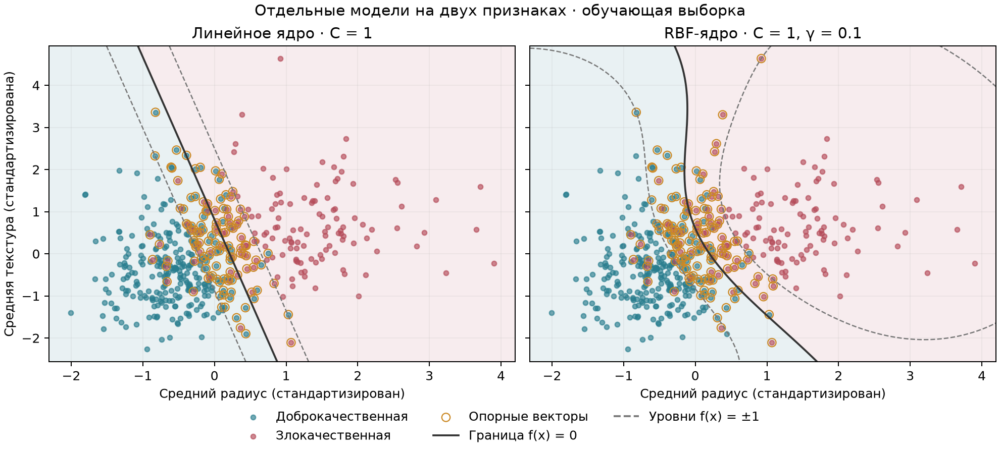

# Лабораторная №3. Метод опорных векторов

[Breast Cancer Wisconsin](https://www.kaggle.com/datasets/uciml/breast-cancer-wisconsin-data): 569 объектов, 30 числовых признаков. Злокачественные опухоли — $y=+1$ (212), доброкачественные — $y=-1$ (357). `id` и пустой столбец исключены. Train/test — **455/114**, стратификация, seed 42.

## Двойственная задача и ядра

Реализована минимизация по множителям Лагранжа через `scipy.optimize.minimize`, метод SLSQP, с аналитическим градиентом (`ftol=1e-9`, максимум 2000 итераций):

$$
\begin{gathered}
\min_{\lambda}\;\frac12\sum_{i,j}\lambda_i\lambda_j y_i y_j K(x_i,x_j)-\sum_i\lambda_i,\\
0\le\lambda_i\le C,\qquad\sum_i\lambda_i y_i=0.
\end{gathered}
$$

Для линейного ядра $K(x,z)=x^\top z$ восстанавливается $w=\sum_i\lambda_i y_i x_i$. Для RBF используется $K(x,z)=e^{-\gamma\|x-z\|^2}$. Ответ определяется знаком оценки:

$$
f(x)=\sum_i\lambda_i y_iK(x_i,x)+b.
$$

$C$ задаёт штраф за нарушения отступа; чем больше $\gamma$, тем быстрее убывает RBF-ядро с расстоянием между объектами.

Смещение $b$ — среднее значений по свободным опорным векторам:

$$
b_i=y_i-\sum_j\lambda_j y_j K(x_j,x_i),\qquad 0\lt\lambda_i\lt C.
$$

Если свободных векторов нет, берём середину допустимого интервала $b$. Его задают условия $M_i\ge1$ при $\lambda_i=0$ и $M_i\le1$ при $\lambda_i=C$, где $M_i=y_i f(x_i)$.

$C\in\{0.1,1,10\}$, для RBF $\gamma\in\{0.01,0.1\}$ выбраны по F1 на validation: 25% train, стратификация, seed 42. При равенстве F1 выбирались меньшие C и γ. Стандартизация обучалась внутри каждого разбиения; итоговые модели переобучены на всех 455 объектах train.

| Ядро | C | γ | Validation F1 |
|---|---:|---:|---:|
| Линейное ядро | 1 | — | 0.9545 |
| RBF-ядро | 1 | 0.1 | 0.9655 |



Опорными стали **37 из 455** объектов у линейной модели (8.1%) и **194** у RBF (42.6%). Свободные множители $0\lt\lambda\lt C$ сосредоточены около $M=1$. Для итоговых моделей опорными считаются объекты с $\lambda\gt10^{-6}$.

## Визуализация границы

Для рисунка отдельно обучены модели **только на `radius_mean` и `texture_mean`**. Параметры указаны над панелями, кольцами отмечены опорные векторы. Эти модели не участвуют в таблице качества на 30 признаках.



## Сравнение со sklearn SVC

Одинаковые данные, стандартизация, C и γ; у SVC `tol=1e-8`. F1 и Recall рассчитаны для злокачественного класса.

| Ядро | Реализация | Ошибки из 114 | Accuracy | F1 | Recall |
|---|---|---:|---:|---:|---:|
| Линейное ядро | Собственная | 4 | 0.9649 | 0.9500 | 0.9048 |
| Линейное ядро | sklearn SVC | 4 | 0.9649 | 0.9500 | 0.9048 |
| RBF-ядро | Собственная | 8 | 0.9298 | 0.9070 | 0.9286 |
| RBF-ядро | sklearn SVC | 8 | 0.9298 | 0.9070 | 0.9286 |

Линейная модель пропустила **4** злокачественных случая и дала **0** ложноположительных ответов; RBF — **3** и **5** соответственно. При переходе к RBF Recall изменился на **+0.0238**, F1 — на **-0.0430**. Расхождений ответов собственной и библиотечной реализаций для обоих ядер — **0**.

Невязка — $\lvert\sum_i\lambda_i y_i\rvert$; $\Delta f=f-f_{SVC}$ — разность оценок на test.

| Ядро | Невязка | $P-D$ | Макс. $\lvert\Delta f\rvert$ | Разных ответов |
|---|---:|---:|---:|---:|
| Линейное ядро | 5.2e-10 | 5.8e-04 | 2.2e-04 | 0 |
| RBF-ядро | 4.7e-13 | 9.2e-05 | 4.4e-06 | 0 |

Прямой функционал на train:

$$
P=\frac12\|w\|^2+C\sum_i\max(0,1-M_i).
$$

Двойственная цель $D$ — с противоположным знаком к минимизируемому выше выражению. Разрыв $P-D$ в оптимуме равен нулю. Для RBF квадрат нормы вычисляется через ядро: $\|w\|^2=\sum_{i,j}\lambda_i\lambda_j y_i y_j K(x_i,x_j)$.

## Запуск

```bash
python -m pip install -r requirements.txt
python source/main.py
```
