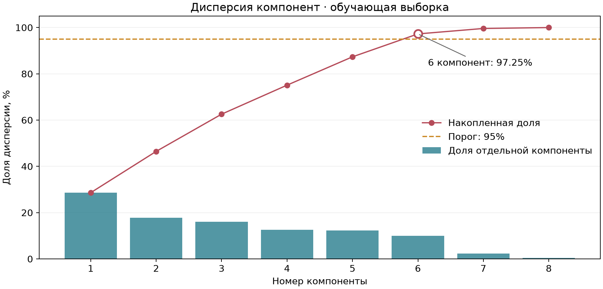
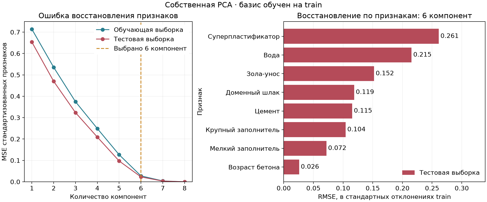
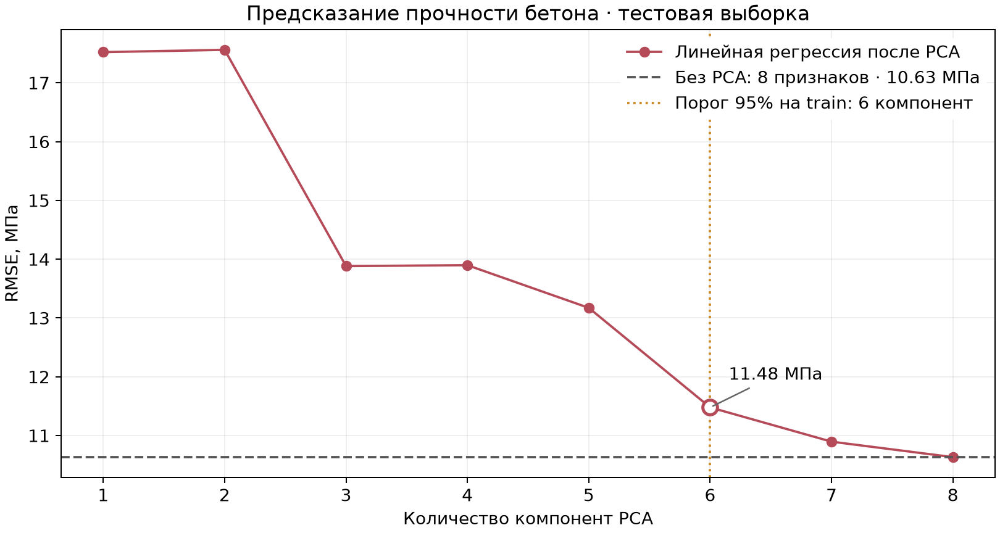

# Лабораторная №4. PCA

[Concrete Compressive Strength](https://www.kaggle.com/datasets/elikplim/concrete-compressive-strength-data-set): 1030 измерений прочности бетона, 8 признаков — состав смеси и возраст. Целевая переменная — прочность при сжатии; в PCA она не участвует. Удалены 0 строк с пропусками и 25 полных повторов.

Обучающая/тестовая выборки — **805/200**, seed 42. Совпадающие векторы признаков объединены в группы и не разделяются между выборками. Признаки стандартизированы по обучающей выборке: масса компонентов и возраст измеряются в разных единицах.

## PCA через SVD

Для центрированной матрицы признаков $X_c=U\Sigma V^\top$ направления компонент — строки $V^\top$. Проекция на первые $m$ компонент и восстановление:

$$
Z=X_cV_m,\qquad \widehat X=ZV_m^\top+\overline X.
$$

$U$ и $V$ содержат левые и правые сингулярные векторы; диагональ $\Sigma$ — сингулярные числа по убыванию. $V_m$ содержит первые $m$ столбцов $V$, а $\overline X$ — обучающее среднее стандартизованных признаков.

Дисперсия компоненты вычисляется как $\lambda_j=\sigma_j^2/(n-1)$, где $\sigma_j$ — сингулярное число, $n$ — число обучающих объектов. Разложение выполнено через `numpy.linalg.svd`.

## Эффективная размерность

Выбираем минимальное число компонент, сохраняющее не менее **95% дисперсии** обучающих признаков:

$$
m=\min\left\{r:\frac{\sum_{j=1}^r\lambda_j}{\sum_{j=1}^8\lambda_j}\ge 0.95\right\}.
$$

Это критерий сжатия, а не ранг матрицы.



**Эффективная размерность — 6 из 8:** сохранено 97.25% дисперсии. Первые 5 компонент сохраняют только 87.35%, поэтому выбранный порог ещё не достигнут.

## Восстановление признаков

Ошибку восстановления считаем в стандартизованном пространстве. MSE усредняет квадрат ошибки по объектам и признакам; RMSE отдельного признака выражен в его стандартных отклонениях на обучении.



При 6 компонентах MSE равна **0.0275 на обучающей выборке и 0.0228 на тестовой**. Наибольшая ошибка на тесте у признака «суперпластификатор»: RMSE = 0.261. Сохранённая доля общей дисперсии не определяет качество регрессии и точность восстановления каждого признака.

## Регрессия после PCA

Для каждого числа компонент обучена обычная линейная регрессия на той же обучающей выборке. RMSE прочности рассчитана на test; базовая модель использует все 8 исходных признаков без PCA.



При 6 компонентах сохранено **97.25% дисперсии**, но RMSE равна **11.48 МПа** против **10.63 МПа** без PCA (+8.0%). Это дополнительная проверка сохранения информации о прочности: число компонент выбрано по порогу 95% дисперсии train и по test не подбирается.

## Сравнение с sklearn

Эталон — `sklearn.decomposition.PCA(svd_solver="full")` на той же обучающей матрице. Знаки компонент могут различаться, поэтому сравниваем матрицы проекции $V_mV_m^\top$ и восстановленные признаки. Для них взято максимальное расхождение по всем $m=1,\ldots,8$.

| Проверка | Расхождение |
|---|---:|
| Сингулярные числа: максимальная разность | 0.00e+00 |
| Дисперсии компонент: максимальная разность | 0.00e+00 |
| Матрицы проекции: максимальная норма Фробениуса разности | 0.00e+00 |
| Восстановленные признаки test: максимальная разность | 1.33e-15 |

## Запуск

```bash
python -m pip install -r requirements.txt
python source/main.py
```
