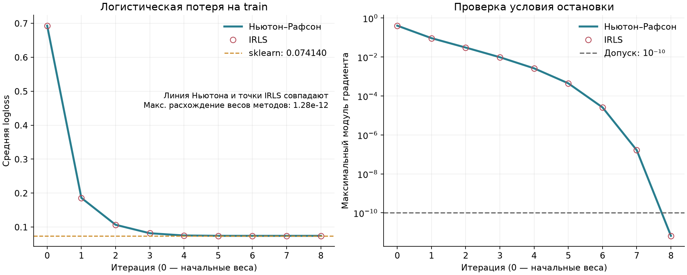
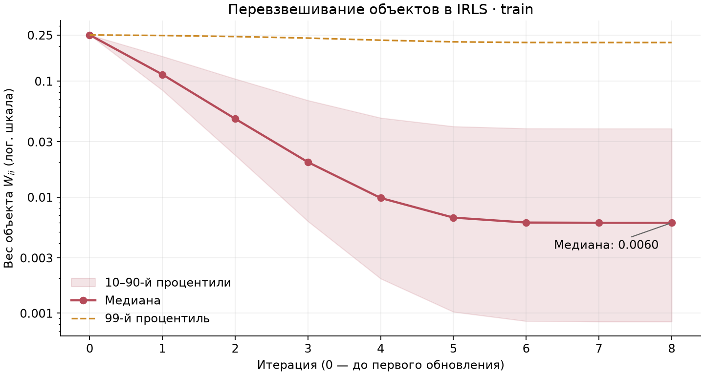
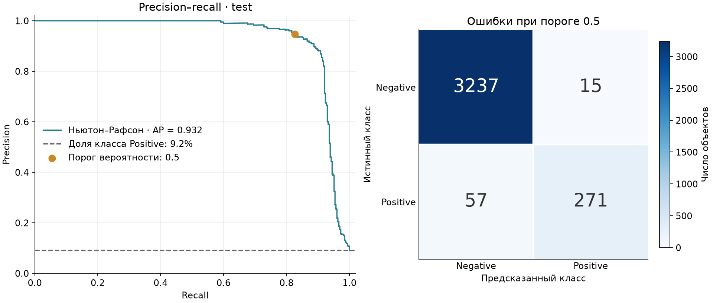
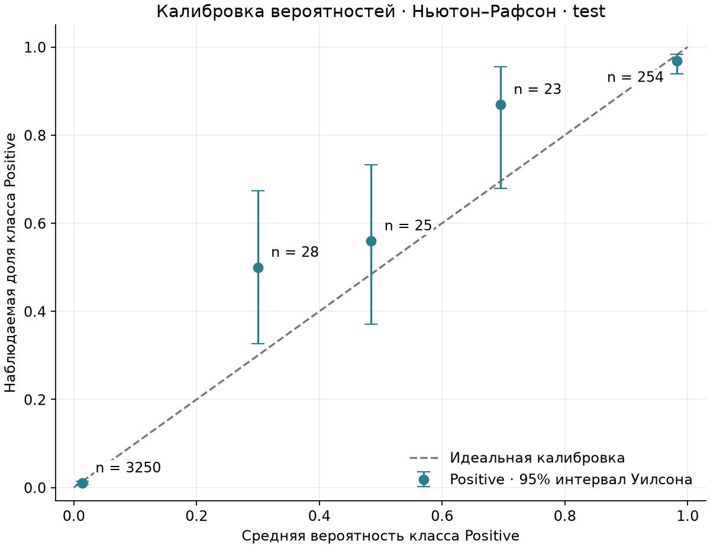

# Лабораторная №5. Логистическая регрессия

[HTRU2](https://www.kaggle.com/datasets/charitarth/pulsar-dataset-htru2): 17 898 объектов, 8 числовых признаков: среднее, стандартное отклонение, асимметрия и эксцесс для профиля импульса и кривой DM–SNR. Positive ($y=1$) — пульсары (1 639 объектов), Negative ($y=0$) — остальные объекты (16 259). Данные скачиваются с Kaggle при запуске; пропусков и повторов нет.

Train/test — **14318/3580**, стратификация, seed 42. Признаки стандартизированы по средним и стандартным отклонениям train.

## Методы и сходимость

В матрицу $X$ добавлен столбец единиц; $x_i$ — признаки объекта с этим свободным членом, $w$ — коэффициенты модели, $n$ — размер train. Ответ $y_i\in\{0,1\}$ — метка класса, $y$ — вектор ответов. Вероятности класса Positive равны $p=\sigma(Xw)$, где $\sigma(t)=1/(1+e^{-t})$ — сигмоида. Средняя логистическая потеря без регуляризации $L$, её градиент $g$ и гессиан $H$:

$$
\begin{gathered}
L(w)=\frac1n\sum_i\left[\log(1+e^{x_i^\top w})-y_i x_i^\top w\right],\\
g=\frac{X^\top(p-y)}n,\qquad H=\frac{X^\top WX}n,\\
W=\operatorname{diag}(p_i(1-p_i)).
\end{gathered}
$$

**Ньютон–Рафсон** решает $H\Delta=-g$ и обновляет $w\leftarrow w+\Delta$. **IRLS** решает взвешенную задачу наименьших квадратов с рабочим ответом $z=Xw+W^{-1}(y-p)$:

$$
X^\top WXw_{new}=X^\top Wz.
$$

Поскольку $Wz=WXw+y-p$, оба обновления алгебраически совпадают. В коде IRLS сразу вычисляется $Wz$, без деления на нулевые веса; системы решаются через `solve`, без обращения матриц.

Начальные веса нулевые, шаг полный. Остановка: $\|g\|_\infty\le10^{-10}$, максимум 100 шагов. Ньютон–Рафсон: 8 шагов, остановка по градиенту; IRLS: 8 шагов, остановка по градиенту.



Максимальное расхождение коэффициентов Ньютона и IRLS по всем общим итерациям — **1.28e-12**.

## Перевзвешивание объектов в IRLS

Показаны веса $W_{ii}=p_i(1-p_i)$ во вспомогательной задаче МНК. Полоса охватывает центральные 80% объектов train; вертикальная шкала логарифмическая.



В начале все веса равны **0.25**. К концу медиана снижается до **0.0060**, но 99-й процентиль остаётся **0.215**: у большинства объектов прогнозы близки к 0 или 1, у небольшой части — к 0.5. Это веса МНК, а не ошибки объектов.

## Сравнение с sklearn

Эталон — `LogisticRegression` без регуляризации (`C=np.inf`), с тем же свободным членом и подготовкой данных. Параметры: `solver="lbfgs"`, `tol=1e-12`, `max_iter=1000`. Число итераций L-BFGS — 43; они не равнозначны шагам Ньютона.

$\Delta w$ и $\Delta p$ — разности с эталоном; вероятности сравниваются на test.

| Метод | Train logloss | $\lVert g\rVert_\infty$ | Макс. $\lvert\Delta w\rvert$ | Макс. $\lvert\Delta p\rvert$ |
|---|---:|---:|---:|---:|
| Ньютон–Рафсон | 0.0741398180 | 6.61e-12 | 1.01e-06 | 4.19e-07 |
| IRLS | 0.0741398180 | 6.61e-12 | 1.01e-06 | 4.19e-07 |
| sklearn | 0.0741398180 | 4.43e-09 | — | — |

Расхождение train logloss с эталоном не превышает **2.51e-15**. Близки коэффициенты, вероятности и стационарные значения одной и той же функции.

## Качество на тесте

Порог вероятности — 0.5. Precision, recall и F1 рассчитаны для класса Positive; AP (average precision) — средняя precision, взвешенная по приросту recall.

| Метод | Precision | Recall | F1 | AP | Logloss |
|---|---:|---:|---:|---:|---:|
| Ньютон–Рафсон | 0.9476 | 0.8262 | 0.8827 | 0.9324 | 0.0696 |
| IRLS | 0.9476 | 0.8262 | 0.8827 | 0.9324 | 0.0696 |
| sklearn | 0.9476 | 0.8262 | 0.8827 | 0.9324 | 0.0696 |



Ответы всех трёх моделей совпали. Верно распознано **271 из 328** объектов Positive; **57** ложноотрицательных и **15** ложноположительных ответов. Кривая показывает компромисс между recall и precision при изменении порога; матрица — результат при пороге 0.5.

## Калибровка вероятностей

Вероятности test разделены на пять интервалов шириной 0.2. Каждая точка сравнивает средний прогноз с фактической долей класса Positive в группе; $n$ — число объектов, вертикальные отрезки — 95% интервалы Уилсона для этой доли.



В группе 0.2–0.4 средний прогноз — **30%**, фактическая доля — **50%** (14 из 28). В средних диапазонах мало объектов и интервалы широкие, поэтому оценка калибровки здесь неточна.

## Запуск

```bash
python -m pip install -r requirements.txt
python source/main.py
```
