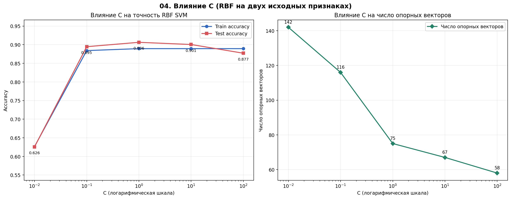
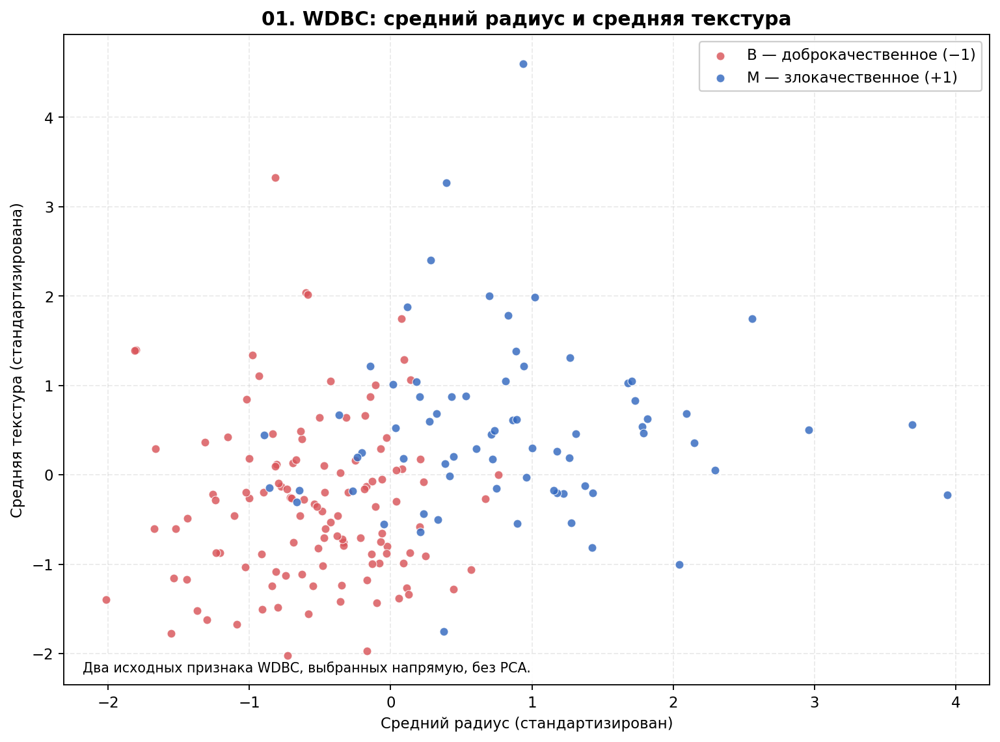
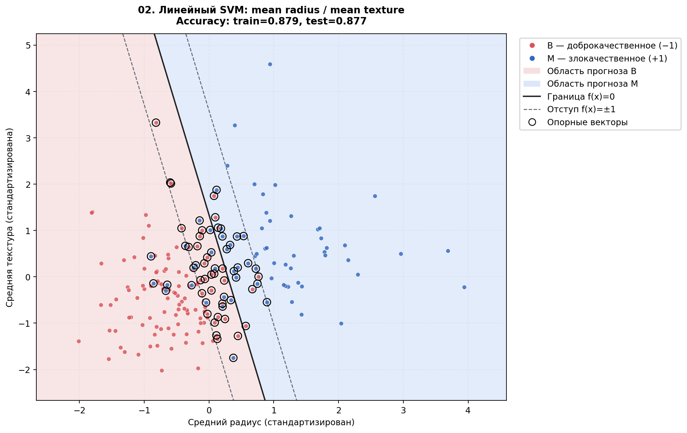
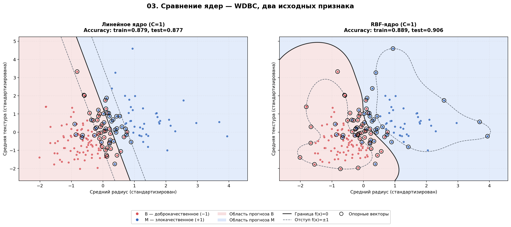
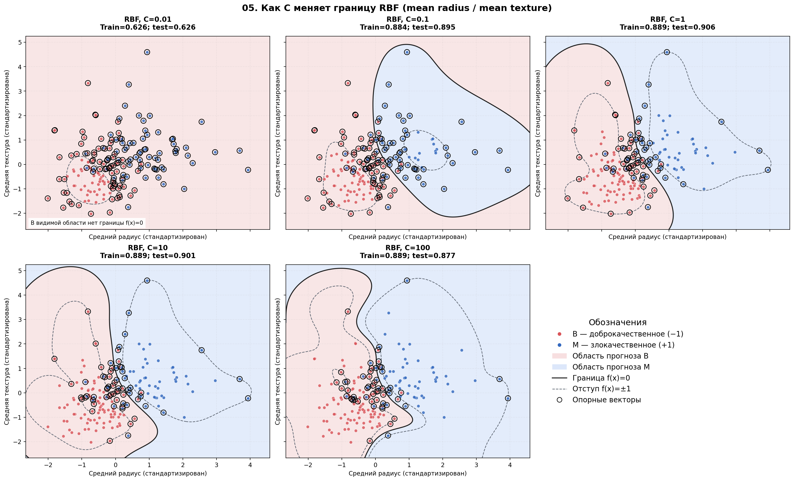
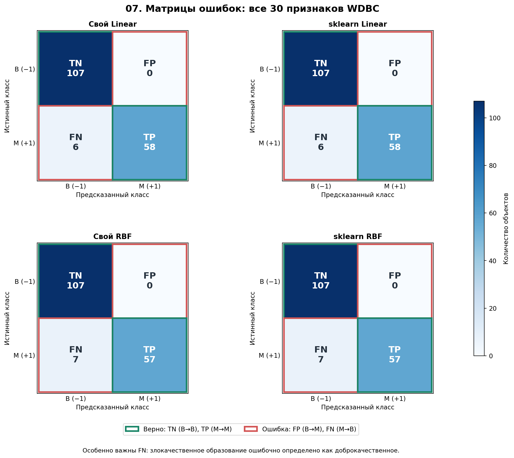
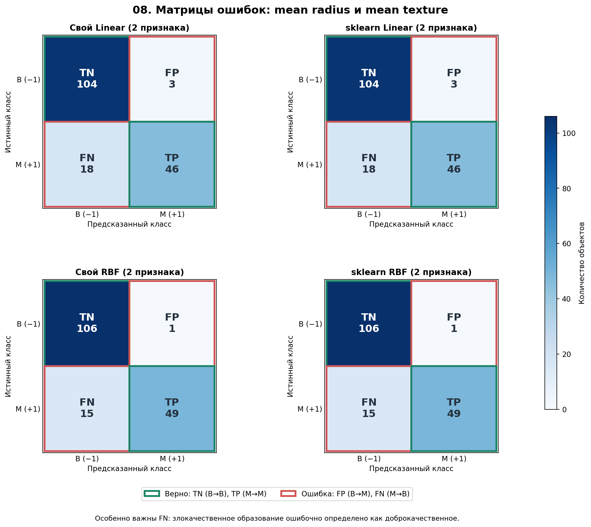

# Лабораторная работа №3. SVM

---

В рамках лабораторной работы реализован метод опорных векторов (**Support Vector Machine, SVM**) для бинарной классификации и проведено сравнение собственной реализации с эталонным алгоритмом `scikit-learn`.

На лекции были рассмотрены аналитическая и геометрическая постановки SVM, переход к задаче квадратичного программирования, решение двойственной задачи по множителям Лагранжа, трюк с ядром и влияние регуляризации. В данной работе эти принципы применены к реальному датасету **Wisconsin Diagnostic Breast Cancer (WDBC)**.

## Задание

---

- [x] Выбрать датасет для бинарной классификации.
- [x] Реализовать решение двойственной задачи по множителям Лагранжа $\lambda_i$ с помощью [`scipy.optimize.minimize`](https://docs.scipy.org/doc/scipy/reference/generated/scipy.optimize.minimize.html).
- [x] Реализовать трюк с ядром.
- [x] Построить линейный классификатор.
- [x] Визуализировать решение.
- [x] Сравнить собственную реализацию с эталонной реализацией `sklearn.svm.SVC`.

---

# Отчёт

Метод опорных векторов (**SVM**) — алгоритм классификации, который ищет разделяющую гиперплоскость с максимально широким отступом (*margin*) между классами. Для пересекающихся данных используется **Soft-Margin SVM**: нарушения отступа разрешаются, но учитываются в целевой функции со штрафом.

Благодаря **kernel trick** SVM позволяет строить нелинейные границы без явного преобразования исходных объектов в пространство признаков большей размерности.

**Цель работы:** самостоятельно реализовать SVM через двойственную задачу и метод `SLSQP` из `scipy.optimize.minimize`, обучить линейную и RBF-модели на WDBC, исследовать влияние параметра регуляризации `C`, визуализировать границы и сравнить результаты с `scikit-learn`.

---

## Основные принципы SVM

### Геометрическая постановка

Линейный классификатор задаёт разделяющую гиперплоскость:

$$
f(x)=w^Tx+b.
$$

Разделяющая граница задаётся уравнением $f(x)=0$.

SVM стремится максимизировать ширину разделяющей полосы $2/\|w\|$. В реальных данных классы могут перекрываться, поэтому вводятся переменные нарушения отступа $\xi_i$:

$$
\min_{w,b,\xi} \frac12\|w\|^2+C\sum_{i=1}^n\xi_i,
$$

при ограничениях:

$$
y_i(w^Tx_i+b)\geq 1-\xi_i,\qquad \xi_i\geq0.
$$

Коэффициент **$C$** задаёт цену нарушений: при маленьком $C$ они штрафуются слабее, при большом — сильнее. При фиксированных $w,b$ минимальное допустимое нарушение равно:

$$
\xi_i=\max(0,1-y_if(x_i)).
$$

Это **hinge loss**. Следовательно, прямая задача эквивалентна минимизации регуляризованной суммы hinge loss:

$$
\frac12\|w\|^2+C\sum_i\max(0,1-y_if(x_i)).
$$

### Прямая и двойственная задачи

Вместо непосредственного поиска $w,b,\xi$ используется двойственная задача по множителям Лагранжа $\lambda_i$:

$$
\max_{\lambda} D(\lambda),
$$

где

$$
D(\lambda)=\sum_{i=1}^n\lambda_i-
\frac12\sum_{i=1}^n\sum_{j=1}^n\lambda_i\lambda_jy_iy_jK(x_i,x_j).
$$

при обязательных ограничениях:

$$
0\leq\lambda_i\leq C,\qquad \sum_i\lambda_i y_i=0.
$$

Первое ограничение следует из Soft-Margin-постановки и стоимости нарушений $C$. Второе получается из условия стационарности лагранжиана по свободному члену $b$. Оно означает равенство суммарных множителей объектов двух классов, а не равенство количества объектов разных классов.

В двойственной постановке данные входят в функцию через $K(x_i,x_j)$, поэтому становится возможным трюк с ядром.

### Трюк с ядром

Скалярное произведение $x_i^Tx_j$ заменяется функцией ядра $K(x_i,x_j)$, вычисляющей скалярное произведение в некотором пространстве признаков без явного построения этого отображения.

В собственной реализации предусмотрены **два ядра**:

| Ядро | Формула | Назначение |
|---|---|---|
| Линейное (`linear`) | $K(x_i,x_j)=x_i^Tx_j$ | Линейная разделяющая гиперплоскость |
| Гауссово (`rbf`) | $K(x_i,x_j)=\exp(-\gamma\|x_i-x_j\|^2)$ | Нелинейная разделяющая граница |

Для RBF параметр $\gamma$ рассчитывается по обучающим данным тем же способом, что и `gamma="scale"` в `sklearn`:

$$
\gamma=\frac{1}{d\cdot V},
$$

где $d$ — число признаков, а $V$ — дисперсия всех элементов обучающей матрицы, вычисленная функцией `X.var()`. В коде это записано без дополнительных математических макросов:

```python
def gamma_scale(X):
    return 1.0 / (X.shape[1] * X.var())
```

Числовое значение $\gamma$ одинаково у собственной RBF-модели и соответствующего эталона. Полиномиальное ядро обсуждалось на лекции, но **в данном коде не реализовывалось и не тестировалось**.

### Роль параметра C

Параметр $C$ регулирует компромисс между шириной разделяющей полосы и штрафом за нарушения отступа:

- **Маленькое C:** нарушения относительно дешевы, регуляризация сильнее; при слишком малом значении возможно недообучение.
- **Большое C:** нарушения дороже, регуляризация относительно слабее; тестовое качество при этом не обязано расти.

Для исследования использованы значения $C\in\{0.01,0.1,1,10,100\}$ на отдельной двумерной выборке с RBF-ядром.

---

## Реализация с помощью `scipy.optimize.minimize`

В реализации используется оптимизатор **SLSQP**: он позволяет задать и диапазон значений множителей, и ограничение типа равенства.

Вводится матрица ядра $K_{ij}=K(x_i,x_j)$, затем матрица

$$
Q_{ij}=y_i y_j K_{ij}.
$$

Поскольку `minimize` ищет **минимум**, знак двойственной целевой функции меняется:

$$
F(\lambda)=\frac12\lambda^TQ\lambda-\sum_i\lambda_i.
$$

Аналитический градиент:

$$
\nabla F(\lambda)=Q\lambda-e,
$$

где $e$ — вектор единиц той же длины, что и $\lambda$. Градиент передаётся оптимизатору для численного решения задачи; это **градиент двойственной целевой функции**, а не градиент hinge loss. Ограничения:

$$
0\leq\lambda_i\leq C,\qquad \lambda^Ty=0.
$$

Фрагмент собственной реализации:

```python
K = kernel_matrix(X, X, kind=kind, gamma=gamma)
Q = np.outer(y, y) * K
constraint = {
    "type": "eq",
    "fun": equality_constraint,
    "jac": equality_gradient,
    "args": (y,),
}
result = minimize(
    fun=dual_objective,
    x0=np.zeros(len(y)),
    args=(Q,),
    jac=dual_gradient,
    method="SLSQP",
    bounds=[(0.0, C)] * len(y),
    constraints=[constraint],
    options={"maxiter": 2200, "ftol": 1e-9, "disp": False},
)
```

После оптимизации объекты с $\lambda_i>\varepsilon$ считаются опорными векторами. Смещение $b$ восстанавливается преимущественно по **свободным опорным векторам** ($0<\lambda_i<C$), для которых выполняется $y_if(x_i)=1$:

$$
b=y_i-\sum_j\lambda_jy_jK(x_j,x_i).
$$

Если таких векторов нет, в коде предусмотрен запасной способ вычисления $b$ через неравенства KKT. Для линейного ядра дополнительно восстанавливается вектор весов $w=\sum_i\lambda_i y_i x_i$. Для RBF достаточно ядерной формы разделяющей функции.

---

## Практическая реализация и анализ результатов

### Подготовка данных и предобработка

Для работы выбран набор [**UCI Wisconsin Diagnostic Breast Cancer (WDBC)**](https://archive.ics.uci.edu/dataset/17/breast+cancer+wisconsin+diagnostic). Исходный файл `wdbc.data` содержит идентификатор объекта, диагноз и 30 числовых признаков. Идентификатор не используется как признак. Если загрузка UCI недоступна, в коде предусмотрена резервная загрузка встроенной копии WDBC через `sklearn.datasets.load_breast_cancer`.

| Характеристика | Значение |
|---|---:|
| Объектов | 569 |
| Числовых признаков | 30 |
| B — доброкачественные, метка −1 | 357 |
| M — злокачественные, метка +1 | 212 |
| Train (70%) | 398 объектов × 30 признаков |
| Test (30%) | 171 объект × 30 признаков |

Разделение выполняется со стратификацией (`stratify=y`) и `random_state=42`. Далее признаки стандартизируются через `StandardScaler`: среднее и стандартное отклонение определяются **только по обучающей выборке**, а к тестовой применяются уже найденные параметры.

Основные модели обучаются **на всех 30 признаках и всех 398 обучающих объектах**. Для двумерных графиков отдельно берутся два исходных признака `mean radius` и `mean texture` и стратифицированная обучающая подвыборка из **190 объектов**; тестовая выборка состоит из 171 объекта с теми же двумя признаками. **PCA не используется.**

### Архитектура реализации

Вместо класса `MySVM` алгоритм реализован **в функциональном стиле**. Функция `fit_svm()` возвращает обычный словарь с параметрами модели; `predict()` использует этот словарь для классификации новых объектов.

#### Параметры обучения

```python
C = 1.0
C_VALUES = [0.01, 0.1, 1.0, 10.0, 100.0]
RANDOM_STATE = 42
TEST_SIZE = 0.30
FEATURE_COLUMNS = (0, 1)  # mean radius, mean texture
```

`C` определяет штраф за нарушения отступа (не задаёт ширину полосы напрямую); `kind` выбирает ядро (`"linear"` или `"rbf"`); `gamma` задаёт параметр RBF; `tol` используется для численного выделения опорных и свободных опорных векторов.

#### Реализация ядер

```python
def kernel_matrix(A, B, kind="linear", gamma=None):
    ...
```

- `linear`: рассчитывает матрицу скалярных произведений `A @ B.T`;
- `rbf`: сначала вычисляет квадраты расстояний $\|A_i-B_j\|^2$, затем $\exp(-\gamma\|A_i-B_j\|^2)$.

#### Целевая функция и ограничения

```python
def dual_objective(lambdas, Q):
    return 0.5 * lambdas @ Q @ lambdas - np.sum(lambdas)

def dual_gradient(lambdas, Q):
    return Q @ lambdas - np.ones_like(lambdas)

def equality_constraint(lambdas, y):
    return lambdas @ y
```

#### Обучение модели

```python
def fit_svm(X, y, C=1.0, kind="linear", gamma=None, tol=None):
    ...
```

Алгоритм выполняется в следующем порядке:

1. Вычисление матрицы ядра $K$ и матрицы $Q$.
2. Подготовка целевой функции, градиента и ограничений $0\leq\lambda_i\leq C$, $\lambda^Ty=0$.
3. Решение двойственной задачи через `minimize(method="SLSQP")` с начальным вектором $\lambda=0$.
4. Выделение опорных векторов по практически ненулевым $\lambda_i$.
5. Вычисление смещения $b$ по условиям KKT.
6. Для линейного ядра — восстановление $w$.
7. Сохранение множителей, опорных векторов, $b$, параметров ядра и, при необходимости, $w$ в словарь.
8. Вычисление $f(x)$ и присвоение класса по знаку: $+1$ при $f(x)\geq0$ и $-1$ в противном случае.

Функции `decision_function()` и `predict()` используют:

Для линейного ядра:

$$
f(x)=w^Tx+b.
$$

Для RBF-ядра:

$$
f(x)=\sum_{i\in SV}\lambda_i y_iK(x_i,x)+b.
$$

`sklearn.svm.SVC` не участвует в обучении собственной модели и применяется **только для эталонного сравнения**.

### Результаты экспериментов

Все результаты ниже для основных моделей получены при $C=1$ на **30 исходных признаках**. Положительным классом при расчёте Precision, Recall и F1 выбран **M (+1)**.

#### Линейное ядро

```text
Train Accuracy:          0.9899
Test Accuracy:           0.9649
Precision M:             1.0000
Recall M:                0.9062
F1 M:                    0.9508
Количество SV:               36
```

Линейная модель правильно классифицировала **165 из 171** тестовых объектов: 107 доброкачественных и 58 злокачественных. При этом шесть действительно злокачественных объектов были ошибочно отнесены к классу B. По сравнению с RBF линейная модель на этом разбиении показала немного более высокую Test Accuracy и Recall M.

#### RBF-ядро

```text
Train Accuracy:          0.9849
Test Accuracy:           0.9591
Precision M:             1.0000
Recall M:                0.8906
F1 M:                    0.9421
Количество SV:              100
```

RBF-модель правильно классифицировала **164 из 171** тестовых объектов: 107 доброкачественных и 57 злокачественных. Семь действительно злокачественных объектов были ошибочно отнесены к классу B. Нелинейное ядро не дало преимущества на основной 30-признаковой выборке при выбранных параметрах.

### Исследование влияния параметра C

Эксперимент проведён **отдельно для RBF на двух исходных признаках** `mean radius` и `mean texture` (190 train, 171 test). Это не результат основной модели на всех 30 признаках. В каждом запуске изменялось только значение $C$; данные и $\gamma$ оставались одинаковыми.

| C | Train Acc | Test Acc | Опорных векторов |
|---:|---:|---:|---:|
| 0.01 | 0.6263 | 0.6257 | 142 |
| 0.1 | 0.8842 | 0.8947 | 116 |
| 1 | 0.8895 | 0.9064 | 75 |
| 10 | 0.8895 | 0.9006 | 67 |
| 100 | 0.8895 | 0.8772 | 58 |

**Наблюдения:**

1. **C = 0.01:** сильная регуляризация; модель фактически предсказывает преобладающий класс B во всей отображаемой области. Тестовая точность 0.6257 соответствует доле объектов B в Test (107/171): выраженное недообучение.
2. **C = 0.1:** появляется содержательная нелинейная граница, Test Accuracy возрастает до 0.8947.
3. **C = 1:** наибольшая тестовая точность **0.9064** среди пяти проверенных значений.
4. **C = 10:** форма границы меняется, однако Test Accuracy немного снижается до 0.9006.
5. **C = 100:** тестовая точность снижается до 0.8772, хотя штраф за нарушения вырос. Увеличение C не гарантирует улучшения обобщения.

Число опорных векторов **в этом эксперименте** уменьшилось со 142 до 58 по мере роста C. Это наблюдение не является универсальным законом для любого датасета. Выбор $C=1$ по максимальной точности на данном Test — описательный результат эксперимента; для полноценного подбора гиперпараметров следует использовать кросс-валидацию или отдельную валидационную выборку.



### Сравнение с реализацией scikit-learn

Для обоих ядер собственная реализация сравнивалась с `sklearn.svm.SVC` при одинаковых $C$ и $\gamma$ (для RBF).

**Линейное ядро.** Собственная модель и sklearn показали одинаковые Train Accuracy = **0.9899**, Test Accuracy = **0.9649** и число опорных векторов **36**. Их тестовые предсказания совпали для всех 171 объектов.

**RBF-ядро.** Собственная модель и sklearn также показали одинаковые Train Accuracy = **0.9849**, Test Accuracy = **0.9591** и число опорных векторов **100**. Тестовые предсказания совпали для всех 171 объектов.

**Сводная таблица результатов (все 30 признаков):**

| Модель | Train Acc | Test Acc | Precision M | Recall M | F1 M | SV |
|---|---:|---:|---:|---:|---:|---:|
| Свой Linear | 0.9899 | 0.9649 | 1.0000 | 0.9062 | 0.9508 | 36 |
| sklearn Linear | 0.9899 | 0.9649 | 1.0000 | 0.9062 | 0.9508 | 36 |
| Свой RBF | 0.9849 | 0.9591 | 1.0000 | 0.8906 | 0.9421 | 100 |
| sklearn RBF | 0.9849 | 0.9591 | 1.0000 | 0.8906 | 0.9421 | 100 |

Сверка предсказаний:

```text
Совпадение Linear (свой / sklearn): 1.0 (100%)
Совпадение RBF (свой / sklearn):    1.0 (100%)
```

Проверка соблюдения равенства двойственной задачи в предоставленном запуске:

```text
λᵀy, Linear: -1.706606002211594e-11
λᵀy, RBF:    -1.8131609483012764e-12
```

Обе величины практически равны нулю в пределах численной погрешности. Совпадение предсказаний и матриц ошибок с эталоном — сильная проверка корректности алгоритма на данном разбиении; оно не означает, что все внутренние коэффициенты различных оптимизаторов абсолютно идентичны.

**Почему результаты получились такими:**

1. **Корректная постановка задачи:** в собственной реализации учтены двойственная целевая функция, ограничение равенства, диапазон множителей и восстановление свободного члена по KKT.
2. **Зависимость от ядра и представления данных:** на всех 30 признаках Linear немного лучше RBF; на двух выбранных признаках RBF лучше Linear. Более сложная граница не гарантирует лучший результат на любой выборке.
3. **Влияние C:** на двумерном эксперименте слишком маленькое C привело к недообучению, а при больших значениях тестовая точность снизилась.
4. **Количество признаков и объектов:** основная модель обучалась на 398 объектах с 30 признаками, а визуальная — на 190 объектах с двумя признаками. Различия качества нельзя приписывать только ядру или только числу признаков.
5. **Значимость Recall:** идеальная Precision M = 1.0 не означает обнаружение всех злокачественных образований: Linear пропустил шесть, RBF — семь объектов M.
6. **Стандартизация:** предотвращает доминирование признаков большого масштаба в скалярных произведениях и расстояниях.

### Визуализация результатов

#### Исходные данные (два признака)



Красные точки — B (−1), синие — M (+1). Классы частично перекрываются, поэтому идеальная классификация только по двум признакам затруднительна.

#### Линейное ядро



Отдельная двумерная линейная модель: Train Accuracy **0.8789**, Test Accuracy **0.8772**, **63** опорных вектора. Чёрная сплошная линия — $f(x)=0$, пунктирные — уровни $f(x)=\pm1$, чёрные кольца вокруг точек обозначают опорные векторы. Цвет фона показывает предсказываемый моделью класс.

#### Сравнение линейного и RBF-ядер



| Двумерная модель, C = 1 | Train Acc | Test Acc | SV |
|---|---:|---:|---:|
| Linear | 0.8789 | 0.8772 | 63 |
| RBF | 0.8895 | 0.9064 | 75 |

Linear строит прямую, RBF — гибкую нелинейную границу. На двух выбранных признаках RBF правильно классифицировал на **пять тестовых объектов больше** (155 против 150).

#### Влияние C на геометрию RBF



При $C=0.01$ в показанной области нет границы $f(x)=0$ и модель фактически предсказывает B. При дальнейшем увеличении C появляются и изменяются нелинейные разделяющие области; на графике видно, что форма границы меняется даже тогда, когда Train Accuracy остаётся одинаковой. Само по себе усложнение границы не гарантирует увеличение тестовой точности.

#### Матрицы ошибок: все 30 признаков



| Модель | TN (B→B) | FP (B→M) | FN (M→B) | TP (M→M) |
|---|---:|---:|---:|---:|
| Linear (свой и sklearn) | 107 | 0 | 6 | 58 |
| RBF (свой и sklearn) | 107 | 0 | 7 | 57 |

У обеих моделей **FP = 0**, поэтому Precision M равна 1.0. Однако есть ложноотрицательные ответы (FN): злокачественные образования ошибочно отнесены к B. Их отражает Recall M: **0.9062** для Linear и **0.8906** для RBF.

#### Матрицы ошибок: два исходных признака



| Модель | TN | FP | FN | TP |
|---|---:|---:|---:|---:|
| Linear (свой и sklearn) | 104 | 3 | 18 | 46 |
| RBF (свой и sklearn) | 106 | 1 | 15 | 49 |

На двух признаках RBF уменьшил число ложноположительных ответов с 3 до 1 и число ложноотрицательных — с 18 до 15 по сравнению с Linear. При этом двумерный эксперимент не следует напрямую приравнивать к основному эксперименту: у них различаются и количество признаков, и объём обучающей выборки.

---

## Выводы

Самостоятельная реализация SVM через решение двойственной задачи с помощью `scipy.optimize.minimize(method="SLSQP")` успешно применена к бинарной классификации WDBC. Использованы линейное и RBF-ядра, ограничения на множители Лагранжа, выделение опорных векторов и восстановление разделяющей функции по условиям KKT.

На **всех 30 признаках** собственный Linear SVM достиг Test Accuracy **0.9649**, а RBF — **0.9591**. При сравнении с `sklearn.svm.SVC` соответствующие метрики, число опорных векторов и все тестовые предсказания совпали. Проверка $\lambda^Ty\approx0$ также подтвердила выполнение ограничения двойственной задачи с высокой численной точностью.

В **отдельном двумерном эксперименте** на `mean radius` и `mean texture` RBF превзошёл линейную модель: **0.9064** против **0.8772** на тесте. Исследование $C$ показало недообучение при очень малом значении и снижение тестовой точности при дальнейшем увеличении параметра после $C=1$. Таким образом, итоговое качество определяется не только сложностью ядра, но и выбранным представлением данных и параметрами регуляризации.

Разбор матриц ошибок также показал необходимость учитывать **Recall по положительному классу M**, а не ограничиваться общей Accuracy: даже при Precision M = 1.0 модели допускают пропуски злокачественных объектов.