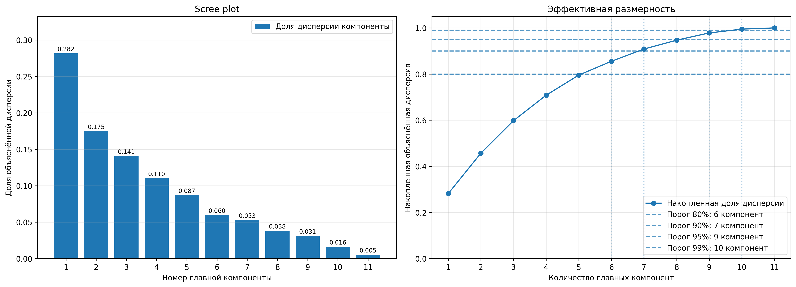
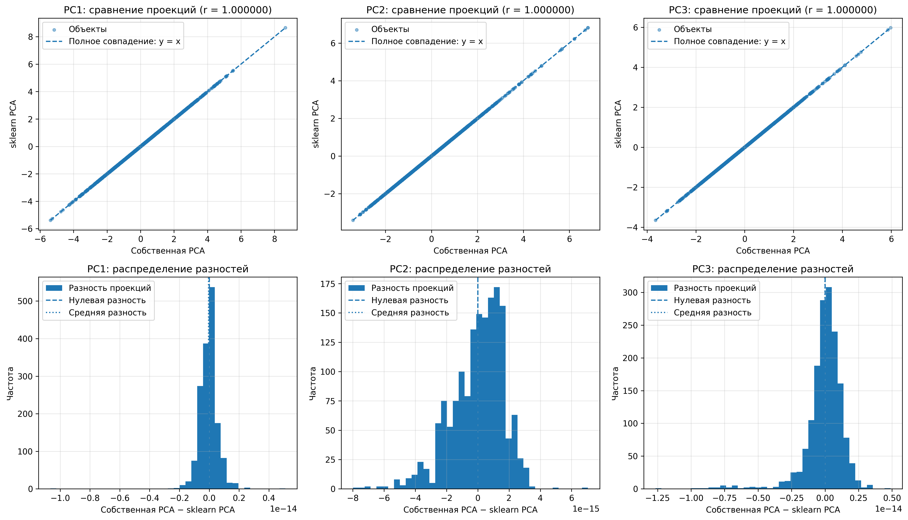
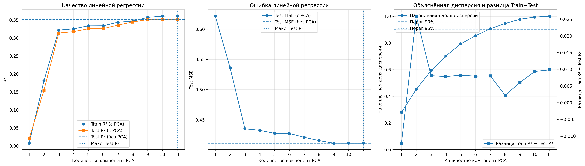

# Лабораторная работа №4. PCA

В рамках лабораторной работы реализован метод главных компонент (**Principal Component Analysis, PCA**) с помощью сингулярного разложения матрицы признаков. Определена эффективная размерность выборки, выполнено численное сравнение собственной реализации с `sklearn.decomposition.PCA` и исследовано влияние сокращения числа компонент на качество линейной регрессии.

Для исследования использован набор данных **Wine Quality Red** из репозитория UCI Machine Learning Repository. Целевой переменной регрессии является оценка качества вина `quality`.

## Задание

1. Реализовать PCA через сингулярное разложение.
2. Определить эффективную размерность выборки.
3. Показать эквивалентность собственной реализации с эталонной.
4. Подготовить отчёт.

В дополнение к основным пунктам проведено сравнение линейной регрессии на исходных признаках и на главных компонентах по аналогии с предоставленным примером лабораторной работы.

# Отчёт

**Цель работы:** самостоятельно реализовать PCA через SVD, определить число компонент, необходимое для сохранения заданной доли дисперсии, проверить совпадение результатов с `scikit-learn` и оценить последствия снижения размерности для задачи прогнозирования качества вина.

## Основные принципы PCA

### Идея метода

PCA преобразует исходные взаимосвязанные признаки в новые ортогональные направления, называемые главными компонентами. Первая компонента описывает максимальную возможную дисперсию данных. Каждая следующая описывает максимальную оставшуюся дисперсию при условии ортогональности предыдущим компонентам.

Метод не использует значения целевой переменной `quality`. Поэтому направление с большой дисперсией не обязательно оказывается наиболее полезным для предсказания качества вина.

### Подготовка матрицы признаков

Перед применением PCA признаки стандартизируются:

$$
z_{ij}=\frac{x_{ij}-\mu_j}{\sigma_j}.
$$

Здесь $\mu_j$ обозначает среднее значение признака, а $\sigma_j$ обозначает его стандартное отклонение. Стандартизация необходима, поскольку признаки измеряются в разных единицах и имеют разные масштабы. В собственной реализации параметры стандартизации рассчитываются функциями `standardize_fit()` и `standardize_transform()`.

### Сингулярное разложение

Для центрированной матрицы $X_c$ вычисляется сингулярное разложение:

$$
X_c=U\Sigma V^T.
$$

Матрица $U$ содержит левые сингулярные векторы, диагональная матрица $\Sigma$ содержит сингулярные значения $s_j$, а строки $V^T$ задают направления главных компонент. В коде разложение выполняется самостоятельно посредством `np.linalg.svd()`, без обращения к готовому алгоритму PCA.

Дисперсия вдоль каждой компоненты рассчитывается по сингулярным значениям:

$$
\lambda_j=\frac{s_j^2}{n-1}.
$$

Доля объяснённой дисперсии компоненты равна:

$$
r_j=\frac{\lambda_j}{\sum_{k=1}^{p}\lambda_k}.
$$

Координаты объектов в пространстве первых $m$ главных компонент получаются проецированием:

$$
Z=(X-\mu)V_m^T.
$$

Обратное преобразование выполняется по формуле:

$$
\hat X=ZV_m+\mu.
$$

Если сохраняются не все компоненты, восстановление является приближённым, поскольку часть дисперсии исходных данных отбрасывается.

### Эффективная размерность

Эффективная размерность $m$ определяется как минимальное количество первых главных компонент, сохраняющее заданную долю общей дисперсии. Для этого используется накопленная доля:

$$
R_m=\sum_{j=1}^{m}r_j.
$$

Относительная потеря дисперсии составляет:

$$
E_m=\frac{\sum_{j=m+1}^{p}\lambda_j}{\sum_{j=1}^{p}\lambda_j}=1-R_m.
$$

Для заданного порога $q$ выбирается минимальное $m$, удовлетворяющее условию $R_m\ge q$. В эксперименте рассмотрены пороги 80%, 90%, 95% и 99%.

## Практическая реализация и анализ результатов

### Датасет и предобработка

Использован набор [UCI Wine Quality](https://archive.ics.uci.edu/dataset/186/wine+quality).

| Характеристика | Значение |
|:---|---:|
| Количество объектов | 1599 |
| Количество исходных признаков | 11 |
| Целевая переменная | `quality` |
| Признаки для PCA | 11 физико химических показателей |
| Обучающая выборка в регрессионном эксперименте | 1119 объектов |
| Тестовая выборка в регрессионном эксперименте | 480 объектов |

При исследовании структуры данных PCA применяется к стандартизированной матрице всех 1599 объектов без столбца `quality`. Для исследования регрессии сначала проводится разделение на Train и Test в пропорции 70% и 30%, а параметры стандартизации и PCA рассчитываются только по Train. Это исключает использование информации из тестовой выборки при обучении преобразования.

### Результаты анализа главных компонент

На рисунке слева приведён **Scree plot** с долей общей дисперсии, объясняемой каждой компонентой. Первая компонента сохраняет около **28,2%**, вторая около **17,5%**, третья около **14,1%**. Их совокупный вклад составляет приблизительно 60%. Вклад последующих компонент постепенно уменьшается.

На рисунке справа показана накопленная объяснённая дисперсия и минимальное количество компонент для достижения каждого заданного порога.

По представленному графику получены следующие результаты:

| Требуемая доля дисперсии | Эффективная размерность | Фактически сохранено, приблизительно | Сокращение числа признаков |
|:---:|---:|---:|---:|
| 80% | 6 компонент | 85,5% | 45,5% |
| 90% | 7 компонент | 90,8% | 36,4% |
| 95% | 9 компонент | 97,7% | 18,2% |
| 99% | 10 компонент | 99,3% | 9,1% |

Процент сохранённой дисперсии в таблице указан приближённо по подписям графика. Точные значения вычисляются и печатаются самим скриптом.

**Основной результат:** для сохранения не менее 95% дисперсии достаточно девяти главных компонент вместо одиннадцати исходных признаков. При таком преобразовании размерность сокращается на 18,2%. Для сохранения не менее 90% достаточно семи компонент, что соответствует сокращению числа признаков на 36,4%.

### Сравнение собственной реализации с `scikit-learn`

Для сравнения использованы **девять компонент**, выбранных по порогу 95%. Собственная реализация и `sklearn.decomposition.PCA` получают одну и ту же стандартизированную матрицу признаков. Для библиотечной реализации указан параметр `svd_solver="full"`.

Сопоставляются собственные значения, доли объяснённой дисперсии, сингулярные значения, направления компонент, координаты преобразованных объектов, результаты обратного преобразования и ортогональность найденных направлений.

Направление сингулярного вектора определено с точностью до знака: векторы $v$ и $-v$ описывают одну и ту же ось. Поэтому перед сопоставлением знаки собственных компонент согласуются с эталонными. Различие только в знаке не рассматривается как ошибка PCA.

На верхних трёх графиках изображено сравнение проекций для PC1, PC2 и PC3. Точки располагаются вдоль линии $y=x$, а показанная корреляция для всех трёх компонент составляет **1,000000** при округлении до шести знаков.

Нижние три графика отражают разности координат, полученных двумя реализациями. Они сосредоточены около нуля; характерный масштаб отклонений на изображении составляет порядка $10^{-14}$ и $10^{-15}$. Это численная погрешность вычислений с плавающей точкой, а не содержательное расхождение алгоритмов.

| Проверка | Критерий корректности |
|:---|:---|
| Доли объяснённой дисперсии | Практическое совпадение соответствующих значений |
| Направления компонент | Совпадение после согласования знаков |
| Координаты после PCA | Малые MAE, RMSE и максимальная разность |
| Восстановление данных | Практическое совпадение восстановленных матриц и ошибок MSE |
| Ортогональность | Матрица произведения компонент с транспонированной матрицей близка к единичной |

Численная проверка реализована через `np.allclose()` с абсолютной и относительной точностью `1e-8`. Показанные графики подтверждают практически полное совпадение проекций собственной и эталонной PCA на рассмотренных компонентах.

Следует различать ошибку восстановления исходных признаков и расхождение двух реализаций. При использовании девяти компонент восстановление исходных одиннадцати признаков допускает потерю части дисперсии. При этом собственный PCA и sklearn должны давать практически одинаковые восстановленные матрицы.

### Исследование влияния PCA на линейную регрессию

Дополнительный эксперимент показывает, что математически корректное снижение размерности не обязано улучшать прогнозирование целевой переменной. Для оценки использована линейная регрессия `sklearn.linear_model.LinearRegression`.

Сначала обучается базовая модель на всех одиннадцати стандартизированных исходных признаках. Далее собственный PCA последовательно оставляет от одной до одиннадцати компонент, и для каждого числа компонент обучается отдельная линейная регрессия. Разделение исходной выборки и тестовые объекты во всех запусках одинаковы: `test_size=0.30`, `random_state=42`.

Для каждого варианта вычисляются Train R², Test R², разница между ними, накопленная доля дисперсии и Test MSE. R² показывает качество предсказания относительно использования среднего значения целевой переменной, а MSE измеряет среднюю квадратичную ошибку прогноза.

#### Качество регрессии

На первом графике показано изменение Train R² и Test R² в зависимости от количества главных компонент. Горизонтальная линия обозначает Test R² базовой регрессии без PCA. Наиболее заметный прирост качества происходит при переходе от одной компоненты к первым трём. Затем дальнейшее добавление компонент повышает качество постепенно.

По изображению базовый Test R² составляет около **0,35**. Максимум Test R² среди рассмотренных вариантов отмечен при **11 компонентах**, когда сохранено полное пространство исходных признаков. Полученное качество практически совпадает с базовой линейной регрессией.

#### Ошибка предсказания

На втором графике изображён Test MSE. При использовании только одной компоненты ошибка заметно выше, затем она уменьшается по мере добавления новых компонент. При девяти и более компонентах кривая практически достигает уровня базовой регрессии без PCA, около **0,41** по графику. Значения приведены приближённо; точные метрики выводятся программой в консоль.

#### Дисперсия и разница Train R² с Test R²

Третий график сопоставляет накопленную объяснённую дисперсию с разницей между качеством на обучающей и тестовой выборках. По мере увеличения числа компонент накопленная дисперсия возрастает до 100%. Разница Train R² и Test R² остаётся небольшой для большей части рассмотренных вариантов. Сама по себе эта разница не является достаточным доказательством переобучения.

**Интерпретация эксперимента:** PCA выбирает направления по дисперсии исходных признаков, а не по их связи с `quality`. Поэтому сохранение 95% дисперсии не означает сохранение 95% качества регрессии. В данном эксперименте девять компонент дают результат, близкий к полной модели, но максимальный Test R² достигается при одиннадцати компонентах. При сохранении всех компонент PCA представляет собой ортогональное преобразование полного пространства, поэтому результат обычной линейной регрессии должен практически совпадать с базовой моделью.

Выбор максимального Test R² по одной и той же тестовой выборке здесь используется для описания результатов лабораторного эксперимента. Для независимой оценки окончательно выбранного числа компонент потребовались бы отдельная валидационная процедура и финальный тест.

## Выводы

В работе самостоятельно реализован алгоритм PCA через сингулярное разложение матрицы стандартизированных признаков. Реализация включает центрирование данных, вычисление сингулярных значений и направлений главных компонент, расчёт объяснённой дисперсии, прямое и обратное преобразование.

Для набора Wine Quality Red с 11 исходными признаками установлено, что для сохранения не менее **80%** дисперсии достаточно **6 компонент**, не менее **90%** достаточно **7 компонент**, не менее **95%** достаточно **9 компонент**, а не менее **99%** достаточно **10 компонент**. Таким образом, при пороге 95% количество признаков сокращается на **18,2%**.

Сравнение с `sklearn.decomposition.PCA` показало практически полное совпадение проекций. Для первых трёх компонент корреляция между координатами собственной и эталонной реализаций на графиках равна **1,000000**, а разности находятся в пределах численной погрешности.

Эксперимент с линейной регрессией показал, что сокращение размерности может сохранять качество прогнозирования на уровне, близком к базовой модели, однако не гарантирует его улучшения. На представленных графиках максимальное Test R² достигается при полном наборе из 11 компонент и практически совпадает с Test R² модели без PCA. Следовательно, эффективность PCA следует оценивать отдельно с точки зрения сохранения дисперсии и с точки зрения качества решения прикладной задачи.

