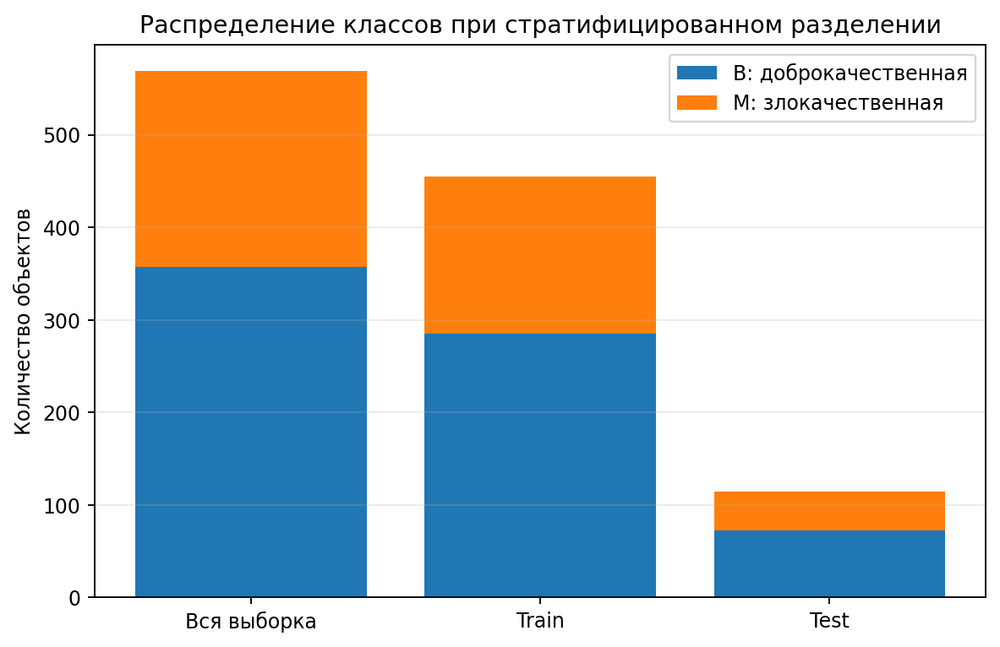
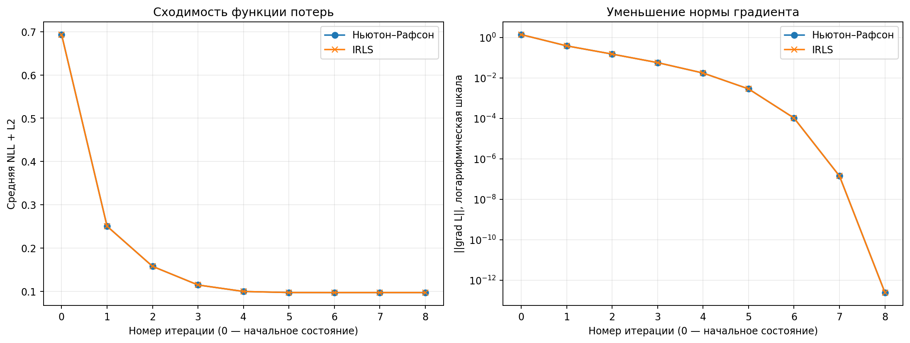
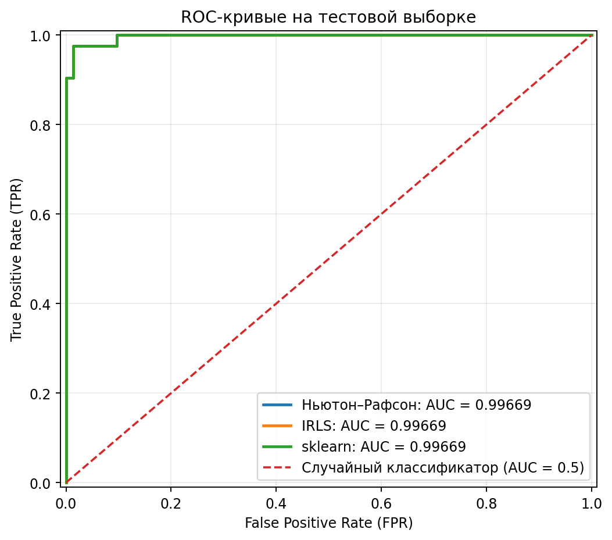
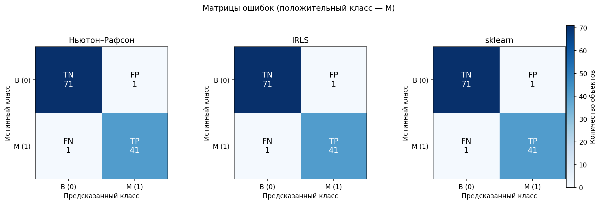
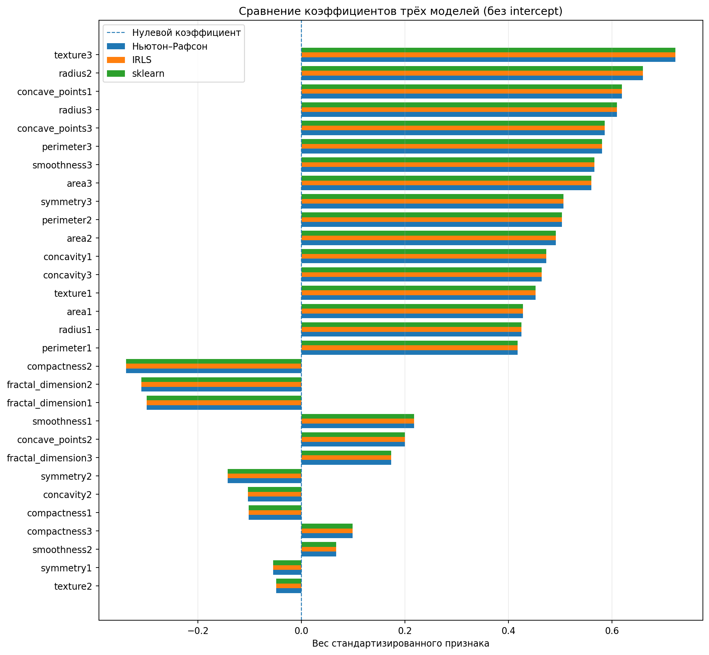
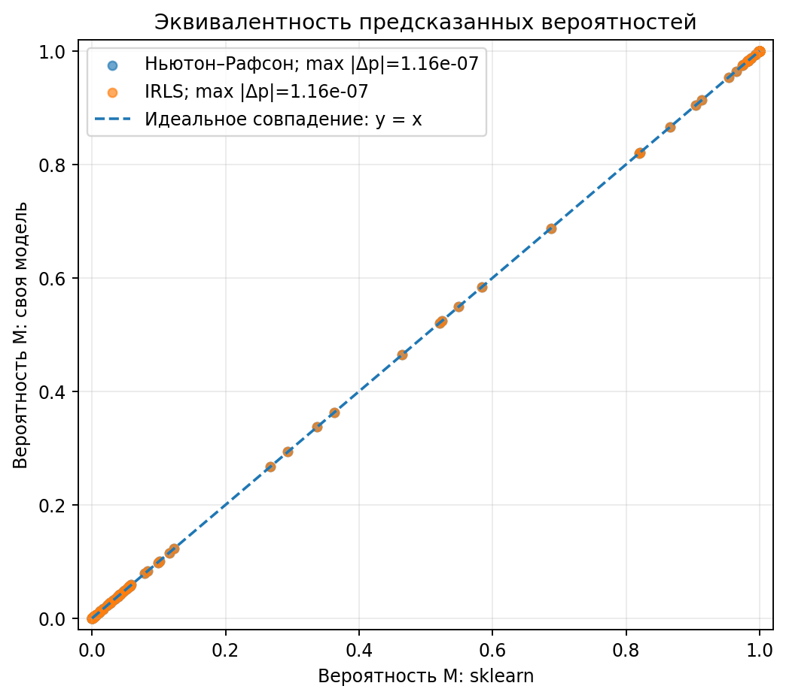

# Лабораторная работа №5. Логистическая регрессия

В рамках лабораторной работы самостоятельно реализована бинарная логистическая регрессия двумя методами: Ньютона–Рафсона и IRLS (Iteratively Reweighted Least Squares). Проведено сравнение собственных реализаций между собой и с эталонной `sklearn.linear_model.LogisticRegression` по сходимости, коэффициентам, предсказанным вероятностям и качеству классификации.

Для исследования использован набор данных Breast Cancer Wisconsin (Diagnostic) из UCI Machine Learning Repository. Целевая переменная характеризует диагноз: `B` означает доброкачественное образование, `M` означает злокачественное образование. Задача состоит в предсказании класса `M` по числовым характеристикам клеточных ядер.

## Задание

Реализовать логистическую регрессию с помощью метода Ньютона–Рафсона.

Реализовать логистическую регрессию с помощью IRLS.

Показать эквивалентность собственных реализаций и сравнить результаты с эталонной реализацией.

Подготовить отчёт по результатам эксперимента.

## Отчёт

**Цель работы:** самостоятельно реализовать два способа оптимизации логистической регрессии, проверить их математическую и численную эквивалентность, сравнить полученные решения с `scikit-learn` и оценить качество бинарной классификации на общей тестовой выборке.

### Основные принципы логистической регрессии

#### Идея метода

Логистическая регрессия решает задачу классификации, оценивая вероятность принадлежности объекта к положительному классу. Сначала строится линейная комбинация признаков, затем к ней применяется сигмоидная функция:

$$
z_i = w_0 + \sum_{j=1}^{d}w_j x_{ij}, \qquad
p_i = \sigma(z_i) = \frac{1}{1+e^{-z_i}}.
$$

Здесь $x_{ij}$ обозначает значение признака, $w_j$ обозначает его коэффициент, $w_0$ является свободным коэффициентом, а $p_i$ является оценённой вероятностью класса `M` для объекта $i$. При пороге классификации $0.5$ объект относится к классу `M`, если $p_i \geq 0.5$, иначе к классу `B`.

#### Функция потерь и регуляризация

Параметры определяются минимизацией средней отрицательной логарифмической функции правдоподобия (NLL) с L2-регуляризацией:

$$
L(w)=\frac{1}{n}\sum_{i=1}^{n}
\left[\log(1+e^{x_i^T w})-y_i x_i^T w\right]
+\frac{\lambda}{2}\sum_{j=1}^{d}w_j^2.
$$

Первая часть оценивает согласованность предсказанных вероятностей с истинными классами. Вторая ограничивает величину коэффициентов, снижая риск получения чрезмерно больших весов. Свободный коэффициент $w_0$ не регуляризуется. В эксперименте используется $\lambda=0.01$. Для устойчивого вычисления логарифмического слагаемого применяется `np.logaddexp`.

#### Метод Ньютона–Рафсона

Для нахождения минимума рассчитываются градиент и матрица вторых производных, или гессиан. Если $X$ обозначает матрицу признаков с дополнительным столбцом единиц, $p$ обозначает вектор предсказанных вероятностей, $W=\operatorname{diag}(p_i(1-p_i))$, а $R=\operatorname{diag}(0,1,\ldots,1)$, то:

$$
\nabla L(w)=\frac{X^T(p-y)}{n}+\lambda Rw,
\qquad
H(w)=\frac{X^T W X}{n}+\lambda R.
$$

На очередной итерации вычисляется поправка к коэффициентам:

$$
w_{\mathrm{new}}=w-H(w)^{-1}\nabla L(w).
$$

В программной реализации обратная матрица явно не вычисляется: соответствующая система линейных уравнений решается через `np.linalg.solve`. Предусмотрено уменьшение шага, если полное обновление приводит к увеличению функции потерь. Обучение прекращается при достижении заданной точности.

#### Метод IRLS

IRLS сводит каждую итерацию логистической регрессии к задаче взвешенных наименьших квадратов. Для текущих значений коэффициентов вычисляются веса наблюдений и рабочий отклик:

$$
W_i=p_i(1-p_i), \qquad
z_i=x_i^T w+\frac{y_i-p_i}{W_i}.
$$

После этого находится новое значение коэффициентов из системы:

$$
\left(\frac{X^T W X}{n}+\lambda R\right)w_{\mathrm{new}}
=\frac{X^T Wz}{n}.
$$

При одинаковых исходных параметрах и регуляризации обновление IRLS алгебраически эквивалентно шагу Ньютона–Рафсона. В лабораторной методы реализованы отдельно, чтобы проверить это равенство не только теоретически, но и численно. Для устойчивости расчётов очень малые значения весов ограничиваются снизу.

### Практическая реализация и анализ результатов

#### Датасет и предобработка

| Характеристика | Значение |
|:---|---:|
| Набор данных | Breast Cancer Wisconsin (Diagnostic), UCI ID 17 |
| Количество объектов | 569 |
| Числовые признаки | 30 |
| Доброкачественные образования, `B = 0` | 357 |
| Злокачественные образования, `M = 1` | 212 |
| Обучающая выборка | 455 объектов (80%) |
| Тестовая выборка | 114 объектов (20%) |
| Случайное зерно (`seed`) | 42 |
| Параметр L2-регуляризации | 0.01 |
| Порог классификации | 0.5 |

Разделение выполняется стратифицированно: соотношение классов сохраняется в обучающей и тестовой частях. Для стандартизации каждого признака рассчитываются среднее значение и стандартное отклонение **только по обучающей выборке**:

$$
\widetilde{x}_{ij}=\frac{x_{ij}-\mu_j}{\sigma_j}.
$$

К тестовым данным применяются уже полученные значения $\mu_j$ и $\sigma_j$. Это исключает использование информации из тестовой выборки при подготовке модели. Затем для собственных реализаций добавляется столбец единиц, соответствующий свободному коэффициенту.

#### Распределение классов

Во всей выборке содержится 357 доброкачественных и 212 злокачественных образований. Класс `B` преобладает и составляет приблизительно 62.7% объектов, тогда как класс `M` составляет около 37.3%. После разделения обучающая выборка содержит 285 объектов `B` и 170 объектов `M`, тестовая содержит 72 объекта `B` и 42 объекта `M`.

График подтверждает сохранение исходных пропорций классов. Это важно для корректного сравнения моделей: распределение целевой переменной в тестовой выборке не должно существенно отличаться от распределения в обучающей из-за случайного разделения.

#### Согласование условий сравнения с эталоном

В качестве эталона используется `LogisticRegression` с решателем `lbfgs`. Для неё установлены те же обучающие объекты и стандартизированные признаки. Чтобы согласовать силу регуляризации с собственной функцией потерь, применяется соотношение:

$$
C=\frac{1}{n_{\mathrm{train}}\lambda}.
$$

Во всех трёх моделях свободный коэффициент не штрафуется. `scikit-learn` используется только для обучения эталонной логистической регрессии. Разделение данных, стандартизация, собственные методы оптимизации и расчёт метрик реализованы в программе самостоятельно.

#### Сходимость метода Ньютона–Рафсона и IRLS

На левом графике представлено изменение средней NLL с L2-регуляризацией, на правом показана норма градиента в логарифмической шкале. Нулевая итерация соответствует начальным нулевым коэффициентам.

Оба метода демонстрируют одинаковую траекторию оптимизации. Функция потерь резко уменьшается на первых итерациях: от приблизительно 0.693 в начальном состоянии до значения около 0.10 к четвёртой итерации. Затем изменение становится незначительным, и обе реализации достигают одного итогового значения:

$$
L_{\mathrm{train}}=0.097401987582.
$$

Ньютону–Рафсону и IRLS потребовалось по **8 итераций**. Итоговая норма градиента обоих методов составляет $2.508\cdot10^{-13}$. Такое значение близко к нулю и указывает на достижение стационарной точки с высокой численной точностью. Полное наложение кривых согласуется с теоретической эквивалентностью обновлений.

Для эталонной модели итоговое значение функции потерь также равно $0.097401987582$, а норма градиента составляет $1.224\cdot10^{-8}$. Небольшая разница норм градиента обусловлена различием численных процедур оптимизации и критериев остановки.

#### Качество классификации на тестовой выборке

Все метрики рассчитаны для одной и той же тестовой выборки из 114 объектов. Положительным классом считается `M = 1`.

| Метод | Accuracy | Precision | Recall | Specificity | F1 | ROC AUC | Log-loss |
|:---|---:|---:|---:|---:|---:|---:|---:|
| Ньютон–Рафсон | 0.98246 | 0.97619 | 0.97619 | 0.98611 | 0.97619 | 0.99669 | 0.08791 |
| IRLS | 0.98246 | 0.97619 | 0.97619 | 0.98611 | 0.97619 | 0.99669 | 0.08791 |
| sklearn | 0.98246 | 0.97619 | 0.97619 | 0.98611 | 0.97619 | 0.99669 | 0.08791 |

Все три реализации правильно классифицировали 112 из 114 тестовых объектов, поэтому Accuracy равна 98.246%. Precision и Recall для класса `M` составляют примерно 97.619%. Specificity равна 98.611%, то есть модель правильно распознаёт подавляющее большинство доброкачественных образований.

Одинаковые метрики показывают, что при выбранном пороге три метода принимают одни и те же классификационные решения. Однако совпадение только агрегированных метрик само по себе ещё не доказывает эквивалентность алгоритмов. Поэтому дополнительно сопоставляются матрицы ошибок, коэффициенты и индивидуальные предсказанные вероятности.

#### ROC-кривые

ROC-кривая отражает зависимость доли правильно обнаруженных положительных объектов (TPR) от доли ошибочно отнесённых к положительному классу отрицательных объектов (FPR) при изменении порога классификации. Пунктирная диагональ соответствует случайному классификатору с ROC AUC, равной 0.5.

Кривые Ньютона–Рафсона, IRLS и `sklearn` практически полностью накладываются друг на друга. Для каждой модели получено **ROC AUC = 0.99669**. Значение, близкое к единице, показывает высокую способность моделей ранжировать злокачественные образования выше доброкачественных по предсказанной вероятности. Такое совпадение дополнительно подтверждает близость оценок вероятностей у трёх реализаций.

#### Матрицы ошибок

У всех трёх методов матрица ошибок одинакова:

| Истинный класс / Предсказанный класс | B (0) | M (1) |
|:---|---:|---:|
| B (0) | 71 (TN) | 1 (FP) |
| M (1) | 1 (FN) | 41 (TP) |

Из 72 доброкачественных образований 71 распознано правильно, а одно ошибочно классифицировано как злокачественное. Из 42 злокачественных образований 41 распознано правильно, а одно ошибочно отнесено к доброкачественным.

Таким образом, на тестовой выборке допущены **две ошибки**: одна ложноположительная (FP) и одна ложноотрицательная (FN). Для задачи обнаружения злокачественных образований пропуск положительного класса особенно значим, поэтому помимо общей Accuracy необходимо отдельно учитывать Recall. Полученные результаты характеризуют учебный эксперимент на данном разделении данных и не являются подтверждением пригодности модели для клинического применения.

#### Сравнение коэффициентов трёх моделей

На графике приведены коэффициенты всех 30 стандартизированных признаков без свободного коэффициента. Положительный вес при прочих равных увеличивает логарифм отношения шансов принадлежности к классу `M`, отрицательный уменьшает его. Поскольку признаки стандартизированы, коэффициенты можно сравнивать по масштабу более осмысленно, чем веса исходных признаков в разных единицах измерения.

Наиболее заметные положительные коэффициенты на графике наблюдаются, в частности, у `texture3`, `radius2` и `concave_points1`. Среди отрицательных выделяются `compactness2` и признаки `fractal_dimension1` и `fractal_dimension2`. При этом признаки могут быть взаимосвязаны, поэтому отдельный коэффициент не следует трактовать как независимую причинную характеристику диагноза.

Столбцы трёх реализаций практически полностью совпадают для каждого признака. Максимальные численные расхождения коэффициентов приведены ниже.

#### Численная проверка эквивалентности

| Сравниваемая величина | Максимальное абсолютное расхождение |
|:---|---:|
| Коэффициенты Ньютона–Рафсона и IRLS | $1.554\cdot10^{-15}$ |
| Коэффициенты Ньютона–Рафсона и sklearn | $2.991\cdot10^{-7}$ |
| Коэффициенты IRLS и sklearn | $2.991\cdot10^{-7}$ |
| Вероятности Ньютона–Рафсона и sklearn | $1.164\cdot10^{-7}$ |
| Вероятности IRLS и sklearn | $1.164\cdot10^{-7}$ |

Расхождение между векторами коэффициентов Ньютона–Рафсона и IRLS находится на уровне погрешности вычислений с плавающей точкой. Различия с `sklearn` несколько больше, но остаются численно малыми и не влияют на итоговые классы: у каждой собственной реализации **0 несовпадений предсказанных классов с эталоном**. Программная проверка близости решений Ньютона–Рафсона и IRLS завершилась успешно (`ПРОЙДЕНА`).

#### Эквивалентность предсказанных вероятностей

По горизонтальной оси отложены вероятности класса `M`, предсказанные `sklearn`, по вертикальной оси приведены вероятности собственных реализаций. Пунктирная прямая $y=x$ обозначает идеальное совпадение значений.

Точки обеих реализаций располагаются непосредственно на диагонали. Максимальное абсолютное отличие от вероятностей эталона составляет $1.164\cdot10^{-7}$ и для Ньютона–Рафсона, и для IRLS. Это важнее одного лишь совпадения Accuracy: график подтверждает, что модели выдают практически одинаковые вероятности **для каждого тестового объекта**, а не только одинаковые бинарные ответы после применения порога 0.5.

### Выводы

В работе самостоятельно реализована бинарная логистическая регрессия с помощью метода Ньютона–Рафсона и итерационного метода взвешенных наименьших квадратов IRLS. Реализация включает вычисление сигмоиды, регуляризованной функции потерь, градиента, гессиана, обновление коэффициентов, подготовку данных и расчёт метрик классификации. `scikit-learn` использован исключительно в качестве эталонной модели.

На наборе Breast Cancer Wisconsin (Diagnostic) оба собственных метода сошлись за 8 итераций к одинаковому значению обучающей функции потерь $0.097401987582$ и норме градиента $2.508\cdot10^{-13}$. Максимальная разность их коэффициентов равна $1.554\cdot10^{-15}$, что практически соответствует машинной точности. Таким образом, теоретическая эквивалентность метода Ньютона–Рафсона и IRLS подтверждена численно.

Сравнение с `sklearn` также показало практически полное совпадение решений. Максимальная разность коэффициентов составила $2.991\cdot10^{-7}$, максимальная разность предсказанных вероятностей составила $1.164\cdot10^{-7}$. На тестовой выборке все три модели дали одинаковые результаты: Accuracy 0.98246, Precision 0.97619, Recall 0.97619, Specificity 0.98611, F1 0.97619, ROC AUC 0.99669 и Log-loss 0.08791. В каждой матрице ошибок зафиксированы 71 TN, 1 FP, 1 FN и 41 TP.

Представленные графики подтверждают совпадение траекторий сходимости, коэффициентов, ROC-кривых и индивидуальных вероятностей. Следовательно, обе самостоятельные реализации корректно решают поставленную задачу и воспроизводят результат эталонной логистической регрессии в пределах малой численной погрешности. Полученная оценка качества относится к одному фиксированному разделению датасета; для более устойчивой оценки обобщающей способности потребовалась бы дополнительная проверка на других разбиениях или кросс-валидация.

