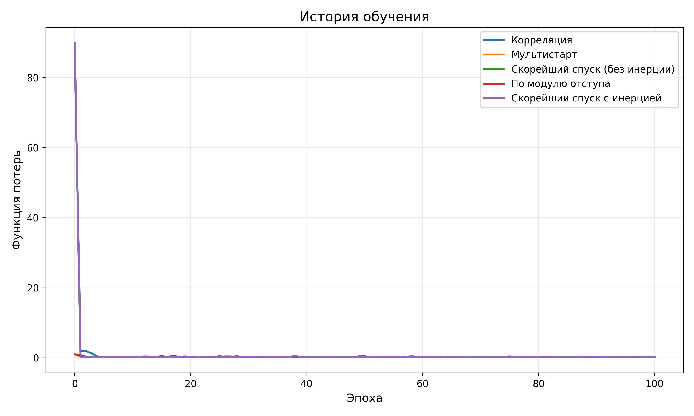
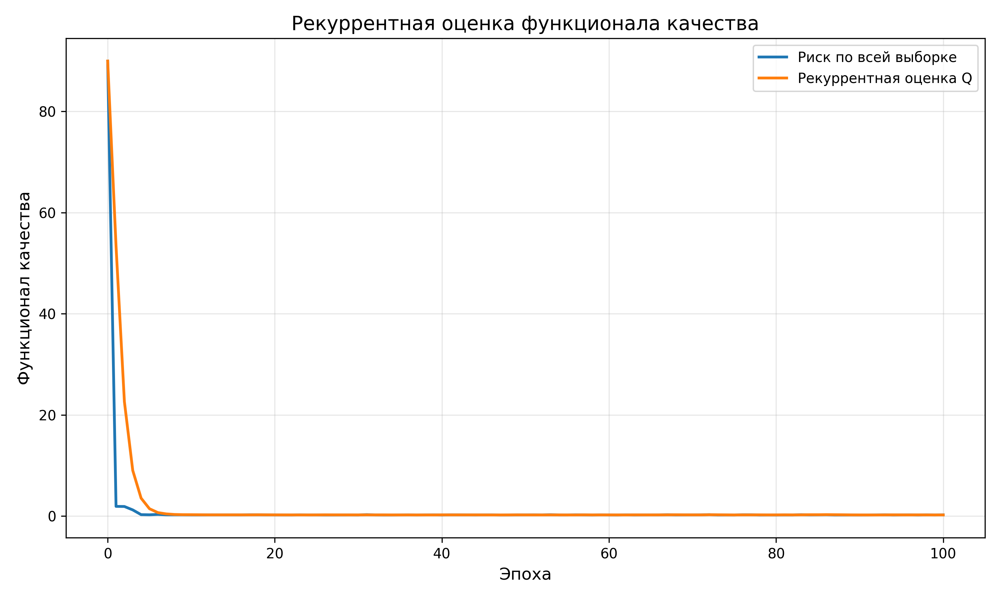
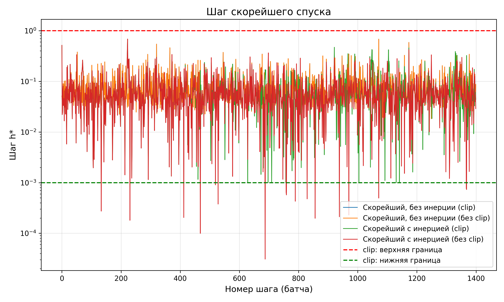
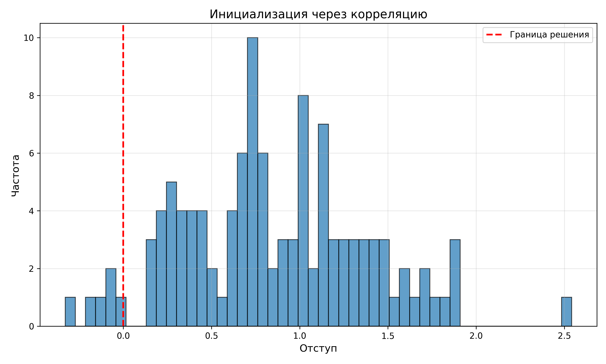
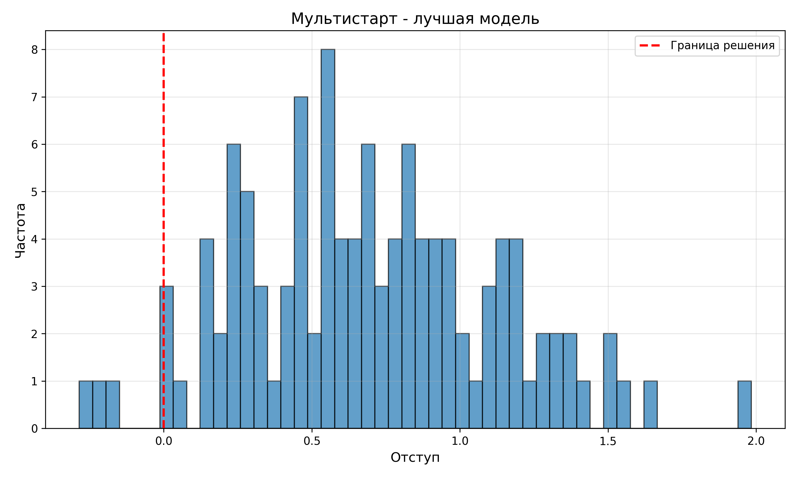
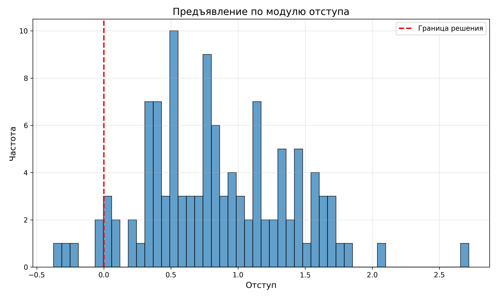
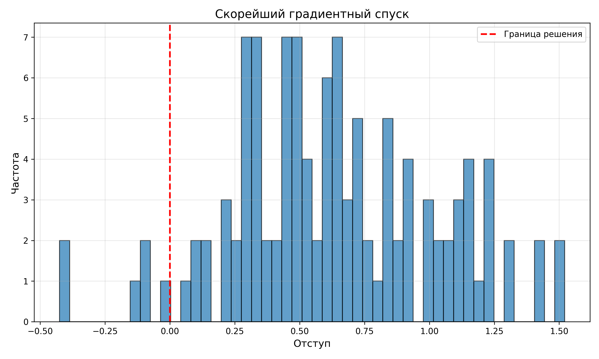

Лабораторная работа №1: Линейная классификация

Студент: Шошников С.В.

СУТЬ РАБОТЫ

Построить линейный классификатор, который по 30 измерениям опухоли предсказывает, злокачественная она или нет. Веса модели подбираются стохастическим градиентным спуском с инерцией, квадратичной функцией потерь и L2-регуляризацией. Сравниваются способы инициализации весов и способы выбора шага и объектов, результат сопоставляется с эталонной реализацией из sklearn.

ДАТАСЕТ

Breast Cancer Wisconsin (sklearn).
Объектов: 569 (455 train, 114 test, стратифицированное разбиение).
Признаков: 30.
Классов: 2 (злокачественная и доброкачественная опухоль), метки преобразованы в -1 и +1.
Признаки стандартизуются StandardScaler, обученным только на train.

МОДЕЛЬ И ФОРМУЛЫ

Линейный классификатор:

    a(x) = sign( w·x + b )

Отступ объекта (больше нуля - верная классификация, модуль - уверенность):

    M = y · (w·x + b)

Эмпирический риск: квадратичная функция потерь и L2-регуляризация:

    Q(w, b) = (1/n) · сумма_i (1 - M_i)^2  +  λ · ||w||^2

Градиент риска:

    dQ/dw = (1/n) · сумма_i [ -2 (1 - M_i) · y_i · x_i ]  +  2λ·w
    dQ/db = (1/n) · сумма_i [ -2 (1 - M_i) · y_i ]

Стохастический градиентный спуск с инерцией (градиент g считается по батчу из 32 объектов):

    v = γ·v + (1 - γ)·h·g
    w = w - v

Рекуррентная оценка функционала качества (экспоненциальное скользящее среднее потерь по батчам, не требует прохода по всей выборке):

    Q = λ_b · ε_batch + (1 - λ_b) · Q,     λ_b = |batch| / n

Параметры: шаг h = 0.1, γ = 0.9, λ = 0.001, 100 эпох.

РЕАЛИЗОВАННЫЕ МЕТОДЫ (по пунктам задания)

П.2. Отступ. Вычисляется для каждого объекта, строятся гистограммы отступов для каждого метода.

П.3. Градиент. Выведен аналитически и проверен сравнением с численным градиентом (центральные разности), максимальное расхождение около 4e-11.

П.4. Рекуррентная оценка Q. Считается по ходу обучения и сравнивается с точным риском по всей выборке.

П.5-6. SGD с инерцией и L2-регуляризацией. Множитель (1 - γ) в формуле инерции нормирует накопленный шаг; без него шаг в 1/(1 - γ) раз превышает задуманный.

П.7. Скорейший градиентный спуск. Риск батча вдоль направления (u_w, u_b) является параболой по шагу h:

    Q(h) = mean( (1 - M_i + h·y_i·s_i)^2 ) + λ·||w - h·u_w||^2,     s_i = <u_w, x_i> + u_b

Её минимум считается аналитически на каждом батче:

    h* = ( <g_w, u_w> + g_b·u_b ) / ( 2 · ( mean(s^2) + λ·||u_w||^2 ) )

Важно, чтобы направление, по которому минимизируется риск, совпадало с направлением, по которому делается шаг. Формула h* верна для шага w = w - h*·u. Если применить её к скорости с инерцией v = γ·v + (1 - γ)·h·g, это условие нарушается: первый шаг составляет лишь (1 - γ) = 10% от вычисленного, а следующие идут в направлении накопленной скорости, а не антиградиента. Поэтому реализованы два отдельных режима (параметр step_rule):

    'steepest' - скорейший спуск без инерции. Направление u = g (антиградиент батча), шаг w = w - h*·g.
                 Параметр γ в этом режиме не используется. h* - точный минимум риска батча вдоль фактического шага.
    'steepest_momentum' - скорейший спуск с инерцией. Направление - скользящее среднее градиентов
                 u = γ·u_prev + (1 - γ)·g, шаг w = w - h*·u, h* - точный минимум риска батча вдоль u, то есть
                 вдоль фактического направления движения. Если <g, u> <= 0 (инерция направлена против
                 градиента), инерция сбрасывается: u = g.

Режим 'constant' (п.5) - обычный SGD с инерцией и фиксированным шагом, как раньше.

Ограничение шага (clip). Шаг h* считается по батчу из 32 объектов при 31 параметре, поэтому он точен только для этого батча и может быть слишком большим или слишком малым для всей выборки. Для защиты от выбросов h* ограничивается отрезком [0.001, 1.0] (параметры lr_min, lr_max; clip_step=False отключает ограничение). Верхняя граница страхует от больших шагов, нижняя - от остановки обучения, когда направление почти ортогонально градиенту. Если знаменатель формулы почти нулевой (меньше 1e-12), используется фиксированный шаг learning_rate. Реальное влияние ограничения измерено и приведено в разделе «Скорейший спуск: проверка и эксперимент».

Неполный батч. При n = 455 и размере батча 32 последний батч эпохи состоит из 7 объектов. Точный шаг по 7 объектам при 31 параметре очень шумный, и именно он определяет итоговые веса эпохи. Для скорейшего спуска неполный батч отбрасывается (параметр drop_last=True, в остальных режимах поведение прежнее). Эффект измерен в таблице 10 запусков ниже.

П.8. Предъявление объектов по модулю отступа. Вероятность попасть в батч выше у объектов с малым |M| (около границы):

    p_i ~ exp( -|M_i| / T )

П.9.1. Инициализация через корреляцию. Для каждого признака отдельно берётся коэффициент одномерной регрессии на метку:

    w_j = <y, f_j> / <f_j, f_j>

П.9.2. Мультистарт. 5 запусков со случайными малыми весами, лучший выбирается по риску на обучающей выборке (тест в выборе не участвует).

П.9.3. Случайное предъявление (обычное перемешивание) и предъявление по модулю отступа (п.8).

П.10-11. Метрики качества и сравнение с эталоном из sklearn.

МЕТРИКИ КАЧЕСТВА

Из матрицы ошибок (TP, FP, FN, TN) считаются:

    accuracy  = (TP + TN) / n
    precision = TP / (TP + FP)
    recall    = TP / (TP + FN)
    F1        = 2 · precision · recall / (precision + recall)

РЕЗУЛЬТАТЫ

Точность на тесте (114 объектов):

    Корреляция (инициализация):  0.9474
    Мультистарт:                 0.9649
    Скорейший спуск (без инерции): 0.9561
    По модулю отступа:           0.9561
    sklearn SGDClassifier:       0.9035
    sklearn RidgeClassifier:     0.9474

Одна ошибка на тесте равна около 0.9%, поэтому разница между методами в 1-2 объекта не является статистически значимой.

Сравнение с эталоном (тест):

    Модель                           Accuracy  Precision  Recall   F1
    Своя реализация (корреляция)     0.9474    0.9342     0.9861   0.9595
    sklearn RidgeClassifier          0.9474    0.9342     0.9861   0.9595
    sklearn SGDClassifier            0.9035    0.9178     0.9306   0.9241

Эталон сравнивается на той же функции потерь (squared_error), коэффициенты регуляризации пересчитаны под формулу риска: alpha = 2·λ для SGDClassifier и alpha = n·λ для RidgeClassifier. Результат своей реализации совпадает с аналитическим решением RidgeClassifier.

Анализ:

- Мультистарт дал наилучший результат (96.49%). Запуск выбран по риску на обучении, поэтому точность на тесте честная. Риск квадратичный и выпуклый, поэтому запуски приходят почти в один минимум, и преимущество мультистарта в несколько объектов случайно.
- Скорейший спуск (режим без инерции, неполный батч отброшен) дал 95.61% на тесте, ошибок 5 из 114. Эксперимент пересчитан после исправления: раньше шаг, оптимальный вдоль антиградиента, применялся к скорости с инерцией γ = 0.9, и результат (94.74%) относился к другому, не скорейшему, алгоритму. Подробности в следующем разделе.
- Предъявление по модулю отступа дало 95.61% на тесте и самую высокую точность на обучении (97.36%). Риск сходится шумнее, так как объекты около границы попадают в батч чаще.

СКОРЕЙШИЙ СПУСК: ПРОВЕРКА И ЭКСПЕРИМЕНТ

Проверка формулы шага. На батче из 32 объектов риск вдоль -g пересчитывался на сетке шагов от 0 до 3·h*. Минимум на сетке совпадает с аналитическим h*, а при 0.9·h* и 1.1·h* риск выше:

    Старт (инициализация по корреляции): h* = 0.02500, минимум на сетке 0.02500.
        Риск батча: до шага 123.93, при h* 2.03, при 0.9·h* 3.25, при 1.1·h* 3.25.
    Обученная модель: h* = 0.08979, минимум на сетке 0.08979.
        Риск батча: при h* 0.15027, при 0.9·h* 0.15066, при 1.1·h* 0.15066.

Одиночные запуски (инициализация через корреляцию, seed 42, 100 эпох, 1400 шагов):

    Режим                                   Риск    Train   Test    Шагов с clip   h* (мин / медиана / макс)
    Без инерции, с clip                     0.2521  0.9692  0.9298  0 из 1400      0.0183 / 0.0613 / 0.6823
    Без инерции, без clip                   0.2521  0.9692  0.9298  -              0.0183 / 0.0613 / 0.6823
    С инерцией (γ = 0.9), с clip            0.2531  0.9582  0.9386  10 из 1400     0.0010 / 0.0513 / 0.6848
    С инерцией (γ = 0.9), без clip          0.2457  0.9648  0.9386  -              0.0000 / 0.0502 / 0.6848
    SGD без инерции, h = 0.01 (для сравн.)  0.2172  0.9714  0.9474  -              -

Ограничение clip на практике почти не срабатывает: в режиме без инерции ни разу, поэтому результаты с ним и без него совпадают; в режиме с инерцией 10 шагов из 1400 попали на нижнюю границу (без ограничения самые маленькие h* порядка 1e-5 - 1e-4, то есть почти нулевые шаги), качество при этом практически не меняется (тест 0.9386 в обоих случаях). Верхняя граница 1.0 в данном эксперименте не достигалась (максимум h* около 0.68).

Устойчивость к случайности. Точность на 114 тестовых объектах меняется на 1-3 объекта от запуска к запуску, поэтому один запуск ничего не доказывает. Результат 10 запусков (seed 0..9, остальные параметры те же):

    Метод                                          Риск (среднее / макс)   Test (среднее / мин)
    SGD с инерцией, h = 0.1, γ = 0.9               0.2285 / 0.2523         0.9614 / 0.9474
    SGD без инерции, h = 0.01                      0.2157 / 0.2221         0.9544 / 0.9474
    Скорейший, без инерции, с неполным батчем      0.2497 / 0.3771         0.9553 / 0.9386
    Скорейший, без инерции, без неполного батча    0.2294 / 0.2554         0.9561 / 0.9386
    Скорейший с инерцией, без неполного батча      0.2445 / 0.3469         0.9561 / 0.9298

Выводы по скорейшему спуску:

- Со скорейшим спуском не нужен подбор шага. Главное преимущество видно в начале: при инициализации по корреляции (начальный риск около 90) скорейший спуск за первую эпоху снижает риск с 90 до 0.34, обычному SGD с h = 0.1 и γ = 0.9 нужно четыре эпохи, чтобы дойти до 0.28 (риск на эпохах 1-3: 1.92, 1.89, 1.22). SGD без инерции с h = 0.1 из такой точки расходится (шаг велик для начального градиента), поэтому для сравнения взят h = 0.01.
- По итоговому качеству скорейший спуск не превосходит SGD с подобранным шагом: средний риск после 100 эпох у него выше (0.229-0.250 против 0.216-0.229), точность на тесте в среднем одинакова (0.955-0.961), различия меньше одной ошибки на 114 объектов и не значимы. Причина: шаг минимизирует риск одного батча, а не всей выборки, и итоговые веса шумят вслед за последними батчами (стохастический градиент не затухает).
- Исключение неполного батча заметно снижает разброс риска скорейшего спуска (максимум по 10 запускам 0.377 -> 0.255).
- Инерция в скорейшем спуске результата не улучшает (риск 0.2445 против 0.2294 без инерции): при шаге, оптимальном для текущего батча, дополнительное усреднение направлений дало в этом эксперименте не выигрыш, а чуть больший риск (причину отдельно не исследовали).

ГРАФИКИ

История обучения (риск по эпохам для пяти запусков):

Кривая «Скорейший спуск с инерцией» (режим steepest_momentum) добавлена для сравнения. Подписи на графике называют запуск по способу инициализации или выбора объектов. Кривая «Корреляция» это обычный SGD с инициализацией через корреляцию, а не отдельный метод оптимизации. Кривые «Корреляция», «Скорейший спуск» и «Скорейший спуск с инерцией» стартуют с риска около 90, потому что все используют инициализацию через корреляцию, то есть начинают из одной точки (поэтому синяя кривая закрыта остальными). Скорейший спуск сбрасывает риск с 90 до значений меньше 1 уже в первую эпоху, обычному SGD с инерцией (синяя кривая) нужно несколько эпох. «Мультистарт» и «По модулю отступа» стартуют со случайных малых весов, где отступы около нуля и риск около 1. Высокий стартовый риск корреляционной инициализации объясняется тем, что веса подбираются для каждого признака независимо, а признаки сильно связаны между собой, поэтому при сложении прогноз завышен. За 3-5 эпох все кривые приходят к значению около 0.2-0.3. Из-за пика на старте масштаб оси Y сжимает сходимость в плоскую линию у нуля.

Рекуррентная оценка Q:

Шаг скорейшего спуска по батчам (границы clip показаны пунктиром; кривые «без инерции» с clip и без него совпадают, поэтому верхняя из них закрывает нижнюю):

Оценка Q, посчитанная по батчам, следует за точным риском по всей выборке (0.2271 и 0.2372 на последней эпохе) без прохода по выборке. На первых эпохах она выше точного риска: она усредняет потери, посчитанные при прежних, худших весах.

Распределение отступов на тесте (красная линия - граница, левее неё ошибки):

Корреляция, ошибок 6 из 114:

Мультистарт (лучшая модель), ошибок 4 из 114:

По модулю отступа, ошибок 5 из 114:

Скорейший спуск (без инерции), ошибок 5 из 114:

ВЫВОДЫ

1. Реализован линейный классификатор с SGD, инерцией, L2-регуляризацией и квадратичной функцией потерь; аналитический градиент подтверждён численным.
2. Инициализация через корреляцию даёт детерминированный старт, но с завышенным начальным риском; обучение быстро его исправляет.
3. Мультистарт выбирает запуск по риску на обучении, поэтому тестовая выборка остаётся независимой.
4. Скорейший спуск требует согласования шага с направлением: шаг, оптимальный вдоль антиградиента, нельзя применять к скорости с инерцией. Реализованы два корректных режима (без инерции и с шагом, оптимальным вдоль фактического направления движения), формула проверена на сетке. Ограничение шага clip почти не срабатывает. Преимущество скорейшего спуска - быстрый выход из плохой начальной точки и отсутствие подбора шага, по итоговой точности он не лучше SGD с подобранным шагом.
5. Предъявление по модулю отступа работает без расходимости, риск сходится шумнее.
6. На одинаковой функции потерь собственная реализация совпадает с RidgeClassifier (94.74%); все методы отличаются на 1-5 объектов теста, что не значимо.

ЗАПУСК

    cd source
    python main.py

Графики сохраняются в текущей директории, метрики выводятся в консоль.
