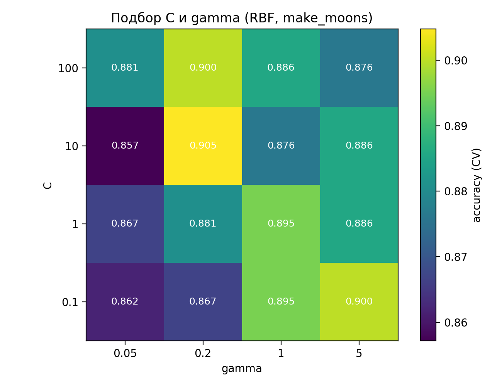
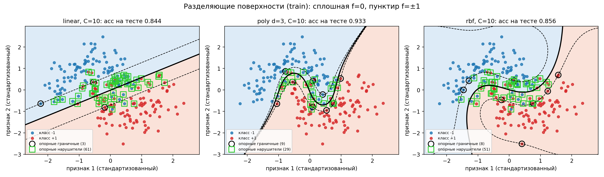
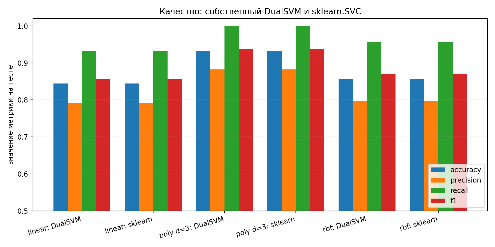
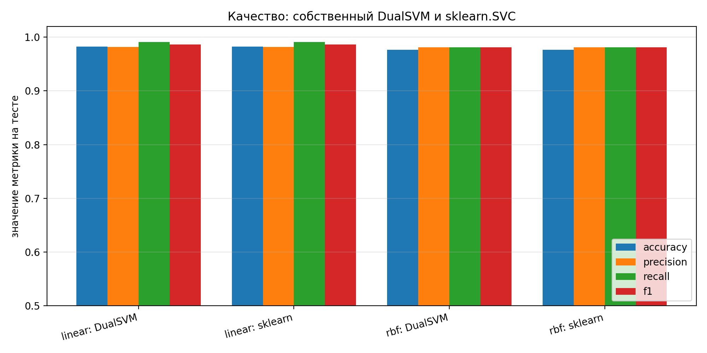
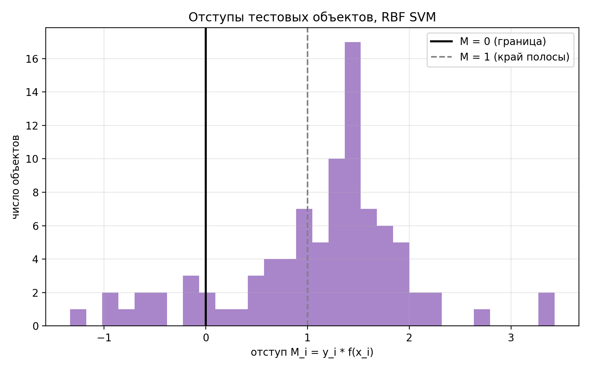
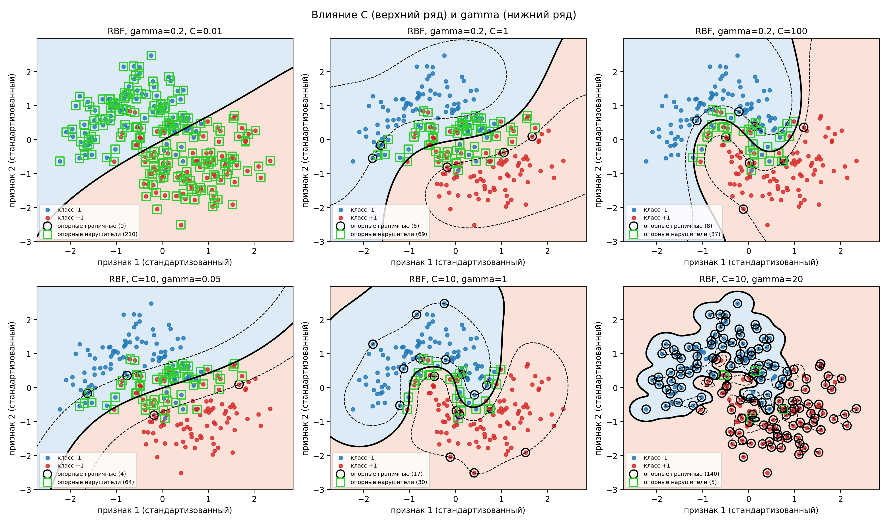

# Лабораторная работа №3. SVM

Студент: Шошников С.В.

## Цель работы

Реализовать метод опорных векторов через решение двойственной задачи по `lambda`, построить линейный классификатор, применить трюк с ядром для нелинейной классификации, визуализировать решение и сравнить с эталонной реализацией (`sklearn.svm.SVC`).

Обозначения (как в лекции):

```text
X^l = {(x_i, y_i)}, i = 1..l   - обучающая выборка;
x_i in R^n, y_i in {-1, +1}    - объекты и метки;
w in R^n, w0 in R              - параметры модели;
a(x) = sign(<w, x> - w0)       - линейный классификатор;
M_i = y_i (<w, x_i> - w0)      - отступ объекта x_i.
```

## Структура

```text
lab3/
├── README.md
├── svm_boundaries.png               - границы линейного / полиномиального / RBF SVM
├── svm_c_gamma.png                  - влияние C и gamma
├── svm_grid_cv.png                  - подбор C и gamma (CV)
├── rbf_margins.png                  - отступы тестовых объектов
├── svm_quality.png                  - сравнение метрик на make_moons
├── svm_quality_breast_cancer.png    - сравнение метрик на Breast Cancer
└── source/
    ├── kernels.py                   - ядра и проверка положительной полуопределённости
    ├── svm_dual.py                  - собственная реализация SVM (двойственная задача)
    ├── plots.py                     - визуализации
    └── main.py                      - сценарий эксперимента
```

## Запуск

```bash
cd source
python main.py
```

Графики сохраняются в каталог `lab3`. Датасеты загружаются из `sklearn.datasets` в момент запуска (в репозитории не хранятся). Время работы около 1-2 минут (подбор параметров через CV и решение QP через SLSQP). На Windows при ошибке кодировки консоли запускать с `PYTHONIOENCODING=utf-8`.

## Датасеты

1. `make_moons` (300 объектов, `noise = 0.25`, `random_state = 42`). Двумерный и нелинейно разделимый: можно нарисовать границу и наглядно показать разницу между линейным и ядерным SVM. Разбиение 210 / 90, стратифицированное.
2. Breast Cancer Wisconsin (`load_breast_cancer`): 569 объектов, 30 признаков, два класса. Реальные данные для проверки в многомерном случае. Разбиение 398 / 171.

Метки приводятся к `{-1, +1}`. Признаки стандартизируются по статистикам train.

## Теория

### Постановка

Для линейно разделимой выборки ищется гиперплоскость с максимальным зазором. Полоса между `<w, x> - w0 = -1` и `<w, x> - w0 = +1` имеет ширину `2 / ||w||`, поэтому максимизация зазора эквивалентна минимизации `||w||`:

```text
(1/2) ||w||^2 -> min,   M_i >= 1, i = 1..l.
```

Если выборка линейно неразделима, вводятся штрафы `xi_i >= 0` (допустимые нарушения отступа):

```text
(1/2) ||w||^2 + C sum_i xi_i -> min,   M_i >= 1 - xi_i,  xi_i >= 0.
```

Эквивалентная безусловная форма: `(1/2)||w||^2 + C sum_i (1 - M_i)_+ -> min`, где `(1 - M)_+` - кусочно-линейная функция потерь (hinge loss), гладкая мажоранта пороговой функции потерь `[M < 0]`. Коэффициент `C` задаёт компромисс между шириной полосы и числом/величиной нарушений: большой `C` - жёсткий штраф (граница подстраивается под данные), малый `C` - широкая полоса, много нарушителей.

### Двойственная задача

Лагранжиан и условия KKT дают:

```text
w = sum_i lambda_i y_i x_i,    sum_i lambda_i y_i = 0,    0 <= lambda_i <= C,
```

и двойственную задачу, которая решается в коде:

```text
-L(lambda) = -sum_i lambda_i + (1/2) sum_i sum_j lambda_i lambda_j y_i y_j <x_i, x_j>  ->  min_lambda
sum_i lambda_i y_i = 0,   0 <= lambda_i <= C.
```

Это задача квадратичного программирования с линейным ограничением-равенством и ограничениями-неравенствами (границами). Условия дополняющей нежёсткости:

```text
lambda_i = 0        =>  M_i >= 1,   xi_i = 0
0 < lambda_i < C    =>  M_i = 1,    xi_i = 0
lambda_i = C        =>  M_i <= 1,   xi_i = 1 - M_i
```

### Типы объектов

* периферийные: `lambda_i = 0`, `M_i >= 1`, не влияют на решение;
* опорные граничные: `0 < lambda_i < C`, `M_i = 1`, лежат ровно на границе полосы;
* опорные нарушители: `lambda_i = C`, `M_i < 1`, `xi_i > 0` (внутри полосы или по ту сторону границы).

Опорным называется объект с `lambda_i != 0`: только такие объекты входят в сумму `w = sum lambda_i y_i x_i`, от этого и название метода. Нарушитель может быть классифицирован правильно, если `0 <= M_i < 1` (он внутри полосы, но по правильную сторону от `f = 0`); неправильно классифицирован он только при `M_i < 0`, то есть `xi_i > 1`.

### Свободный член

Для любого опорного граничного объекта (`0 < lambda_i < C`, `M_i = 1`) выполнено `w0 = <w, x_i> - y_i`. В реализации `w0` усредняется по всем таким объектам. Нарушители (`M_i < 1`) для этого не подходят. Если граничных векторов нет (например, при очень малом `C` все опорные объекты - нарушители, график `C = 0.01` на `svm_c_gamma.png`), `w0` из KKT определён лишь отрезком допустимых значений: берётся его середина (см. `_compute_w0`).

### Трюк с ядром

В двойственной задаче и в решающем правиле объекты входят только через скалярные произведения, поэтому `<x, x'>` заменяется на ядро `K(x, x')`:

```text
a(x) = sign( sum_i lambda_i y_i K(x_i, x) - w0 ),
w0 = sum_j lambda_j y_j K(x_j, x_i) - y_i   для 0 < lambda_i < C.
```

Ядро - функция `K(x, x') = <psi(x), psi(x')>` для некоторого спрямляющего отображения `psi` в пространство `H`. Разделяющая гиперплоскость строится в `H`, но `psi` явно не вычисляется (пространство может быть очень большим или бесконечномерным). Соответственно, при нелинейном ядре формула `w = sum lambda_i y_i x_i` неприменима: вектор `w` живёт в `H` (`w = sum lambda_i y_i psi(x_i)`), и явно он не нужен. В `DualSVM` свойство `w_` доступно только для линейного ядра.

Требования к ядру: симметричность `K(x, x') = K(x', x)` и неотрицательная определённость, то есть матрица Грама `[K(x_i, x_j)]` положительно полуопределена для любой выборки (теорема Мерсера). Одной симметрии недостаточно. Значения ядра не обязаны быть неотрицательными (например, линейное ядро принимает отрицательные значения). В коде проверяется минимальное собственное значение матрицы Грама.

Конструктивные способы получения ядер (из допустимых `K1`, `K2`): `a K1` (`a > 0`), `K1 + K2`, `K1 * K2`, `f(x) f(x') ` для любой функции `f`, `K1(phi(x), phi(x'))`, `p(K1)` для полинома с неотрицательными коэффициентами, `exp(K1)`. Например, полиномиальное ядро - степень суммы линейного ядра и константы, а RBF получается как `exp(-gamma ||x||^2) exp(-gamma ||x'||^2) exp(2 gamma <x, x'>)`.

Реализованные ядра:

```text
линейное:        K(x, x') = <x, x'>
полиномиальное:  K(x, x') = (<x, x'> + 1)^3
RBF (гауссово):  K(x, x') = exp(-gamma ||x - x'||^2)
```

Параметры: `gamma` определяет масштаб влияния одного объекта (малый `gamma` - гладкая, почти линейная граница; большой - граница обегает отдельные точки, переобучение), `C` - строгость штрафа за нарушения.

## Реализация

`DualSVM` (`source/svm_dual.py`):

* матрица `Q_ij = y_i y_j K(x_i, x_j)`;
* `scipy.optimize.minimize(method="SLSQP")` минимизирует `(1/2) lambda^T Q lambda - sum lambda` с аналитическим градиентом `Q lambda - 1`, границами `[0, C]` и ограничением `lambda^T y = 0`;
* значения `lambda` с точностью до `1e-6 C` округляются до `0` и `C` (численная реализация условий `lambda_i = 0`, `lambda_i = C`);
* определяются типы объектов, вычисляется `w0`, решающая функция `f(x) = sum lambda_i y_i K(x_i, x) - w0`;
* `sign(0)` лекцией не определён, в коде `f(x) = 0` относится к классу `+1`.

Эталон: `sklearn.svm.SVC` с теми же `kernel`, `C`, `gamma`, `degree`, `coef0`. Эталон используется только для сравнения.

## Результаты

### Подбор параметров (make_moons)

Сетка `C in {0.1, 1, 10, 100}` x `gamma in {0.05, 0.2, 1, 5}`, 5-fold CV на train, собственный SVM с RBF-ядром. Лучшие параметры: `C = 10`, `gamma = 0.2` (CV accuracy 0.905). Те же `C = 10` для остальных ядер.



Допустимость ядер: матрицы Грама линейного, полиномиального и RBF-ядер положительно полуопределены (проверено на train).

### Решение (make_moons)



Сплошная линия - `f = 0`, пунктир - `f = +-1`. Чёрным кружком выделены опорные граничные объекты, зелёным квадратом - опорные нарушители.

Линейный SVM не может повторить изогнутую границу: `w = (0.854, -1.443)`, ширина полосы `2/||w|| = 1.193`, 3 граничных и 61 нарушитель. Нелинейные ядра строят изогнутую границу в исходном пространстве.

### Сравнение с эталоном

make_moons, тест (90 объектов), `C = 10`:

| Модель | Accuracy | Precision | Recall | F1 | Опорных |
|---|---:|---:|---:|---:|---:|
| linear, DualSVM | 0.8444 | 0.7925 | 0.9333 | 0.8571 | 64 |
| linear, sklearn | 0.8444 | 0.7925 | 0.9333 | 0.8571 | 64 |
| poly d=3, DualSVM | 0.9333 | 0.8824 | 1.0000 | 0.9375 | 38 |
| poly d=3, sklearn | 0.9333 | 0.8824 | 1.0000 | 0.9375 | 38 |
| rbf, DualSVM | 0.8556 | 0.7963 | 0.9556 | 0.8687 | 59 |
| rbf, sklearn | 0.8556 | 0.7963 | 0.9556 | 0.8687 | 59 |

Breast Cancer, тест (171 объект), `C = 1`, `gamma = 1/30`:

| Модель | Accuracy | Precision | Recall | F1 | Опорных |
|---|---:|---:|---:|---:|---:|
| linear, DualSVM | 0.9825 | 0.9815 | 0.9907 | 0.9860 | 31 |
| linear, sklearn | 0.9825 | 0.9815 | 0.9907 | 0.9860 | 31 |
| rbf, DualSVM | 0.9766 | 0.9813 | 0.9813 | 0.9813 | 91 |
| rbf, sklearn | 0.9766 | 0.9813 | 0.9813 | 0.9813 | 91 |




Собственная реализация совпадает с эталоном: одинаковые метрики, 100% совпадение предсказаний, одинаковое число опорных векторов, `w0` совпадает до 3-4 знаков, максимальное расхождение решающей функции `|f_own - f_sklearn|` на тесте не больше 0.015. Малые расхождения объясняются разной точностью QP-солверов (SLSQP и SMO в libsvm).

Замечание: на make_moons у полиномиального ядра accuracy выше, чем у RBF (0.933 против 0.856), хотя параметры подбирались для RBF. Тест из 90 объектов, одна ошибка - это 1.1 п.п., поэтому различие в несколько объектов нельзя считать значимым (CV accuracy RBF на train - 0.905). На Breast Cancer классы почти линейно разделимы, поэтому линейное ядро не уступает RBF.

### Отступы



RBF SVM, тест: `min M = -1.335`, `mean M = 1.129`, объектов с `M < 0` (ошибок) - 13 из 90. Большинство объектов лежит за пределами полосы (`M >= 1`).

### Влияние C и gamma



| Параметры (RBF) | Accuracy train | Accuracy test | Опорных |
|---|---:|---:|---:|
| gamma = 0.2, C = 0.01 | 0.867 | 0.822 | 210 |
| gamma = 0.2, C = 1 | 0.886 | 0.867 | 74 |
| gamma = 0.2, C = 100 | 0.914 | 0.911 | 45 |
| C = 10, gamma = 0.05 | 0.881 | 0.867 | 68 |
| C = 10, gamma = 1 | 0.933 | 0.911 | 47 |
| C = 10, gamma = 20 | 0.986 | 0.922 | 145 |

* Малое `C`: широкая полоса, все 210 объектов - нарушители (граница почти линейная, недообучение). С ростом `C` нарушителей становится меньше, граница точнее следует данным.
* Малое `gamma`: почти линейная граница. Большое `gamma` (20): граница обегает отдельные точки, accuracy на train 0.986, число опорных векторов растёт до 145, то есть переобучение; на тесте при этом не лучше, чем при `gamma = 1`.

## Ответы на вопросы для защиты

Краткие ответы по теории даны выше в разделе «Теория». Привязка к программе:

* двойственная задача и ограничения `lambda`: `DualSVM.fit` в `source/svm_dual.py` (`minimize`, `bounds`, `constraints`);
* типы объектов: атрибуты `support_`, `boundary_`, `violators_`;
* `w0`: `DualSVM._compute_w0`;
* решающее правило: `DualSVM.decision_function` (используются только опорные объекты);
* ядра и проверка допустимости: `source/kernels.py`;
* отступы: `DualSVM.margins`, график `rbf_margins.png`.

## Соответствие пунктам задания

| Пункт | Реализация |
|---|---|
| Датасет для бинарной классификации | `make_moons`, Breast Cancer |
| Решение двойственной задачи по lambda | `DualSVM`, `scipy.optimize.minimize` (SLSQP) |
| Трюк с ядром | `kernels.py`, `DualSVM(kernel="poly" / "rbf")` |
| Линейный классификатор | `DualSVM(kernel="linear")`, вектор `w` |
| Визуализация решения | `svm_boundaries.png`, `svm_c_gamma.png`, `rbf_margins.png`, `svm_grid_cv.png` |
| Сравнение с эталоном | `sklearn.svm.SVC`, таблицы выше, `svm_quality*.png` |

## Выводы

1. Двойственная задача (QP по `lambda` с ограничениями `0 <= lambda_i <= C`, `sum lambda_i y_i = 0`) решена через SLSQP; собственная реализация совпала с `sklearn.SVC` на обоих датасетах.
2. Решение определяется только опорными объектами (`lambda_i != 0`): на make_moons их 18-30% выборки, на Breast Cancer 8-23%.
3. Линейный SVM не справляется с нелинейно разделимыми данными (make_moons, accuracy 0.844). Трюк с ядром позволяет строить нелинейную границу без явного перехода в спрямляющее пространство.
4. `C` управляет штрафом за нарушения (малое - недообучение, большое - подстройка под данные), `gamma` - гладкостью границы (большое - переобучение). Параметры выбраны кросс-валидацией на train, тест в выборе не участвовал.
5. На реальных данных со слабой нелинейностью (Breast Cancer) линейное ядро даёт тот же результат, что RBF (0.98), при меньшем числе опорных векторов.
