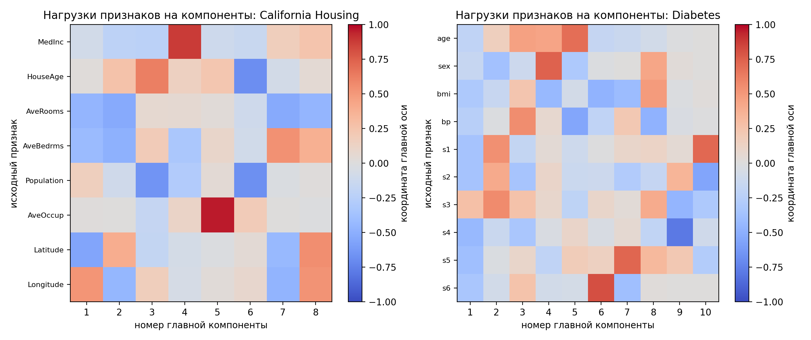
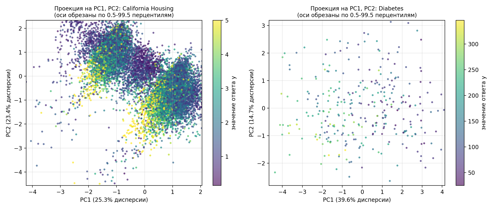
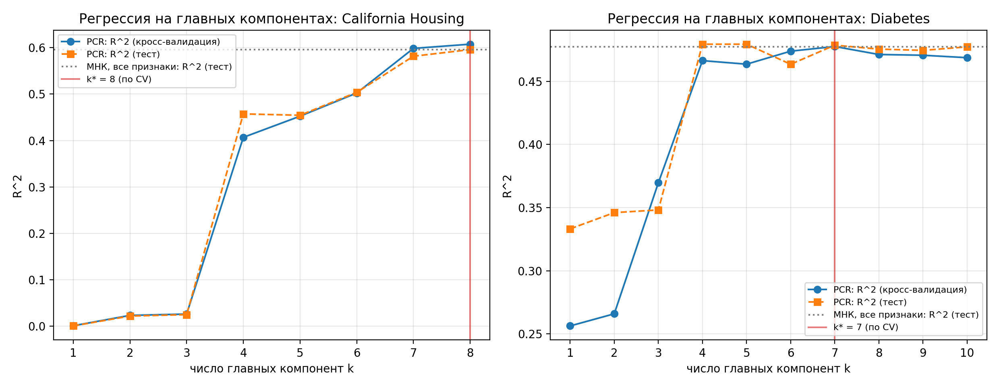
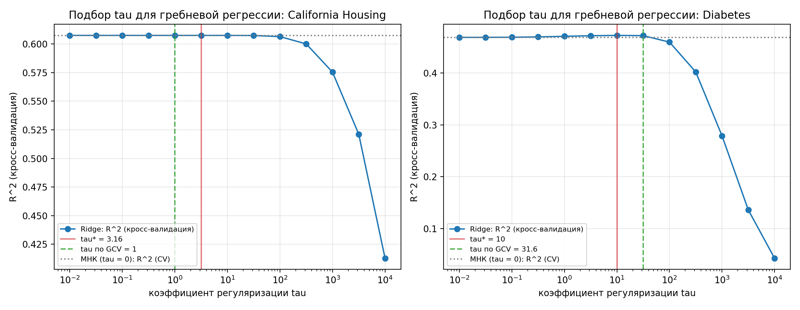

# Лабораторная работа №4. PCA

Студент: Шошников С.В.

## Цель работы

Реализовать метод главных компонент (PCA) через сингулярное разложение, определить эффективную размерность выборки, показать эквивалентность с `sklearn.decomposition.PCA` и проверить, как PCA и SVD связаны с линейной регрессией (МНК, гребневая регрессия, регрессия на главных компонентах).

## Структура

```text
lab4/
├── README.md
├── pca_correlations.png     - корреляции признаков
├── pca_spectrum.png         - спектр и ошибка восстановления E_m
├── pca_loadings.png         - нагрузки признаков на компоненты
├── pca_projection.png       - проекция на две главные компоненты
├── regression_pcr.png       - R^2 регрессии на главных компонентах
├── regression_ridge.png     - подбор tau для гребневой регрессии
└── source/
    ├── pca.py               - собственная PCA и критерии размерности
    ├── regression.py        - МНК / Ridge / PCR через SVD, кросс-валидация
    ├── plots.py             - графики
    └── main.py              - эксперименты
```

## Запуск

```bash
cd source
python main.py
```

Датасеты загружаются из `sklearn.datasets` при запуске (California Housing скачивается и кэшируется, в репозитории данных нет). Графики сохраняются в каталог `lab4`. Время работы около минуты. На Windows при ошибке кодировки консоли запускать с `PYTHONIOENCODING=utf-8`.

## Датасеты

Разбиение 70 / 30 (`random_state = 42`). Среднее и стандартное отклонение признаков считаются только по обучающей выборке и применяются к тесту.

| Датасет | Объектов (train / test) | Признаков | Ответ y |
|---|---|---|---|
| California Housing | 14448 / 6192 | 8 | медианная стоимость жилья в районе |
| Diabetes | 309 / 133 | 10 | прогрессирование болезни через год |

Оба датасета подходят для линейной регрессии и содержат коррелированные признаки (корреляции на train):

* California: Latitude и Longitude -0.923, AveRooms и AveBedrms +0.846; cond(X) = 6.6;
* Diabetes: s1 и s2 +0.891, s3 и s4 -0.733; cond(X) = 20.4.


## Теория

### Регрессия и МНК

Задача регрессии отличается от классификации тем, что ответ `y` вещественный. Многомерная линейная регрессия предсказывает `y` как линейную функцию признаков: `a(x) = <x, w>` (свободный член удобно получить центрированием).

МНК минимизирует остаточную сумму квадратов `RSS(w) = ||F w - y||^2`, где `F` - матрица объекты-признаки. Приравнивая градиент к нулю, получаем нормальную систему `F^T F w = F^T y`, откуда `w = (F^T F)^{-1} F^T y`. Эта запись применима только при невырожденной `F^T F`. Если признаки линейно зависимы (или почти зависимы), `F^T F` вырождена или плохо обусловлена: мультиколлинеарность делает коэффициенты неустойчивыми (малое изменение данных сильно меняет `w`), хотя качество на обучении может быть хорошим.

### SVD и МНК

Сингулярное разложение `F = V D U^T`: `U` (`n x n`) и `V` - ортогональные, `D` - диагональная с сингулярными числами `sqrt(lambda_1) >= ... >= sqrt(lambda_n) >= 0`, где `lambda_j` - собственные значения `F^T F`. Решение МНК выражается через разложение без обращения `F^T F`:

```text
w = U D^{-1} V^T y = sum_j (v_j^T y / sqrt(lambda_j)) u_j,       ||w||^2 = sum_j (v_j^T y)^2 / lambda_j.
```

Малые `lambda_j` попадают в знаменатель и раздувают `w`: это и есть влияние плохой обусловленности. Нормальная система возводит матрицу в квадрат: `cond(F^T F) = cond(F)^2` (в эксперименте на Diabetes 20.4 против 417.9), поэтому SVD численно надёжнее. Нулевые сингулярные числа отбрасываются (псевдообратная матрица).

### Гребневая регрессия и PCR

Ridge добавляет штраф `tau ||w||^2`: `w = (F^T F + tau I)^{-1} F^T y`. В базисе SVD это сводится к замене `lambda_j` на `lambda_j + tau`, то есть к множителям `f_j = lambda_j / (lambda_j + tau)` перед каждой компонентой решения. Параметр `tau` сжимает коэффициенты вдоль направлений с малой дисперсией. Регрессия на главных компонентах (PCR) использует множители `f_j = 1` при `j <= k` и `0` иначе, то есть жёстко отбрасывает малые компоненты. МНК соответствует `f_j = 1`. Все три метода реализованы одним классом `SVDRegression` с разным фильтром. Эффективное число степеней свободы Ridge определяется следом матрицы сглаживания: `df(tau) = sum_j lambda_j / (lambda_j + tau)`. Для PCR аналогичная величина равна `k`. Параметры (`tau`, `k`) подбираются кросс-валидацией на обучающей выборке. Для `tau` также реализована обобщённая кросс-валидация, которой не нужно разбиение на блоки: `GCV(tau) = ||y - y_hat||^2 / (n - 1 - tr H)^2`, где `tr H = sum_j f_j` - то же эффективное число степеней свободы.

### Постановка PCA

Нужно заменить `n` исходных признаков на `m < n` новых так, чтобы по новым признакам можно было как можно точнее восстановить исходные. Ищется ортонормированный базис (матрица `U`), минимизирующий ошибку восстановления

```text
||F - F U_m U_m^T||^2 -> min,        G = F U_m - новые признаки,   F_hat = G U_m^T - приближённое восстановление.
```

PCA - обучение без учителя: ответ `y` в постановке не участвует, поэтому даже для датасета, выбранного под регрессию, компоненты строятся только по признакам.

### PCA через SVD

Если `F = V D U^T` (признаки центрированы), то столбцы `U` - главные компоненты (собственные векторы `F^T F`), `lambda_j = d_j^2` - их собственные значения, дисперсия вдоль `j`-й оси равна `lambda_j / (n - 1)`. Новые признаки `G = F U = V D` некоррелированы. Оптимальное приближение ранга `m` - усечённое разложение (теорема Эккарта-Янга), его ошибка равна сумме отброшенных `lambda_j`:

```text
E_m = ||F - F_hat_m||^2 / ||F||^2 = (lambda_{m+1} + ... + lambda_n) / (lambda_1 + ... + lambda_n).
```

Доля сохранённой дисперсии - `1 - E_m`.

В `numpy.linalg.svd` порядок матриц другой, чем в лекции: `F = U_np diag(s) Vt`. Соответствие: строки `Vt` - главные оси (столбцы `U` лекции), `s_j^2 = lambda_j`, `U_np` соответствует `V` лекции.

### Эффективная размерность

Эффективная размерность выборки - наименьшее `m`, при котором `E_m <= eps`. Использованы:

* порог по ошибке: `eps = 0.05` (основной) и `eps = 0.01`;
* крутой склон: первое `m`, на котором ошибка падает не менее чем в 3 раза, `E_{m-1} / E_m >= 3` (эвристика; максимум отношения брать нельзя, потому что `E_m -> 0` и в хвосте отношения всегда растут);
* критерий Кайзера: число компонент с дисперсией выше средней (для стандартизованных данных около 1) - ответ на вопрос, сколько осей несут структуру.

### Центрирование и масштабирование

Центрирование нужно, чтобы первая ось описывала разброс данных, а не положение центра облака; без него первая компонента почти совпала бы с вектором среднего. Масштабирование (стандартизация) нужно, когда признаки измеряются в разных единицах: иначе компонента с самой большой дисперсией (например, Population у California) подавила бы остальные. Среднее и масштаб оцениваются по train и применяются к test (иначе информация из теста просачивается в обучение). Мы используем те же статистики train при `transform` на тесте и при кросс-валидации внутри блоков.

### Знак компонент

Вектор `v` и `-v` задают одну и ту же ось, а SVD определено с точностью до знака каждой пары `(u_j, v_j)`. Поэтому знаки компонент у двух корректных реализаций могут различаться; sklearn дополнительно фиксирует знак (`svd_flip`). При сравнении мы выравниваем знаки и показываем, что после этого расхождение нулевое.

## Реализация

* `PCASVD` (`source/pca.py`): центрирует `X`, вызывает `numpy.linalg.svd`, хранит `mean_`, `components_`, `singular_values_`, `explained_variance_ = s^2/(n-1)` и `explained_variance_ratio_`; методы `transform`, `inverse_transform`, `residual_share` (`E_m`); функции `effective_dimension`, `steep_slope`, `kaiser`.
* `SVDRegression` (`source/regression.py`): стандартизация и центрирование внутри `fit`, решение `w = V diag(f_j / s_j) U^T y`; отбрасывание нулевых сингулярных чисел; `degrees_of_freedom` - след матрицы сглаживания. `cv_scores` - 5-fold кросс-валидация R^2.
* `gcv_scores` (`source/regression.py`): GCV для подбора `tau` по одному SVD.
* Эталоны (только для сравнения): `sklearn.decomposition.PCA`, `LinearRegression`, `Ridge`, `PCA + LinearRegression`.

## Результаты

### Проверка свойств разложения

| Свойство | California | Diabetes |
|---|---:|---:|
| ортонормированность осей, max abs(V V^T - I) | 1.6e-15 | 7.8e-16 |
| некоррелированность проекций, max abs corr | 5.2e-15 | 2.3e-15 |
| дисперсия проекций = s^2/(n-1) | 3.6e-15 | 4.0e-15 |
| восстановление по всем осям | 1.2e-13 | 2.9e-15 |

Ошибка восстановления, посчитанная напрямую `||X - X_k||^2 / ||X||^2`, совпала с `E_k` из собственных значений (например, California, `k = 4`: 0.223741 в обоих случаях).

### Эквивалентность с `sklearn.decomposition.PCA`

Максимальное расхождение `PCA(svd_solver="full")` и собственной реализации на одних и тех же данных:

| Что сравниваем | California | Diabetes |
|---|---:|---:|
| `mean_` | 0 | 0 |
| `singular_values_` | 0 | 0 |
| `explained_variance_` | 0 | 0 |
| `explained_variance_ratio_` | 2.8e-17 | 2.8e-17 |
| `components_` после выравнивания знаков | 0 | 0 |
| `transform` на тесте | 7.1e-15 | 8.9e-16 |
| `inverse_transform` (k = 2, середина, n-1) | не более 4.0e-15 | не более 8.9e-16 |

Знак отличался у 4 из 8 компонент (California) и у 2 из 10 (Diabetes) до выравнивания; это не ошибка (см. теорию). Точные нули объясняются тем, что обе реализации вызывают один и тот же LAPACK через `numpy.linalg.svd`.

### Эффективная размерность

California Housing:

| m | 1 | 2 | 3 | 4 | 5 | 6 | 7 | 8 |
|---|---|---|---|---|---|---|---|---|
| доля дисперсии | 0.253 | 0.234 | 0.159 | 0.130 | 0.126 | 0.082 | 0.010 | 0.006 |
| E_m | 0.747 | 0.513 | 0.353 | 0.224 | 0.098 | 0.016 | 0.006 | 0.000 |

Diabetes:

| m | 1 | 2 | 3 | 4 | 5 | 6 | 7 | 8 | 9 | 10 |
|---|---|---|---|---|---|---|---|---|---|---|
| доля дисперсии | 0.396 | 0.147 | 0.126 | 0.098 | 0.068 | 0.060 | 0.054 | 0.044 | 0.008 | 0.001 |
| E_m | 0.604 | 0.457 | 0.332 | 0.233 | 0.165 | 0.106 | 0.052 | 0.009 | 0.001 | 0.000 |

| Критерий | California | Diabetes |
|---|---:|---:|
| `E_m <= 0.05` | 6 | 8 |
| `E_m <= 0.01` | 7 | 8 |
| крутой склон (падение в 3 раза) | 6 | 8 |
| Кайзер | 5 | 3 |


Эффективная размерность California равна 6 из 8, Diabetes - 8 из 10: в обоих случаях две последние компоненты несут около 1-2% дисперсии и порождены сильной корреляцией пар признаков (Latitude и Longitude, AveRooms и AveBedrms; s1 и s2). Критерий Кайзера отвечает на другой вопрос (сколько осей выше среднего уровня) и даёт меньшие числа, поэтому критерии не обязаны совпадать.




На California видно, что PCA чувствителен к выбросам: в необрезанной проекции облако сжато в точку из-за нескольких районов с аномальными значениями (потому на графике оси обрезаны по 0.5-99.5 перцентилям). Пятая компонента почти целиком совпадает с признаком AveOccup (его выбросы не коррелируют с остальными признаками).

### Регрессия

Параметры подбирались 5-fold кросс-валидацией на train (стандартизация внутри блоков), тест использован один раз.

California Housing:

| Модель | R^2 тест | RMSE тест | `||w||` | след сглаживания |
|---|---:|---:|---:|---:|
| МНК (все признаки) | 0.5958 | 0.7284 | 1.582 | 8.000 |
| Ridge (`tau` = 3.16) | 0.5958 | 0.7283 | 1.578 | 7.992 |
| PCR (`k` = 8) | 0.5958 | 0.7284 | 1.582 | 8.000 |

Diabetes:

| Модель | R^2 тест | RMSE тест | `||w||` | след сглаживания |
|---|---:|---:|---:|---:|
| МНК (все признаки) | 0.4773 | 53.12 | 69.85 | 10.000 |
| Ridge (`tau` = 10) | 0.4781 | 53.08 | 42.68 | 8.621 |
| PCR (`k` = 7) | 0.4786 | 53.05 | 41.78 | 7.000 |

R^2 регрессии на главных компонентах в зависимости от числа компонент `k`:

| k | 1 | 2 | 3 | 4 | 5 | 6 | 7 | 8 | 9 | 10 |
|---|---|---|---|---|---|---|---|---|---|---|
| California, CV | 0.001 | 0.024 | 0.026 | 0.407 | 0.452 | 0.502 | 0.598 | 0.607 | | |
| California, тест | 0.001 | 0.022 | 0.025 | 0.457 | 0.454 | 0.504 | 0.582 | 0.596 | | |
| Diabetes, CV | 0.256 | 0.266 | 0.370 | 0.466 | 0.464 | 0.474 | 0.478 | 0.471 | 0.471 | 0.469 |
| Diabetes, тест | 0.333 | 0.346 | 0.348 | 0.479 | 0.479 | 0.464 | 0.479 | 0.476 | 0.474 | 0.477 |




Подбор `tau` обобщённой кросс-валидацией даёт близкие значения: California - `tau = 1` (5-fold CV: 3.16), Diabetes - `tau = 31.6` (5-fold CV: 10). Кривые качества на плато плоские, поэтому оба значения лежат в области, где R^2 почти не меняется (на графике GCV показан зелёной пунктирной линией).

Выводы по регрессии:

* На Diabetes мультиколлинеарность (s1 и s2) заметна: коэффициенты МНК велики (`||w|| = 69.9`), Ridge и PCR сжимают их до 42-43 и немного улучшают качество (R^2 0.477 -> 0.478-0.479; разница в пределах шума). На California корреляции слабее (cond(X) = 6.6), регуляризация не нужна: `tau* = 3.16` почти не меняет решение, `k* = 8` (все компоненты).
* Высокая доля сохранённой дисперсии не гарантирует сохранения информации об ответе: на California первые три компоненты (около 65% дисперсии) дают R^2 около 0 (они описывают географию и размеры жилья), а резкий скачок происходит на четвёртой (MedInc, 13% дисперсии), и ещё +0.1 к R^2 даёт седьмая компонента с долей дисперсии 1%. Поэтому число компонент для регрессии нужно выбирать по кросс-валидации, а не по доле дисперсии.

### Эквивалентность регрессии с эталонами

Максимальные расхождения (коэффициенты в стандартизованном пространстве и предсказания на тесте):

| Что сравниваем | California | Diabetes |
|---|---:|---:|
| МНК через SVD и нормальная система, коэффициенты | 1.4e-15 | 3.3e-13 |
| `cond(F)` / `cond(F^T F)` | 6.6 / 43.0 | 20.4 / 417.9 |
| МНК и `LinearRegression`, коэффициенты / предсказания | 4.2e-15 / 1.4e-13 | 3.4e-14 / 1.4e-13 |
| Ridge и `sklearn.Ridge`, коэффициенты / предсказания | 6.7e-15 / 1.4e-13 | 1.8e-13 / 2.3e-13 |
| PCR и `PCA + LinearRegression`, предсказания | 1.3e-13 | 1.7e-13 |

### Линейно зависимые признаки (синтетика)

Пример из 7 признаков: три скрытых фактора, смешанных ортогональной матрицей, шум 0.05 и последний признак равен точной сумме двух других. Собственные значения: `3.662 1.826 1.420 0.096 0.004 0.004 0.001`; эффективная размерность по порогу и по крутому склону равна 3 (`E_3 = 0.015`). Без шума ранг матрицы равен 3, четыре сингулярных числа обращаются в ноль, но PCA и МНК через SVD (с отбрасыванием нулевых сингулярных чисел) работают без проблем, чего нельзя сказать о нормальной системе с `(F^T F)^{-1}`.

## Ответы на вопросы для защиты

Теоретические формулировки приведены выше. Привязка к программе:

* SVD и главные компоненты: `PCASVD.fit` (`source/pca.py`);
* новые признаки и восстановление: `PCASVD.transform`, `inverse_transform`;
* `E_m` и эффективная размерность: `PCASVD.residual_share`, `effective_dimension`, `steep_slope`, `kaiser`;
* центрирование и масштабирование без утечки: `SVDRegression.fit` (стандартизация внутри обучения), `load` в `main.py` (статистики train применяются к test);
* МНК, Ridge, PCR через SVD: `SVDRegression._filter`, `fit`;
* эффективное число степеней свободы Ridge: `SVDRegression.degrees_of_freedom` (`sum_j lambda_j / (lambda_j + tau)`, в отличие от эффективной размерности PCA, которая определяется по ошибке восстановления без участия `y`);
* сравнение с эталоном и знаки: `align_signs`, `pca_section` в `main.py`.

PCA не гарантирует улучшения прикладной задачи: она сохраняет направления большой дисперсии, а полезный для `y` сигнал может лежать в малых компонентах (пример California выше). PCA строит новые признаки как линейные комбинации исходных, а отбор признаков оставляет подмножество исходных; новые признаки труднее интерпретировать, но они некоррелированы.

## Соответствие пунктам задания

| Пункт | Реализация |
|---|---|
| Датасет для линейной регрессии | California Housing, Diabetes |
| PCA через сингулярное разложение | `PCASVD` на `numpy.linalg.svd` |
| Эффективная размерность выборки | `E_m`, пороги 0.05 и 0.01, крутой склон, Кайзер; графики `pca_spectrum.png` |
| Эквивалентность с эталоном | сравнение с `sklearn.decomposition.PCA` (таблица выше) |
| Отчёт | этот README |

## Выводы

1. PCA реализована через SVD центрированной матрицы и совпадает с `sklearn.decomposition.PCA` до машинной точности (после выравнивания знаков компонент).
2. Эффективная размерность по критерию `E_m <= 0.05`: 6 из 8 (California) и 8 из 10 (Diabetes); лишние компоненты порождены корреляцией признаков.
3. Через SVD естественно выражаются МНК, Ridge и PCR (различаются множителями `f_j`); SVD устойчивее нормальной системы, так как `cond(F^T F) = cond(F)^2`.
4. Ridge и PCR заметно сжимают коэффициенты только при выраженной мультиколлинеарности (Diabetes); на California выигрыша нет.
5. Доля объяснённой дисперсии не равна информативности для `y`: число компонент для регрессии выбирается кросс-валидацией.
