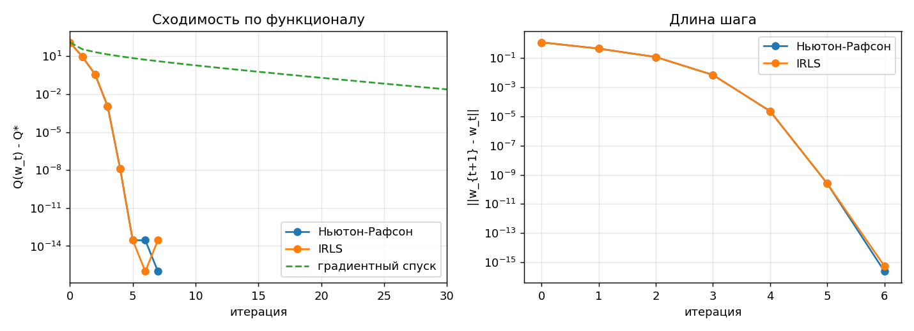
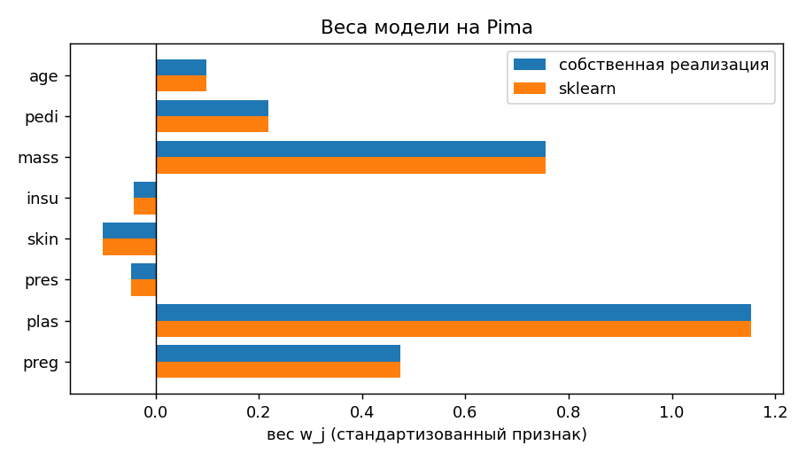
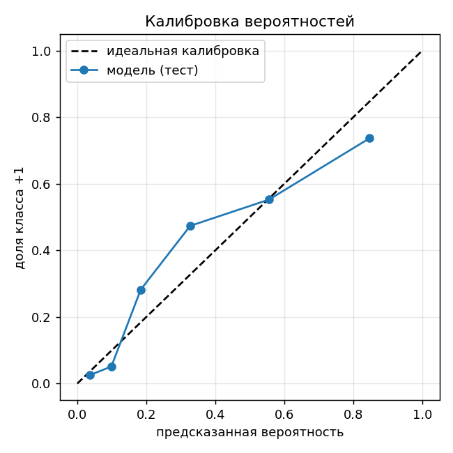
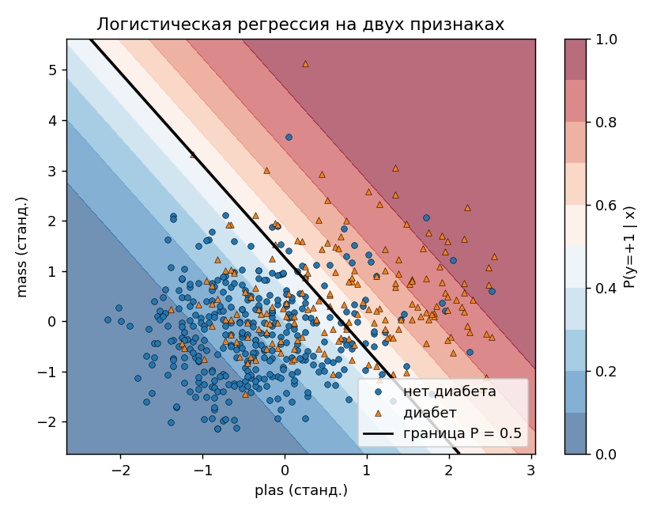
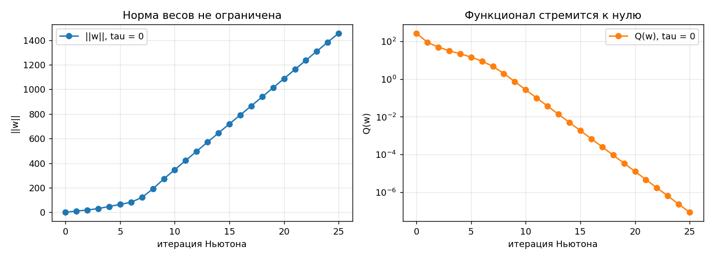

# Лабораторная работа №5. Логистическая регрессия

Логистическая регрессия реализована двумя способами: методом Ньютона-Рафсона и итеративно перевзвешиваемым МНК (IRLS, в маржинальной записи и в записи GLM). Эквивалентность показана сравнением с `sklearn.linear_model.LogisticRegression`.

## Запуск

```sh
cd students/sv-shoshnikov/lab5/source
python main.py
```

На Windows при выводе кириллицы может понадобиться `PYTHONIOENCODING=utf-8`. Данные скачиваются при запуске (`fetch_openml`) и в репозиторий не входят. Нужны `numpy`, `scipy`, `matplotlib`, `scikit-learn`.

## Структура

- `source/data.py` - загрузка, стратифицированное разбиение, обработка пропусков, стандартизация, столбец единиц;
- `source/logistic.py` - функционал, градиент, гессиан, направления Ньютона и IRLS, градиентный спуск, AUC (собственная);
- `source/plots.py` - графики;
- `source/main.py` - эксперименты.

Собственные алгоритмы (`logistic.py`) не используют готовых реализаций из sklearn. `sklearn` применяется только как эталон в `main.py` (а также для разбиения `train_test_split` и для проверки метрик `log_loss`, `roc_auc_score`).

## Датасет

**Pima Indians Diabetes** (OpenML `diabetes`): 768 пациенток, 8 признаков, ответ - диабет (268) или нет (500). Разбиение стратифицированное 70/30 (`random_state=42`): train 537 (доля положительных 0.348), test 231 (0.351).

Почему этот датасет: он не разделим линейно, поэтому нерегуляризованная задача имеет конечный минимум и сравнивать коэффициенты с `sklearn(penalty=None)` корректно. Число обусловленности матрицы после стандартизации 2.42.

Предобработка (всё по обучающей выборке, затем применяется к тесту):

- в `plas`, `pres`, `skin`, `insu`, `mass` ноль означает пропуск (в train нулей 3, 23, 157, 256, 8). Они заменяются медианой по train. У `preg` ноль - настоящее значение;
- стандартизация средним и СКО train;
- к матрице добавляется столбец единиц, свободный член - обычный вес `w_0`.

Второй датасет, **Breast Cancer Wisconsin** (`sklearn.datasets`), нужен только для вопроса про разделимую выборку (раздел ниже).

## Постановка

Метки кодируются как `y_i in {-1, +1}`, `M_i = y_i <w, x_i>` - отступ, `sigma_i = sigma(M_i)`, `sigma(z) = 1/(1+e^{-z})`.

Вероятностная модель: `P(y=+1 | x) = sigma(<w, x>)`. Тогда `P(y | x) = sigma(M)`, а максимум правдоподобия по выборке даёт

```
Q(w) = sum_i ln(1 + exp(-M_i)) -> min,       (+ tau/2 ||w_{1:}||^2 при регуляризации)
```

Градиент и гессиан (`D = diag(0,1,...,1)`, свободный член не штрафуется):

```
Q'(w)  = -F^T (y * (1 - sigma)) + tau D w
Q''(w) =  F^T diag(sigma (1 - sigma)) F + tau D
```

Гессиан - сумма положительно полуопределённых матриц ранга 1, поэтому `Q` выпукла.

## Реализация

**Ньютон-Рафсон** (`newton_direction`): `w := w - h Q''^{-1} Q'`, `h = 1`, старт `w = 0`. Обратная матрица не строится, решается система `np.linalg.solve`.

**IRLS** (`irls_direction`): вводятся веса объектов `gamma_i = sqrt(sigma_i (1 - sigma_i))` и модифицированные ответы `y~_i = y_i sqrt((1 - sigma_i)/sigma_i)`. Для `F~ = diag(gamma) F`:

```
F~^T F~ = F^T diag(sigma (1 - sigma)) F = Q'',      F~^T y~ = F^T (y (1 - sigma)) = -Q'
```

(множители `gamma_i` и `1/sqrt(sigma_i)` в произведении `gamma_i y~_i` дают ровно `y_i (1 - sigma_i)`). Поэтому `w += h (F~^T F~)^{-1} F~^T y~` - это шаг взвешенного МНК, совпадающий с шагом Ньютона. Для решения используется `np.linalg.lstsq(F~, y~)`, нормальные уравнения не строятся. При `tau > 0` к задаче дописываются строки `sqrt(tau) D` с правой частью `-sqrt(tau) D w`, и подзадача становится гребневой.

**IRLS в записи GLM** (`irls_glm_direction`, метки 0/1): для распределения Бернулли `c'(theta) = mu = sigma(theta)`, `c''(theta) = mu (1 - mu)`, `phi = 1`, поэтому `gamma_i = sqrt(mu_i (1 - mu_i))`, `y~_i = (y_i - mu_i)/gamma_i`. Дисперсия ограничена снизу `1e-300`: у насыщенного объекта (`mu = 1` в float64) иначе получится 0/0.

**Численные детали.**
- `sigma` считается через `scipy.special.expit`, лог-потери через `np.logaddexp(0, -M)`: прямые формулы переполняются при больших `|M|`.
- В маржинальной IRLS `sigma` ограничена отрезком `[1e-12, 1 - 1e-12]`, чтобы вес и ответ были конечными.
- Останов: `||w^{t+1} - w^t|| < 1e-10`.

Для сравнения реализован градиентный спуск с шагом `1/L`, `L = lambda_max(F^T F)/4` (`Q'' <= F^T F / 4`).

## Результаты на Pima

### Метод Ньютона-Рафсона (tau = 0)

| t | Q(w) | ‖grad‖ | ‖шаг‖ | шаг_t / шаг_(t-1)^2 |
|---|---|---|---|---|
| 0 | 372.2200 | 2.15e+02 | 1.17e+00 | - |
| 1 | 255.7707 | 4.25e+01 | 4.34e-01 | 0.319 |
| 2 | 247.1825 | 7.61e+00 | 1.15e-01 | 0.611 |
| 3 | 246.8083 | 4.09e-01 | 6.83e-03 | 0.516 |
| 4 | 246.8071 | 1.36e-03 | 2.26e-05 | 0.485 |
| 5 | 246.8071 | 1.50e-08 | 2.49e-10 | 0.486 |
| 6 | 246.8071 | 1.70e-14 | 2.43e-16 | - |

Отношение длины шага к квадрату предыдущего стабилизируется около 0.49, то есть сходимость квадратичная: число верных знаков удваивается за итерацию. Метод остановился за 7 итераций.



### Ньютон и IRLS - один и тот же процесс

Траектории `w^t` всех трёх реализаций совпадают на каждой итерации: максимальное расхождение `3e-15` на первом шаге и `<= 4.4e-16` после него. Все три метода останавливаются на 7 итерации. IRLS, запущенный из МНК-приближения (как в лекции), сходится за 6 итераций к тому же решению (`2.2e-16`).

Веса IRLS в решении: `gamma_i^2` не превосходят 0.25 и достигаются у объектов с отступом около нуля (`M = 0.004, -0.006, 0.015`), у самых надёжно классифицированных (`M` около 4.5) вес около 0.01. Сумма весов 79.9 из 537: решение определяется в основном объектами у границы.

### Сравнение с эталоном (`penalty=None`)

| solver | max‖Δw‖ | max‖ΔP‖ на тесте | совпадение предсказаний | итераций sklearn |
|---|---|---|---|---|
| `newton-cholesky` | 2.2e-16 | 2.2e-16 | 100% | 6 |
| `lbfgs` (tol=1e-12) | 4.1e-08 | 3.5e-08 | 100% | 14 |

`Q(w_own) = Q(w_sklearn) = 246.80711705`. `newton-cholesky` - это тот же метод Ньютона, поэтому совпадение до машинной точности ожидаемо; `lbfgs` - квазиньютоновский и приближает гессиан, отсюда `1e-8`.

С регуляризацией `tau = 1` соответствует `C = 1` в sklearn (`sklearn` минимизирует `C * sum(loss) + 1/2 ||w||^2`, свободный член не штрафуется): расхождение Ньютона `1.1e-16`, IRLS `2.2e-16`.

### Качество на тесте

| модель | accuracy | log-loss | AUC |
|---|---|---|---|
| Ньютон-Рафсон | 0.7446 | 0.4826 | 0.8359 |
| IRLS | 0.7446 | 0.4826 | 0.8359 |
| IRLS (GLM) | 0.7446 | 0.4826 | 0.8359 |
| sklearn newton-cholesky | 0.7446 | 0.4826 | 0.8359 |
| МНК на метках | 0.7359 | - | 0.8347 |

Собственный AUC совпадает с `roc_auc_score`. Оценки МНК на тесте лежат в `[-1.60, 1.47]` и не являются вероятностями. Разница МНК и логистической регрессии по accuracy (0.009, около двух объектов из 231) в пределах шума; существенное отличие - у логистической регрессии выход корректно трактуется как вероятность.

### Скорость: Ньютон против градиентного спуска

До `Q - Q* < 1e-6` Ньютону и IRLS нужно 4 итерации, градиентному спуску - 80. На такой хорошо обусловленной задаче (cond 2.4) градиентный спуск тоже сходится к 5.7e-14 за 300 итераций, но линейно, а не квадратично. Цена Ньютона - решение системы `(p+1) x (p+1)` на каждой итерации, при большом числе признаков это становится дорого.

### Интерпретация весов

Признаки стандартизованы, поэтому `exp(w_j)` - во сколько раз меняются шансы диабета при росте признака на одно СКО:

| признак | w | exp(w) |
|---|---|---|
| plas (глюкоза) | 1.153 | 3.17 |
| mass (ИМТ) | 0.756 | 2.13 |
| preg | 0.473 | 1.60 |
| pedi | 0.219 | 1.25 |
| age | 0.098 | 1.10 |
| pres, skin, insu | -0.049, -0.103, -0.044 | около 0.90-0.96 |

Веса `pres`, `skin`, `insu` малы, а у `insu` и `skin` более половины значений - заполненные медианой пропуски, поэтому их вклад нельзя интерпретировать надёжно. Веса совпадают со `sklearn` (`odds_ratios.png`, `weights` печатаются в `main.py`).




Калибровка по 6 интервалам равного размера на тесте показывает приблизительное соответствие: в бинах с предсказанной вероятностью 0.2-0.35 наблюдаемая доля положительных выше предсказанной (0.28 и 0.47), в верхнем бине (0.85) ниже (0.74). В каждом бине по 38-39 объектов, поэтому такие отклонения могут быть шумом, и о мискалибровке уверенно говорить нельзя.

### Две переменные для визуализации

Модель на `plas` и `mass` (`w = [-0.825, 1.193, 0.650]`) даёт accuracy 0.7446 на тесте, как и модель на всех признаках. Граница `P = 0.5` - прямая, линии уровня вероятности параллельны ей.



## Разделимая выборка (вопрос 16)

На Breast Cancer при `tau = 0` точность на train 1.0: классы линейно разделимы. Правдоподобие можно увеличивать бесконечно, умножая `w` на большое число, поэтому минимума нет: на 25 итерациях Ньютона `‖w‖` растёт примерно линейно (с 0 до 1384), а `Q` падает до `8.5e-8`. Остановить метод может только критерий по `Q` или число итераций; полученные веса определяются остановкой, а не данными.

| tau | итераций | ‖w‖ | Q без штрафа | accuracy test |
|---|---|---|---|---|
| 0.01 | 14 | 26.49 | 6.27 | 0.9532 |
| 0.1 | 12 | 8.42 | 14.54 | 0.9825 |
| 1 | 10 | 3.38 | 21.96 | 0.9883 |
| 10 | 9 | 1.79 | 34.87 | 0.9825 |
| 100 | 7 | 1.00 | 70.50 | 0.9415 |

L2-штраф делает задачу строго выпуклой с единственным минимумом. Здесь `tau` выбран для иллюстрации по тесту, это не подбор параметра (в основной части лабораторной регуляризация не используется). Разницу точности между `tau` в диапазоне 0.1-10 нельзя считать значимой: тест содержит 171 объект.



## Ответы на вопросы для сдачи теории

### Основные

1. **Для чего.** Для оценки вероятности класса и классификации. Слово «регрессия» - потому что моделируется среднее ответа `E[y|x] = P(y=1|x)` как функция линейного предиктора; класс получается пороговым правилом `P >= 0.5`.
2. **Предиктор, сигмоида, логит.** `z = <w, x>`, `P(y=1|x) = sigma(z)`. Обратная функция `logit(p) = ln(p/(1-p)) = z` - это функция связи: логарифм шансов линеен по признакам.
3. **Log-loss.** Для бернуллиевского `y in {0,1}` правдоподобие `prod mu_i^{y_i} (1-mu_i)^{1-y_i}`. Минус логарифм: `-sum [y ln mu + (1-y) ln(1-mu)]`. При `mu = sigma(z)` и `M = (2y-1) z` это `sum ln(1 + e^{-M})`.
4. **МНК для классификации.** Можно (в разделе результатов он дал 0.7359), но он предполагает нормальный шум с постоянной дисперсией, а у бернуллиевского ответа дисперсия `mu(1-mu)` зависит от среднего. Оценки выходят за `[0, 1]`, объекты с большим отступом «штрафуются» за правильное, но далёкое решение. Правдоподобие Бернулли даёт согласованную модель.
5. **Ньютон-Рафсон.** Квадратичная аппроксимация `Q` в текущей точке: `w := w - Q''^{-1} Q'`. Градиент даёт направление, гессиан - кривизну и длину шага. Градиентный спуск использует только градиент, сходится линейно (80 итераций против 4 в эксперименте).
6. **IRLS.** Шаг Ньютона записывается как решение взвешенной задачи наименьших квадратов `||diag(gamma)(F delta - y~)||^2`, у которой веса и ответы зависят от текущего `w`. Поэтому метод - последовательность взвешенных МНК, на каждой итерации веса пересчитываются.
7. **Веса.** `gamma_i^2 = sigma_i (1 - sigma_i)`, модифицированные ответы `y~_i = y_i sqrt((1-sigma_i)/sigma_i)`. После итерации пересчитываются `w`, отступы, `sigma_i`, `gamma_i` и `y~_i`. Веса максимальны (0.25) на границе и около нуля у уверенно классифицируемых объектов.
8. **Связь.** Одна и та же линейная система: `F~^T F~ = Q''`, `F~^T y~ = -Q'`. Направления совпадают; в эксперименте траектории равны до `4e-16`. Различие только в вычислении (решение системы против взвешенной регрессии через `lstsq`).
9. **GLM.** Три компонента: распределение ответа из экспоненциального семейства, линейный предиктор `eta = <w, x>` и функция связи `g(E[y]) = eta`.
10. **Связи.** Нормальное - тождественная; Бернулли - логит; Пуассон - логарифм.
11. **Постановки.** Бернулли: один исход 0/1 (дефолт клиента). Биномиальное: число успехов из `n` испытаний (число заболевших в группе из `n` человек). Пуассон: число событий за интервал (число обращений в службу поддержки в день).

### Дополнительные

14. Распределение Бернулли и нормальное лежат в экспоненциальном семействе, а логит и тождественная функция - их канонические связи. Поэтому линейная регрессия с гауссовским шумом и логистическая регрессия - два частных случая GLM, а IRLS работает для обоих (для нормального `gamma = 1` и шаг МНК выполняется один раз).
15. GLM: `g(E[y]) = sum w_j x_j` линейна по признакам. GAM: `g(E[y]) = sum f_j(x_j)` - сумма гладких нелинейных функций признаков, эти функции подбираются по данным; интерпретируемость аддитивности сохраняется, линейность - нет.
16. См. раздел про разделимую выборку: оптимума нет, `‖w‖` растёт неограниченно, нужна регуляризация или остановка.
17. Квадрат ошибки чувствителен к выбросам и оценивает только среднее. Робастные функции (Хьюбер, абсолютная ошибка) ограничивают влияние выбросов; квантильные позволяют оценивать условные квантили, интервалы и несимметричные риски.

## Ограничения

- Датасет небольшой (231 объект в тесте), различия accuracy в 1-2 объекта статистически не значимы.
- Пропуски заполнены медианой; признаки `skin` и `insu` содержат много заполненных значений, поэтому их веса надёжно не интерпретируются.
- Градиентный спуск реализован в простейшем варианте с постоянным шагом `1/L` как контрольная точка для скорости, а не как оптимизированный конкурент.
- Параметр регуляризации на Breast Cancer показан сеткой для иллюстрации и не подбирался на отдельной валидационной выборке.

## Соответствие заданию

| пункт задания | где |
|---|---|
| выбрать датасет | Pima (основной), Breast Cancer (разделимый случай) |
| Ньютон-Рафсон | `logistic.newton_direction`, `newton_raphson` |
| IRLS | `logistic.irls_direction`, `irls_glm_direction` |
| эквивалентность с эталоном | раздел «Сравнение с эталоном», `main.py` |
| отчёт | этот файл, графики в корне `lab5` |
