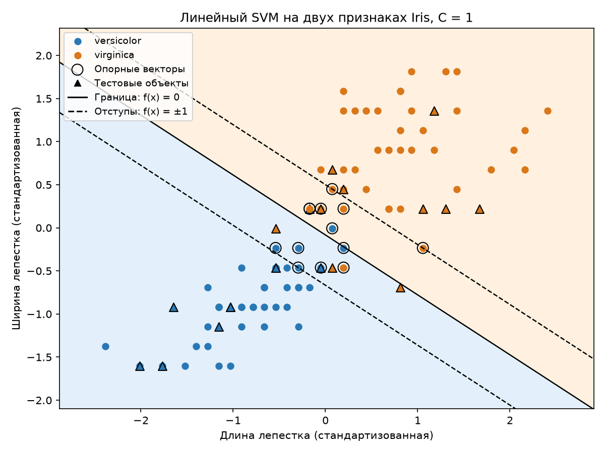
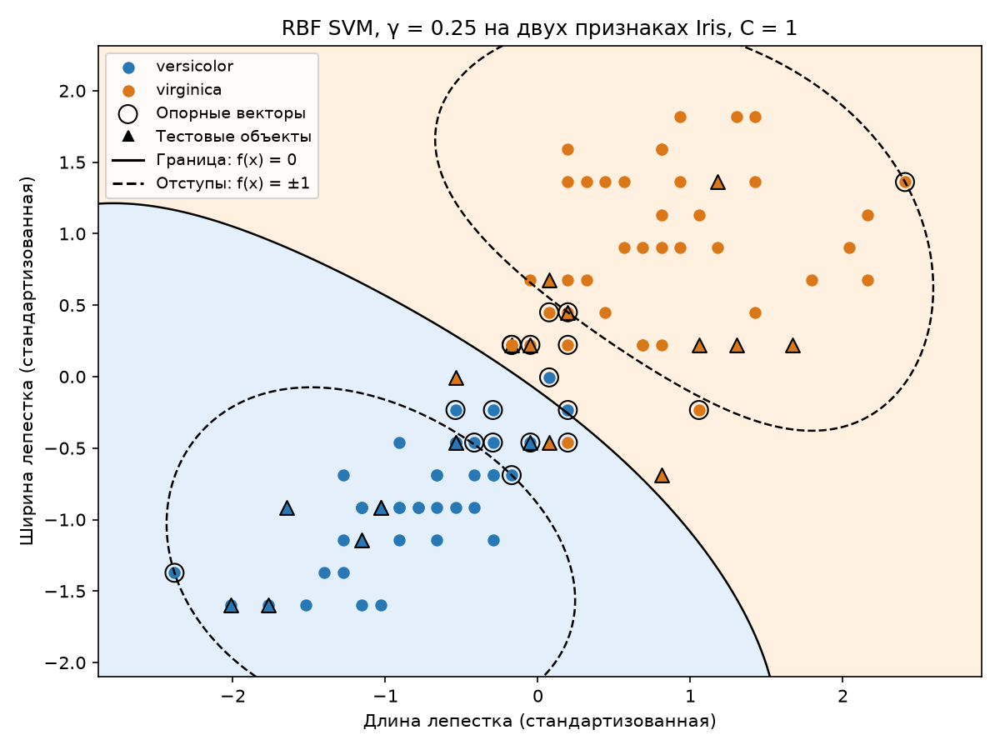

# Лабораторная работа №3. SVM

## 1. датасет

Используется Iris из `sklearn.datasets`: классы `versicolor` - `-1`
и `virginica` - `1`.

Всего 100 объектов, 80 обучение 20 тест, признаки стандартизируются через `StandardScaler`

## 2. Решение двойственной задачи

Для линейного SVM минимизируется функция:

$$
\frac{1}{2}\sum_{i,j}\alpha_i\alpha_j y_i y_j x_i^T x_j
-\sum_i\alpha_i
$$

при ограничениях:

$$
0\leq\alpha_i\leq C,\qquad \sum_i\alpha_i y_i=0.
$$

Используется мягкий зазор с `C=1`, поскольку выбранные классы могут
пересекаться. Оптимизация выполняется методом
[SLSQP в scipy.optimize.minimize](https://docs.scipy.org/doc/scipy/reference/optimize.minimize-slsqp.html)
с аналитическим градиентом. Если оптимизатор не сошёлся, функция сообщает об ошибке.

## 3. Трюк с ядром

В `source/kernels.py` реализованы два ядра:

$$
K_{linear}(x,z)=x^Tz,
\qquad
K_{RBF}(x,z)=\exp(-\gamma\|x-z\|^2).
$$

В двойственной задаче скалярные произведения заменены значениями выбранного
ядра. Ограничения остаются прежними. RBF позволяет получить нелинейную границу
без явного перехода в другое пространство признаков.

Функция `solve_dual` принимает параметры `kernel` и `gamma`.
По умолчанию используется линейное ядро, поэтому запуск шага 2 сохраняет
прежний результат.

При `C=1` линейное ядро даёт 11 опорных векторов, RBF с `gamma=0.25` — 25.
Значение `gamma` выбрано как начальное для четырёх стандартизованных признаков,
подбор параметра пока не выполнялся. Число опорных векторов само по себе
не определяет качество классификации.

Временные проверки подтвердили формулы ядер, ограничения и оптимальность
решения для обоих вариантов.

## 4. Линейный классификатор

$$
w=\sum_i\alpha_i y_i x_i.
$$

Смещение `b` рассчитывается как среднее значение `y_i - w^T x_i`
по опорным векторам с `0 < alpha_i < C`. Если таких объектов нет,
берётся середина допустимого интервала для `b`, полученного из условий
оптимальности.

Решающее правило:

$$
f(x)=w^T x+b,\qquad
a(x)=\begin{cases}1,&f(x)\geq0,\\-1,&f(x)<0.\end{cases}
$$

При `C=1` получено 11 опорных векторов. На тестовой выборке правильно
классифицированы 18 из 20 объектов: accuracy — `90%`, ошибок — 2.
Модель использует все четыре стандартизованных признака.

Временные проверки подтвердили условия оптимальности и предсказания
на простом примере, включая случай без свободных опорных векторов.

Для обоих ядер реализован `KernelSVM` с решающей функцией:

$$
f(x)=\sum_{i\in SV}\alpha_i y_i K(x,x_i)+b.
$$

Смещение вычисляется тем же способом, но вместо `w^T x_i` используется сумма
по ядру. `LinearSVM` сохраняет линейный интерфейс и вектор весов `weights`.

## 5. Визуализация решения

Цвет точек это наш класс объекта, цвет фона - предсказанный класс.
Круги обозначают обучающие объекты, треугольники тут тестовые.
Опорные векторы обведены чёрным. Сплошная линия показывает границу `f(x)=0`,
пунктирные — отступы `f(x)=±1`.

Оба графика строятся на длине и ширине лепестка, с одним разбиением на обучение
и тест и одинаковыми масштабами осей. Для визуализации модели отдельно обучаются
на двух признаках; это не проекция моделей на четырёх признаках.

| Ядро | C | gamma | Опорных векторов | Test accuracy |
|---|---:|---:|---:|---:|
| Linear | 1 | — | 13 | 80% (16/20) |
| RBF | 1 | 0.25 | 18 | 85% (17/20) |

Шаг 5 сохраняет оба графика. Параметры заданы заранее, подбор по тестовой выборке
не выполняется.

## 6. Сравнение с эталоном

Собственный `KernelSVM` с каждым из двух ядер сравнивается с
[`sklearn.svm.SVC`](https://scikit-learn.org/stable/modules/generated/sklearn.svm.SVC.html)
с тем же ядром, `C=1` и `gamma=0.25` для RBF. Используются все четыре признака
и одно разбиение данных. Положительным классом считается `virginica` (`1`).

| Метрика | Наш Linear | SVC Linear | Наш RBF | SVC RBF |
|---|---:|---:|---:|---:|
| Accuracy | 0.90 | 0.90 | 0.90 | 0.90 |
| Precision | 0.83 | 0.83 | 1.00 | 1.00 |
| Recall | 1.00 | 1.00 | 0.80 | 0.80 |
| F1 | 0.91 | 0.91 | 0.89 | 0.89 |
| Опорных векторов | 11 | 11 | 25 | 25 |

Для каждого ядра предсказания собственной модели и соответствующего `SVC`
на тестовой выборке совпали на `100%`. Оба ядра правильно классифицировали
18 из 20 объектов, но ошиблись на разных классах: Linear отнёс два `versicolor`
к `virginica`, RBF — два `virginica` к `versicolor`.

На этом разбиении RBF не улучшил accuracy на четырёх признаках. Разница
на двух признаках составляет один тестовый объект, поэтому по этому опыту