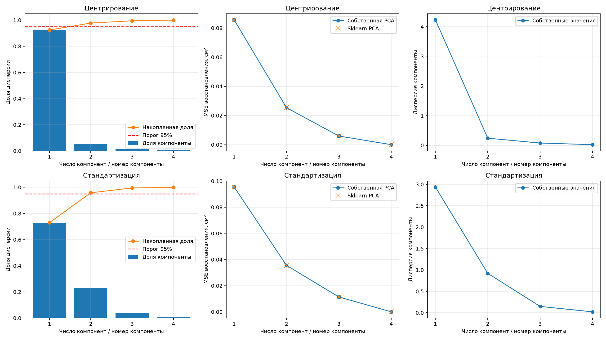
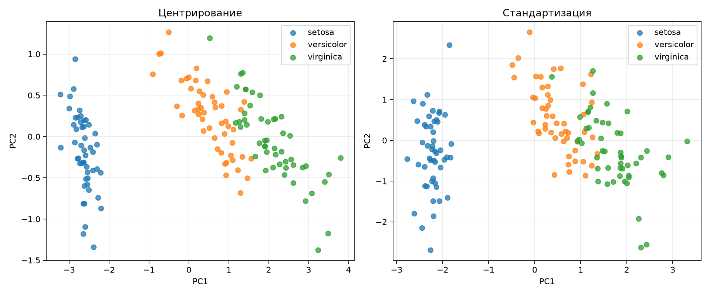
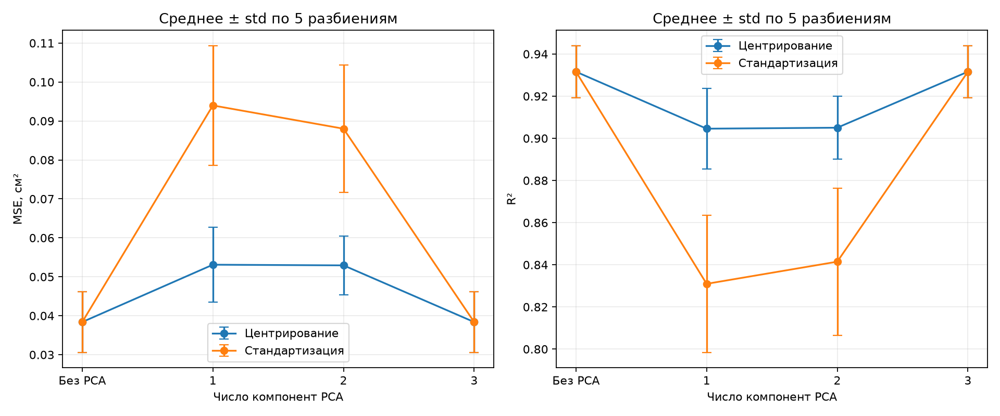

# Лабораторная работа №4. PCA

## 1. Выбор и подготовка данных

Используется датасет Iris из `sklearn.datasets`:

- 150 объектов;
- 4 числовых признака: длина и ширина чашелистика, длина и ширина лепестка;
- 3 вида ирисов, по 50 объектов каждого вида;
- все измерения приведены в сантиметрах.

Проводятся два эксперимента. В первом PCA применяется ко всем четырём
признакам для исследования структуры данных. Метки видов используются только
для раскрашивания точек на графике и не участвуют в PCA.

Во втором эксперименте решается задача линейной регрессии: ширина лепестка
предсказывается по длине и ширине чашелистика и длине лепестка. Ширина лепестка
исключена из входных признаков. Таким образом, Iris используется для регрессии
с непрерывным ответом, а не для предсказания номера класса.

Сравниваются два способа подготовки признаков: только центрирование и
центрирование со стандартизацией. При стандартизации каждый признак делится
на своё стандартное отклонение, рассчитанное с `ddof=0`.

## 2. Реализация PCA через SVD

Собственная реализация находится в [source/pca.py](source/pca.py).
Для центрированной матрицы вычисляется сингулярное разложение:

$$
X_c=X-\mu=U\Sigma V^T.
$$

Первые `k` строк матрицы `Vᵀ` образуют главные компоненты. Проекция и
восстановление рассчитываются следующим образом:

$$
Z=X_cV_k,\qquad \widehat X=ZV_k^T+\mu.
$$

Дисперсия каждой компоненты равна `s² / (n − 1)`, где `s` — соответствующее
сингулярное число. Доля объяснённой дисперсии получается делением этой величины
на сумму дисперсий всех компонент.

Реализованы методы `fit`, `transform`, `inverse_transform` и `fit_transform`.
Для вычислений используется `numpy.linalg.svd`; готовая PCA применяется только
при сравнении с эталоном. Среднее сохраняется при обучении и затем используется
при обработке новых объектов.

## 3. Исследование числа компонент и масштабирования

На всей выборке выполнено 8 вариантов: от 1 до 4 компонент для каждого
способа подготовки данных. Ошибка восстановления равна среднему квадрату
разности исходных и восстановленных значений по всем объектам и признакам.
Для сравнения двух способов обработки восстановленные данные возвращаются
в сантиметры. Поэтому MSE в таблице имеет общие единицы — см².

| Обработка | Компоненты | Сохранённая дисперсия | MSE восстановления, см² |
|---|---:|---:|---:|
| Центрирование | 1 | 92.4619% | 0.085604 |
| Центрирование | 2 | 97.7685% | 0.025341 |
| Центрирование | 3 | 99.4788% | 0.005919 |
| Центрирование | 4 | 100% | ≈ 0 |
| Стандартизация | 1 | 72.9624% | 0.095484 |
| Стандартизация | 2 | 95.8132% | 0.035537 |
| Стандартизация | 3 | 99.4821% | 0.011372 |
| Стандартизация | 4 | 100% | ≈ 0 |

При увеличении числа компонент ошибка восстановления уменьшается. При четырёх
компонентах восстановление точное с учётом погрешности вычислений.
Без стандартизации первая компонента сохраняет значительно больше дисперсии.
Это связано с различиями в разбросе исходных признаков. После стандартизации
вклад признаков выравнивается и доля первой компоненты уменьшается.

При одинаковом числе компонент центрирование даёт меньшую ошибку в см².
PCA без стандартизации непосредственно минимизирует ошибку в исходном масштабе,
а после стандартизации минимизируется ошибка в стандартизованных координатах.
Доли дисперсии в двух обработках относятся к разным матрицам и не являются
одной и той же величиной.



Для эффективной размерности выбирается минимальное число компонент,
сохраняющее заданную долю общей дисперсии.

| Порог | Центрирование | Стандартизация |
|---|---:|---:|
| 90% | 1 | 2 |
| 95% | 2 | 2 |
| 99% | 3 | 3 |

При основном пороге 95% эффективная размерность равна двум в обоих вариантах.
Это размерность по выбранному критерию сохранения дисперсии, а не ранг матрицы:
все четыре компоненты имеют ненулевую дисперсию.

На двумерных проекциях `setosa` хорошо отделяется от остальных видов.
Области `versicolor` и `virginica` частично пересекаются. Стандартизация меняет
расположение точек, но общая структура сохраняется.



## 4. Сравнение с эталонной реализацией

В каждом из 8 вариантов собственная модель сравнивается с
`sklearn.decomposition.PCA(svd_solver="full")` на одинаковых данных.
Проверяются сингулярные числа, дисперсии, доли дисперсии, матрицы проекции,
координаты объектов и восстановленные данные.

Знак главной компоненты может различаться, поэтому перед сравнением координат
знаки согласуются по скалярному произведению соответствующих компонент.
Дополнительно сравниваются матрицы `VₖVₖᵀ`, которые от знаков не зависят.

| Проверяемая величина | Максимальное абсолютное расхождение по 8 вариантам |
|---|---:|
| Дисперсия компоненты | 4.44 · 10⁻¹⁵ |
| Доля дисперсии | 9.02 · 10⁻¹⁷ |
| Матрица проекции | 1.11 · 10⁻¹⁵ |
| Координаты после согласования знаков | 1.78 · 10⁻¹⁵ |
| Восстановленные данные | 2.66 · 10⁻¹⁵ |

Все программные проверки проходят с абсолютным допуском `1e-10`.
На исследованных данных обе реализации эквивалентны с точностью вычислений.

## 5. Влияние PCA на линейную регрессию

Проверяются 5 разбиений с `random_state = 0, 1, 2, 3, 42`. В каждом разбиении
120 объектов используются для обучения и 30 — для тестирования. Стратификация
по виду ириса сохраняет по 40 объектов каждого вида в train и по 10 в test.
Для всех вариантов одного разбиения train и test одинаковы.

Среднее, стандартное отклонение и PCA вычисляются только по train. Тестовые
объекты преобразуются с сохранёнными параметрами. Результаты анализа всей
выборки из раздела 3 не используются при обучении регрессии.

Сравниваются регрессия без PCA и регрессия на 1, 2 и 3 компонентах.
Коэффициенты и свободный член находятся методом наименьших квадратов через
`numpy.linalg.lstsq`. Регуляризация не используется. Всего выполнено 40
вариантов: 5 разбиений × 2 обработки × 4 модели. Для каждого из 30 вариантов
с PCA также рассчитывается результат с эталонной PCA; регрессия остаётся той же.

В таблице приведены среднее и выборочное стандартное отклонение по пяти
разбиениям (`ddof=1`). Чем меньше MSE и больше R², тем лучше результат.

| Обработка | Компоненты | Test MSE, см² | Test R² |
|---|---|---:|---:|
| Центрирование | Без PCA | 0.038384 ± 0.007785 | 0.931599 ± 0.012363 |
| Центрирование | 1 | 0.053104 ± 0.009611 | 0.904579 ± 0.019111 |
| Центрирование | 2 | 0.052933 ± 0.007523 | 0.905042 ± 0.014892 |
| Центрирование | 3 | 0.038384 ± 0.007785 | 0.931599 ± 0.012363 |
| Стандартизация | Без PCA | 0.038384 ± 0.007785 | 0.931599 ± 0.012363 |
| Стандартизация | 1 | 0.093992 ± 0.015342 | 0.830966 ± 0.032519 |
| Стандартизация | 2 | 0.088020 ± 0.016406 | 0.841472 ± 0.034924 |
| Стандартизация | 3 | 0.038384 ± 0.007785 | 0.931599 ± 0.012363 |

На всех пяти обучающих выборках эффективная размерность трёх входных признаков
при пороге 95% равна двум для обеих обработок. Тем не менее сокращение до двух
компонент увеличивает среднюю MSE с `0.038384` до `0.052933` без стандартизации
и до `0.088020` со стандартизацией. Сохранение 95% дисперсии признаков не
гарантирует сохранения информации, важной для предсказания ширины лепестка.

При трёх компонентах результат совпадает с регрессией без PCA: сохраняются все
направления входного пространства. Без сокращения размерности стандартизация
также не меняет предсказания МНК со свободным членом.

Максимальное отличие предсказаний при собственной и эталонной PCA равно
`2.22 · 10⁻¹⁵`. Совпадение проверяется программно для каждого варианта.



Пять разбиений показывают чувствительность результата к выборке. Их тестовые
наборы могут пересекаться; стандартное отклонение на графике не является
доверительным интервалом. Тестовые метрики используются для сравнения заранее
заданных вариантов, подбор параметров по тесту не выполняется.

## 6. Запуск и проверка

Команды выполняются из корня репозитория:

```bash
python -m pip install -r students/trofimov-av/lab4/requirements.txt
python students/trofimov-av/lab4/source/run_pca.py
python students/trofimov-av/lab4/source/run_regression.py
python -m unittest discover -s students/trofimov-av/lab4/source -p test_pca.py -v
```

Скрипты сохраняют графики в `figures`, а численные результаты в `results`:

- [pca.tsv](results/pca.tsv) — все 8 вариантов PCA и ошибки относительно sklearn;
- [dimensions.tsv](results/dimensions.tsv) — размерности при трёх порогах;
- [regression.tsv](results/regression.tsv) — все 40 вариантов регрессии;
- [regression_summary.tsv](results/regression_summary.tsv) — средние метрики и разброс.

В таблицах регрессии `n_components=0` обозначает модель без PCA.
Датасет загружается через `load_iris()` при запуске и в репозиторий не копируется.
Проверено на Python 3.14.5, NumPy 2.5.3, pandas 3.0.6,
scikit-learn 1.9.1 и Matplotlib 3.11.2.

Все 4 теста пройдены. Они проверяют преобразование новых объектов относительно
sklearn, ортонормальность компонент, полное восстановление, связь ошибки с
отброшенными сингулярными числами, линейно зависимые и постоянные признаки,
порог размерности и применение параметров подготовки только из train.

## 7. Итоги

Реализована PCA через SVD и подтверждено совпадение с эталоном для всех
исследованных вариантов. Для четырёх признаков Iris две компоненты сохраняют
не менее 95% дисперсии как с масштабированием, так и без него.

В задаче предсказания ширины лепестка лучший средний результат среди
исследованных вариантов дают все три исходных признака: MSE `0.038384`
и R² `0.931599`. Сокращение размерности ухудшает качество. Для двумерного
отображения Iris PCA полезна, но в рассмотренной задаче регрессии удалять
третью компоненту невыгодно.
