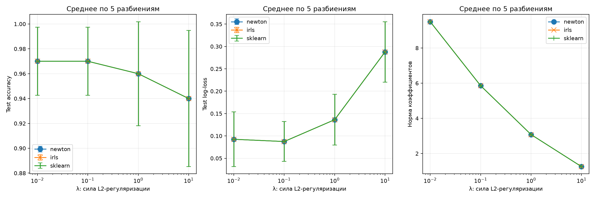
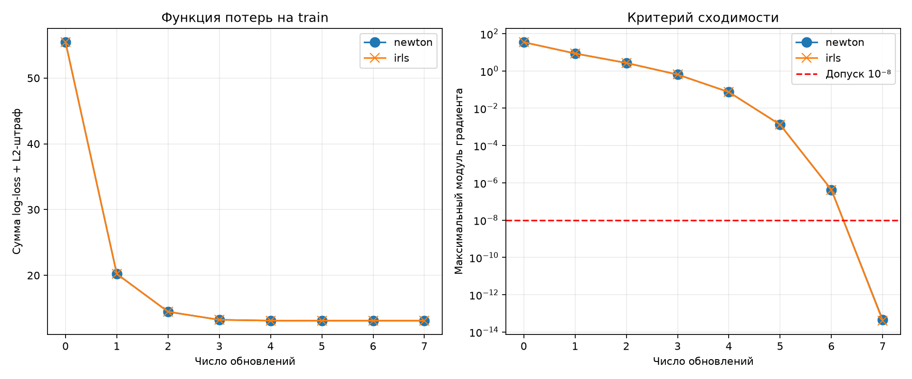
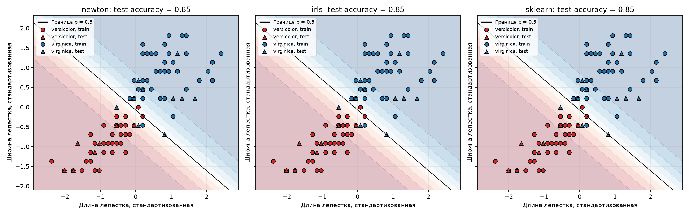

# Лабораторная работа №5. Логистическая регрессия

## 1. Выбор и подготовка данных

Датасет Iris загружается через `sklearn.datasets.load_iris` при запуске.
Используются два вида: `versicolor` с меткой 0 и `virginica` с меткой 1.
Получается 100 объектов, по 50 каждого класса, и 4 числовых признака.
Выбраны близкие виды, для которых задача сложнее, чем отделение `setosa`.

В каждом эксперименте данные разделяются на train и test в отношении 80/20
со стратификацией: 80 обучающих объектов и 20 тестовых, поровну обоих классов.
Проверяются разбиения с `random_state = 0, 1, 2, 3, 42`.

Признаки стандартизируются по среднему и стандартному отклонению train:

$$
x'_{ij}=\frac{x_{ij}-\mu_j}{s_j}.
$$

Для test применяются те же параметры. Тестовая выборка не участвует в
вычислении среднего, масштаба или коэффициентов модели.

## 2. Собственная логистическая регрессия

Реализация находится в [source/logistic.py](source/logistic.py).
Вероятность положительного класса задаётся сигмоидой:

$$
p_i=\sigma(b+x_i^Tw),\qquad\sigma(t)=\frac{1}{1+e^{-t}}.
$$

Если вероятность не меньше 0.5, предсказывается `virginica`, иначе —
`versicolor`. Порог одинаковый во всех экспериментах.

Минимизируется сумма логистических потерь с L2-регуляризацией:

$$
L(w,b)=\sum_{i=1}^{n}
\left[\log(1+e^{\eta_i})-y_i\eta_i\right]
+\frac{\lambda}{2}\|w\|_2^2,
\qquad\eta_i=b+x_i^Tw.
$$

Свободный член не штрафуется. Регуляризация ограничивает рост коэффициентов,
в том числе при линейной разделимости обучающих объектов. Исследуются
`λ = 0.01, 0.1, 1, 10`.

Для устойчивого вычисления вероятностей используется `scipy.special.expit`,
для потерь — `numpy.logaddexp`. Обучение начинается с нулевых коэффициентов.
Готовая библиотечная модель используется только как эталон.

## 3. Метод Ньютона–Рафсона и IRLS

В матрицу F добавляется столбец единиц, а коэффициенты объединяются в β.
Матрица штрафа D диагональная: первый элемент равен нулю, остальные равны λ.

В методе Ньютона рассчитываются градиент и гессиан:

$$
g=F^T(p-y)+D\beta,
\qquad H=F^TWF+D,
$$

где W — диагональная матрица с элементами `pᵢ(1 − pᵢ)`.
Из системы `Hδ = −g` находится направление, после чего коэффициенты
обновляются: `β ← β + δ`. Система решается через `numpy.linalg.lstsq`,
без явного вычисления обратной матрицы.

В IRLS на каждой итерации вычисляются рабочие ответы:

$$
z=F\beta+W^{-1}(y-p).
$$

Новые коэффициенты находятся из задачи взвешенного МНК:

$$
\min_{\beta_{new}}
\|W^{1/2}(F\beta_{new}-z)\|_2^2
+\beta_{new}^TD\beta_{new}.
$$

В коде формируются взвешенная матрица признаков и дополнительные строки для
штрафа, после чего вызывается `numpy.linalg.lstsq`. Таким образом, два метода
реализованы через разные вычисления: систему с гессианом и взвешенный МНК.

Алгебраически оба метода дают одинаковое обновление:

$$
(F^TWF+D)\beta_{new}=F^TWz
=(F^TWF+D)\beta-g.
$$

Поэтому при одинаковой начальной точке и параметрах ожидается совпадение
траекторий, а не разное качество классификации.

В обоих методах веса ограничиваются снизу значением `1e-12`, чтобы избежать
деления на ноль. Если полный шаг увеличивает функцию потерь, длина шага
последовательно делится пополам. Обучение завершается при максимальном модуле
градиента не больше `1e-8`, но не позднее 100 обновлений. Признак `converged_`
показывает, выполнен ли критерий сходимости.

## 4. Сравнение регуляризации и эталонной реализации

Для каждого из 5 разбиений проверяются 4 значения λ и 3 реализации:
Ньютона–Рафсона, IRLS и `sklearn.linear_model.LogisticRegression`.
Всего получается 60 обучений.

Эталон использует `solver="lbfgs"`, `tol=1e-12`, `max_iter=2000`.
Для совпадения задачи оптимизации задаётся `C = 1 / λ`: в собственной модели
используется сумма потерь и штраф `λ‖w‖² / 2`. Свободный член не штрафуется
в обеих реализациях. Все модели получают одинаковые стандартизованные данные.

Рассчитываются accuracy, F1 положительного класса, log-loss и ROC-AUC.
Для log-loss используются вероятности, без регуляризационного штрафа.
Ниже приведены средние метрики; для accuracy и log-loss также показано
выборочное стандартное отклонение по пяти разбиениям (`ddof=1`).

Метрики Ньютона, IRLS и sklearn совпали до приведённых знаков:

| λ | Accuracy | F1 | Log-loss | ROC-AUC |
|---:|---:|---:|---:|---:|
| 0.01 | 0.9700 ± 0.0274 | 0.9704 | 0.0925 ± 0.0611 | 0.9980 |
| 0.1 | 0.9700 ± 0.0274 | 0.9704 | 0.0874 ± 0.0446 | 1.0000 |
| 1 | 0.9600 ± 0.0418 | 0.9589 | 0.1362 ± 0.0569 | 0.9980 |
| 10 | 0.9400 ± 0.0548 | 0.9331 | 0.2878 ± 0.0675 | 0.9880 |

При увеличении λ средняя норма коэффициентов уменьшается с `9.4978` до `1.2546`.
Сильная регуляризация в рассмотренном диапазоне ухудшает качество: модель
сильнее ограничена в разделении близких видов. Наименьшая средняя log-loss
наблюдается при λ = 0.1, но это описательное сравнение заранее заданных
вариантов, а не подбор параметра по независимой валидации.



### Численная эквивалентность

Для каждого из 20 сочетаний разбиения и λ сравниваются коэффициенты,
вероятности на test и предсказанные классы.

| Величина | Ньютон относительно sklearn | IRLS относительно sklearn |
|---|---:|---:|
| Максимальное отличие вероятностей | 2.90 · 10⁻⁷ | 2.90 · 10⁻⁷ |
| Максимальное отличие коэффициентов, включая свободный член | 8.02 · 10⁻⁷ | 8.02 · 10⁻⁷ |
| Совпадение классов во всех вариантах | 100% | 100% |

Программно проверяется абсолютный допуск `1e-6` для вероятностей и `1e-5`
для коэффициентов. Небольшие расхождения связаны с численным решением и
разными критериями остановки алгоритмов. Собственные модели во всех
экспериментах выполнили критерий по градиенту.

| λ | Обновления Ньютона, среднее | Обновления IRLS, среднее | Итерации sklearn L-BFGS, среднее |
|---:|---:|---:|---:|
| 0.01 | 9.6 | 9.6 | 20.0 |
| 0.1 | 8.0 | 8.0 | 18.2 |
| 1 | 7.0 | 7.0 | 14.2 |
| 10 | 5.0 | 5.0 | 10.2 |

Одна итерация разных алгоритмов требует разного объёма вычислений, а критерии
остановки различаются. По этому числу нельзя делать вывод об ускорении.

## 5. Исследование сходимости

Для разбиения с `random_state=42` и λ = 1 сохраняется история функции потерь
и максимального модуля градиента. Начальное значение целевой функции равно
`55.451774`, после сходимости — `13.105756`. Оба метода сходятся за 7 обновлений.
Кривые совпадают с точностью вычислений.



Дополнительно сравниваются ограничения на число обновлений:
`max_iter = 1, 2, 3, 5, 10, 30`. Результаты обоих методов совпали:

| max_iter | Выполнено обновлений | Сходимость | Максимальный модуль градиента | Test accuracy | Test log-loss |
|---:|---:|---|---:|---:|---:|
| 1 | 1 | Нет | 8.63 | 1.00 | 0.326484 |
| 2 | 2 | Нет | 2.68 | 1.00 | 0.243038 |
| 3 | 3 | Нет | 0.637 | 0.95 | 0.222841 |
| 5 | 5 | Нет | 0.00131 | 0.90 | 0.226488 |
| 10 | 7 | Да | ≈ 4 · 10⁻¹⁴ | 0.90 | 0.226510 |
| 30 | 7 | Да | ≈ 4 · 10⁻¹⁴ | 0.90 | 0.226510 |

Высокая accuracy после первой итерации не означает сходимости: обучающая
целевая функция ещё далека от минимума, а вероятности менее точны по log-loss.
Оптимизация обучающей функции не обязана монотонно улучшать accuracy или
log-loss на test. Остановка определяется градиентом на train; лучшие
промежуточные тестовые значения не используются для выбора момента остановки.

## 6. Визуализация границ классификации

Для двумерной визуализации отдельно обучаются все три модели только по длине
и ширине лепестка. Используются λ = 1 и разбиение с `random_state=42`.
Это отдельный эксперимент на двух признаках, а не проекция границы модели
с четырьмя признаками.

Круги обозначают train, треугольники — test. Фон показывает вероятность
`virginica`: красная область соответствует малой вероятности, синяя — большой.
Чёрная линия — граница с вероятностью 0.5.



Границы всех моделей визуально совпадают. Каждая модель получает test accuracy
`0.85`, то есть правильно классифицирует 17 из 20 объектов, и log-loss
`0.274184`. Ошибки возникают в области пересечения классов. На том же
разбиении при четырёх признаках и λ = 1 accuracy равна `0.90`.

## 7. Запуск и проверка

Команды выполняются из корня репозитория:

```bash
python -m pip install -r students/trofimov-av/lab5/requirements.txt
python students/trofimov-av/lab5/source/run_experiments.py
python students/trofimov-av/lab5/source/run_visualization.py
python -m unittest discover -s students/trofimov-av/lab5/source -p test_logistic.py -v
```

Проверено на Python 3.14.5. Версии зависимостей указаны в
[requirements.txt](requirements.txt). Датасет в репозиторий не копируется.
Графики создаются без открытия окон.

Полные результаты сохранены в таблицах:

- [experiments.tsv](results/experiments.tsv) — все 60 обучений и сравнение с эталоном;
- [summary.tsv](results/summary.tsv) — средние результаты по разбиениям;
- [convergence.tsv](results/convergence.tsv) — траектории обоих собственных методов;
- [iteration_budget.tsv](results/iteration_budget.tsv) — сравнение 12 запусков с разными ограничениями числа итераций;
- [boundaries.tsv](results/boundaries.tsv) — результаты трёх моделей на двух признаках.

Все 5 тестов пройдены. Проверяются:

- совпадение со sklearn для обоих методов при всех четырёх значениях λ;
- выполнение критерия сходимости и невозрастание обучающей функции потерь;
- совпадение траекторий Ньютона и IRLS и корректный статус при недостатке итераций;
- градиент и гессиан с помощью конечных разностей;
- работа на разделимых данных с регуляризацией и конечные вероятности при больших логитах;
- работа с дублирующимися признаками без регуляризации на неразделимых данных.

## 8. Итоги

Реализована бинарная логистическая регрессия двумя способами: методом
Ньютона–Рафсона и через IRLS. Оба метода дают одинаковые обновления и совпадают
со sklearn по предсказанным классам во всех исследованных вариантах.

При λ = 0.01 и λ = 0.1 средняя test accuracy составляет 97%, а при λ = 10
снижается до 94%. Увеличение регуляризации уменьшает норму коэффициентов и
число обновлений до сходимости, но в данном исследовании ухудшает качество.

Пять разбиений позволяют увидеть разброс результатов. Их тестовые наборы
могут пересекаться, а показанное стандартное отклонение не является
доверительным интервалом. Для выбора итогового λ потребовалась бы отдельная
валидация; здесь сравниваются заранее заданные значения.
