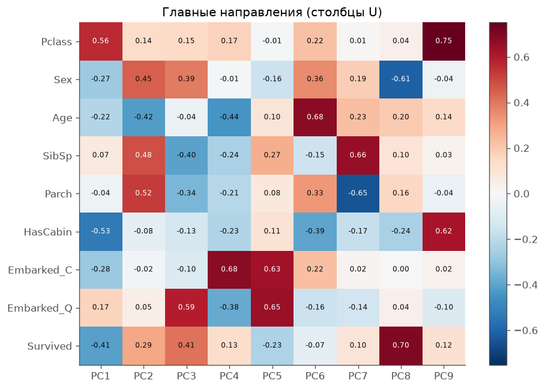
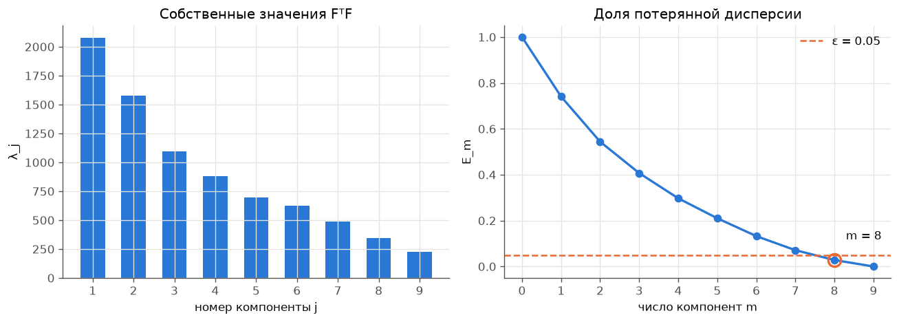
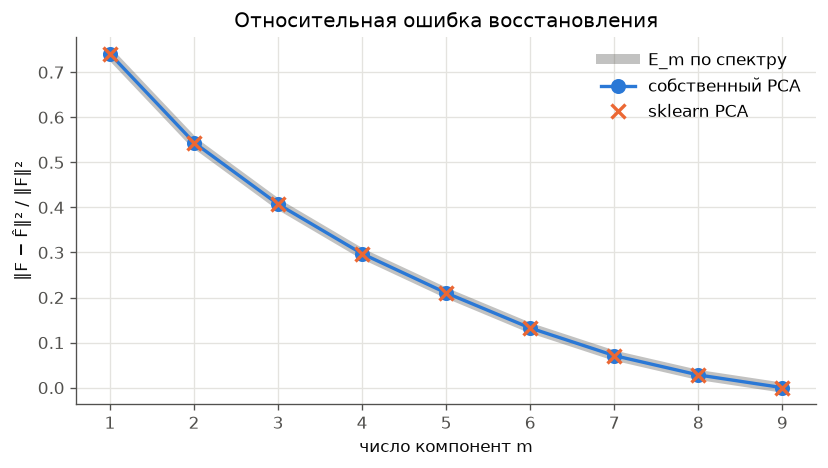
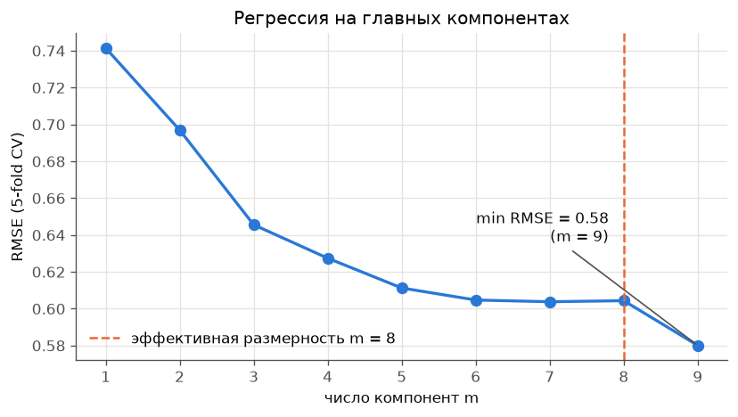

# Лабораторная работа №4. PCA

Вавилова Варвара

PCA реализован через сингулярное разложение, по спектру определена эффективная размерность выборки, результат сверен с `sklearn.decomposition.PCA`.

Теория и обозначения — лекция 4 «Линейные модели регрессии» (раздел «Метод главных компонент»). Для проверки на регрессии использована кросс-проверка из лекции 6 «Оценивание качества обучения, методы отбора признаков».

## Запуск

```bash
cd students/vavilova-vl/lab4
uv run python source/main.py
```

Скрипт печатает все таблицы из отчёта и сохраняет графики в `images/`.

**Данные.** Файл `source/Titanic-Dataset.csv` в репозиторий не попадает (в корневом `.gitignore` стоит правило `*.csv`). При первом запуске [source/data.py](source/data.py) сам скачивает его с Kaggle через `kagglehub` — датасет [Titanic Dataset](https://www.kaggle.com/datasets/yasserh/titanic-dataset), ключ Kaggle API не нужен. Без доступа к сети скачайте `Titanic-Dataset.csv` со страницы датасета вручную и положите в `source/`.

## Структура

| Файл | Назначение |
|---|---|
| [source/data.py](source/data.py) | загрузка, построение признаков; `Preprocessor` — заполнение пропусков и стандартизация по обучающей выборке |
| [source/pca.py](source/pca.py) | класс `PCA`: `fit`, `transform`, `fit_transform`, `inverse_transform` через SVD |
| [source/dimension.py](source/dimension.py) | $E_m$, эффективная размерность, критерий «крутого склона», число обусловленности |
| [source/reference.py](source/reference.py) | проверка основной теоремы PCA и сравнение с `sklearn.decomposition.PCA` |
| [source/regression.py](source/regression.py) | МНК в новых признаках (PCR) и t×q-fold кросс-проверка |
| [source/plots.py](source/plots.py) | графики |
| [source/main.py](source/main.py) | точка входа: запускает все эксперименты |

## 1. Датасет

**Titanic**: $\ell = 891$ пассажир.

**Целевая переменная** — $y = \log(1 + \text{Fare})$, стоимость билета. Это единственный непрерывный признак датасета, поэтому он и выбран целью регрессии. Распределение Fare сильно скошено (медиана 14, максимум 512); логарифм делает зависимость от признаков ближе к линейной и не даёт нескольким дорогим билетам определять всю модель. Плюс единица нужна, потому что у 15 пассажиров Fare = 0.

**Признаки** ($n = 9$):

| Признак | Как получен |
|---|---|
| `Pclass` | класс билета 1–3 |
| `Sex` | 1 — женщина, 0 — мужчина |
| `Age` | возраст; 177 пропусков заполняются медианой обучающей выборки (на всей выборке — 28 лет) |
| `SibSp`, `Parch` | число братьев/сестёр/супругов и родителей/детей на борту |
| `HasCabin` | 1, если номер каюты известен |
| `Embarked_C`, `Embarked_Q` | индикаторы порта посадки; S — базовый. У 2 пассажиров порт пропущен: индикаторы заполняются медианой обучающей выборки, то есть самым частым портом (S) |
| `Survived` | выжил ли пассажир |

`Name`, `Ticket` и `PassengerId` — идентификаторы, они не используются. Для порта взяты два индикатора, а не три: сумма трёх всегда равна 1, и это дало бы точную линейную зависимость и нулевое собственное значение.

Все признаки приведены к нулевому среднему и единичной дисперсии, иначе первые компоненты определял бы `Age`, у которого самый крупный масштаб.

Медианы для пропусков, средние и стандартные отклонения считает класс `Preprocessor` по той выборке, на которой он обучен. В разделах 2–4 (спектр, эффективная размерность, сравнение со sklearn) это вся выборка: там ничего не прогнозируется. В кросс-проверке (раздел 5) `Preprocessor` обучается заново на обучающей части каждого блока, а контрольные объекты преобразуются уже готовыми статистиками. Иначе медиана `Age` и параметры стандартизации включали бы контрольные объекты, и оценка качества была бы смещённой. Центрирование внутри PCA эту проблему не решает: пропуски к тому моменту уже заполнены по всей выборке.

## 2. PCA через сингулярное разложение

$F$ — матрица «объекты–признаки» размера $\ell \times n$. Ищем новые признаки $G$ ($\ell \times m$) и преобразование $U$ ($n \times m$), такие что $\hat F = GU^\top$ как можно точнее приближает $F$:

$$\|GU^\top - F\|^2 \to \min_{G,\,U}.$$

**Основная теорема.** Минимум достигается, когда столбцы $U$ — собственные векторы $F^\top F$ для $m$ наибольших собственных значений $\lambda_1 \ge \dots \ge \lambda_m$, а $G = FU$. При этом:

1. $U^\top U = I_m$;
2. $G^\top G = \Lambda = \mathrm{diag}(\lambda_1, \dots, \lambda_m)$ — новые признаки некоррелированы;
3. $U\Lambda = F^\top F U$;
4. $\|GU^\top - F\|^2 = \sum_{j>m} \lambda_j$.

**Связь с SVD.** $F = VDU^\top$, где $D = \mathrm{diag}(\sqrt{\lambda_1}, \dots, \sqrt{\lambda_n})$. Поэтому $U$ берётся прямо из SVD, а новые признаки — $G = FU = VD$. Матрицу $F^\top F$ явно не строим: SVD работает с $F$ напрямую и численно устойчивее.

Детали реализации:

- В лекции PCA записан для $F$ без сдвига. Мы центрируем $F$ (как sklearn), и тогда $\frac{1}{\ell-1}F^\top F$ — ковариационная матрица. Поскольку признаки уже стандартизированы, среднее и так нулевое, и это ни на что не влияет.
- Пары $(v_j, u_j)$ определены с точностью до одновременной смены знака. Знак фиксируется так, чтобы наибольшая по модулю координата $u_j$ была положительной.
- В коде `eigenvalues_` — это $\lambda_j$ в смысле лекции, а `explained_variance_` $= \lambda_j / (\ell - 1)$ — то же, что одноимённое поле sklearn. Доли дисперсии и $E_m$ от этой нормировки не зависят.

Спектр на нашей выборке:

| $j$ | $\sqrt{\lambda_j}$ | $\lambda_j$ | $\lambda_j/(\ell-1)$ | доля | накопленная доля | $E_j$ |
|---:|---:|---:|---:|---:|---:|---:|
| 1 | 45.600 | 2079.39 | 2.3364 | 25.93% | 25.93% | 0.7407 |
| 2 | 39.725 | 1578.11 | 1.7732 | 19.68% | 45.61% | 0.5439 |
| 3 | 33.123 | 1097.11 | 1.2327 | 13.68% | 59.29% | 0.4071 |
| 4 | 29.681 | 880.94 | 0.9898 | 10.99% | 70.28% | 0.2972 |
| 5 | 26.420 | 698.02 | 0.7843 | 8.70% | 78.98% | 0.2102 |
| 6 | 24.983 | 624.14 | 0.7013 | 7.78% | 86.77% | 0.1323 |
| 7 | 22.158 | 490.96 | 0.5516 | 6.12% | 92.89% | 0.0711 |
| 8 | 18.557 | 344.38 | 0.3869 | 4.29% | 97.18% | 0.0282 |
| 9 | 15.032 | 225.96 | 0.2539 | 2.82% | 100.00% | 0.0000 |

$\lambda_j$ из SVD совпадают с собственными значениями $F^\top F$, посчитанными `np.linalg.eigvalsh`: относительное расхождение $1.6 \cdot 10^{-15}$.

**Проверка основной теоремы.** Для каждого $m = 1, \dots, 9$ проверены свойства 1–4. Расхождения 2 и 3 нормированы на $\lambda_1$, расхождение 4 — на $\|F\|^2$. Наибольшее отклонение по всем $m$ и свойствам — $4.0 \cdot 10^{-15}$, то есть теорема выполняется с точностью до машинной арифметики.



Как устроены компоненты (столбцы $U$):

- **PC1** (26%) — «социальный статус»: высокий `Pclass` (дешёвый класс), нет каюты, не выжил. Это главная ось датасета.
- **PC2** (20%) — «семья»: `SibSp`, `Parch` и `Sex` с одной стороны, `Age` с другой, то есть молодые пассажиры с родственниками.
- **PC4, PC5** — почти целиком порт посадки.
- **PC9** (2.8%) $\approx 0.75\,\text{Pclass} + 0.62\,\text{HasCabin}$. `Pclass` и `HasCabin` сильно отрицательно коррелированы ($r = -0.73$): у первого класса каюта почти всегда известна. Вдоль направления, где они растут вместе, дисперсия поэтому мала. Это пассажиры, у которых класс и наличие каюты «противоречат» друг другу.


В проекции на первые две компоненты (46% дисперсии) цена билета явно растёт справа налево, вдоль PC1. Наклонные полосы — следствие дискретных признаков (`Pclass`, `SibSp`, `Parch`, индикаторы).

## 3. Эффективная размерность

**Эффективная размерность выборки** — наименьшее $m$, при котором

$$E_m = \frac{\|GU^\top - F\|^2}{\|F\|^2} = \frac{\lambda_{m+1} + \dots + \lambda_n}{\lambda_1 + \dots + \lambda_n} \le \varepsilon.$$

Второй критерий из той же лекции — **«крутой склон»**: ищем $m$, при котором $E_{m-1} \gg E_m$. В коде берётся $m$ с наибольшим отношением $E_{m-1}/E_m$. Случай $m = n$ исключён: там $E_n = 0$ и отношение бесконечно при любом спектре.



| Критерий | $m$ |
|---|---:|
| $E_m \le 0.20$ | 6 |
| $E_m \le 0.10$ | 7 |
| **$E_m \le 0.05$** | **8** |
| $E_m \le 0.01$ | 9 |
| «крутой склон», $\max E_{m-1}/E_m$ | 8 |

Отношения $E_{m-1}/E_m$ для $m = 1, \dots, 8$: 1.35, 1.36, 1.34, 1.37, 1.41, 1.59, 1.86, **2.52**.

При $\varepsilon = 0.05$ эффективная размерность $m = 8$ из 9, и критерий «крутого склона» даёт то же значение.

При этом «склон» здесь пологий. В примере из лекции $E_m$ падает в десятки раз за один шаг, а у нас наибольшее отношение — всего 2.5. Спектр убывает плавно, без обрыва: признаки Titanic в основном слабо коррелированы, и каждый несёт свою информацию. Поэтому ответ по первому критерию зависит от $\varepsilon$ — от 6 до 9 компонент.

Число обусловленности $\mu(F^\top F) = \lambda_{\max} / \lambda_{\min} = 9.2$ невелико: сильной мультиколлинеарности нет, и почти вырожденных направлений, которые стоило бы отбросить ради устойчивости, тоже нет.

## 4. Эквивалентность с эталонной реализацией

Для каждого $m = 1, \dots, 9$ собственный `PCA(m)` сравнивался с `sklearn.decomposition.PCA(n_components=m, svd_solver="full")`. Перед сравнением знаки главных направлений выравниваются, потому что они определены неоднозначно. Сравнивались главные направления $U$, дисперсии компонент $\lambda_j/(\ell-1)$, доли дисперсии, сингулярные числа $\sqrt{\lambda_j}$, новые признаки $G$ и восстановленная матрица $\hat F$.

| $m$ | $U$ | $\lambda/(\ell-1)$ | доля | $\sqrt\lambda$ | $G$ | $\hat F$ | смен знака |
|---:|---:|---:|---:|---:|---:|---:|---:|
| 1 | 4.4e-16 | 4.0e-15 | 5.0e-16 | 4.3e-14 | 3.1e-15 | 2.4e-15 | 0 |
| 2 | 6.4e-16 | 4.0e-15 | 5.0e-16 | 4.3e-14 | 3.6e-15 | 3.3e-15 | 0 |
| 3–9 | 2.6e-15 | 4.0e-15 | 5.0e-16 | 4.3e-14 | 1.1e-14 | ≤ 9.7e-15 | 0 |

В таблице — максимальное абсолютное расхождение. По всем $m$ и всем величинам оно не превышает $4.3 \cdot 10^{-14}$, то есть совпадение с точностью до машинной арифметики. Смен знака нет: выбранное правило фиксации знака совпадает с тем, что использует sklearn (`svd_flip`).



Относительные ошибки восстановления обеих реализаций совпадают между собой и с теоретическим $E_m$, вычисленным только по спектру (оба расхождения $2 \cdot 10^{-16}$).

## 5. Проверка на задаче регрессии

**МНК в новых признаках**. Заменяем $F$ на приближение $GU^\top$ и решаем $\|G\beta - y\|^2 \to \min$:

$$\beta^* = D^{-1}V^\top y, \qquad \alpha^* = U\beta^* = \sum_{j=1}^{m} \frac{1}{\sqrt{\lambda_j}}\, u_j (v_j^\top y).$$

От обычного МНК это решение отличается только тем, что в сумме $m$ слагаемых вместо $n$. В коде используется равносильная запись $\beta^* = \Lambda^{-1}G^\top y$, она следует из $G^\top G = \Lambda$. При $m = n$ функция `pcr_fit` даёт обычный МНК: коэффициенты совпадают с `sklearn.linear_model.LinearRegression` до $1.3 \cdot 10^{-15}$.

**Внешний критерий**. Качество оценивается RMSE на кросс-проверке $t \times q$-fold с $t = 10$, $q = 5$: выборка 10 раз случайно разбивается на 5 блоков, и каждый объект ровно 10 раз попадает в контроль. Одиночный $q$-fold заметно зависит от разбиения, а $t \times q$-fold лекция называет стандартом де-факто. Заполнение пропусков, стандартизация и PCA обучаются только на обучающей части каждого разбиения, так что статистики контрольных объектов в модель не попадают.



| $m$ | 1 | 2 | 3 | 4 | 5 | 6 | 7 | **8** | 9 |
|---|---:|---:|---:|---:|---:|---:|---:|---:|---:|
| RMSE | 0.742 | 0.697 | 0.646 | 0.627 | 0.611 | 0.605 | 0.604 | **0.604** | 0.580 |

RMSE измеряется в единицах $\log(1 + \text{Fare})$: ошибка 0.58 соответствует отклонению цены примерно в $e^{0.58} \approx 1.8$ раза.

- Первая компонента сразу даёт основную часть качества: стандартное отклонение $y$ равно 0.97, а одна PC1 снижает ошибку до 0.74.
- С 6-й по 8-ю компоненту качество почти не меняется (0.604–0.605).
- **Последняя, 9-я компонента даёт самый большой прирост на хвосте**: RMSE падает с 0.604 до 0.580. Это PC9 = «`Pclass` + `HasCabin`», направление с наименьшей дисперсией. Цена билета определяется прежде всего классом, а наличие каюты связано с ней слабее. PC9 как раз отделяет класс от наличия каюты, и эта разница для цены важна.

Отсюда главный вывод этого раздела. **PCA — обучение без учителя**: он не смотрит на $y$, и компонента с маленькой дисперсией признаков может быть сильно связана с целевой переменной. Отбор компонент по $E_m$ хорош для сжатия признакового описания, но для регрессии его нужно проверять внешним критерием.

На данных Titanic отбрасывать компоненты не нужно: модель на всех 9 признаках лучше, а мультиколлинеарность слабая ($\mu = 9.2$), так что регуляризация через PCA ничего не даёт. Норма коэффициентов уменьшается лишь немного: с 0.663 (МНК на всех признаках) до 0.571 (8 компонент).

## Выводы

1. PCA реализован через SVD центрированной матрицы $F = VDU^\top$: главные направления — столбцы $U$, новые признаки $G = FU = VD$. Свойства основной теоремы выполняются с точностью $4 \cdot 10^{-15}$.
2. Эффективная размерность выборки Titanic при $\varepsilon = 0.05$ равна **8 из 9**, критерий «крутого склона» даёт то же значение. Но спектр плоский ($\mu = 9.2$), признаки слабо коррелированы, и выборку нельзя существенно сжать без потери информации.
3. Собственная реализация совпадает с `sklearn.decomposition.PCA` по всем величинам с точностью до $4.3 \cdot 10^{-14}$.
4. В регрессии на $\log(1 + \text{Fare})$ лучший результат на 10×5-fold CV даёт полный набор компонент (RMSE 0.580). Отброшенная по критерию $E_m$ компонента PC9 оказалась полезной для прогноза: малая дисперсия признаков не означает малую связь с целевой переменной.
