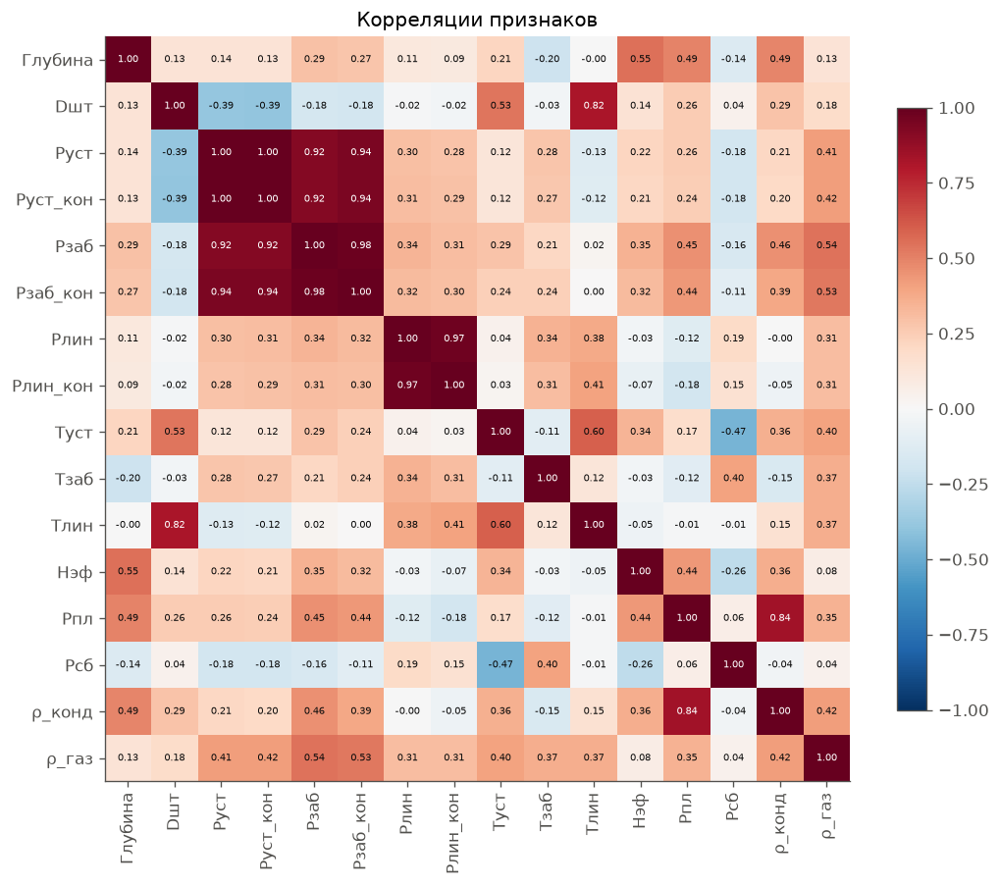
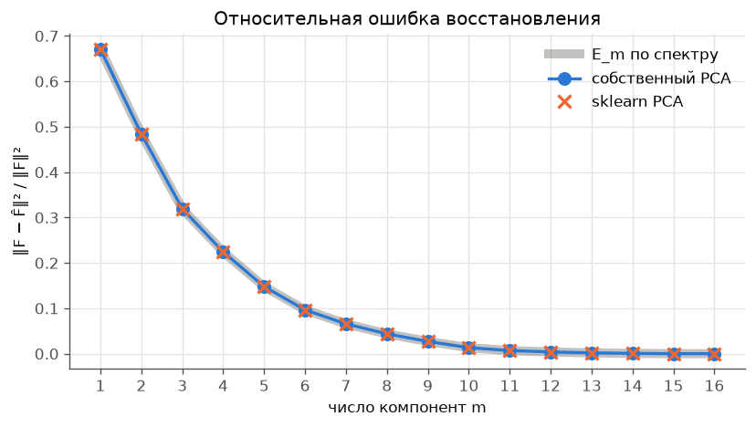
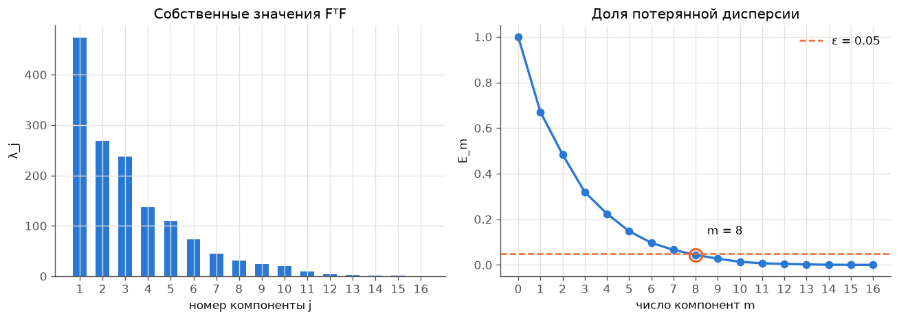
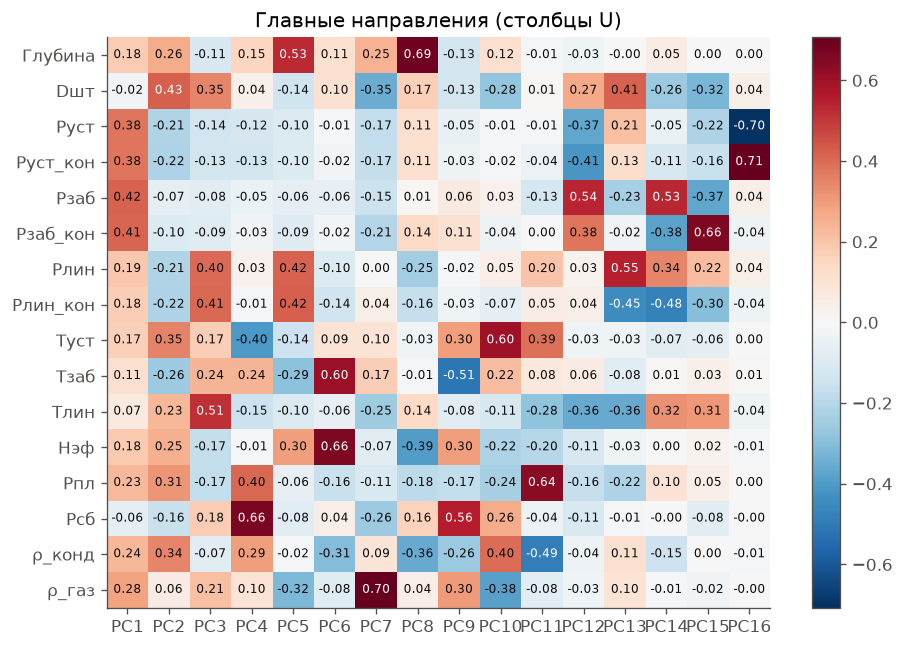
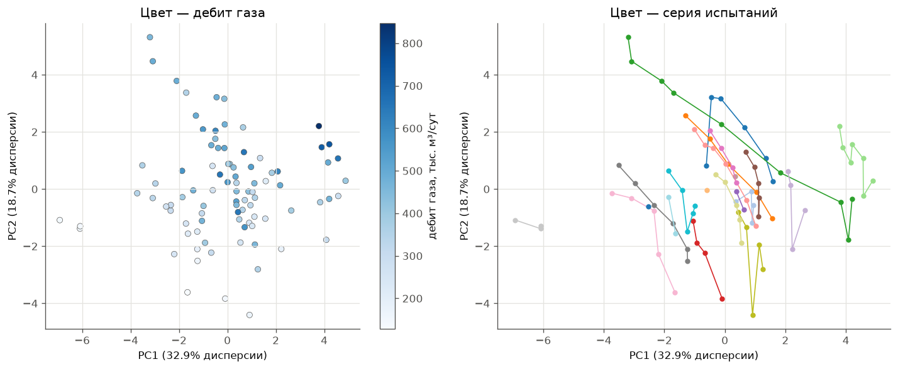
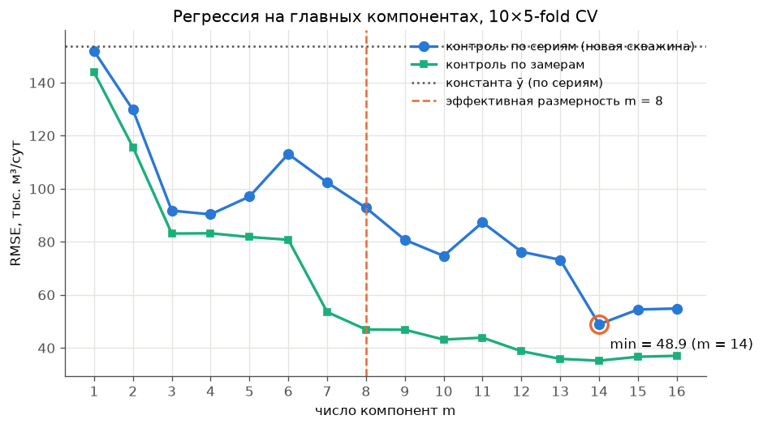
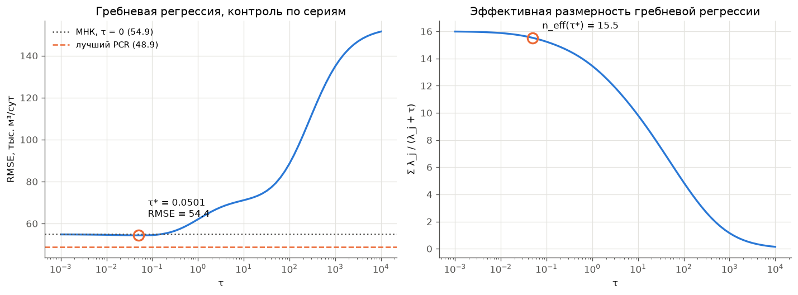
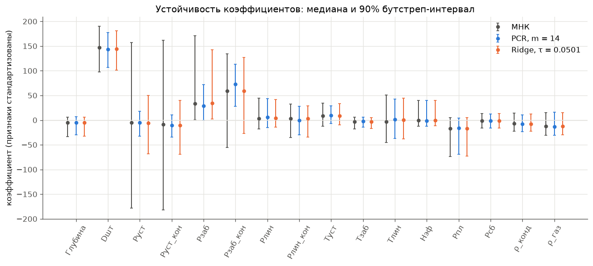

# Дополнительное исследование: PCA на данных испытаний газоконденсатных скважин

В основной лабораторной PCA применялся к Titanic, и там он оказался почти бесполезен для регрессии: признаки слабо коррелированы ($\mu(F^\top F) = 9.2$), и лучший результат давал обычный МНК на всех признаках. Здесь те же методы применены к данным противоположного типа: технологическим замерам, в которых многие признаки почти дублируют друг друга. Цель — проверить, когда PCA и регуляризация действительно нужны.

Используется реализация PCA и проверки из основной лабораторной ([../source/pca.py](../source/pca.py), [../source/reference.py](../source/reference.py), [../source/dimension.py](../source/dimension.py)). Добавлены регрессия на главных компонентах и гребневая регрессия через одно SVD, а также кросс-проверка по сериям испытаний.

## Запуск

```bash
cd students/vavilova-vl/lab4
uv run python addition_investigation/run.py
```

| Файл | Назначение |
|---|---|
| [data.csv](data.csv) | исходные данные (разделитель `;`, десятичная запятая) |
| [gas_data.py](gas_data.py) | загрузка, очистка, выделение серий испытаний; `Preprocessor` — заполнение пропусков и стандартизация по обучающей выборке |
| [models.py](models.py) | МНК, PCR и гребневая регрессия через SVD; кросс-проверка по сериям; бутстреп |
| [gas_plots.py](gas_plots.py) | графики, которых нет в основной лабораторной |
| [run.py](run.py) | точка входа: печатает все таблицы отчёта и сохраняет графики в `images/` |

## 1. Данные

Каждая строка — один режим испытания скважины: скважину открывают на штуцере диаметра $D_\text{шт}$ и замеряют давления, температуры и дебиты. Обычно у одной скважины 4–7 режимов с разными штуцерами. Всего в файле 93 замера.

**Целевая переменная** — $y$ = дебит газа в стандартных условиях, тыс. м³/сут. Среднее 392, стандартное отклонение 150, диапазон 128–847.

**Признаки** ($n = 16$) — всё, что измеряется на режиме, кроме других дебитов:

| Признак | Столбец в файле | Смысл |
|---|---|---|
| `Глубина` | Глубина манометра | глубина замера забойного давления, м |
| `Dшт` | Dшт | диаметр штуцера, мм |
| `Руст`, `Руст_кон` | Руст(ср), Руст(кон) | устьевое давление: среднее за режим и в конце режима |
| `Рзаб`, `Рзаб_кон` | Рзаб(ср), Рзаб(кон) | забойное давление: среднее и в конце |
| `Рлин`, `Рлин_кон` | Pлин(ср), Рлин(кон) | давление в линии: среднее и в конце |
| `Туст`, `Тзаб`, `Тлин` | Туст, Тзаб, Tлин | температуры на устье, на забое, в линии |
| `Нэф` | Нэф | эффективная толщина пласта, м |
| `Рпл` | Рпл. Тек (послед точка на КВД) | текущее пластовое давление |
| `Рсб` | Pсб | давление в сборном коллекторе |
| `ρ_конд`, `ρ_газ` | Ro_c, Удельная плотность газа | плотность конденсата и относительная плотность газа |

**Что не используется и почему:**

- Другие дебиты (конденсата, воды, смеси, газа в линейных условиях), `G_total` и `КГФ`. Они измеряются вместе с дебитом газа или вычисляются из него: например, $r(\text{дебит смеси}, y) = 0.999$. С ними задача стала бы тривиальной.
- `Тна шлейфе`, `Рпл. Тек (Карноухов)`, `Рпл. Тек (Расчет по КВД)`, `Ro_g`, `Ro_w`: в них от 12 до 70 пропусков из 93.

**Очистка:**

- Удалены 3 замера без забойного давления, забойной температуры и глубины манометра. Остаётся $\ell = 90$.
- Плотность конденсата 186 кг/м³ (одна строка) при остальных значениях 770–801 считается опечаткой и заменяется пропуском.
- В трёх строках `Рлин_кон` равно 41–48 атм при среднем за тот же режим около 100 атм. Это тоже опечатка; значение заменено средним за режим.
- Остаются 3 пропуска (2 в `Рпл`, 1 в `ρ_конд`). Их заполняет класс `Preprocessor` по той выборке, на которой он обучен: медианой своей серии испытаний, а если этой серии в выборке нет или значения в ней нет — общей медианой. Он же стандартизует признаки. Исправления опечаток выше — фиксированные правила для отдельной строки и статистик выборки не используют.

Для описательного анализа, PCA и бутстрепа (разделы 2–4 и 6) `Preprocessor` обучается на всей выборке: качество прогноза там не оценивается. В кросс-проверке (раздел 5) он обучается заново на обучающей части каждого блока, а контрольные замеры заполняются и стандартизуются уже готовыми статистиками. При контроле по сериям серия контрольного замера целиком в контроле, поэтому её пропуск заполняется общей медианой обучающих замеров, а не по соседним режимам той же скважины.

**Серии испытаний.** Режимы одной скважины очень похожи друг на друга: у них одинаковые глубина, толщина пласта, пластовое давление, плотности. Серия выделяется по паре «глубина манометра + $Н_\text{эф}$», получается 21 серия по 1–10 режимов. Это важно для кросс-проверки (раздел 5).

## 2. Мультиколлинеарность



Сильнее всего коррелированные пары:

| пара | $r$ |
|---|---:|
| `Руст` – `Руст_кон` | 0.998 |
| `Рзаб` – `Рзаб_кон` | 0.978 |
| `Рлин` – `Рлин_кон` | 0.969 |
| `Руст` – `Рзаб_кон` | 0.942 |
| `Руст` – `Рзаб` | 0.922 |

Три пары «среднее – конечное» давление — практически дубликаты: за время режима давление почти не меняется. Устьевое и забойное давления тоже сильно связаны, потому что отличаются на вес столба газа в скважине.

С дебитом сильнее всего связаны `Dшт` ($r = 0.86$), `Тлин` (0.80) и `Туст` (0.65): чем шире штуцер, тем больше дебит, а чем больше дебит, тем меньше газ успевает остыть по пути наверх. Давления по отдельности связаны с дебитом слабо ($|r| \le 0.28$), хотя физически дебит определяется именно перепадом давлений.

## 3. PCA и эффективная размерность

Признаки стандартизованы; PCA — та же реализация через SVD, что в основной лабораторной.

**Проверки.** Свойства 1–4 основной теоремы выполняются с точностью $1.6 \cdot 10^{-15}$, отличие от `sklearn.decomposition.PCA` по всем $m$ — не больше $1.2 \cdot 10^{-14}$, смен знака нет. Ошибка восстановления совпадает с $E_m$ до $1.1 \cdot 10^{-16}$.



| $j$ | $\lambda_j$ | доля | накопленная | $E_j$ |
|---:|---:|---:|---:|---:|
| 1 | 473.9 | 32.9% | 32.9% | 0.671 |
| 2 | 269.2 | 18.7% | 51.6% | 0.484 |
| 3 | 237.2 | 16.5% | 68.1% | 0.319 |
| 4 | 136.9 | 9.5% | 77.6% | 0.224 |
| 5 | 110.3 | 7.7% | 85.2% | 0.148 |
| 6 | 73.5 | 5.1% | 90.3% | 0.097 |
| 7 | 44.5 | 3.1% | 93.4% | 0.066 |
| 8 | 31.6 | 2.2% | 95.6% | 0.044 |
| 9–11 | 24.0 … 9.1 | 3.7% | 99.3% | 0.007 |
| 12–15 | 4.5 … 0.85 | 0.7% | 99.99% | 0.00006 |
| 16 | **0.093** | 0.01% | 100% | 0 |



| Критерий | $m$ |
|---|---:|
| $E_m \le 0.20$ | 5 |
| $E_m \le 0.10$ | 6 |
| **$E_m \le 0.05$** | **8** |
| $E_m \le 0.01$ | 11 |
| «крутой склон», $\max E_{m-1}/E_m$ | 15 |

**Число обусловленности** $\mu(F^\top F) = \lambda_{\max}/\lambda_{\min} = 5101$, в 550 раз больше, чем на Titanic. Если отбросить 5 последних компонент ($m = 11$), $\mu$ падает до 52.

Два критерия дают очень разные ответы, и оба осмысленны:

- **$E_m \le 0.05 \Rightarrow m = 8$**: восемь направлений описывают 95.6% разброса. По этому критерию 16 признаков можно сжать вдвое.
- **«Крутой склон» $\Rightarrow m = 15$**: $E_{14}/E_{15} = 10.1$, а все остальные отношения не больше 2.8. Это единственный настоящий обрыв в спектре: $\lambda_{16} = 0.093$ в 9 раз меньше $\lambda_{15}$. Последняя компонента — это `Руст_кон` − `Руст`, разность двух почти одинаковых замеров (см. ниже). Критерий нашёл ровно одно вырожденное направление.

На Titanic «склон» был пологим (максимальное отношение 2.5), и оба критерия случайно совпали. Здесь видно, что они отвечают на разные вопросы: первый — «сколько направлений нужно, чтобы описать почти весь разброс», второй — «где кончаются осмысленные направления и начинается шум».

## 4. Главные компоненты



| компонента | доля | наибольшие координаты $u_j$ | смысл |
|---|---:|---|---|
| PC1 | 32.9% | `Рзаб` 0.42, `Рзаб_кон` 0.41, `Руст` 0.38, `Руст_кон` 0.38 | общий уровень давления в скважине |
| PC2 | 18.7% | `Dшт` 0.43, `Туст` 0.35, `ρ_конд` 0.34, `Рпл` 0.31 | режим отбора: шире штуцер — теплее устье |
| PC3 | 16.5% | `Тлин` 0.51, `Рлин_кон` 0.41, `Рлин` 0.40, `Dшт` 0.35 | состояние линии |
| PC4 | 9.5% | `Рсб` 0.66, `Рпл` 0.40, `Туст` −0.40 | давление в сборном коллекторе |
| PC5 | 7.7% | `Глубина` 0.53, `Рлин` 0.42, `Рлин_кон` 0.42 | глубина скважины |
| PC6 | 5.1% | `Нэф` 0.66, `Тзаб` 0.60 | свойства пласта |
| … | | | |
| PC12 | 0.31% | `Рзаб` 0.54, `Руст_кон` −0.41, `Рзаб_кон` 0.38 | забойное против устьевого давления |
| PC15 | 0.06% | `Рзаб_кон` 0.66, `Рзаб` −0.37 | разность «конец − среднее» для забойного давления |
| PC16 | 0.01% | `Руст_кон` 0.71, `Руст` −0.70 | разность «конец − среднее» для устьевого давления |

PC1 собирает все четыре давления скважины с почти равными весами: они изменяются вместе. Последние компоненты — разности почти одинаковых замеров. Это ровно та структура, которую описывает лекция: коррелированные признаки дают одно направление с большим $\lambda$ (их общий уровень) и одно с почти нулевым (их разность).



На проекции слева дебит растёт вдоль PC2, то есть вместе со штуцером. Справа видно, что режимы одной серии лежат на одной линии: при смене штуцера скважина двигается вдоль своей траектории, а разные скважины сдвинуты друг относительно друга. Отсюда главная трудность задачи: предсказать дебит новой скважины гораздо сложнее, чем ещё одного режима знакомой.

## 5. Регрессия: МНК, PCR и гребневая

Все три метода решаются через одно SVD центрированной обучающей матрицы $F = VDU^\top$ и отличаются только весами слагаемых:

$$\alpha = \sum_{j=1}^n w_j\,\frac{1}{\sqrt{\lambda_j}}\,u_j\,(v_j^\top y), \qquad w_j = \begin{cases} 1 & \text{МНК},\\ [\,j \le m\,] & \text{PCR},\\ \dfrac{\lambda_j}{\lambda_j + \tau} & \text{гребневая}.\end{cases}$$

Решения на всей выборке совпадают с `sklearn.linear_model.LinearRegression` (до $5.8 \cdot 10^{-13}$) и `Ridge` (до $2.1 \cdot 10^{-11}$).

**Кросс-проверка по сериям.** Используется $t \times q$-fold с $t = 10$, $q = 5$, но блоки составляются из серий испытаний, а не из отдельных замеров: все режимы одной скважины попадают либо в обучение, либо в контроль. Иначе в обучении оказываются соседние режимы той же скважины, и контроль проверяет интерполяцию между штуцерами, а не прогноз для новой скважины. Заполнение пропусков, стандартизация и SVD строятся только по обучающей части каждого блока; в подготовку контрольных замеров не попадают ни их собственные статистики, ни статистики других контрольных замеров.



| $m$ | 1 | 2 | 3 | 4 | 5 | 6 | 7 | **8** | 9 | 10 | 11 | 12 | 13 | **14** | 15 | 16 (МНК) |
|---|---:|---:|---:|---:|---:|---:|---:|---:|---:|---:|---:|---:|---:|---:|---:|---:|
| по сериям | 151.9 | 129.8 | 91.8 | 90.4 | 97.1 | 113.1 | 102.4 | 92.8 | 80.8 | 74.7 | 87.3 | 76.3 | 73.2 | **48.9** | 54.5 | 54.9 |
| по замерам | 143.9 | 115.7 | 83.1 | 83.2 | 81.8 | 80.8 | 53.6 | 46.9 | 46.9 | 43.2 | 43.9 | 38.8 | 35.9 | 35.2 | 36.7 | 37.0 |

RMSE в тыс. м³/сут; константный прогноз $\bar y$ даёт 153.9.

**Наблюдения:**

1. **Отбрасывание двух последних компонент улучшает прогноз**: PCR с $m = 14$ даёт 48.9 против 54.9 у МНК (−11%). Это не случайность разбиения: на 10 разных случайных разбиениях $m = 14$ лучшее во всех 10 случаях (в среднем 55.4 против 60.4 у МНК), и на leave-one-group-out тоже (48.3 против 53.4). Выброшенные PC15 и PC16 — разности «конец − среднее» для давлений, то есть шум измерений.

   Выигрыш почти целиком получается на одной серии (глубина 3576.3 м). У неё «средние» и «конечные» давления расходятся заметнее, чем у остальных (например, `Руст` 233.5 и `Руст_кон` 249). МНК поставил большие веса на эти разности, и на этой серии его ошибка 85 против 38 у PCR с $m = 14$.

2. **Эффективная размерность $m = 8$ для регрессии не подходит**: RMSE 92.8, почти вдвое хуже. Компоненты 9–14 описывают всего 3.7% разброса признаков, но важны для прогноза: добавление одной PC14 (0.12% разброса) снижает ошибку с 73 до 49. Тот же вывод, что на Titanic: малая дисперсия признаков не означает малую связь с $y$.

3. **Кривая по сериям немонотонна**, по замерам — почти монотонна. При контроле по замерам модель видит соседние режимы той же скважины, и каждая новая компонента помогает их подогнать. При контроле по сериям лишние компоненты могут подогнать особенности обучающих скважин, которые на новые не переносятся (скачок на $m = 6$). Разница между кривыми — от 7 до 49 тыс. м³/сут — показывает, насколько оптимистична была бы оценка без учёта серий.



**Гребневая регрессия почти не помогает**: лучшее $\tau = 0.05$, RMSE 54.4 против 54.9 у МНК; при $\tau \ge 1$ ошибка только растёт. Причина видна из весов $w_j = \lambda_j/(\lambda_j + \tau)$:

- чтобы подавить шумовую PC16 ($\lambda = 0.09$), нужно $\tau \gg 0.09$;
- но при $\tau \sim 1$ подавляется и полезная PC14 ($\lambda = 1.7$, вес 0.63), а при $\tau \sim 10$ — и PC9–PC13.

Полезные и бесполезные направления здесь лежат в спектре рядом, и «мягкое» подавление по величине $\lambda_j$ не может их разделить. PCR вырезает именно две последние компоненты и поэтому выигрывает. Эффективная размерность гребневой модели при $\tau^* = 0.05$ равна $n_\text{eff} = 15.5$, а обусловленность $\mu(F^\top F + \tau I)$ падает лишь до 3314.

## 6. Устойчивость коэффициентов

Неравенство $\frac{\|\delta\alpha\|}{\|\alpha\|} \le \mu \frac{\|\delta u\|}{\|u\|}$ говорит, что при большом $\mu$ коэффициенты МНК сильно зависят от выборки. Проверим это напрямую: 500 раз выбираем 21 серию с возвращением (бутстреп по сериям), обучаем три модели и смотрим на разброс коэффициентов.



Ширина 90% бутстреп-интервала коэффициента (признаки стандартизованы, единицы — тыс. м³/сут на одно стандартное отклонение признака):

| признак | МНК | PCR, $m = 14$ | Ridge, $\tau = 0.05$ |
|---|---:|---:|---:|
| `Руст` | 335.7 | **50.4** | 117.8 |
| `Руст_кон` | 343.6 | **44.5** | 109.1 |
| `Рзаб` | 170.9 | **72.4** | 140.1 |
| `Рзаб_кон` | 189.0 | **84.7** | 153.7 |
| `Dшт` | 92.6 | 71.0 | 79.4 |
| `Тлин` | 96.2 | 80.4 | 83.0 |
| остальные 10 | 23–80 | 20–72 | 22–78 |
| медиана по признакам | 64.9 | 51.4 | 59.0 |

- У МНК коэффициенты при `Руст` и `Руст_кон` меняются в диапазоне около ±170, то есть больше, чем коэффициент самого сильного признака `Dшт` (~150). При этом они почти зеркальны: корреляция двух коэффициентов по бутстрепу −0.92, а интервал их суммы (142) в 2.4 раза уже, чем у каждого по отдельности. МНК довольно уверенно определяет вклад общего уровня устьевого давления, но не может решить, как поделить вес между двумя почти одинаковыми замерами. Это и есть почти-неединственность решения при почти вырожденной $F^\top F$.
- PCR с $m = 14$ сужает интервалы для `Руст` и `Руст_кон` в 7–8 раз, для `Рзаб` и `Рзаб_кон` — в 2.2–2.4 раза: направления, вдоль которых вес можно перекладывать, выброшены.
- Ridge с $\tau = 0.05$ сужает их втрое, но не убирает совсем. Для признаков, не участвующих в дублирующих парах, все три метода дают почти одинаковый разброс.

## Выводы

1. На данных испытаний скважин признаки сильно мультиколлинеарны: три пары «среднее – конечное» давление коррелируют с $r \ge 0.97$, $\mu(F^\top F) = 5101$ против 9.2 на Titanic. PCA через SVD работает корректно: теорема и совпадение со sklearn проверены с точностью $\le 1.2 \cdot 10^{-14}$.
2. Эффективная размерность по $E_m \le 0.05$ равна **8 из 16**: данные можно сжать вдвое с потерей 4.4% разброса. Критерий «крутого склона» даёт **15**: он находит единственное вырожденное направление `Руст_кон` − `Руст`.
3. **Здесь PCA помогает регрессии**: PCR с $m = 14$ снижает ошибку прогноза для новой скважины на 11% (48.9 против 54.9) и в 2–8 раз сужает разброс коэффициентов при дублирующих признаках. Результат устойчив к выбору разбиения.
4. Но число компонент нужно выбирать по внешнему критерию, а не по $E_m$: $m = 8$ даёт ошибку 92.8, почти вдвое хуже МНК. Компоненты с малой дисперсией признаков (PC9–PC14) содержат важную для дебита информацию.
5. Гребневая регрессия почти не помогает (54.4): её «мягкое» подавление по $\lambda_j$ не может отделить шумовые PC15–PC16 от полезной PC14 с близким $\lambda$.
6. Кросс-проверка по отдельным замерам занижает ошибку до 2 раз (для МНК — в 1.5 раза) по сравнению с проверкой по сериям, потому что режимы одной скважины попадают и в обучение, и в контроль. Для данных с группами контроль нужно строить по группам.
7. Сравнение с Titanic: PCA полезен для регрессии, когда в данных есть почти дублирующие признаки (большое $\mu$), и бесполезен, когда признаки независимы. В обоих случаях отбирать компоненты по доле дисперсии нельзя — это обучение без учителя, и малая дисперсия признака не означает малую связь с ответом.
