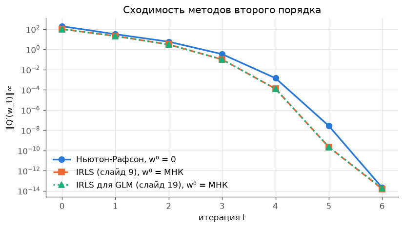
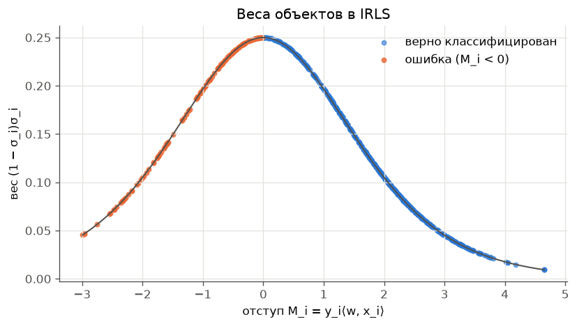
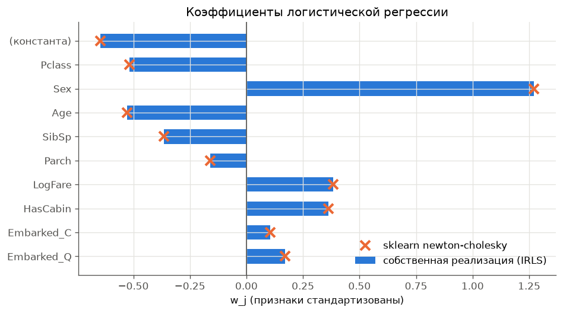
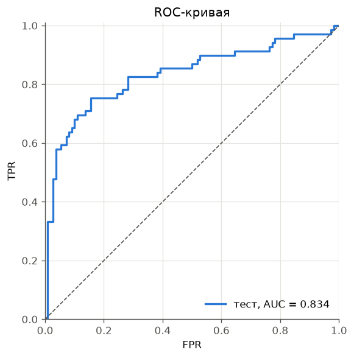

# Лабораторная работа №5. Логистическая регрессия

Вавилова Варвара

Логистическая регрессия реализована методом Ньютона–Рафсона и методом IRLS (в двух формах: из раздела о логистической регрессии и из раздела об обобщённой линейной модели). Показано, что все три способа делают один и тот же шаг и совпадают с `sklearn.linear_model.LogisticRegression`.

Теория - лекция 5 «Нелинейная регрессия». Метрики качества - лекция 6 «Оценивание качества обучения».

Содержание:

- [Запуск и структура](#запуск-и-структура)
- [Часть I. Теория](#часть-i-теория)
  1. [Нелинейная регрессия и метод Ньютона–Рафсона](#1-нелинейная-регрессия-и-метод-ньютонарафсона)
  2. [Логистическая регрессия: постановка](#2-логистическая-регрессия-постановка)
  3. [Градиент и гессиан](#3-градиент-и-гессиан)
  4. [Сведение шага Ньютона к взвешенному МНК](#4-сведение-шага-ньютона-к-взвешенному-мнк)
  5. [Алгоритм IRLS](#5-алгоритм-irls)
  6. [Вероятностная постановка: обобщённая линейная модель](#6-вероятностная-постановка-обобщённая-линейная-модель)
  7. [Метрики качества](#7-метрики-качества)
- [Часть II. Реализация](#часть-ii-реализация)
- [Часть III. Эксперименты](#часть-iii-эксперименты)
- [Выводы](#выводы)

## Запуск и структура

```bash
cd students/vavilova-vl/lab5
uv run python source/main.py
```

Скрипт печатает все таблицы из отчёта и сохраняет графики в `images/`.

**Данные.** Файл `source/Titanic-Dataset.csv` в репозиторий не попадает (в корневом `.gitignore` стоит правило `*.csv`). При первом запуске [source/data.py](source/data.py) сам скачивает его с Kaggle через `kagglehub` — датасет [Titanic Dataset](https://www.kaggle.com/datasets/yasserh/titanic-dataset), ключ Kaggle API не нужен. Без доступа к сети скачайте `Titanic-Dataset.csv` со страницы датасета вручную и положите в `source/`.

| Файл | Назначение |
|---|---|
| [source/data.py](source/data.py) | загрузка, признаки, разбиение на обучение и тест, стандартизация |
| [source/losses.py](source/losses.py) | сигмоида, функционал $Q(w)$, градиент и гессиан |
| [source/solvers.py](source/solvers.py) | метод Ньютона–Рафсона, IRLS, IRLS для GLM, выбор шага |
| [source/model.py](source/model.py) | класс `LogisticRegression`: `fit`, `predict_proba`, `predict` |
| [source/metrics.py](source/metrics.py) | accuracy, log-loss, ROC-кривая и AUC, матрица ошибок |
| [source/reference.py](source/reference.py) | сравнение со sklearn и проверка тождества IRLS = Ньютон |
| [source/plots.py](source/plots.py) | графики |
| [source/main.py](source/main.py) | точка входа: запускает все эксперименты |

---

# Часть I. Теория

## 1. Нелинейная регрессия и метод Ньютона–Рафсона

### 1.1. Постановка

- $X^\ell = \lbrace (x_i, y_i) \rbrace_{i=1}^{\ell}$ - обучающая выборка, $x_i \in \mathbb{R}^n$, $y_i \in \mathbb{R}$;
- $y_i = y(x_i)$, где $y: X \to Y$ - неизвестная зависимость;
- $f(x, \alpha)$ - **нелинейная** модель регрессии с параметрами $\alpha \in \mathbb{R}^p$.

Метод наименьших квадратов:

$$
Q(\alpha, X^\ell) = \sum_{i=1}^{\ell} \bigl(f(x_i, \alpha) - y_i\bigr)^2 \to \min_\alpha.
$$

В отличие от линейного случая, явной формулы для минимума нет, и задача решается итерационно.

### 1.2. Метод Ньютона–Рафсона

Функционал раскладывается в ряд Тейлора до второго порядка вокруг текущего приближения $\alpha^t$:

$$
Q(\alpha) \approx Q(\alpha^t) + Q'(\alpha^t)^\top(\alpha - \alpha^t) + \tfrac{1}{2}(\alpha - \alpha^t)^\top Q''(\alpha^t)(\alpha - \alpha^t).
$$

Минимум этой квадратичной аппроксимации даёт шаг метода:

$$
\alpha^{t+1} := \alpha^t - h_t\,\bigl(Q''(\alpha^t)\bigr)^{-1} Q'(\alpha^t),
$$

где $Q'$ - **градиент** (вектор из $\mathbb{R}^p$), $Q''$ - **гессиан** (матрица $p \times p$), $h_t$ - величина шага (можно $h_t = 1$).

Для МНК компоненты градиента и гессиана:

$$
\frac{\partial Q}{\partial \alpha_j} = 2\sum_{i=1}^{\ell}\bigl(f(x_i,\alpha) - y_i\bigr)\frac{\partial f(x_i,\alpha)}{\partial \alpha_j},
$$

$$
\frac{\partial^2 Q}{\partial \alpha_j\,\partial \alpha_k} = 2\sum_{i=1}^{\ell}\frac{\partial f}{\partial \alpha_j}\frac{\partial f}{\partial \alpha_k} - \underbrace{2\sum_{i=1}^{\ell}\bigl(f(x_i,\alpha) - y_i\bigr)\frac{\partial^2 f}{\partial \alpha_j\,\partial \alpha_k}}_{\text{при линеаризации полагается } 0}.
$$

**Свойство:** вблизи минимума метод сходится **квадратично** - число верных знаков примерно удваивается за итерацию. Цена - вычисление и решение системы с гессианом на каждом шаге.

### 1.3. Метод Ньютона–Гаусса 

Чтобы не вычислять вторые производные, модель линеаризуют около $\alpha^t$:

$$
f(x_i, \alpha) \approx f(x_i, \alpha^t) + \sum_{j=1}^{p}\frac{\partial f(x_i, \alpha^t)}{\partial \alpha_j}(\alpha_j - \alpha_j^t).
$$

В матричных обозначениях $F_t = \bigl(\frac{\partial f}{\partial \alpha_j}(x_i, \alpha^t)\bigr)_{\ell\times p}$, $f_t = \bigl(f(x_i, \alpha^t)\bigr)_{\ell\times 1}$ шаг принимает вид

$$
\alpha^{t+1} := \alpha^t - h_t\,\underbrace{(F_t^\top F_t)^{-1}F_t^\top(f_t - y)}_{\beta},
$$

где $\beta$ - решение задачи линейной регрессии $\|F_t\beta - (f_t - y)\|^2 \to \min_\beta$.

**Главная идея лекции: нелинейная задача сводится к серии линейных регрессий.** Тот же приём ниже применяется к логистической регрессии.

## 2. Логистическая регрессия: постановка

### 2.1. Модель и отступ

Классы $Y = \lbrace -1, +1 \rbrace$, линейный классификатор

$$
a(x, w) = \mathrm{sign}(w^\top x), \qquad x, w \in \mathbb{R}^n.
$$

**Отступ** (margin) объекта $x_i$:

$$
M_i(w) = y_i\, w^\top x_i.
$$

$M_i > 0$ - объект классифицирован верно, $M_i < 0$ - ошибка; $|M_i|$ показывает, насколько уверенно.

Свободного члена в модели нет; его роль играет вес $w_0$ при константном признаке $f_0(x) \equiv 1$, который добавляется к матрице признаков.

### 2.2. Аппроксимация эмпирического риска

Хотим минимизировать число ошибок $\sum_i [M_i(w) < 0]$, но эта функция кусочно-постоянна, и градиентные методы к ней неприменимы. Её заменяют **гладкой верхней оценкой**:

$$
Q(w) = \sum_{i=1}^{\ell}[M_i(w) < 0] \;\le\; \sum_{i=1}^{\ell}\mathcal{L}(M_i) \to \min_w, \qquad
\mathcal{L}(M) = \log\bigl(1 + e^{-M}\bigr).
$$

$\mathcal{L}(M)$ - **логарифмическая функция потерь**. Она гладкая, выпуклая, убывает по отступу, стремится к нулю при $M \to +\infty$ и растёт почти линейно при $M \to -\infty$.

**Оценка сверху.** В лекции логарифм натуральный, и тогда $\mathcal{L}(0) = \ln 2 \approx 0.69 < 1$. Строго верхней оценкой пороговой функции будет $\log_2(1 + e^{-M})$. Множитель $1/\ln 2$ не меняет точку минимума, поэтому в коде используется натуральный логарифм.

### 2.3. Сигмоида

$$
\sigma(z) = \frac{1}{1 + e^{-z}}, \qquad \sigma(-z) = 1 - \sigma(z), \qquad \sigma'(z) = \sigma(z)\bigl(1 - \sigma(z)\bigr).
$$

Через неё $\mathcal{L}(M) = -\ln\sigma(M)$. Дальше везде $\sigma_i = \sigma(M_i) = \sigma(y_i w^\top x_i)$; в разделе 6 будет показано, что это вероятность верного ответа на объекте $x_i$.

## 3. Градиент и гессиан

### 3.1. Вывод

Производная потери по отступу: $\dfrac{d}{dM}\ln(1 + e^{-M}) = -\dfrac{e^{-M}}{1 + e^{-M}} = -(1 - \sigma(M))$. Так как $\partial M_i/\partial w_j = y_i f_j(x_i)$, получаем

$$
\frac{\partial Q(w)}{\partial w_j} = -\sum_{i=1}^{\ell}(1 - \sigma_i)\,y_i\,f_j(x_i), \qquad j = 1, \dots, n.
$$

Дифференцируя ещё раз и используя $\sigma' = \sigma(1-\sigma)$ и $y_i^2 = 1$:

$$
\frac{\partial^2 Q(w)}{\partial w_j\,\partial w_k} = \sum_{i=1}^{\ell}(1 - \sigma_i)\,\sigma_i\,f_j(x_i)\,f_k(x_i), \qquad j, k = 1, \dots, n.
$$

### 3.2. Матричная форма

$F = \bigl(f_j(x_i)\bigr)_{\ell\times n}$ - матрица «объекты–признаки», $D = \mathrm{diag}\bigl((1-\sigma_i)\sigma_i\bigr)$:

$$
Q'(w) = -F^\top\bigl((1-\sigma)\odot y\bigr), \qquad Q''(w) = F^\top D F.
$$

### 3.3. Выпуклость

Все веса $(1-\sigma_i)\sigma_i \in (0, \tfrac14]$, поэтому $v^\top Q''v = \sum_i (1-\sigma_i)\sigma_i (x_i^\top v)^2 > 0$ при $v \ne 0$ и $\mathrm{rk}\,F = n$. Гессиан положительно определён, $Q$ строго выпукла, **минимум единственный**, и метод Ньютона к нему сходится.

Исключение - **линейно разделимая выборка**. Тогда $Q(w) \to 0$ при $\|w\| \to \infty$ вдоль разделяющего направления, и минимума нет: веса неограниченно растут. Titanic не разделим (на обучении 139 ошибок), так что проблемы нет.

## 4. Сведение шага Ньютона к взвешенному МНК

### 4.1. Вывод

Подставим формулы раздела 3 в шаг Ньютона. Направление шага:

$$
\bigl(Q''(w)\bigr)^{-1}Q'(w) = -\bigl(F^\top DF\bigr)^{-1}F^\top D\Bigl(\frac{y_i}{\sigma_i}\Bigr)_{\ell\times 1},
$$

потому что $D\,(y_i/\sigma_i) = \bigl((1-\sigma_i)\sigma_i \cdot y_i/\sigma_i\bigr) = \bigl((1-\sigma_i)y_i\bigr)$.

Выражение $(F^\top DF)^{-1}F^\top D z$ - это МНК-решение задачи **линейной регрессии со взвешенными объектами** и **модифицированными ответами** $z_i = y_i/\sigma_i$:

$$
\sum_{i=1}^{\ell}(1 - \sigma_i)\,\sigma_i\,\Bigl(w^\top x_i - \frac{y_i}{\sigma_i}\Bigr)^2 \to \min_w.
$$

### 4.2. Интерпретация

- $\sigma_i = P(y_i \mid x_i)$ - вероятность правильной классификации $x_i$ (раздел 6);
- чем ближе $x_i$ к разделяющей границе ($M_i \approx 0$, $\sigma_i \approx \tfrac12$), тем больше вес $(1-\sigma_i)\sigma_i$, максимум которого $\tfrac14$;
- чем выше вероятность ошибки (меньше $\sigma_i$), тем больше модифицированный ответ $1/\sigma_i$.

**Вывод:** на каждой итерации происходит более точная настройка на «наиболее трудных» объектах.

## 5. Алгоритм IRLS

### 5.1. Шаги алгоритма

IRLS - Iteratively Reweighted Least Squares, МНК с итерационным перевзвешиванием объектов.

**Вход:** $F$, $y$. **Выход:** $w$.

1. $w := (F^\top F)^{-1}F^\top y$ - нулевое приближение, обычный МНК;
2. для $t = 1, 2, 3, \dots$
3. $\quad \sigma_i := \sigma(y_i w^\top x_i)$ для всех $i$;
4. $\quad \gamma_i := \sqrt{(1 - \sigma_i)\sigma_i}$;
5. $\quad \tilde F := \mathrm{diag}(\gamma_1, \dots, \gamma_\ell)\,F$;
6. $\quad \tilde y_i := y_i\sqrt{(1-\sigma_i)/\sigma_i}$;
7. $\quad$ выбрать градиентный шаг $h_t$;
8. $\quad w := w + h_t\,(\tilde F^\top\tilde F)^{-1}\tilde F^\top\tilde y$;
9. $\quad$ если $\lbrace\sigma_i\rbrace$ мало изменились, выйти из цикла.

### 5.2. Почему это шаг Ньютона

$$
\tilde F^\top\tilde F = F^\top\mathrm{diag}(\gamma_i^2)F = F^\top DF = Q''(w),
$$

$$
\tilde F^\top\tilde y = \sum_{i=1}^{\ell}\gamma_i\,y_i\sqrt{\frac{1-\sigma_i}{\sigma_i}}\,x_i = \sum_{i=1}^{\ell}(1-\sigma_i)\,y_i\,x_i = -Q'(w).
$$

Значит, $(\tilde F^\top\tilde F)^{-1}\tilde F^\top\tilde y = -(Q'')^{-1}Q'$, и шаг 8 совпадает с шагом Ньютона. Разница только в вычислениях: вектор $\delta = (\tilde F^\top\tilde F)^{-1}\tilde F^\top\tilde y$ - это решение задачи $\|\tilde F\delta - \tilde y\|^2 \to \min$. Её можно решать методами линейной регрессии (QR, SVD), не строя $F^\top DF$, что численно устойчивее.

### 5.3. Нулевое приближение и первый шаг

При $w = 0$ все $\sigma_i = \tfrac12$, поэтому $D = \tfrac14 I$, $Q'(0) = -\tfrac12 F^\top y$, и первый шаг Ньютона из нуля

$$
w^1 = 0 + (\tfrac14 F^\top F)^{-1}\cdot\tfrac12 F^\top y = 2\,(F^\top F)^{-1}F^\top y,
$$

то есть **удвоенное решение МНК**. На Titanic это выполняется с точностью $2.4\cdot10^{-15}$. Поэтому старт IRLS с МНК естествен: это то же направление, что у первого шага Ньютона из нуля, только вдвое короче.

## 6. Вероятностная постановка: обобщённая линейная модель

### 6.1. Связь МНК с методом максимального правдоподобия

Модель данных с гауссовским шумом: $y_i = f(x_i, \alpha) + \varepsilon_i$, $\varepsilon_i \sim \mathcal{N}(0, \sigma^2)$, или $y_i \sim \mathcal{N}(\mu_i, \sigma^2)$, $\mu_i = \mathbb{E}y_i = f(x_i, \alpha)$. Тогда

$$
-\ln L(\varepsilon_1, \dots, \varepsilon_\ell \mid \alpha) = \mathrm{const}(\alpha) + \frac{1}{2}\sum_{i=1}^{\ell}\frac{1}{\sigma_i^2}\bigl(f(x_i,\alpha) - y_i\bigr)^2 \to \min_\alpha,
$$

то есть **МНК эквивалентен методу максимального правдоподобия** для нормального распределения.

### 6.2. Обобщённая линейная модель

**Нормальная линейная модель:** $y_i \sim \mathcal{N}(\mu_i, \sigma^2)$, $\mu_i = x_i^\top\alpha = \mathbb{E}y_i$.

**Обобщённая линейная модель (GLM):** $y_i \sim \mathrm{Exp}(\theta_i, \varphi_i)$, $\theta_i = x_i^\top\alpha = g(\mathbb{E}y_i)$.

$\mathrm{Exp}$ - **экспоненциальное семейство распределений** с параметрами $\theta_i$, $\varphi_i$ и функциями $c(\theta)$, $h(y, \varphi)$:

$$
p(y_i \mid \theta_i, \varphi_i) = \exp\Bigl(\frac{y_i\theta_i - c(\theta_i)}{\varphi_i} + h(y_i, \varphi_i)\Bigr).
$$

Математическое ожидание и дисперсия:

$$
\mu_i = \mathbb{E}y_i = c'(\theta_i), \qquad \mathbb{D}y_i = \varphi_i\,c''(\theta_i).
$$

**Функция связи** (link function) $g(\mu) = [c']^{-1}(\mu)$ - монотонная функция, переводящая матожидание в линейный предиктор: $\theta_i = g(\mu_i)$.

### 6.3. Распределение Бернулли

Для $y_i \in \lbrace 0, 1 \rbrace$:

$$
p(y_i \mid \mu_i) = \mu_i^{y_i}(1 - \mu_i)^{1 - y_i} = \exp\Bigl(y_i\ln\frac{\mu_i}{1 - \mu_i} + \ln(1 - \mu_i)\Bigr).
$$

Сравнивая с формой экспоненциального семейства:

$$
\theta_i = g(\mu_i) = \ln\frac{\mu_i}{1 - \mu_i}, \qquad c(\theta_i) = -\ln(1 - \mu_i) = \ln(1 + e^{\theta_i}), \qquad \varphi_i = 1.
$$

Функция связи - **логит**, обратная к ней - сигмоида: $\mu_i = c'(\theta_i) = \sigma(\theta_i)$, и $c''(\theta_i) = \mu_i(1 - \mu_i)$.

### 6.4. Максимизация правдоподобия для GLM

Логарифм правдоподобия при $\theta_i = x_i^\top\alpha$:

$$
L(\alpha) = \sum_{i=1}^{\ell}\frac{y_i\theta_i - c(\theta_i)}{\varphi_i} \to \max_\alpha,
$$

$$
\frac{\partial L}{\partial \alpha_j} = \sum_{i=1}^{\ell}\frac{y_i - c'(x_i^\top\alpha)}{\varphi_i}f_j(x_i), \qquad
\frac{\partial^2 L}{\partial \alpha_j\,\partial \alpha_k} = -\sum_{i=1}^{\ell}\frac{c''(x_i^\top\alpha)}{\varphi_i}f_j(x_i)f_k(x_i).
$$

Метод Ньютона–Рафсона $\alpha^{t+1} := \alpha^t + h_t\bigl(-L''\bigr)^{-1}L'$ снова приводит к IRLS:

$$
\gamma_i = \sqrt{\tfrac{1}{\varphi_i}c''(\theta_i)}, \qquad \tilde F = \mathrm{diag}(\gamma)F, \qquad \tilde y_i = \frac{y_i - c'(\theta_i)}{\varphi_i\gamma_i}, \qquad
w := w + h_t(\tilde F^\top\tilde F)^{-1}\tilde F^\top\tilde y.
$$

Для Бернулли: $\gamma_i = \sqrt{\mu_i(1-\mu_i)}$, $\tilde y_i = (y_i - \mu_i)/\gamma_i$. Это реализовано в `irls_glm`.

**Знак шага.** При $W_t = \mathrm{diag}(\gamma_i)$ матрица $-L''$ равна $\tilde F^\top\tilde F$, а $L'$ равен $\tilde F^\top\tilde y$, поэтому шаг максимизации правдоподобия - $w + h_t(\tilde F^\top\tilde F)^{-1}\tilde F^\top\tilde y$.

### 6.5. Логистическая регрессия как частный случай GLM

Апостериорные вероятности классов при $\tilde y_i = 2y_i - 1 \in \lbrace -1, +1 \rbrace$:

$$
P(y_i = 1 \mid x_i) = \sigma(\theta_i), \quad P(y_i = 0 \mid x_i) = \sigma(-\theta_i) \quad\Longrightarrow\quad p(y_i \mid x_i) = \sigma(\tilde y_i\,x_i^\top\alpha) = \sigma(M_i).
$$

Отсюда **$\sigma_i = \sigma(M_i)$ - вероятность верного ответа** на объекте $x_i$, как и утверждалось в разделе 4.2.

Максимум правдоподобия эквивалентен минимуму log-loss:

$$
\sum_{i=1}^{\ell}\bigl[y_i\ln\mu_i + (1-y_i)\ln(1-\mu_i)\bigr] \to \max_\alpha
\quad\Longleftrightarrow\quad
\sum_{i=1}^{\ell}\ln\bigl(1 + \exp(-\tilde y_i\,x_i^\top\alpha)\bigr) \to \min_\alpha.
$$

Из двух предположений - $y_i$ бернуллиевские, и $\mu_i$ монотонно зависит от линейной функции $\theta_i = x_i^\top\alpha$ - вытекают все свойства логистической регрессии:

- логарифмическая функция потерь $\ln(1 + e^{-M_i})$;
- сигмоидная функция связи $p(y_i \mid x_i) = \sigma(M_i)$;
- **линейная модель описывает логарифм отношения шансов**:

$$
x_i^\top\alpha = \theta_i = \ln\frac{\mu_i}{1 - \mu_i} = \ln\frac{P(y_i = 1 \mid x_i)}{P(y_i = 0 \mid x_i)}.
$$

Поэтому $e^{\alpha_j}$ - во сколько раз умножаются шансы класса 1 при росте признака $f_j$ на единицу (раздел III.5).

**Вывод:** две формы IRLS (разделы 5 и 6.4) - один и тот же алгоритм. Первая записана через метки $\pm 1$ и вероятность верного ответа $\sigma_i$, вторая - через метки $0/1$ и вероятность класса 1 $\mu_i$.

## 7. Метрики качества

### 7.1. Матрица ошибок и accuracy

| | модель | учитель |
|---|---|---|
| TP | $a(x_i) = +1$ | $y_i = +1$ |
| TN | $a(x_i) = -1$ | $y_i = -1$ |
| FP - ложная тревога, ошибка I рода | $a(x_i) = +1$ | $y_i = -1$ |
| FN - пропуск цели, ошибка II рода | $a(x_i) = -1$ | $y_i = +1$ |

$$
\mathrm{Accuracy} = \frac{1}{\ell}\sum_{i=1}^{\ell}[a(x_i) = y_i] = \frac{TP + TN}{TP + TN + FP + FN}.
$$

Недостаток: не учитывается дисбаланс классов и разная цена ошибок I и II рода.

### 7.2. ROC-кривая и AUC

Классификатор с порогом: $a(x) = \mathrm{sign}\bigl(g(x, w) - w_0\bigr)$. Каждому порогу $w_0$ соответствует точка

$$
\mathrm{FPR} = \frac{FP}{FP + TN}, \qquad \mathrm{TPR} = \frac{TP}{TP + FN}.
$$

TPR - **чувствительность**, $1 - \mathrm{FPR}$ - **специфичность**. **ROC-кривая** - множество таких точек при всех порогах; строится сортировкой объектов по убыванию $g(x_i, w)$. **AUC** - площадь под ней, она равна доле правильно упорядоченных пар:

$$
\mathrm{AUC} = \frac{1}{\ell_-\ell_+}\sum_{i=1}^{\ell}\sum_{j=1}^{\ell}[y_i < y_j]\,\bigl[g(x_i, w) < g(x_j, w)\bigr].
$$

AUC не зависит от порога и от монотонных преобразований $g$, поэтому удобна, когда соотношение цены ошибок не зафиксировано. Пары с равными $g$ в коде засчитываются как $\tfrac12$.

### 7.3. Логарифм правдоподобия, log-loss

AUC не различает модели, отличающиеся монотонным преобразованием $g$, а значит, ничего не говорит о качестве самих вероятностей. Для вероятностной модели $g(x, w) = P(y = +1 \mid x, w)$ используют

$$
L(w) = \sum_{i=1}^{\ell}[y_i = +1]\ln g(x_i, w) + [y_i = -1]\ln\bigl(1 - g(x_i, w)\bigr) \to \max_w.
$$

В отчёте печатается $-L(w)/\ell$ - средний log-loss. На обучении он равен $Q(w)/\ell$ из раздела 2.2.

---

# Часть II. Эксперименты

## 1. Датасет

**Titanic**, 891 пассажир. Задача - бинарная классификация: выжил ли пассажир, `Survived` ∈ {0, 1}; в формулах с отступами используется $y = 2\cdot\text{Survived} - 1 \in \lbrace -1, +1\rbrace$.

Выборка разбита на обучение ($\ell = 712$) и тест ($k = 179$) со стратификацией по классу: доля выживших 0.383 и 0.385.

| Признак | Как получен |
|---|---|
| `Pclass` | класс билета 1–3 |
| `Sex` | 1 - женщина, 0 - мужчина |
| `Age` | возраст; пропуски заполнены медианой обучающей части |
| `SibSp`, `Parch` | число родственников на борту |
| `LogFare` | $\log(1 + \text{Fare})$ - цена билета сильно скошена |
| `HasCabin` | 1, если номер каюты известен |
| `Embarked_C`, `Embarked_Q` | индикаторы порта посадки; S - базовый, 2 пропуска заполнены значением S |
| константа | $f_0(x) = 1$, вес $w_0$ - свободный член |

Порт закодирован двумя индикаторами, а не тремя: сумма трёх индикаторов равна константному признаку. Это точная линейная зависимость, при которой $\mathrm{rk}\,F < n$ и гессиан вырожден (раздел I.3.3).

Признаки стандартизованы по статистикам **обучающей** части. Оптимум от этого не меняется (веса просто пересчитываются), но коэффициенты становятся сравнимыми, а гессиан - лучше обусловленным: в оптимуме его число обусловленности 13.8.

## 2. Сходимость

| $t$ | Ньютон, $w^0 = 0$: $Q(w_t)$ | $\lVert Q'\rVert_\infty$ | IRLS, $w^0$ = МНК: $Q(w_t)$ | $\lVert Q'\rVert_\infty$ | $\max\lvert\Delta\sigma\rvert$ |
|---:|---:|---:|---:|---:|---:|
| 0 | 493.5208 | 1.9e+02 | 372.2826 | 1.0e+02 | - |
| 1 | 317.1326 | 3.1e+01 | 310.2554 | 2.1e+01 | 1.8e-01 |
| 2 | 304.5674 | 5.6e+00 | 304.1256 | 3.0e+00 | 9.0e-02 |
| 3 | 303.9519 | 3.3e-01 | 303.9497 | 9.9e-02 | 1.7e-02 |
| 4 | 303.94948582 | 1.4e-03 | 303.94948577 | 1.3e-04 | 7.2e-04 |
| 5 | 303.94948577 | 2.7e-08 | 303.94948577 | 2.2e-10 | 1.1e-06 |
| 6 | 303.94948577 | 2.0e-14 | 303.94948577 | 1.6e-14 | 2.3e-12 |

Две проверки по формулам:

- при $w = 0$ все $\sigma_i = \tfrac12$, поэтому $Q = 712\ln 2 = 493.52$;
- первая компонента градиента в нуле (при константе) равна $-\tfrac12\sum_i y_i = -\tfrac12(273 - 439) = 83$.



Все методы сходятся за **6 итераций**, во всех итерациях $h_t = 1$. Сходимость **квадратичная** (раздел I.1.2): после третьей итерации число верных знаков удваивается за шаг ($9.9\cdot10^{-2} \to 1.3\cdot10^{-4} \to 2.2\cdot10^{-10}$). Значение $1.6\cdot10^{-14}$ - уже предел машинной точности для суммы 712 слагаемых.

Старт с МНК на одну итерацию «впереди» старта с нуля. Это объясняется разделом I.5.3: первый шаг Ньютона из нуля - удвоенный МНК, а старт с МНК даёт то же направление сразу.

Итоговые веса трёх методов совпадают до $1.3\cdot10^{-16}$.

## 3. Эквивалентность IRLS и метода Ньютона

Тождество (раздел I.5.2) проверено в нескольких точках:

| точка $w$ | $\dfrac{\max\lvert\tilde F^\top\tilde F - Q''\rvert}{\max\lvert Q''\rvert}$ | $\dfrac{\max\lvert\tilde F^\top\tilde y + Q'\rvert}{\max\lvert Q'\rvert}$ |
|---|---:|---:|
| $w = 0$ | 0 | 0 |
| $w$ = МНК | 1.7e-16 | 1.4e-16 |
| $w_1$ IRLS | 2.2e-16 | 1.7e-16 |
| $w_2$ IRLS | 2.5e-16 | 1.8e-15 |
| $w_3$ IRLS | 1.3e-16 | 4.0e-14 |

Рост второй погрешности к $w_3$ - не нарушение тождества: градиент в знаменателе уменьшился до $10^{-1}$, а абсолютная ошибка осталась на уровне округления. В самом оптимуме $Q' \approx 10^{-14}$, и относительная ошибка теряет смысл, поэтому он в таблицу не включён.

**Траектории.** Из одной начальной точки ($w^0$ = МНК) три метода проходят одну и ту же последовательность $w_0, \dots, w_6$. Наибольшее расхождение по всем итерациям - $1.3\cdot10^{-15}$ (Ньютон против IRLS) и $6.1\cdot10^{-16}$ (Ньютон против IRLS для GLM).

## 4. Веса объектов в IRLS

Иллюстрация раздела I.4.2: вес объекта $(1-\sigma_i)\sigma_i$ на последней итерации против его отступа.



Четыре пассажира из обучающей выборки (в оптимуме $w^*$):

| пассажир | исход | $P(y=1 \mid x)$ | $M_i$ | $\sigma_i$ | вес $(1-\sigma_i)\sigma_i$ | $\tilde y_i = y_i e^{-M_i/2}$ |
|---|---|---:|---:|---:|---:|---:|
| Johnston, Miss. Catherine - 3 класс, SibSp = 1, Parch = 2 | погибла | 0.500 | 0.002 | 0.500 | **0.250** | −1.00 |
| Lam, Mr. Ali - 3 класс | выжил | 0.168 | −1.599 | 0.168 | 0.140 | 2.22 |
| Dahl, Mr. Karl - 3 класс, 45 лет | выжил | 0.048 | −2.992 | 0.048 | 0.046 | **4.46** |
| Sage, Mr. Douglas - 3 класс, 8 братьев/сестёр | погиб | 0.009 | 4.655 | 0.991 | 0.009 | −0.10 |

- У пассажирки на самой границе классов ($M \approx 0$) вес максимален, $\tfrac14$.
- Уверенно и верно классифицированный объект (Sage) почти не влияет на шаг: его вес 0.009.
- Худшая ошибка обучения (Dahl: модель дала ему 4.8% шансов, а он выжил) получает **наибольший модифицированный ответ**, $\tilde y = 4.46$. Но вес у неё небольшой, 0.046, так что один выброс не разворачивает модель.

В среднем вес 139 ошибочно классифицированных объектов - 0.187, верно классифицированных - 0.123.

## 5. Сравнение с эталонной реализацией

Эталон - `sklearn.linear_model.LogisticRegression(C=np.inf, tol=1e-12)`. `C = ∞` отключает регуляризацию: по умолчанию sklearn минимизирует $Q(w) + \frac{1}{2C}\|w\|^2$ с $C = 1$, и сравнение было бы некорректным. Раньше это задавалось `penalty=None`, в sklearn 1.8 этот параметр объявлен устаревшим.

| решатель sklearn | итераций | $\max\lvert\Delta w\rvert$ | $\max\lvert\Delta p\rvert$ на тесте | разных предсказаний |
|---|---:|---:|---:|---:|
| `newton-cholesky` | 6 | 2.2e-16 | 2.2e-16 | 0 |
| `lbfgs` | 17 | 7.6e-08 | 5.2e-08 | 0 |

`newton-cholesky` - тот же метод Ньютона–Рафсона, гессиан в нём раскладывается разложением Холецкого. Он делает те же 6 итераций и совпадает с нашей реализацией **до машинной точности**. `lbfgs` - квазиньютоновский метод: гессиан он не вычисляет, а приближает по истории градиентов. Ему нужно 17 итераций, и останавливается он на точности $\sim10^{-7}$. Ни на одном объекте теста предсказанные классы не различаются.



| признак | $w_j$ | sklearn | $e^{w_j}$ |
|---|---:|---:|---:|
| (константа) | −0.6467 | −0.6467 | 0.524 |
| Pclass | −0.5174 | −0.5174 | 0.596 |
| Sex | 1.2722 | 1.2722 | 3.569 |
| Age | −0.5283 | −0.5283 | 0.590 |
| SibSp | −0.3649 | −0.3649 | 0.694 |
| Parch | −0.1600 | −0.1600 | 0.852 |
| LogFare | 0.3831 | 0.3831 | 1.467 |
| HasCabin | 0.3614 | 0.3614 | 1.435 |
| Embarked_C | 0.1055 | 0.1055 | 1.111 |
| Embarked_Q | 0.1716 | 0.1716 | 1.187 |

**Интерпретация через отношение шансов** (раздел I.6.5). Признаки стандартизованы, поэтому $e^{w_j}$ - во сколько раз меняются шансы выжить при росте признака на одно стандартное отклонение $s_j$. На единицу исходного признака множитель равен $e^{w_j/s_j}$.

- **Пол** - главный фактор: $e^{1.272} = 3.57$ на стандартное отклонение. Переход от мужчины к женщине - это $1/s = 1/0.479$ стандартного отклонения, поэтому при прочих равных шансы женщины выжить в $e^{1.272/0.479} \approx 14$ раз выше.
- **Класс:** каждый следующий класс (1 → 2 → 3) умножает шансы на $e^{-0.517/0.833} \approx 0.54$.
- **Возраст:** каждый год - множитель $e^{-0.528/13.0} \approx 0.96$.
- Число братьев/сестёр/супругов снижает шансы; цена билета и известная каюта повышают их.
- **Константа** $-0.647$ - логарифм шансов «среднего» пассажира (все стандартизованные признаки равны нулю): $\sigma(-0.647) = 0.34$.

## 6. Качество классификации

| | accuracy | log-loss | AUC |
|---|---:|---:|---:|
| обучение | 0.8048 | 0.4269 | 0.8701 |
| тест | 0.7933 | 0.4761 | 0.8340 |
| sklearn, тест | 0.7933 | 0.4761 | 0.8340 |

Матрица ошибок на тесте (порог $P = 0.5$, то есть $w^\top x = 0$):

| | предсказано: выжил | предсказано: погиб |
|---|---:|---:|
| **выжил** | TP = 49 | FN = 20 |
| **погиб** | FP = 17 | TN = 93 |

TPR (чувствительность) $= 49/69 = 0.71$; FPR $= 17/110 = 0.15$, специфичность $0.85$.



- **log-loss** на обучении равен $Q(w^*)/\ell = 303.949/712 = 0.4269$ - это то самое число, которое минимизировалось.
- **AUC** посчитан как доля правильно упорядоченных пар «погибший - выживший» и совпадает с `sklearn.metrics.roc_auc_score` точно.
- Разница между обучением и тестом небольшая (accuracy 0.805 против 0.793): 10 параметров на 712 объектов переобучиться почти не дают.

---

## Выводы

1. Логистическая регрессия реализована тремя способами: методом Ньютона–Рафсона, IRLS (метки ±1) и IRLS для обобщённой линейной модели с распределением Бернулли (метки 0/1).
2. Шаг IRLS совпадает с шагом Ньютона: тождества $\tilde F^\top\tilde F = Q''$ и $\tilde F^\top\tilde y = -Q'$ выполняются с точностью $\sim10^{-16}$. Из одной начальной точки три метода проходят одну и ту же траекторию, расхождение не больше $1.3\cdot10^{-15}$. Две формы IRLS - один алгоритм в разных обозначениях.
3. Сходимость квадратичная: 6 итераций с шагом $h_t = 1$ до $\|Q'\|_\infty \approx 10^{-14}$. Первый шаг Ньютона из нуля - удвоенное решение МНК, что объясняет выбор нулевого приближения в IRLS.
4. Собственная реализация совпадает с `sklearn.linear_model.LogisticRegression(C=∞, solver="newton-cholesky")` до $2.2\cdot10^{-16}$ по весам и вероятностям. С `lbfgs` - до $10^{-7}$, потому что это приближённый метод.
5. На тесте accuracy 0.793, AUC 0.834. По отношению шансов главный фактор выживания - пол, затем класс и возраст.
