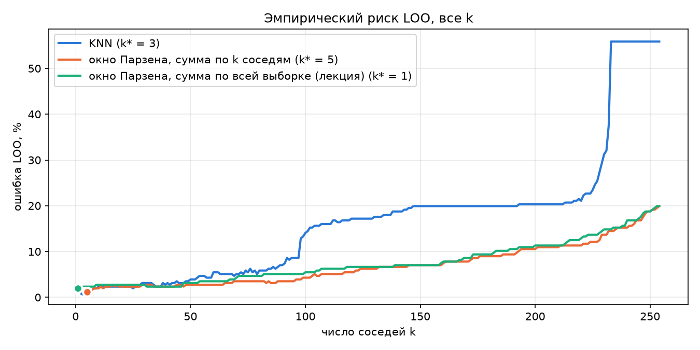
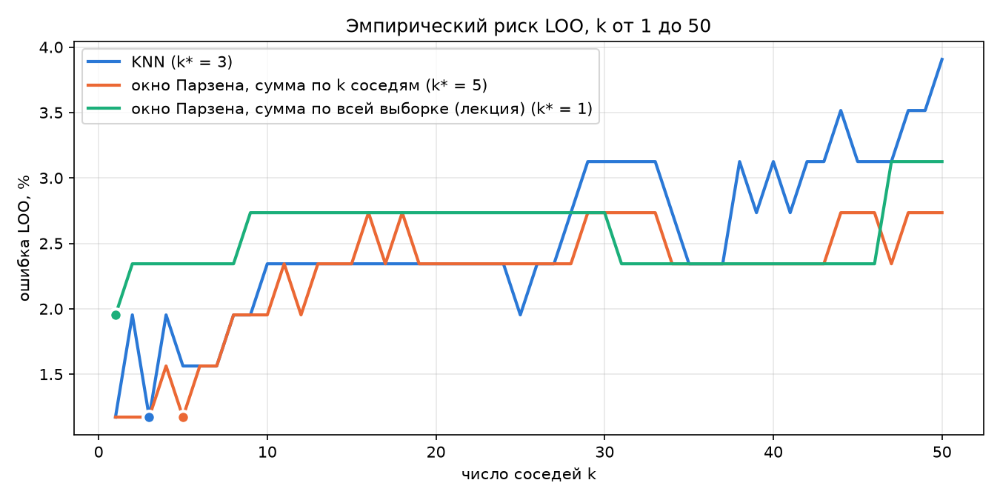
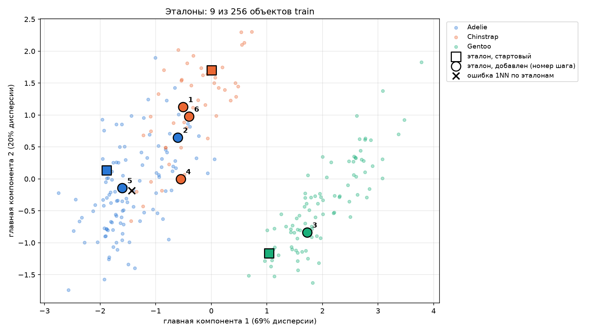
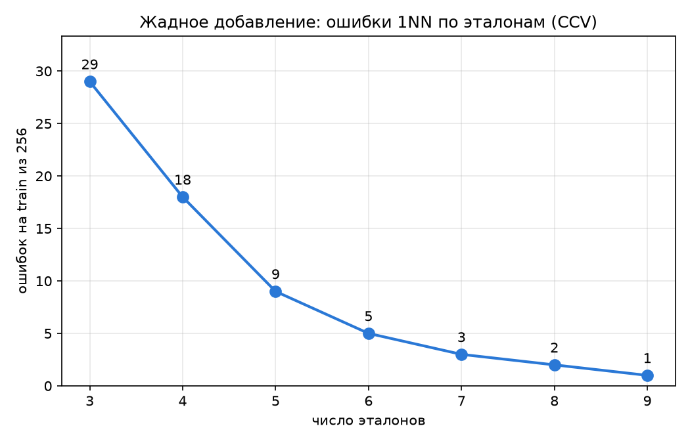

# Лабораторная работа №2. Метрическая классификация

## Задание

В рамках лабораторной работы предстоит реализовать алгоритм классификации KNN и подобрать параметр k методом скользящего контроля.

1. выбрать датасет для классификации;
2. реализовать алгоритм KNN с методом окна Парзена переменной ширины;
   1. в качестве ядра можно использовать гауссово ядро;
3. подобрать параметр k методом скользящего контроля (LOO);
4. обосновать выбор параметров алгоритма, построить графики эмпирического риска для различных k;
5. сравнить с эталонной реализацией KNN;
   1. сравнить качество работы алгоритмов;
6. реализовать алгоритм отбора эталонов;
7. подготовить визуализацию результатов работы алгоритма отбора эталонов;
8. сравнить качество работы KNN с и без отбора эталонов;
9. подготовить небольшой отчет о проделанной работе.

## Описание

Модель определяет вид пингвина по размерам его тела. Это метрический классификатор, он ничего не обучает, а хранит всю выборку и для нового пингвина ищет похожих среди уже известных. Ответ – вид, который преобладает среди ближайших соседей. В окне Парзена близкие соседи весят больше дальних. Чтобы не хранить всю выборку, из нее отбираются эталоны, несколько самых полезных пингвинов, по которым классификатор работает почти так же хорошо.

**Общая сводка**

- Ошибка LOO на train – **1.17%** (3 пингвина из 256) у KNN при $k = 3$ и у окна Парзена при $k = 5$. На test оба ошибаются на 1 пингвине из 86, окно Парзена по формуле из лекции – ни разу.
- Своя реализация совпадает с эталоном `sklearn` по LOO при всех 50 проверенных $k$.
- Жадный отбор оставил **9 эталонов из 256**. 1NN по ним на test не ошибается ни разу, по всей выборке – 2 ошибки.
- Главное, что пришлось поменять, это взять гауссово ядро **из лекции** $e^{-2r^2}$. С ядром $e^{-r^2/2}$ окно Парзена по формуле из лекции при $k \approx 50$ переставало узнавать Chinstrap.

## Файлы

| файл | что внутри |
|---|---|
| `source/data_preprocessing.py` | подготовка данных, разбиение train/test, стандартизация |
| `source/model.py` | расстояния, KNN, окно Парзена, LOO, выбор k, отступы, CCV, отбор эталонов, предсказания |
| `source/metric.py` | accuracy, матрица ошибок, precision, recall, F1, macro-F1 |
| `source/sklearn_baseline.py` | эталон |
| `source/report.py`, `source/main.py` | вывод таблиц и графиков, запуск всего |

---

## 1. Датасет

**Palmer Penguins** (Kaggle), 344 пингвина трех видов, нужно предсказать вид (`species`). Adelie – 152 пингвина (44%), Gentoo – 124 (36%), Chinstrap – 68 (20%).

**Обработка данных:**

| шаг | зачем |
|---|---|
| взяты 4 признака (длина и глубина клюва, длина ласты, масса) | числовые, расстояние между ними имеет смысл |
| удален признак `island` | остров почти однозначно определяет вид (модель угадывала бы место, а не внешний вид) |
| удален признак `sex` | категориальный, 10 пропусков и одно значение `.` |
| удалены 2 пингвина | пропущены все 4 признака, заполнять нечем |
| разбиение 75/25 со стратификацией | доли видов в train и test такие же, как во всем датасете |
| стандартизация признаков, среднее и разброс считаются только по train | масштабы признаков сильно различаются |

| | Adelie | Chinstrap | Gentoo | всего |
|---|---|---|---|---|
| train | 113 | 51 | 92 | 256 |
| test | 38 | 17 | 31 | 86 |

---

## 2. KNN с методом окна Парзена переменной ширины

Похожие пингвины обычно одного вида. Чтобы узнать вид нового пингвина, находим самых похожих на него среди известных и смотрим, какой вид среди них преобладает. Как узнать о новом районе, спросив ближайших соседей.

Схожесть меряется евклидовым расстоянием между векторами признаков (`calculate_dists()`).

$$\rho(u, x) = \sqrt{\sum_j (u_j - x_j)^2}$$

Все алгоритмы ниже устроены одинаково. Для каждого вида складываются веса его объектов, и побеждает вид с наибольшей суммой. Отличаются они только весами.

$$a(u) = \arg\max_y \sum_{i=1}^{\ell} [y_u^{(i)} = y]  w(i, u)$$

Здесь $u$ – новый объект, $x_u^{(i)}$ – $i$-й по близости к нему объект выборки, $y_u^{(i)}$ – его вид.

### KNN

Каждый из $k$ ближайших соседей голосует с весом 1, остальные не голосуют, $w(i, u) = [i \le k]$. `calculate_knn()` считает расстояния до всех объектов, сортирует их, берет виды $k$ ближайших и возвращает самый частый.

**Проблема.** Близкий и далекий сосед весят одинаково. При равенстве голосов (например, 2 на 2 при $k = 4$) ответ решают не данные, а порядок видов, побеждает вид с меньшим номером.

### Окно Парзена

Ближних соседей слышно громче, дальних тише. Громкость задает ядро $K$, а ширина окна $h$ – насколько далеко «слышно».

$$w = K\left(\frac{\rho}{h}\right), \qquad K(r) = e^{-2r^2}$$

Ядро взято из лекции (гауссовское ядро $G(r)$). Для соседа вплотную вес равен 1, на расстоянии $h/2$ – 0.61, на $h$ – 0.14, на $2h$ – 0.0003.

**Переменная ширина.** При фиксированной $h$ в густых областях в окно попадает много пингвинов, а в редких почти никого. Поэтому ширина своя для каждого нового объекта, это расстояние до его $(k+1)$-го соседа.

$$h(u) = \rho(u, x_u^{(k+1)})$$

Окно растягивается, пока не захватит $k$ соседей. Как опрос «иду, пока не наберу $k$ человек», независимо от расстояния. Граница проходит по $(k+1)$-му соседу, а не по $k$-му, чтобы у ядер, которые на границе окна дают 0, все $k$ соседей сохранили голос.

`calculate_parzen()` возвращает вид и суммы весов по видам, суммы нужны для отступов (п. 6).

В лекции сумма идет по **всей** выборке, а $k$ нужен только для ширины окна. Реализованы оба варианта, их выбирает параметр `method` функции `calculate_parzen()`.

| вариант | кто голосует | `method` |
|---|---|---|
| из лекции | все объекты, вес $K(\rho(u, x_i) / h(u))$ | `"parzen_lecture"` |
| KNN с весами окна | только $k$ ближайших, вес $K(\rho(u, x_u^{(i)}) / h(u))$ | `"parzen"` |

Для прямоугольного или треугольного ядра варианты совпадают, за границей окна вес и так 0. Гауссово ядро нигде не обнуляется, поэтому в варианте из лекции формально голосуют все 256 пингвинов. Но вес падает так быстро, что пингвины дальше $2h$ почти ничего не добавляют, и фактически голосуют ближайшие.

**Что следует из весов.** Во втором варианте у первых $k$ соседей $\rho / h$ от 0 до 1, значит вес от 0.14 до 1. Близкий сосед весит до 7 раз больше дальнего в окне и может перевесить нескольких дальних. Поэтому окно меняет ответ обычного KNN не только при ничьей, но и когда за чужой вид голосуют соседи у края окна.

**Почему ядро важно.** Сначала было взято ядро $e^{-r^2/2}$, у него вес на расстоянии $h$ равен 0.61, а на $3h$ – 0.01. С ним вариант из лекции работал плохо, сотни дальних пингвинов с небольшими весами в сумме перекрикивали близких соседей, и при $k \approx 50$ модель переставала узнавать Chinstrap (50 ошибок LOO из 256). С ядром из лекции $e^{-2r^2}$ дальние объекты почти не весят, и при $k = 50$ ошибок 8.

---

## 3. Подбор k методом скользящего контроля (LOO)

Проверять KNN на той же выборке, где он ищет соседей, нельзя. Каждый пингвин находит сам себя на расстоянии 0, и при $k = 1$ ошибок всегда ноль. Поэтому каждый пингвин по очереди «закрывается», его вид угадывается по остальным и сверяется с настоящим.

$$\mathrm{LOO}(k) = \frac{1}{\ell} \sum_{i=1}^{\ell} \left[ a\left(x_i;  X^\ell \setminus \lbrace x_i \rbrace,  k\right) \neq y_i \right], \qquad k^\ast = \arg\min_k \mathrm{LOO}(k)$$

В `calculate_loo()` параметр `method` выбирает алгоритм (`"knn"`, `"parzen"`, `"parzen_lecture"`). Убирает пингвина из выборки `split_leave_one_out()`, а лучшее $k$ выбирает `calculate_best_k()`.

---

## 4. Эмпирический риск и выбор k

На первом графике все $k$ от 1 до 254 (для окна Парзена нужен $(k+1)$-й сосед среди 255 оставшихся).

На втором графике $k$ от 1 до 50, где находится минимум. Точкой отмечено выбранное $k$.

**Ошибка LOO, %.**

| $k$                | 1 | 3 | 6 | 10 | 30 | 50 | 100 | 150 | 200 | 254 |
|--------------------|---|---|---|---|---|---|---|---|---|---|
| `"knn"`            | 1.17 | 1.17 | 1.56 | 2.34 | 3.12 | 3.91 | 14.06 | 19.92 | 20.31 | 55.86 |
| `"parzen"`         | 1.17 | 1.17 | 1.56 | 1.95 | 2.73 | 2.73 | 4.30 | 7.03 | 10.55 | 19.92 |
| `"parzen_lecture"` | 1.95 | 2.34 | 2.34 | 2.73 | 2.73 | 3.12 | 5.47 | 7.03 | 11.33 | 19.92 |

**Что видно на графике.**

- При малых $k$ ошибка минимальна, 3 пингвина из 256. Виды хорошо разделяются по размерам.
- С ростом $k$ ошибка растет. Это недообучение, в голосование попадают пингвины чужих видов.
- При $k$, близком к 256, KNN отвечает всем самым частым видом и ошибка доходит до 56%.
- Оба варианта окна Парзена при малых $k$ на уровне KNN, а с ростом $k$ портятся гораздо медленнее, при $k = 100$ 4–5% против 14%, при $k = 254$ 20% против 56%. Близкие соседи весят намного больше дальних, и толпа дальних почти не влияет на ответ.
- Варианты окна Парзена между собой почти не отличаются. При малых $k$ вариант с $k$ ближайшими чуть точнее (на 1–3 пингвина), при больших $k$ кривые сливаются.

**Выбор k.** Минимум LOO у KNN – 1.17% при $k = 1$ и $k = 3$, у окна Парзена с $k$ ближайшими – 1.17% при $k = 1, 2, 3, 5$, у варианта из лекции – 1.95% только при $k = 1$. Когда минимум достигается при нескольких $k$, берется наибольшее, ответ тогда решают больше соседей, и один шумный пингвин его не перевернет. Итого $k = 3$ для KNN, $k = 5$ для окна Парзена с $k$ ближайшими, $k = 1$ для варианта из лекции.

Разница между $k = 1$, 3 и 5 – один-два пингвина из 256, LOO на такой выборке их надежно не различает. Честный вывод такой, что при $k$ от 1 примерно до 10 качество почти одинаковое и очень высокое.

---

## 5. Сравнение с эталоном

Эталон – `KNeighborsClassifier` из `sklearn` в тех же условиях. Готового окна Парзена переменной ширины в `sklearn` нет, поэтому оно задано своей функцией весов (параметр `weights`). Для варианта с $k$ ближайшими модель берет $k+1$ соседей, ширина окна равна расстоянию до последнего, и он сам не голосует. Для варианта из лекции модель берет всю выборку, а ширина окна равна расстоянию до $(k+1)$-го соседа. Ядро то же, $e^{-2r^2}$.

Сначала проверено, что свои функции считают то же самое. LOO посчитан для $k$ от 1 до 50 своими функциями и через `sklearn` (`cross_val_score` с `LeaveOneOut`).

| своя реализация    | эталон | совпадение LOO |
|--------------------|---|---|
| `"knn"`            | `KNeighborsClassifier()` | 50 из 50 $k$ |
| `"parzen"`         | $k+1$ соседей, свои гауссовы веса | 50 из 50 $k$ |
| `"parzen_lecture"` | вся выборка, свои гауссовы веса | 50 из 50 $k$ |

Дополнительно приведен `weights='distance'`, штатное взвешивание `sklearn` с весом $1/\rho$.

| реализация | модель | $k$ | accuracy | macro-F1 | ошибок из 86 |
|---|---|---|---|---|---|
| своя | KNN | 3 | 0.988 | 0.986 | 1 |
| своя | окно Парзена (k ближайших) | 5 | 0.988 | 0.986 | 1 |
| **своя** | **окно Парзена (лекция)** | 1 | **1.000** | **1.000** | **0** |
| sklearn | KNN | 3 | 0.988 | 0.986 | 1 |
| sklearn | KNN, вес 1/расстояние | 3 | 0.988 | 0.986 | 1 |
| sklearn | окно Парзена (k ближайших) | 5 | 0.988 | 0.986 | 1 |
| sklearn | окно Парзена (лекция) | 1 | 1.000 | 1.000 | 0 |

**Как читать метрики.** Метрики посчитаны своими функциями из `metric.py`.
- **accuracy** – доля верных ответов (`calculate_accuracy`).
- **macro-F1** – F1 считается по каждому виду отдельно (вид против всех остальных), затем берется среднее, каждый вид весит одинаково (`calculate_macro_f1`). Chinstrap в test всего 17, и accuracy могла бы скрыть, что модель плохо его узнает, macro-F1 не скроет.

Ошибка KNN и окна Парзена с $k$ ближайшими – один и тот же Adelie, принятый за Chinstrap. Вариант из лекции не ошибается. Свои реализации дают те же предсказания, что и эталон.

Разница между моделями на test – один пингвин из 86, поэтому сказать, что какая-то из них точно лучше, по test нельзя. Преимущество окна Парзена видно на графике LOO, оно гораздо устойчивее к слишком большому $k$.

---

## 6. Отбор эталонов

KNN хранит всех 256 пингвинов и для каждого нового считает расстояния до всех. Можно оставить несколько «образцов» и сравнивать нового пингвина только с ними. Задача в том, чтобы выбрать образцы, с которыми классификатор ошибается реже всего.

Алгоритм взят из лекции. Эталоны $\Omega \subseteq X^\ell$ используются классификатором 1NN, новый объект получает вид ближайшего эталона.

**Как оценить набор эталонов.** Каждый пингвин train классифицируется по эталонам и сверяется со своим видом. Если пингвин сам эталон, себя он не учитывает, как в LOO. Доля ошибок – критерий CCV, при длине контроля 1 он совпадает с LOO для 1NN. В коде это `calculate_ccv()`.

$$\mathrm{CCV}(\Omega) = \frac{1}{\ell} \sum_{i=1}^{\ell} \left[ y_i \neq y_i^{(1|\Omega)} \right]$$

Здесь $y_i^{(1|\Omega)}$ – вид ближайшего к $x_i$ эталона.

**Жадное добавление** реализовано при помощи `greedy_addition()`.

1. Старт – по одному эталону на каждый вид.
2. Каждый пингвин, который еще не эталон, по очереди пробуется в роли нового эталона, и для каждого варианта считается CCV.
3. Добавляется пингвин с наименьшим CCV.
4. Шаги 2–3 повторяются, пока CCV уменьшается.

«Жадный» – потому что на каждом шаге берется лучший вариант прямо сейчас, без заглядывания вперед.

**Стартовые эталоны.** Чтобы не начать с выброса, берется самый «уверенный» пингвин каждого вида, с наибольшим отступом.

$$M(x_i) = \Gamma_{y_i}(x_i) - \max_{y \neq y_i} \Gamma_y(x_i)$$

$\Gamma_y$ – сумма весов соседей вида $y$ в окне Парзена (голосуют 5 ближайших, лучшее $k$ из п. 4), пингвин при этом исключен из выборки. Положительный отступ значит, что пингвин классифицируется верно, большой – что все его соседи своего вида. В коде это `calculate_margin()` и `calculate_start_omega()`.

**Результат.** Начиная с 3 стартовых эталонов, алгоритм добавил еще 6 и остановился на 9.

| число эталонов | 3 | 4 | 5 | 6 | 7 | 8 | 9 |
|---|---|---|---|---|---|---|---|
| ошибок на train из 256 | 29 | 18 | 9 | 5 | 3 | 2 | 1 |

На десятом шаге ни один кандидат не уменьшает CCV, и отбор заканчивается. Итог – 9 эталонов, CCV 0.39% (1 ошибка из 256). Для сравнения, 1NN по всей выборке ошибается по LOO на 3 пингвинах из 256.

---

## 7. Визуализация отбора эталонов

У пингвинов 4 признака, поэтому для рисунка они сведены к двум главным компонентам (PCA), которые сохраняют 89% разброса данных. Отбор и классификация при этом идут в исходных 4 признаках.

Бледные точки – пингвины train, цвет – вид. Квадраты – стартовые эталоны, круги – добавленные, цифра – номер шага, на котором эталон добавлен. Крестик – пингвин, на котором 1NN по эталонам ошибается.

**Что видно на графике.**

- Четыре из шести добавленных эталонов (шаги 1, 2, 4 и 6) стоят на границе Adelie и Chinstrap, где виды перемешаны. Алгоритм ставит эталоны туда, где без них больше всего путаницы. Эталон 5 – Adelie рядом с несколькими Chinstrap, которые затесались в группу Adelie.
- Gentoo отделен от остальных видов, ему хватило двух эталонов (стартового и шага 3).
- По видам эталоны распределились так, Adelie 3, Chinstrap 4, Gentoo 2. Больше всего эталонов у самого малочисленного вида, Chinstrap, потому что его труднее всего отделить от Adelie.
- Единственная ошибка – Chinstrap, который стоит среди Adelie рядом с эталоном 5. Такой пингвин похож на выброс, и добавлять его в эталоны алгоритму невыгодно.

Ошибки быстро падают на первых шагах (29 → 18 → 9), дальше каждый новый эталон исправляет 1–2 пингвинов. Кривая только убывает, переобучения нет, это совпадает с наблюдением из лекции.

---

## 8. Сравнение KNN с отбором эталонов и без

Эталоны отбирались для 1NN, как в лекции, поэтому сравнивается 1NN по всей выборке (соседи ищутся среди 256 пингвинов train) и 1NN только по 9 эталонам. Качество считается на test.

| модель | объектов | accuracy | macro-F1 | ошибок из 86 |
|---|---|---|---|---|
| 1NN, вся выборка | 256 | 0.977 | 0.972 | 2 |
| **1NN, эталоны** | **9** | **1.000** | **1.000** | **0** |

Объектов для хранения стало в 28 раз меньше, а качество не ухудшилось. Ошибок даже стало меньше, 0 вместо 2, отбор убрал пингвинов у границы видов, которые сбивали 1NN по всей выборке. Разница в 2 пингвина из 86 статистически ничего не доказывает, поэтому обоснованный вывод – с 9 эталонами качество не хуже, чем со всей выборкой.

---

## Выводы

- Окно Парзена из лекции сначала работало плохо, сотни дальних пингвинов с маленькими весами перекрикивали близких соседей. Помогло взять ядро из лекции $e^{-2r^2}$ вместо $e^{-r^2/2}$, дальние объекты с ним почти не весят.
- Два варианта окна Парзена (голосуют $k$ ближайших или вся выборка) отличаются только тем, кто голосует, поэтому они в одной функции с параметром `method`.
- По LOO лучшие малые $k$, $k = 3$ для KNN и $k = 5$ для окна Парзена, ошибка 1.17%. При равной ошибке брал наибольшее $k$, так ответ устойчивее к шуму.
- Окно Парзена заметно устойчивее KNN к большому $k$, близкие соседи весят намного больше дальних.
- Своя реализация совпадает с `sklearn` по LOO при всех проверенных $k$, окно Парзена для сравнения пришлось задать в `sklearn` своей функцией весов.
- Жадный отбор по CCV оставил 9 эталонов из 256. Стартовые эталоны пришлось выбирать по отступу, иначе можно начать с выброса.
- 1NN по 9 эталонам на test не ошибается ни разу. Хранить нужно в 28 раз меньше объектов, а качество не хуже, чем по всей выборке.
