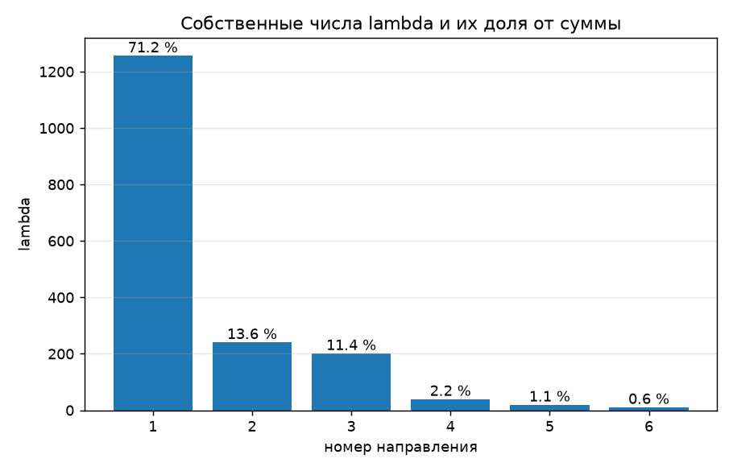
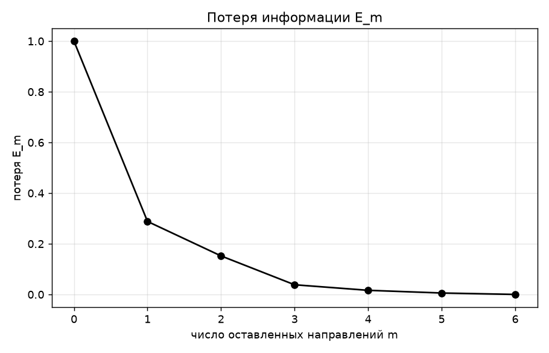

# Лабораторная работа №4. PCA

## Задание

В рамках лабораторной работы предстоит реализовать PCA и сравнить с эталонной реализацией алгоритма.

1. выбрать датасет для линейной регрессии;
2. реализовать PCA через сингулярное разложение;
3. определить эффективную размерность выборки;
4. показать эквивалентность с эталонной реализацией;
5. подготовить отчет.

## Описание

Каждый автомобиль описан шестью числами, но многие из них повторяют друг друга. Тяжелая машина почти всегда с большим двигателем, многоцилиндровая и мощная. Метод главных компонент (PCA) находит новые признаки, каждый из которых смешивает старые, и упорядочивает их по тому, сколько различий между машинами они объясняют. Первых нескольких новых признаков хватает, чтобы описать машины почти так же хорошо, как всеми шестью.

**Общая сводка**

- Датасет Auto MPG, 392 автомобиля и 6 числовых признаков. Четыре из них почти дублируют друг друга, корреляции 0.85–0.96.
- PCA реализован через сингулярное разложение. Ошибка восстановления при любом числе оставленных направлений равна сумме отброшенных собственных чисел.
- Эффективная размерность выборки равна **3 из 6**. Первое направление объясняет 71.2 % разброса, три первых вместе 96.2 %.
- Спектр, проекции и восстановление совпадают с `sklearn.decomposition.PCA`, наибольшая разница $2.3 \cdot 10^{-13}$. Знаки трех направлений из шести противоположны, на результат это не влияет.
- Регрессия на всех шести главных компонентах совпадает с `LinearRegression`. На трех компонентах RMSE на test 3.47 против 3.19, то есть примерно на 9 % хуже.

## Файлы

| файл | что внутри |
|---|---|
| `source/data_preprocessing.py` | загрузка датасета, разбиение train/test, стандартизация |
| `source/model.py` | PCA через SVD, новые признаки, восстановление, потеря, эффективная размерность, регрессия на главных компонентах |
| `source/metric.py` | RMSE и R² |
| `source/sklearn_baseline.py` | эталон sklearn (PCA и линейная регрессия) и сравнение с нашей реализацией |
| `source/plots.py` | графики спектра, потери E_m и RMSE |
| `source/main.py` | запуск всех пунктов и вывод результатов |

---

## 1. Выбор датасета

Выбран датасет **Auto MPG**. Это 398 автомобилей. Цель `mpg` – расход топлива в милях на галлон.

Датасет подходит для работы по трем причинам.
1. Цель непрерывная, то есть это задача линейной регрессии.
2. Все взятые признаки числовые и имеют смысл как величины.
3. Признаки сильно связаны между собой, поэтому их можно описать меньшим числом новых признаков.

**Обработка данных**

| шаг | пометки |
|---|---|
| взяты 6 признаков  | числовые величины |
| удален признак `origin` | это код страны (1, 2, 3), а не величина |
| удален столбец `car name` | текст |
| удалены 6 машин | мощность записана как "?", заполнять нечем, осталось 392 |
| разбиение 75/25 (294 и 98 объектов, seed 42) | стратификации нет, потому что цель непрерывная |

### Зачем центрирование и деление на std

Центрирование обязательно для PCA. SVD измеряет разброс относительно начала координат, поэтому без центрирования первая компонента указывает на центр облака точек, а не вдоль его разброса.

Деление на std нужно, потому что единицы признаков разные. Без него первая компонента повторяет признак с самыми большими числами. На наших данных после одного центрирования первая компонента забирает 99.8 % разброса (почти целиком вес), после центрирования и деления на std – 71 %.

`StandardScaler` считает std с делением на $n$, а не на $n - 1$. Для PCA это не важно, потому что масштаб всех признаков меняется в одно и то же число раз.

---

## 2. Реализация PCA через сингулярное разложение

### 2.1. Разложение

Идея в том, чтобы найти направления, вдоль которых машины различаются сильнее всего. Первое направление самое растянутое, второе самое растянутое из перпендикулярных первому, и так далее.

Матрица $F$ (294 × 6, столбцы центрированы) раскладывается на три множителя.

$$F = V D U^{\top}$$

Столбцы $U$ – главные направления $u_1 \dots u_6$, то есть веса старых признаков в каждом направлении. На диагонали $D$ стоят корни из собственных чисел $\lambda_j$, упорядоченных по убыванию. Число $\lambda_j$ равно сумме квадратов значений вдоль направления $u_j$, а сумма всех $\lambda$ равна сумме квадратов всех элементов $F$.

### 2.2. Новые признаки и восстановление

Новые признаки считаются через первые $m$ столбцов $U$, а старые признаки восстанавливаются из них обратно.

$$G = F U_m, \qquad \hat{F} = G U_m^{\top}$$

Ошибка восстановления – сумма квадратов всех элементов разности.

$$\|\hat{F} - F\|^2 = \sum_{i,j} (\hat{F}_{ij} - F_{ij})^2$$

Проверка теоремы PCA. Ошибка восстановления совпадает с суммой отброшенных $\lambda$, а $G^{\top} G$ диагональна, на диагонали стоят $\lambda$.

| m | 1 | 2 | 3 | 4 | 5 | 6 |
|---|---|---|---|---|---|---|
| ошибка восстановления | 508.4 | 268.3 | 67.4 | 28.7 | 10.0 | 0 |
| сумма отброшенных $\lambda$ | 508.4 | 268.3 | 67.4 | 28.7 | 10.0 | 0 |

---

## 3. Эффективная размерность выборки

Как со сжатием фотографии. Чем сильнее сжимаем, тем больше деталей теряется, и нужно решить, сколько потерь готовы терпеть. Эффективная размерность – наименьшее число направлений, при котором потеря еще допустима.

### 3.1. Спектр

Собственные числа $\lambda$ показывают, насколько сильно данные растянуты вдоль каждого главного направления.

| направление | 1 | 2 | 3 | 4 | 5 | 6 |
|---|---|---|---|---|---|---|
| $\lambda$ | 1255.6 | 240.1 | 200.9 | 38.7 | 18.8 | 10.0 |
| доля от суммы | 71.2 % | 13.6 % | 11.4 % | 2.2 % | 1.1 % | 0.6 % |

### 3.2. Потеря E_m и выбор m

Потеря при $m$ оставленных направлениях – доля отброшенных $\lambda$ от суммы всех. При $m = 0$ она равна 1, при $m = n$ равна 0.

$$E_m = \frac{\lambda_{m+1} + \dots + \lambda_n}{\lambda_1 + \dots + \lambda_n}$$

| m | 0 | 1 | 2 | 3 | 4 | 5 | 6 |
|---|---|---|---|---|---|---|---|
| $E_m$ | 1 | 0.288 | 0.152 | 0.038 | 0.016 | 0.006 | 0 |

**Порог.** Эффективная размерность – наименьшее $m$, при котором $E_m \le \varepsilon$.

| $\varepsilon$ | 0.2 | 0.1 | 0.05 | 0.01 |
|---|---|---|---|---|
| m | 2 | 3 | 3 | 5 |

**Крутой склон.** Ищем $m$, при котором потеря упала сильнее всего, то есть $E_{m-1} \gg E_m$. Берем $m$ с наибольшим отношением $E_{m-1} / E_m$, кроме $m = 0$ (нет предыдущего) и $m = n$ (там $E_n = 0$).

| m | 1 | 2 | 3 | 4 | 5 |
|---|---|---|---|---|---|
| $E_{m-1} / E_m$ | 3.47 | 1.89 | 3.98 | 2.35 | 2.88 |

Наибольшее отношение 3.98 приходится на $m = 3$. Порог 0.05, порог 0.1 и крутой склон дают один и тот же ответ, поэтому эффективная размерность выборки равна **3 из 6**.

По весам в $U$ первое направление отвечает за размер и мощность машины, второе за год выпуска, третье за разгон.

---

## 4. Эквивалентность с эталонной реализацией

В таблице показаны первые три значения каждой величины. Наибольшая разница – максимум модуля разности по всем элементам величины, а не только по показанным.

| величина | наши | sklearn | наибольшая разница |
|---|---|---|---|
| спектр $\lambda$ | 1255.605, 240.060, 200.916 | 1255.605, 240.060, 200.916 | $2.3 \cdot 10^{-13}$ |
| доли $\lambda$ | 0.712, 0.136, 0.114 | 0.712, 0.136, 0.114 | $1.1 \cdot 10^{-16}$ |
| направления $U$, первое направление | 0.455, 0.467, 0.463 | 0.455, 0.467, 0.463 | $5.8 \cdot 10^{-15}$ |
| проекции $G$ на train, первая машина | −0.974, −0.046, −0.890 | −0.974, −0.046, −0.890 | $1.1 \cdot 10^{-14}$ |
| проекции $G$ на test, первая машина | −1.681, −1.411, 0.769 | −1.681, −1.411, 0.769 | $7.8 \cdot 10^{-15}$ |
| восстановление $\hat{F}$ при $m = 3$ на train, первая машина | −0.594, −0.583, −0.332 | −0.594, −0.583, −0.332 | $2.7 \cdot 10^{-15}$ |
| восстановление $\hat{F}$ при $m = 3$ на test, первая машина | −0.910, −0.928, −0.887 | −0.910, −0.928, −0.887 | $2.6 \cdot 10^{-15}$ |

Все расхождения не больше $2.3 \cdot 10^{-13}$, то есть лежат на уровне ошибок округления. 

---

## Регрессия на главных компонентах

Датасет выбран для линейной регрессии, поэтому проверяем, насколько хуже предсказывается расход `mpg`, если вместо шести исходных признаков взять первые $m$ новых.

$$\beta_j = \frac{g_j \cdot y_c}{\lambda_j}, \qquad \hat{y} = G_m \beta + \bar{y}, \qquad y_c = y - \bar{y}$$

Столбцы $G$ ортогональны, поэтому каждый вес находится отдельно.
Среднее $\bar{y}$ считается по train и прибавляется обратно, потому что у новых признаков среднее нулевое, а у расхода нет.
Для test берутся те же $U$, $\beta$ и $\bar{y}$.

Эталон – `LinearRegression` из sklearn на шести исходных признаках.

RMSE – средняя ошибка прогноза в милях на галлон.

$R^2$ – доля разброса расхода, которую объясняет модель.

**Метрики на test**

| m | 1 | 2 | 3 | 4 | 5 | 6 (LinearReg) |
|---|---|---|---|---|---|---|
| RMSE | 4.024 | 3.840 | 3.472 | 3.429 | 3.271 | 3.185 |
| $R^2$ | 0.679 | 0.708 | 0.761 | 0.767 | 0.788 | 0.799 |

При $m = 6$ RMSE и $R^2$ совпадают с `LinearRegression`, то есть регрессия на всех главных компонентах и есть обычная регрессия.

При $m = 3$, то есть при эффективной размерности, ошибка 3.47 против 3.19, примерно на 9 % хуже. Три направления сохраняют 96 % разброса признаков, но не весь сигнал о расходе. PCA оставляет то, что сильнее всего различает машины, а не то, что связано с ответом.

---

## Выводы

- Признаки Auto MPG сильно связаны (корреляции 0.85–0.96), поэтому шесть признаков хорошо сжимаются. Без деления на std первая компонента почти целиком повторяет вес (99.8 % разброса вместо 71 %).
- PCA через сингулярное разложение работает так, как предсказывает теория. Ошибка восстановления при любом $m$ равна сумме отброшенных собственных чисел.
- Эффективная размерность выборки 3 из 6, три новых признака сохраняют 96.2 % разброса.
- Реализация эквивалентна эталонной `sklearn`. Спектр, проекции и восстановление совпадают с точностью $2.3 \cdot 10^{-13}$.
- Для прогноза расхода трех компонент недостаточно. RMSE на test 3.47 против 3.19 у обычной регрессии, то есть на 9 % хуже, потому что PCA сохраняет разброс признаков, а не связь с ответом.
