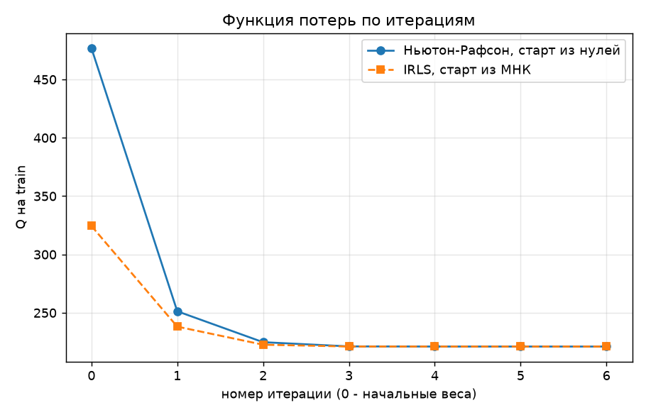

# Лабораторная работа №5. Логистическая регрессия

## Задание

В рамках лабораторной работы предстоит реализовать логистическую регрессию и сравнить с эталонной реализацией алгоритма.

1. выбрать датасет для логистической регрессии;
2. реализовать логистическую регрессию с помощью метода Ньютона-Рафсона и IRLS;
3. показать эквивалентность с эталонной реализацией;
4. подготовить отчет.

## Описание

По результатам обследования пациента нужно оценить вероятность болезни сердца. Логистическая регрессия складывает признаки с весами и переводит сумму в вероятность от 0 до 1. Веса подбираются так, чтобы на обучающей выборке модель как можно увереннее давала правильные ответы. Формулы для таких весов нет, поэтому их ищут итерациями, методом Ньютона-Рафсона или IRLS.

**Общая сводка**

- Датасет Heart Failure Prediction, 918 пациентов, 11 признаков, болезнь сердца у 55 % пациентов.
- Ньютон-Рафсон и IRLS реализованы вручную. Оба сходятся за 6 шагов к одному и тому же минимуму $Q = 221.07$. Из одного старта их траектории совпадают с точностью $10^{-14}$, то есть это один и тот же алгоритм в двух записях.
- С эталонной реализацией `sklearn` веса совпадают с точностью $10^{-7}$ (решатель `lbfgs`) и $10^{-11}$–$10^{-14}$ (решатель `newton-cholesky`), предсказания на test совпадают у всех 230 пациентов.
- На test accuracy 0.896, F1 0.906, одинаково у обоих методов и у `sklearn`.

## Файлы

| файл | что внутри |
|---|---|
| `source/data_preprocessing.py` | загрузка датасета, обработка пропусков и категорий, разбиение train/test, стандартизация |
| `source/model.py` | сигмоида, функция потерь, градиент, гессиан, методы Ньютона-Рафсона и IRLS |
| `source/metric.py` | accuracy, матрица ошибок, precision, recall, F1, log-loss |
| `source/sklearn_baseline.py` | эталонная логистическая регрессия `sklearn` и сравнение с ней |
| `source/plots.py` | график функции потерь по итерациям |
| `source/main.py` | запуск всех пунктов и вывод результатов |

---

## 1. Выбор датасета

Выбран датасет **Heart Failure Prediction** (Kaggle). Это 918 пациентов и 11 признаков обследования.

Датасет подходит для логистической регрессии по трем причинам:
1. Классы почти сбалансированы (55 % и 45 %).
2. Пропуски есть только в одном признаке и их меньше половины. 
3. Классы не разделяются идеально, а это важно, потому что при идеальном разделении у задачи нет конечного решения и веса растут без предела.

**Обработка данных**

| шаг                                                                                                                 | пометки                                                                                              |
|---------------------------------------------------------------------------------------------------------------------|------------------------------------------------------------------------------------------------------|
| холестерин, равный 0 у 170 пациентов. Помечен отдельным признаком `CholesterolMissing`, холестерин заполнен медианой| среди таких пациентов болеют 88 % против 48 % у остальных, поэтому факт пропуска сам несет информацию|
| давление, равное 0 - заполнено медианой                                                                             | -                                                                                                    |
| 5 категориальных признаков переведены в столбцы из 0 и 1, первая категория каждого отброшена                        | матрица $X^{\top} X$ не должна быть вырожденной                                                      |
| метки классов переведены из 0 и 1 в $-1$ и $+1$                                                                     | -                                                                                                    |
| разбиение 75/25 (688 и 230 пациентов, seed 42) со стратификацией                                                    | доля больных в обеих частях одинаковая (0.554 и 0.552)                                               |
| первым добавлен столбец из единиц                                                                                   | его вес играет роль свободного члена модели                                                          |

В итоге 17 столбцов. Ранг матрицы полный (17 из 17), число обусловленности $X^{\top} X$ около 34, то есть матрица далека от вырожденной и метод Ньютона считается устойчиво.

---

## 2. Логистическая регрессия методами Ньютона-Рафсона и IRLS

### 2.1. Модель и функция потерь

Модель складывает признаки пациента с весами и получает оценку $z = w^{\top} x$, любое число. Сигмоида переводит ее в вероятность класса $+1$.

$$\sigma(z) = \frac{1}{1 + e^{-z}}, \qquad P(y = +1 \mid x) = \sigma(w^{\top} x)$$

Для обоих классов вероятность правильного ответа записывается одной формулой через отступ $M_i = y_i w^{\top} x_i$. Положительный отступ значит, что модель угадала.

$$P(y_i \mid x_i) = \sigma(M_i)$$

Откуда сигмоида. Класс – случайная величина с двумя исходами, а логарифм шансов линейно зависит от признаков, $\ln \frac{P}{1 - P} = w^{\top} x$. Если выразить отсюда $P$, получится ровно $\sigma(w^{\top} x)$.

Веса ищутся по принципу максимального правдоподобия. Вероятность того, что модель правильно ответит на всех пациентах, равна произведению $\prod \sigma(M_i)$. Если взять логарифм со знаком минус, произведение становится суммой, а максимум - минимумом. Так получается логарифмическая функция потерь.

$$Q(w) = \sum_{i=1}^{\ell} \ln\left(1 + e^{-M_i}\right) \to \min_w$$

Уверенный верный прогноз почти не штрафуется, прогноз «50 на 50» штрафуется на $\ln 2 \approx 0.69$, а уверенная ошибка штрафуется очень сильно.

При больших отрицательных $M$ число $e^{-M}$ переполняется. Поэтому в коде штраф считается в равной, но устойчивой записи, где под экспонентой всегда число не больше нуля.

$$\ln\left(1 + e^{-M}\right) = \max(-M, 0) + \ln\left(1 + e^{-|M|}\right)$$

### 2.2. Метод Ньютона-Рафсона

Идея метода в том, чтобы вокруг текущих весов заменить $Q$ параболой с тем же наклоном и той же кривизной и сразу перейти в дно этой параболы. Затем повторить в новой точке.

Нужны градиент (наклон) и гессиан (кривизна), где $\sigma_i = \sigma(M_i)$.

$$\frac{\partial Q}{\partial w_j} = -\sum_{i=1}^{\ell} (1 - \sigma_i) y_i x_{ij}, \qquad \frac{\partial^2 Q}{\partial w_j \partial w_k} = \sum_{i=1}^{\ell} (1 - \sigma_i) \sigma_i x_{ij} x_{ik}$$

В матричном виде $g = -X^{\top}\big((1 - \sigma) \circ y\big)$ и $H = X^{\top} D X$, где $D$ – диагональная матрица с числами $(1 - \sigma_i)\sigma_i$. Шаг метода (длина шага $h = 1$)

$$w^{(t+1)} = w^{(t)} - H^{-1} g$$

Подталкивание объекта в градиенте $1 - \sigma_i$ тем больше, чем сильнее модель на нем ошибается. Вес объекта в гессиане $(1 - \sigma_i)\sigma_i$ наибольший у пограничных объектов, где $\sigma_i \approx 0.5$.

Старт из нулевых весов, тогда у всех пациентов $\sigma = 0.5$. Остановка, когда $Q$ меняется меньше чем на $\varepsilon = 10^{-9}$. Лимит 100 итераций защищает от зацикливания.

### 2.3. IRLS

Тот же шаг Ньютона можно получить как решение обычной взвешенной линейной регрессии. На каждой итерации объекты получают веса и новые «ответы», и задача решается методом наименьших квадратов. Веса пересчитываются на каждой итерации, отсюда название Iteratively Reweighted Least Squares.

Алгоритм по лекции.

1. Начальные веса – решение обычного МНК по меткам $\pm 1$, $w = (X^{\top} X)^{-1} X^{\top} y$.
2. На каждой итерации считаются вероятности $\sigma_i = \sigma(M_i)$ и
   - корень из веса объекта $\gamma_i = \sqrt{(1 - \sigma_i)\sigma_i}$,
   - взвешенная матрица $\tilde{F} = \mathrm{diag}(\gamma) X$, каждая строка $X$ умножается на свое $\gamma_i$,
   - модифицированные ответы $\tilde{y}_i = y_i \sqrt{(1 - \sigma_i) / \sigma_i}$.
3. Шаг $w^{(t+1)} = w^{(t)} + (\tilde{F}^{\top} \tilde{F})^{-1} \tilde{F}^{\top} \tilde{y}$.

Почему это тот же Ньютон. $\tilde{F}^{\top} \tilde{F} = X^{\top} D X = H$, то есть это гессиан. $\tilde{F}^{\top} \tilde{y} = \sum_i (1 - \sigma_i) y_i x_i = -g$, то есть это минус градиент. Значит, шаг IRLS равен $-H^{-1} g$, ровно шагу Ньютона.

Цикл остановки и защиты от зацикливания такой же, как у Ньютона.

### 2.4. Сходимость

Ньютон-Рафсон стартует из нулей, IRLS из решения МНК.

| итерация | 0 | 1 | 2 | 3 | 4 | 5 | 6 |
|---|---|---|---|---|---|---|---|
| Q, Ньютон | 476.885 | 251.303 | 224.803 | 221.195 | 221.0698 | 221.0696 | 221.0696 |
| Q, IRLS | 324.450 | 238.143 | 222.647 | 221.096 | 221.0696 | 221.0696 | 221.0696 |

На графике $Q$ на train по итерациям, итерация 0 – начальные веса. IRLS стартует ближе к минимуму, потому что решение МНК уже разделяет классы лучше нулевых весов. После 2–3 шагов обе линии сливаются, а к 5-му шагу оба метода находятся в одном и том же минимуме $Q = 221.0696$. Сходимость быстрая.

**Одинаковый старт.** Если запустить IRLS тоже из нулей, его траектория совпадает с траекторией Ньютона на каждой итерации, наибольшая разница $Q$ равна $2.8 \cdot 10^{-14}$. Это шум округления, то есть методы делают одни и те же шаги. Разный старт дает разный путь, но один и тот же итог, потому что минимум у $Q$ единственный. Гессиан $X^{\top} D X$ положительно определен при полном ранге $X$, поэтому функция потерь строго выпуклая.

---

## 3. Эквивалентность с эталонной реализацией

Эталон – `LogisticRegression` из `sklearn`. Параметры подобраны так, чтобы он решал ту же задачу, что и наши методы.

| параметр | зачем |
|---|---|
| `C=np.inf` | без штрафа за большие веса, остается чистая $Q$ |
| `fit_intercept=False` | смещение уже есть в столбце из единиц |
| `tol=1e-12` | точная остановка, иначе веса совпадут только до 3–4 знаков |
| `max_iter=1000` | запас итераций для строгого `tol` |
| `solver` | `lbfgs` и `newton-cholesky` |

Сравнение выполнено с двумя решателями:
1. `lbfgs` – решатель по умолчанию, это другой, квазиньютоновский метод. Гессиан он не считает, а приближает по истории градиентов.
2. `newton-cholesky` – тот же метод Ньютона, который решает систему $H \delta = g$ разложением Холецкого.

| решатель | итераций | метод | расхождение весов | расхождение вероятностей на test | несовпавших предсказаний на test |
|---|---|---|---|---|---|
| `lbfgs` | 20 | Ньютон-Рафсон | $1.1 \cdot 10^{-7}$ | $7.4 \cdot 10^{-8}$ | 0 |
| | | IRLS | $1.1 \cdot 10^{-7}$ | $7.4 \cdot 10^{-8}$ | 0 |
| `newton-cholesky` | 7 | Ньютон-Рафсон | $1.6 \cdot 10^{-11}$ | $7.6 \cdot 10^{-12}$ | 0 |
| | | IRLS | $3.6 \cdot 10^{-14}$ | $1.7 \cdot 10^{-14}$ | 0 |

Расхождение – наибольшая разница по модулю среди всех весов или всех 230 вероятностей:

С `newton-cholesky` совпадение почти точное, и число итераций совпадает с нашим. 

С `lbfgs` расхождение больше, потому что это другой метод, который останавливается чуть раньше точного минимума. Но и он приходит в ту же точку, а это независимое подтверждение, что найденный минимум правильный.

**Метрики на test**

| метрика | Ньютон-Рафсон | IRLS | sklearn |
|---|---|---|---|
| accuracy | 0.8957 | 0.8957 | 0.8957 |
| precision | 0.8992 | 0.8992 | 0.8992 |
| recall | 0.9134 | 0.9134 | 0.9134 |
| F1 | 0.9063 | 0.9063 | 0.9063 |
| log-loss (среднее) | 0.3160 | 0.3160 | 0.3160 |
| TP / FN / FP / TN | 116 / 11 / 13 / 90 | 116 / 11 / 13 / 90 | 116 / 11 / 13 / 90 |

Precision – доля действительно больных среди тех, кого модель назвала больными.

Recall – доля найденных среди всех больных. 

Модель пропустила 11 больных из 127 и ошибочно назвала больными 13 здоровых из 103. 

Log-loss оценивает сами вероятности, а не только сторону порога. 

Все метрики у трех моделей одинаковые, потому что одинаковы их веса.

---

## Выводы

- Логистическая регрессия не решается одной формулой, поэтому веса ищутся итерациями. Метод Ньютона-Рафсона использует и наклон, и кривизну функции потерь, поэтому сходится за 5–6 шагов вместо сотен у градиентного спуска.
- IRLS – это тот же шаг Ньютона, записанный как взвешенная линейная регрессия. При одинаковом старте траектории совпадают с точностью $10^{-14}$, при разном старте методы приходят в один и тот же минимум.
- Реализация методов эквивалентна эталонной.
- Для корректной работы метода Ньютона важна подготовка данных. Матрица признаков должна иметь полный ранг, а классы не должны разделяться идеально.
- На test модель правильно классифицирует 89.6 % пациентов и находит 91.3 % больных.
- **У задачи только одно решение.** Функция потерь строго выпуклая (гессиан положительно определен при полном ранге $X$), поэтому минимум единственный.