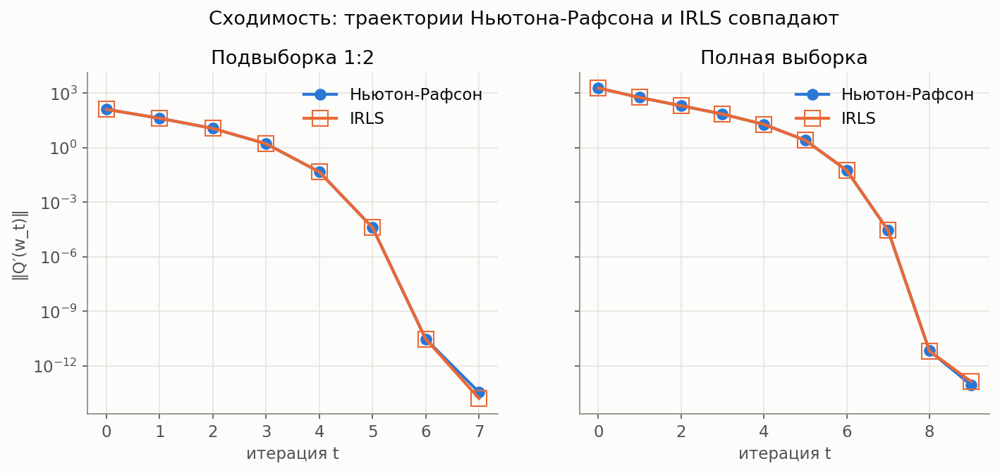
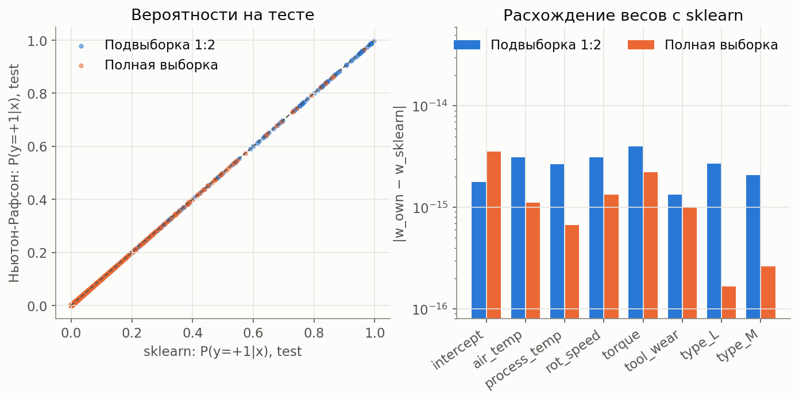
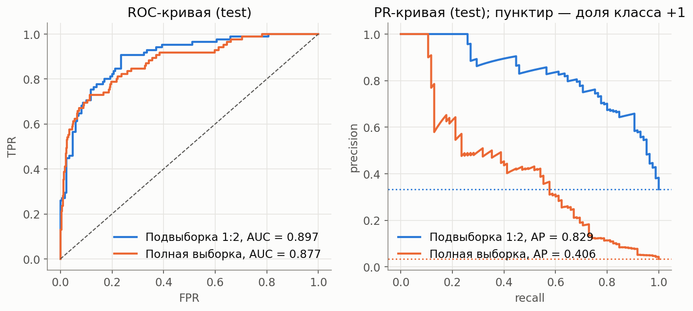

# Лабораторная работа №5. Логистическая регрессия: Ньютон-Рафсон и IRLS

Ссылки «сл. N» указывают на слайды лекции №5 «Нелинейная регрессия» (28 слайдов). Все числа получены запуском скриптов из `sources/` (полный вывод: `results_lab5_compare.txt`, `results_lab5_imbalance.txt`).

## 1. Постановка

Задание: выбрать датасет, реализовать логистическую регрессию методом Ньютона-Рафсона и методом IRLS, показать эквивалентность с эталонной реализацией (`sklearn.linear_model.LogisticRegression`), подготовить отчет.

Выбран вариант B: основной эксперимент на сбалансированной подвыборке из `data.py`, плюс повторение на полной несбалансированной выборке, чтобы проверить вероятностную постановку (сл. 20-21) на реальном дисбалансе классов.

## 2. Данные

**AI4I 2020 Predictive Maintenance**, цель `Machine failure` (бинарная, 10000 строк, 339 отказов, доля 3.39%). Признаки (7): `air_temp`, `process_temp`, `rot_speed`, `torque`, `tool_wear`, one-hot `type_L`, `type_M`. Метки приведены к {−1, +1}, как в лекции (сл. 6). Свободный член вводится константным признаком f₀(x) = 1 (в лекции его нет, это стандартное расширение). Данные грузятся через `data.py

| Эксперимент | Источник | Строк | train / test | Доля +1 | Положительных в test |
|---|---|---|---|---|---|
| Подвыборка 1:2 | `get_data()` без изменений | 1017 | 762 / 255 | 0.333 | 85 |
| Полная выборка | `load_raw()`, свой split | 10000 | 7500 / 2500 | 0.034 | 85 |

В обоих случаях split стратифицированный (`random_state = 42`), `StandardScaler` обучен только на train. Для полной выборки split и масштабирование написаны отдельно в `lr5_data.py`, потому что подвыборка из `data.py` специально меняет баланс классов.

## 3. Теория → код

| Что в лекции | Где в коде (`sources/logreg.py`) |
|---|---|
| Функционал Q(w) = Σ ln(1 + e^{−Mᵢ}), Mᵢ = yᵢwᵀxᵢ (сл. 6) | `loss` |
| Градиент ∂Q/∂wⱼ = −Σ(1−σᵢ)yᵢfⱼ(xᵢ), гессиан ∂²Q/∂wⱼ∂wₖ = Σ(1−σᵢ)σᵢfⱼfₖ (сл. 7) | `grad_hess` |
| Метод Ньютона-Рафсона w ← w − hₜ(Q″)⁻¹Q′, hₜ = 1 (сл. 3, 7) | `_newton_step` |
| Сведение к взвешенной МНК-задаче (сл. 8) | `_irls_step` |
| IRLS: γᵢ = √((1−σᵢ)σᵢ), F̃ = diag(γ)F, ỹᵢ = yᵢ√((1−σᵢ)/σᵢ), w ← w + hₜ(F̃ᵀF̃)⁻¹F̃ᵀỹ (сл. 9) | `_irls_step` |
| Начальное приближение: обычный МНК (сл. 9, шаг 1) | `_init(init="ols")` |
| Остановка при малом изменении {σᵢ} (сл. 9, шаг 9) | `_run`: max\|σᵢᵗ⁺¹ − σᵢᵗ\| < 1e−10 |
| Бернулли, θ = ln(μ/(1−μ)), c(θ) = ln(1+e^θ) (сл. 14) | `_irls_glm_step` |
| IRLS для GLM: γᵢ = √(c″/φ), ỹᵢ = (yᵢ − c′)/(φγᵢ) (сл. 18-19) | `_irls_glm_step` |
| P(y\|x) = σ(ỹ wᵀx), log-loss, odds ratio (сл. 20-21) | `predict_proba`, проверка в `lr5_compare.py` |

**Почему Ньютон-Рафсон и IRLS дают одно и то же.** Для D = diag((1−σᵢ)σᵢ) имеем F̃ᵀF̃ = FᵀDF = Q″(w) (сл. 7), а F̃ᵀỹ = Σ(1−σᵢ)yᵢxᵢ = −Q′(w). Значит, шаг IRLS w + (F̃ᵀF̃)⁻¹F̃ᵀỹ равен w − (Q″)⁻¹Q′, то есть шагу Ньютона-Рафсона (сл. 8). Разница только в вычислении: Ньютон решает систему с гессианом, IRLS решает взвешенную МНК-задачу через `np.linalg.lstsq` (внутри SVD, как в ЛР4). Поэтому эквивалентность проверяется для всей траектории итераций, а не только для итоговых весов.

Третий вариант `irls_glm` работает с метками {0, 1} и формулами GLM (сл. 18-19). Он подтверждает вероятностную постановку: максимизация правдоподобия Бернулли и минимизация log-loss лекции — одна и та же задача (сл. 20).

## 4. Эквивалентность реализаций

Сравниваются: Ньютон-Рафсон, IRLS, IRLS-GLM и эталон `LogisticRegression(penalty=None, solver="newton-cg", tol=1e-12)` (без регуляризации, иначе задачи разные).

| Величина | Подвыборка 1:2 | Полная выборка |
|---|---|---|
| Итераций (Ньютон / IRLS / IRLS-GLM) | 7 / 7 / 7 | 9 / 9 / 9 |
| Q(w*) | 261.281454 | 701.698768 |
| ‖Q′(w*)‖ | 3.6e−14 | 9.3e−14 |
| max\|wₜ(Ньютон) − wₜ(IRLS)\| по всем t | 6.7e−15 | 1.4e−14 |
| max\|wₜ(Ньютон) − wₜ(IRLS-GLM)\| по всем t | 8.0e−15 | 1.4e−14 |
| max\|w(init = МНК) − w(init = 0)\| | 4.4e−16 | 8.9e−16 |
| max\|w − w_sklearn\| | 4.0e−15 | 3.6e−15 |
| max\|p − p_sklearn\| на test | 1.3e−15 | 5.0e−16 |
| \|logloss − logloss_sklearn\| на test | 5.6e−17 | 0 |
| Совпадение предсказанных меток на test | 100% | 100% |
| \|Q(w*) − (−ln L)\| (сл. 20) | 0 (9 знаков) | 0 (9 знаков) |
| min / max собственное значение Q″(w*) | 5.76 / 170.9 | 15.6 / 848.9 |

Все расхождения на уровне машинной точности. Минимальное собственное значение гессиана положительно, поэтому Q строго выпукла и минимум единственный: любые корректные методы обязаны прийти к одним и тем же весам. Старт из нуля и из МНК приводит к тому же решению за то же число итераций.



*Рис. 1. Норма градиента по итерациям: траектории Ньютона-Рафсона и IRLS неразличимы.*
Траектория Ньютона-Рафсона на подвыборке:

| t | 0 | 1 | 2 | 3 | 4 | 5 | 6 | 7 |
|---|---|---|---|---|---|---|---|---|
| Q(wₜ) | 376.5183 | 284.4748 | 263.9664 | 261.3483 | 261.2815 | 261.2815 | 261.2815 | 261.2815 |
| ‖Q′(wₜ)‖ | 1.27e+2 | 4.10e+1 | 1.13e+1 | 1.63 | 4.67e−2 | 4.06e−5 | 3.05e−11 | 3.65e−14 |

На последних итерациях норма градиента падает как 4.7e−2 → 4.1e−5 → 3.1e−11, то есть число верных знаков примерно удваивается. Это согласуется с известной сверхлинейной (квадратичной) сходимостью метода Ньютона (в лекции скорость метода Ньютона-Гаусса лишь сравнивается со скоростью Ньютона-Рафсона, сл. 5; доказательства квадратичной сходимости там нет). На полной выборке путь тот же: 9 итераций, от 1.9e+3 до 1.2e−13.



*Рис. 2. Слева: вероятности на test, обе реализации лежат на диагонали. Справа: расхождение весов (логарифмическая ось; нулевое расхождение показано на уровне 1e−16).*

Веса (Ньютон-Рафсон; у sklearn те же значения, расхождение не больше 4e−15):

| Признак | Подвыборка 1:2 | Полная выборка |
|---|---|---|
| intercept | −1.32514 | −4.98170 |
| air_temp | 2.12263 | 1.55081 |
| process_temp | −1.42391 | −1.07518 |
| rot_speed | 2.83278 | 2.13593 |
| torque | 3.44894 | 2.87552 |
| tool_wear | 1.14493 | 0.85243 |
| type_L | 0.20907 | 0.33685 |
| type_M | 0.04034 | 0.08813 |

Веса `air_temp` и `process_temp` имеют противоположные знаки при корреляции признаков 0.88 (ЛР4); по отдельности эти два веса интерпретировать нельзя, значим их совместный вклад.

## 5. Вариант B: подвыборка против реального дисбаланса

Модель оценивает P(y=+1|x) = σ(wᵀx) (сл. 20-21), поэтому дисбаланс отражается в самих вероятностях. Метрики на test (модель одна и та же, Ньютон-Рафсон; метрики у sklearn совпадают, \|ΔROC-AUC\| = 0):

| Метрика | Подвыборка 1:2 | Полная выборка |
|---|---|---|
| Доля +1 в test | 0.3333 | 0.0340 |
| Средняя P(+1\|x) | 0.3272 | 0.0332 |
| ROC-AUC | 0.8971 | 0.8770 |
| PR-AUC (AP) | 0.8287 | 0.4060 |
| log-loss | 0.3740 | 0.1025 |
| Brier | 0.1185 | 0.0253 |
| accuracy at 0.5 | 0.8314 | 0.9684 |
| accuracy «всегда −1» | 0.6667 | 0.9660 |
| precision / recall at 0.5 | 0.776 / 0.694 | 0.636 / 0.165 |
| Порог F1 (выбран на train) | 0.4156 | 0.2386 |
| precision / recall / F1 at порог | 0.762 / 0.753 / 0.757 | 0.407 / 0.412 / 0.409 |



*Рис. 3. ROC и PR-кривые на test (пунктир на PR: доля класса +1).*

Наблюдения:

1. **Accuracy на полной выборке почти ничего не говорит**: 0.9684 против 0.9660 у константного прогноза «отказа нет». При пороге 0.5 модель находит лишь 16.5% отказов.
2. **Средняя предсказанная вероятность совпадает с долей класса.** На train это точное равенство (0.333333 и 0.033867): условие оптимума ∂Q/∂w₀ = 0 для константного признака означает Σpᵢ = Σyᵢ(0/1). На test близко: 0.3272 против 0.3333 и 0.0332 против 0.0340.
3. **PR-AUC и log-loss между экспериментами напрямую сравнивать нельзя**, они зависят от доли класса. Относительно базовой линии выигрыш у полной выборки по PR-AUC 0.406/0.034 ≈ 12 раз, у подвыборки 0.829/0.333 ≈ 2.5 раза.
4. **Порог надо выбирать отдельно.** Лучший по F1 порог на полной выборке 0.239, а не 0.5; при нем recall растет с 0.165 до 0.412, precision падает с 0.636 до 0.407.
5. **ROC-AUC близки** (0.897 и 0.877), но тестовые наборы разные (255 и 2500 строк, в обоих по 85 положительных). Доверительные интервалы не считались, поэтому утверждать, что одна модель лучше, я не могу.
6. **Свободный член сильно сдвигается** (−1.325 → −4.982, разность −3.657), а веса пяти непрерывных признаков по модулю уменьшаются примерно на 17-27%. Теория смещения априорной доли предсказывает сдвиг свободного члена на ln-odds: −0.693 → −3.351, то есть на −2.658; полученные −3.657 с этим значением не совпадают. Причины я не проверял. Возможные: подвыборка и полная выборка стандартизованы разными `StandardScaler` (поэтому свободные члены нельзя сравнивать напрямую), а линейная логистическая модель только приближает реальную зависимость. Вывод о формуле сдвига по этим числам делать нельзя.

## 6. Замечания о лекции

На слайдах 17-18 знак перед hₜ в шаге Ньютона-Рафсона для максимизации L (плюс на сл. 17, минус на сл. 18) не согласуется со слайдом 19. В коде использован знак слайда 19 (`w + h (F̃ᵀF̃)⁻¹F̃ᵀỹ`), по моей проверке при нем `irls_glm` совпадает с Ньютоном-Рафсоном до 1.4e−14.

## 7. Выводы

1. Ньютон-Рафсон и IRLS для логистической регрессии реализованы по сл. 7 и 9 и дают одинаковые итерации с точностью до ~1e−14, а итоговые веса и вероятности совпадают с `LogisticRegression(penalty=None)` на уровне 1e−15.
2. Совпадение ожидаемо: шаг IRLS алгебраически равен шагу Ньютона, а функционал строго выпуклый.
3. На полной выборке с дисбалансом 3.4% модель корректно калибрована «в среднем», но порог 0.5 непригоден; метрики надо выбирать с учетом доли класса (PR-AUC, F1 при подобранном пороге).

**Ограничения:** одна случайная разбивка, по 85 положительных объектов в тесте (метрики шумные, интервалы не считались); регуляризация не использовалась; граница решения линейная.

## 8. Структура

```
sources/data.py            # без изменений
sources/common.py          # стиль графиков (из ЛР4), без изменений
sources/logreg.py          # Ньютон-Рафсон, IRLS, IRLS-GLM, класс LogisticRegressionIRLS
sources/lr5_data.py        # подвыборка (get_data) и полная выборка со своим split
sources/lr5_compare.py     # эквивалентность с sklearn, траектории, графики 1-2
sources/lr5_imbalance.py   # метрики на двух выборках, график 3
images/lr5_*.png
```

Запуск из корня проекта (там лежит `ai4i2020.csv`):
`PYTHONPATH=sources python3 sources/lr5_compare.py` и `PYTHONPATH=sources python3 sources/lr5_imbalance.py`.
