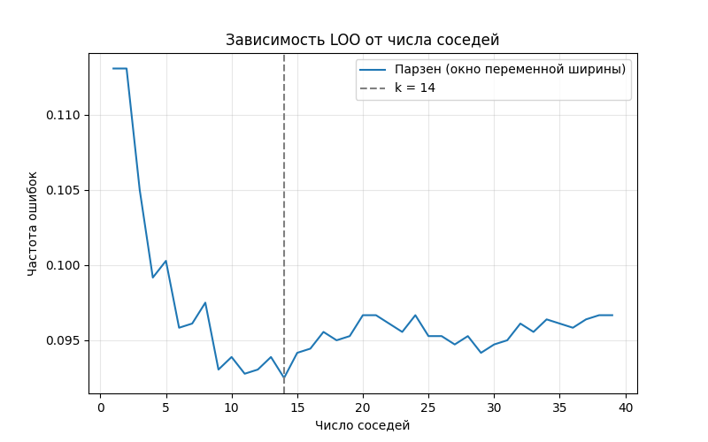
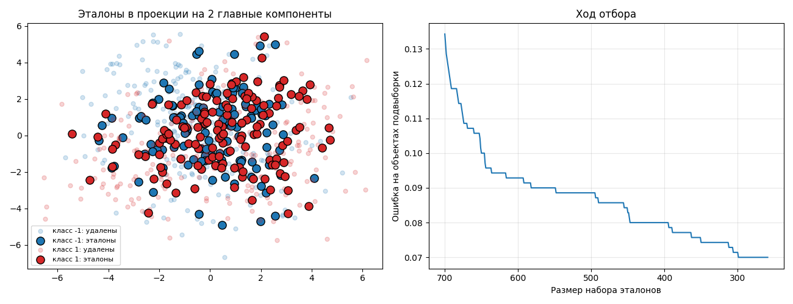
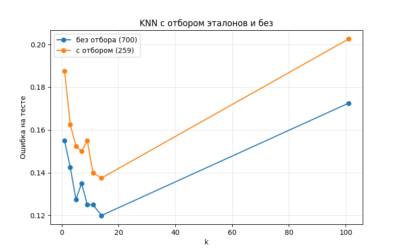

# Отчёт: KNN с окном Парзена переменной ширины и отбор эталонов

## 1. Данные и постановка

- Набор данных: Apple Quality, 4000 объектов, 7 числовых признаков, два класса (−1 и +1), классы сбалансированы (1996 / 2004). Дубликатов и пропусков нет.
- Разбиение: обучающая выборка 3600 объектов (90%), тестовая 400 объектов (10%), фиксированный `seed = 43`.
- Подбор параметров выполняется только по обучающей выборке, тест используется один раз для финального сравнения.

## 2. Алгоритм KNN с окном Парзена переменной ширины

Для классифицируемого объекта `x`:

1. Считаются евклидовы расстояния `d_i` до всех объектов обучающей выборки.
2. Ширина окна `h` равна расстоянию до k-го ближайшего соседа.
3. Каждый объект получает вес `K(d_i / h)`.
4. Веса суммируются по классам, выбирается класс с наибольшей суммой.

Ядро: гауссово `K(r) = exp(−2 r²)` с обрезкой по `r ≤ 1`, то есть голосуют только k ближайших соседей. Без обрезки ядро нефинитно, голосуют все объекты, и оценка размазывается.

## 3. Подбор k методом скользящего контроля (LOO)

Для каждого `k` из диапазона 1…39 каждый объект обучающей выборки по очереди удаляется, классифицируется по остальным 3599 объектам, и считается доля ошибок (эмпирический риск). Лучшим выбирается `k` с минимальным риском.

| Параметр | Значение |
|---|---|
| Диапазон k | 1…39 |
| Лучшее k | **14** |
| Число ошибок LOO | 333 из 3600 |
| Эмпирический риск | **0.0925** |

Обоснование выбора: `k = 14` соответствует минимуму эмпирического риска. Малые `k` дают узкое окно и чувствительность к шуму, большие сглаживают границу классов. Лучшее `k` лежит внутри перебранного диапазона, а не на его границе, поэтому расширять сетку не требуется.

## 4. Сравнение с эталонной реализацией

Эталон: `sklearn.neighbors.KNeighborsClassifier(n_neighbors=k)` с весами `exp(−2 (d/h)²)`, где `h` равно расстоянию до k-го соседа. Эта конфигурация соответствует собственной реализации.

| Алгоритм | k | Ошибка на тесте (400 объектов) |
|---|---|---|
| Собственный Парзен | 14 | 0.1175 |
| sklearn KNN | 14 | 0.1175 |

Результаты совпадают (47 ошибок из 400 у обоих), что подтверждает корректность реализации.
## 5. Алгоритм отбора эталонов

Реализована жадная стратегия удаления не-эталонов с критерием минимума ошибки скользящего контроля:

1. `Ω` = вся подвыборка (все объекты считаются эталонами).
2. Для каждого `x` из `Ω` оценивается ошибка при его удалении. Для каждого объекта подвыборки берутся его `k` ближайших **оставшихся** эталонов (сам объект в соседи не входит), класс определяется большинством голосов. Ошибка считается по всем объектам подвыборки, включая уже удалённые.
3. Удаляется объект, после которого ошибка минимальна. При равенстве выбирается объект с меньшим индексом.
4. Шаги 2-3 повторяются, пока ошибка уменьшается или растёт не более чем на 0.001.

Для ускорения порядок соседей каждого объекта и матрица «сосед имеет чужой класс» вычисляются один раз. Удаление реализовано булевой маской `alive`: сами матрицы не меняются, при пересчёте ошибки из списка соседей отбрасываются удалённые, и берутся первые `k` оставшихся.

Параметры эксперимента:

- подвыборка: первые 700 объектов обучающей выборки (выборка предварительно перемешана, поэтому срез случаен; на полной выборке алгоритм слишком медленный, так как перебирает всех кандидатов на каждом шаге);
- k отбора: 15 (нечётное, ближайшее к лучшему k = 14 из LOO, чтобы при голосовании не было ничьих).

Результат:

| Показатель | Значение |
|---|---|
| Размер подвыборки | 700 |
| Осталось эталонов | **259** (37%) |
| Ошибка 1-NN (LOO) на подвыборке | 0.1486 |
| Ошибка на подвыборке до отбора (k = 15) | 0.1343 |
| Ошибка на подвыборке после отбора | 0.0700 |
| Число шагов удаления | 441 |

Ход отбора: первые удаления быстро снижают ошибку (0.1343 → 0.1186 за 11 шагов: удаляются объекты, мешающие соседям голосовать правильно, например шум внутри чужого класса). Далее ошибка снижается медленно и ступенями с длинными участками без изменения: 0.10 при 650 эталонах, 0.0929 при 600, 0.0886 при 550, 0.0714 при 300 и 0.0700 в конце. На участках без изменения удаляются избыточные объекты, не влияющие на ошибку. Остановка наступила, когда любое следующее удаление увеличивало ошибку больше чем на 0.001 (на 700 объектах одна лишняя ошибка даёт 1/700 ≈ 0.0014).

## 6. Визуализация

- **Эталоны в проекции на 2 главные компоненты.** Удалённые объекты рисуются бледными маленькими точками, эталоны крупными с чёрной обводкой, цвет обозначает класс. Проекция семимерного пространства на плоскость приблизительна, поэтому классы на картинке перекрываются сильнее, чем в исходном пространстве.
- **Ход отбора.** Зависимость ошибки на подвыборке от размера набора эталонов (ось X перевёрнута, процесс идёт слева направо).

## 7. Сравнение KNN с отбором эталонов и без

Оценка на тестовой выборке (400 объектов). Оба варианта строятся на одних и тех же 700 объектах, различается только отбор.

| k | Без отбора (700) | С отбором (259) | Разница |
|---|---|---|---|
| 1 | 0.1550 | 0.1875 | +0.0325 |
| 3 | 0.1425 | 0.1625 | +0.0200 |
| 5 | 0.1275 | 0.1525 | +0.0250 |
| 7 | 0.1350 | 0.1500 | +0.0150 |
| 9 | 0.1250 | 0.1550 | +0.0300 |
| 11 | 0.1250 | 0.1400 | +0.0150 |
| 14 | 0.1200 | 0.1375 | +0.0175 |
| 101 | 0.1725 | 0.2025 | +0.0300 |

Наблюдения:

- Отбор сократил набор в 2.7 раза (700 → 259), что ускоряет предсказание примерно во столько же раз и во столько же уменьшает объём хранимых данных.
- Ошибка на тесте при этом **выросла** при всех `k`, на 0.015-0.0325. Улучшения качества отбор не дал.
- Снижение ошибки с 0.1343 до 0.0700 в п. 5 измерено на тех же объектах, по которым выбирались эталоны, поэтому оно оптимистично и на тесте не подтвердилось.
- Для обоих вариантов лучшее качество на тесте достигается при `k = 14` среди проверенных значений (0.1200 без отбора, 0.1375 с отбором), что согласуется с выбором `k` по LOO.
- При очень большом `k = 101` ошибка резко растёт в обоих вариантах: окно охватывает слишком большую долю выборки, граница классов сглаживается. Это иллюстрирует, почему `k` нужно подбирать, а не брать большим.
- При малых `k` (1, 3) ошибка выше, чем при `k = 14`: чувствительность к шуму.

## 8. Возможные причины и ограничения

1. **Подгонка под подвыборку.** Критерий считается на тех же 700 объектах, и жадное удаление подстраивается именно под них. Разрыв между ошибкой на подвыборке (0.07) и на тесте (около 0.14) это подтверждает.
2. **Размер подвыборки.** При 7 признаках 700 объектов немного, и удаление 63% объектов теряет информацию о границе классов. Ошибка 0.1343 при `k = 15` на 700 объектах выше LOO-ошибки на 3600 объектах (0.0925), то есть на малой выборке соседи в среднем дальше и классификация хуже.
3. **Несовпадение k.** Отбор шёл при `k = 15`, а сравнение проведено для разных `k`. Значение `k = 14` очень близко к 15, и ошибка с отбором всё равно выше, поэтому несовпадение `k` не объясняет ухудшение.
4. **Критерий остановки.** Порог 0.001 при 700 объектах означает остановку при первом же росте ошибки на один объект. Жадный алгоритм может остановиться в локальном минимуме. Кроме того, он продолжает удалять объекты и при неизменной ошибке (длинные участки без изменения на графике хода отбора), что может быть избыточным: многие такие удаления уже не улучшают критерий, а лишь уменьшают набор.

Возможные улучшения: остановить отбор раньше (по плато ошибки) или ввести отложенную выборку для критерия остановки, увеличить подвыборку, использовать для отбора тот же классификатор (Парзен с весами), ускорить пересчёт ошибки только для объектов, у которых удаляемый стоял среди `k` соседей.

## 9. Выводы

1. Реализован KNN с окном Парзена переменной ширины и гауссовым ядром с обрезкой. Оптимальное `k` по LOO равно 14 (риск 0.0925, 333 ошибки из 3600).
2. Собственная реализация даёт на тесте ту же ошибку (0.1175), что и эталонный `KNeighborsClassifier` из sklearn.
3. Реализован жадный отбор эталонов: из 700 объектов оставлено 259 (37%), ошибка на обучающей подвыборке снизилась с 0.1343 до 0.0700.
4. На тестовой выборке отбор эталонов ухудшил качество на 0.015-0.0325 при всех проверенных `k`, то есть он даёт выигрыш по скорости и объёму памяти (набор меньше в 2.7 раза), но не по точности.
5. Наилучшее качество на тесте как с отбором, так и без него достигается при `k = 14`, выбранном по LOO.