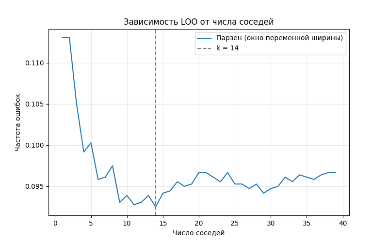
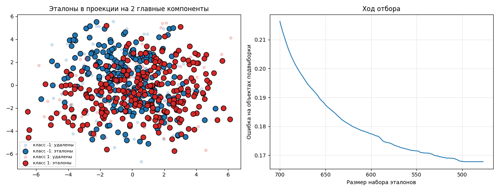
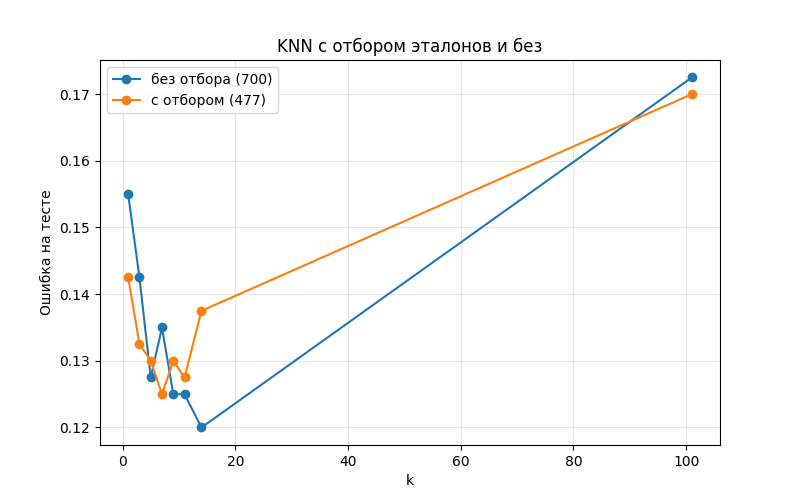

# Отчёт: KNN с окном Парзена переменной ширины и отбор эталонов

## 1. Данные и постановка

- Набор данных: Apple Quality, 4000 объектов, 7 числовых признаков, два класса (−1 и +1), классы сбалансированы (1996 / 2004). Дубликатов и пропусков нет.
- Разбиение: обучающая выборка 3600 объектов (90%), тестовая 400 объектов (10%), фиксированный `seed = 43`.
- Подбор параметров выполняется только по обучающей выборке, тест используется один раз для финального сравнения.

## 2. Алгоритм KNN с окном Парзена переменной ширины

Для классифицируемого объекта `x`:

1. Считаются евклидовы расстояния `d_i` до всех объектов обучающей выборки.
2. Ширина окна `h` равна расстоянию до k-го ближайшего соседа.
3. Каждый объект получает вес `K(d_i / h)`.
4. Веса суммируются по классам, выбирается класс с наибольшей суммой.

Ядро: гауссово `K(r) = exp(−2 r²)` с обрезкой по `r ≤ 1`, то есть голосуют только k ближайших соседей. Без обрезки ядро нефинитно, голосуют все объекты, и оценка размазывается.

## 3. Подбор k методом скользящего контроля (LOO)

Для каждого `k` из диапазона 1…39 каждый объект обучающей выборки по очереди удаляется, классифицируется по остальным 3599 объектам, и считается доля ошибок (эмпирический риск). Лучшим выбирается `k` с минимальным риском.

| Параметр | Значение |
|---|---|
| Диапазон k | 1…39 |
| Лучшее k | **14** |
| Число ошибок LOO | 333 из 3600 |
| Эмпирический риск | **0.0925** |

Обоснование выбора: `k = 14` соответствует минимуму эмпирического риска. Малые `k` дают узкое окно и чувствительность к шуму, большие сглаживают границу классов. Лучшее `k` лежит внутри перебранного диапазона, а не на его границе, поэтому расширять сетку не требуется.

## 4. Сравнение с эталонной реализацией

Эталон: `sklearn.neighbors.KNeighborsClassifier(n_neighbors=k)` с весами `exp(−2 (d/h)²)`, где `h` равно расстоянию до k-го соседа. Эта конфигурация соответствует собственной реализации.

| Алгоритм | k | Ошибка на тесте (400 объектов) |
|---|---|---|
| Собственный Парзен | 14 | 0.1175 |
| sklearn KNN | 14 | 0.1175 |

Результаты совпадают (47 ошибок из 400 у обоих), что подтверждает корректность реализации.
## 5. Алгоритм отбора эталонов

Реализована жадная стратегия удаления не-эталонов. Критерий качества набора эталонов — оценка ошибки через профиль компактности (CCV): вместо голосования большинства ошибка объекта оценивается как сумма взвешенных по Парзену промахов его соседей.

Для объекта `u` и текущего множества эталонов `Ω`:

1. Берутся `k` ближайших **оставшихся** эталонов; сам объект в соседи себе не попадает.
2. Окно — как у классификатора: `h` = расстояние до `k`-го оставшегося эталона.
3. Вес `m`-го соседа задается долей профиля `Π(m,Ω) = K(d_m/h) / Σ_{j≤k} K(d_j/h)`, так что `Σ_m Π(m,Ω) = 1`.
4. `R(m,u) = 1`, если класс `m`-го соседа не совпадает с классом `u`.
5. Ошибка объекта: `C(u,Ω) = Σ_{m=1}^{k} Π(m,Ω) R(m,u)` — доля веса, отданная чужому классу.

Итоговый критерий — средняя ошибка по всей подвыборке, то есть контрольными являются все 700 объектов, включая уже удалённые: `W(Ω) = mean_u C(u,Ω)`. Длина контроля согласована с классификатором: в критерии используются те же `k` ближайших соседей и та же ширина окна Парзена, что и в самом классификаторе, поэтому отбор оптимизирует именно ту взвешенную ошибку, которую допускает алгоритм.

Жадное удаление:

1. `Ω` = вся подвыборка (все объекты считаются эталонами).
2. Для каждого `x` из `Ω` оценивается `W(Ω \ {x})` — удаляется объект, после которого критерий минимален. При равенстве выбирается объект с меньшим индексом.
3. Шаги 2-3 повторяются, пока существует удаление, не увеличивающее `W`: остановка при первом строго увеличении критерия. Изначально сохранялся допуск «+0.001» из предыдущей версии при голосовании большинства: при непрерывном CCV-критерии он допускал медленный дрейф качества (ошибка ползла вверх на десятитысячные за шаг, и отбор останавливался лишь при ~90 эталонах, деградируя тест), поэтому остановка сделана строгой.

Для ускорения порядок соседей и признак «сосед чужого класса» вычисляются один раз. Удаление реализовано булевой маской `Ω`: сами матрицы не меняются, при пересчёте из списка соседей отбрасываются удалённые и берутся первые `k` оставшихся. Ключевое ускорение: при пробе кандидата ошибка пересчитывается только для объектов, у которых кандидат стоит среди первых `k` живых соседей (при вылете объектов первые `k` живых соседей уходят вглубь списка, поэтому затронутые строки ищутся по всей матрице соседей, а не только по первым `k` колонкам). Инкрементальный пересчёт проверен на побитовое совпадение с полным пересчётом ошибки после каждого удаления.

Параметры эксперимента:

- подвыборка: первые 700 объектов обучающей выборки (выборка предварительно перемешана, поэтому срез случаен; на полной выборке алгоритм слишком медленный, так как перебирает всех кандидатов на каждом шаге);
- k отбора: 15 — то же число соседей, что у классификатора (ближайшее нечётное к лучшему k = 14 из LOO; самому критерию нечётность не нужна, он взвешенный и ничьих не допускает).

Результат:

| Показатель | Значение |
|---|---|
| Размер подвыборки | 700 |
| Осталось эталонов | **477** (68%) |
| Профиль[0] (должен ≈ LOO 1-NN) | 0.1486 |
| CCV-критерий до отбора (k = 15) | 0.2163 |
| CCV-критерий после отбора | **0.1678** |
| Число шагов удаления | 222 |

Ход отбора: критерий монотонно снижается с 0.2163 до 0.1678 без скачков назад: 0.1874 при 650 эталонах, 0.1774 при 600, 0.1715 при 550, 0.1679 при 500. Первые удаления убирают объекты, оттягивающие вес чужого класса у своих соседей. Последние ~20 шагов идут по плато: удаляются объекты, у которых все `k` ближайших оставшихся эталонов уже своего класса — их вклад в критерий нулевой и не меняется после удаления (0.1679 → 0.1678). Остановка наступила, когда любое следующее удаление строго увеличивало критерий.

## 6. Визуализация

- **Эталоны в проекции на 2 главные компоненты.** Удалённые объекты рисуются бледными маленькими точками, эталоны крупными с чёрной обводкой, цвет обозначает класс. Проекция семимерного пространства на плоскость приблизительна, поэтому классы на картинке перекрываются сильнее, чем в исходном пространстве.
- **Ход отбора.** Зависимость CCV-критерия `W(Ω)` от размера набора эталонов (ось X перевёрнута, процесс идёт слева направо).

## 7. Сравнение KNN с отбором эталонов и без

Оценка на тестовой выборке (400 объектов). Оба варианта строятся на одних и тех же 700 объектах, различается только отбор.

| k | Без отбора (700) | С отбором (477) | Разница |
|---|---|---|---|
| 1 | 0.1550 | 0.1425 | −0.0125 |
| 3 | 0.1425 | 0.1325 | −0.0100 |
| 5 | 0.1275 | 0.1300 | +0.0025 |
| 7 | 0.1350 | 0.1250 | −0.0100 |
| 9 | 0.1250 | 0.1300 | +0.0050 |
| 11 | 0.1250 | 0.1275 | +0.0025 |
| 14 | 0.1200 | 0.1375 | +0.0175 |
| 101 | 0.1725 | 0.1700 | −0.0025 |

Наблюдения:

- При малых `k` (1, 3, 7) отбор **улучшил** качество: взвешенный CCV-критерий сохраняет эталоны, поддерживающие окрестности объектов, и удаляет в первую очередь объекты, оттягивающие вес чужого класса у своих соседей.
- При `k` = 5, 9, 11 разница в пределах ±0.005 — качество сопоставимо с полным набором.
- При `k` = 14 отбор ухудшил результат (+0.0175): отбор сохраняет 68% объектов, и при широком окне качество почти полного набора оказывается выше, чем у прореженного.
- При `k` = 101 варианты сравнимы (−0.0025): очень широкое окно сглаживает разницу в составе эталонов.
- В отличие от голосования большинства (старая версия: 259 эталонов, ошибка на тесте росла на 0.015-0.0325 при всех `k`), CCV-критерий удаляет меньше и мягче: на тесте есть и улучшения (k = 1, 3, 7), и небольшие ухудшения (k = 5, 9, 11, 14).

## 8. Возможные причины и ограничения

1. **Подгонка под подвыборку.** Критерий считается на тех же 700 объектах, и жадное удаление подстраивается именно под них: CCV-критерий снизился с 0.2163 до 0.1678, однако построенный на оставленных эталонах тестовый Парзен ведёт себя иначе, и улучшение подтверждается только при малых `k`.
2. **Размер подвыборки.** При 7 признаках 700 объектов немного: CCV-критерий до отбора (0.2163) существенно выше LOO-риска на 3600 объектах (0.0925), то есть на малой выборке соседи в среднем дальше и классификация хуже.
3. **Рассогласование окон.** Отбор оптимизировал взвешенную ошибку при окне `k = 15`, а на тесте сравнивался обычный Парзен при разных `k`. При `k`, близких к 15, ландшафт критерия и поведение классификатора согласованы, при иных окнах эталонный набор уже не оптимален по составу (видно по `k = 14`: +0.0175).
4. **Критерий остановки.** Строгая остановка при первом же росте критерия может остановить жадный отбор в локальном минимуме задолго до минимально возможного набора: осталось 68% объектов, профильный критерий при этом перестал снижаться. Хвост-плато удаляет только «невидимые» для критерия объекты (все соседи первого окна — своего класса), такие удаления не влияют на критерий и не помогают классификации, но и не вредят.

Возможные улучшения: увеличить подвыборку, ввести отложенную выборку для критерия остановки, сравнивать на тесте Парзен с тем же окном `k = 15`, что и в критерии отбора.

## 9. Выводы

1. Реализован KNN с окном Парзена переменной ширины и гауссовым ядром с обрезкой. Оптимальное `k` по LOO равно 14 (риск 0.0925, 333 ошибки из 3600).
2. Собственная реализация даёт на тесте ту же ошибку (0.1175), что и эталонный `KNeighborsClassifier` из sklearn.
3. Реализован жадный отбор эталонов с CCV-критерием — оценкой ошибки ΣΠ(m,Ω)R(m) по профилю компактности с нормированными парзеновскими весами и длиной контроля, согласованной с классификатором (`k = 15`): из 700 объектов оставлено 477 (68%), критерий снизился с 0.2163 до 0.1678 без дальнейших строгих улучшений.
4. На тестовой выборке отбор улучшил качество при `k` = 1, 3, 7 (до −0.0125), оставил его сопоставимым при `k` = 5, 9, 11, 101 (±0.005) и ухудшил при `k` = 14 (+0.0175). Хранение и предсказание ускоряются примерно в 700/477 ≈ 1.5 раза.
5. Наилучшее качество на тесте: без отбора — 0.1200 при `k = 14`, с отбором — 0.1250 при `k = 7`, что согласуется с выбором `k` по LOO.