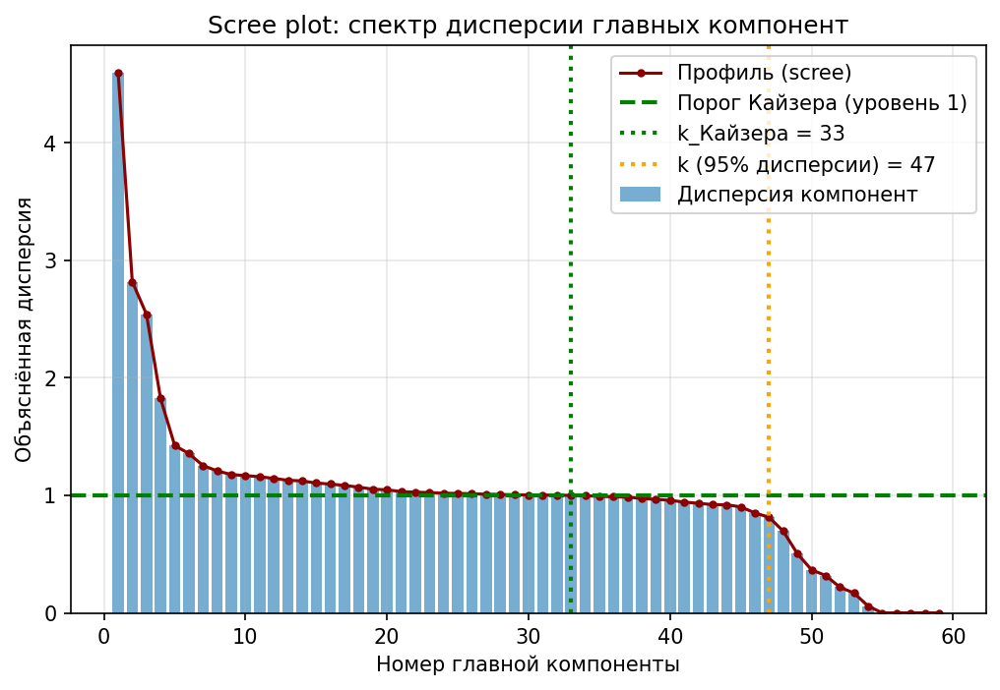
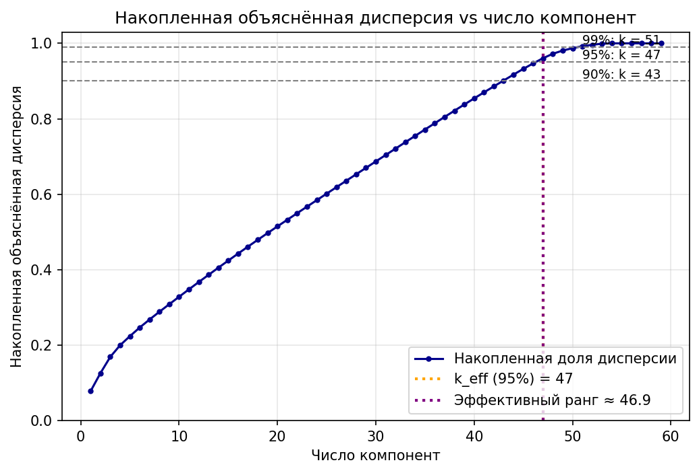

# Лабораторная работа 4: PCA через сингулярное разложение

## Данные

Взят датасет [Used Cars Price Prediction](https://www.kaggle.com/datasets/avikasliwal/used-cars-price-prediction), содержащий объявления о продаже подержанных автомобилей в Индии. Датасет предназначен для задачи **линейной регрессии** — предсказания рыночной цены (`Price`) по характеристикам автомобиля.

**Источник:** Kaggle, Used Cars Price Prediction (Avik Asliwal); файл `train-data.csv`, 6019 наблюдений.

Датасет скачивается из внешнего источника в момент выполнения (через `kagglehub`), в репозитории не хранится.

### Описание признаков датасета

| Признак | Описание |
|---|---|
| `Name` | Марка и модель автомобиля |
| `Location` | Город, в котором выставлен на продажу |
| `Year` | Год выпуска (версия модели) |
| `Kilometers_Driven` | Общий пробег с момента покупки |
| `Fuel_Type` | Тип топлива (Petrol/Diesel/CNG/LPG/Electric) |
| `Transmission` | Тип коробки передач (Manual/Automatic) |
| `Owner_Type` | Количество предыдущих владельцев (First/Second/...) |
| `Mileage` | Расход топлива (км/л) |
| `Engine` | Объём двигателя (CC) |
| `Power` | Мощность двигателя (bhp) |
| `Seats` | Количество мест в машине |
| `New_Price` | Цена новой модели (текущая) |
| `Price` | **Целевая переменная**: цена продажи (в лакхах, 1 lakh = 100 000 рупий) |

### Предобработка

- Удалён служебный столбец индекса `Unnamed: 0` и признак `New_Price` (большая доля пропусков, дублирует смысл `Price`).
- Признак `Name` (~1900 уникальных моделей) заменён на признак `Brand` — первое слово в названии; корректно собраны двухсловные марки (`Land Rover`).
- Строковые числовые признаки `Mileage` / `Engine` / `Power` разобраны с отсечением единиц измерения (`26.60 kmpl`, `1248 CC`, `null bhp`); `null` и нулевые значения (`Mileage == 0` фиксируется как пропуск) заменены медианой.
- Пробег `Kilometers_Driven` обрезан по квантилю 0.995 (6.5 млн км — явный выброс, искажающий масштаб признака).
- Категориальные признаки `Brand`, `Location`, `Fuel_Type`, `Transmission`, `Owner_Type` закодированы one-hot.
- Все признаки стандартизованы: $\tilde{x}_{ij} = (x_{ij} - \mu_j) / \sigma_j$ (вручную, numpy), т.к. признаки имеют сильно разные масштабы. При такой предобработке PCA работает с **корреляционной** матрицей данных.

Итого: **6019 объектов × 59 числовых признаков**.

## Реализация PCA через SVD

Реализация — класс `PCASVD` (`source/pca.py`), только `numpy`.

Матрица данных центрируется, после чего вычисляется сингулярное разложение:

$$X_c = X - \mathbf{1}\mu^T = U \Sigma V^T$$

где $\Sigma$ — диагональная матрица сингулярных чисел $S_i$, $V$ — главные оси в пространстве признаков. Связь SVD с PCA основана на связи спектра ковариационной матрицы с квадратами сингулярных чисел:

$$C = \frac{1}{n-1} X_c^T X_c = V \frac{\Sigma^2}{n-1} V^T \;\Rightarrow\; \lambda_i = \frac{S_i^2}{n-1}$$

то есть собственные значения ковариационной матрицы (объяснённая дисперсия компонент) выражаются через сингулярные числа напрямую — собственно матрицу $X_c^T X_c$ вычислять не нужно.

Реализовано:
- `fit` — среднее $\mu$, главные оси $V$ (строки `Vt`), `explained_variance_ = S²/(n−1)`, доля объяснённой дисперсии;
- `transform` — проекция на компоненты: $Z = X_c V_k^T = U_k \Sigma_k$;
- `inverse_transform` — восстановление из проекции (аппроксимация данных ранга $k$): $\hat{X} = Z V_k + \mu$.

## Эффективная размерность выборки

Рассмотрены три критерия (`source/effective_dim.py`):

1. **Порог по накопленной объяснённой дисперсии** — минимальное $k$, для которого $\sum_{i \le k} \lambda_i / \sum_j \lambda_j \ge$ порога;
2. **Критерий Кайзера** — для стандартизованных данных компоненты с собственным значением выше 1 (среднее собственное значение по признакам равно 1);
3. **Эффективный ранг по энтропии спектра** — экспонента энтропии нормированных собственных значений:

$$\mathrm{rank}_{eff} = \exp\left(-\sum_i p_i \log p_i\right), \quad p_i = \frac{S_i^2}{\sum_j S_j^2}$$

### Скри-плот и накопленная дисперсия



Спектр «тяжёлый» в начале (первые 3–5 компонент имеют дисперсию 1.8–4.5) и длинный плоский «хвост» из компонент с дисперсией около 1 — это типично для данных со смесью числовых и one-hot признаков.



### Результаты

| Критерий | Эффективная размерность |
|---|---|
| 90% объяснённой дисперсии | 43 |
| **95% объяснённой дисперсии** | **47** |
| 99% объяснённой дисперсии | 51 |
| Критерий Кайзера | 33 |
| Эффективный ранг (энтропия) | 46.9 |

**Выбор: $k_{eff} = 47$** (порог 95%). Эффективный ранг по энтропии (46.9) практически совпал с этой оценкой, что подтверждает её согласованность. Критерий Кайзера даёт более консервативную оценку (33), поскольку отсекает весь «плоский хвост» спектра близкий к 1, который для one-hot признаков несёт существенную структурную информацию. Мы выбираем критерий 95% как основной, потому что он контролирует, какую именно часть информации о данных мы сохраняем, сокращая размерность на ~20% (47 из 59 признаков).

## Проверка эквивалентности с эталонной реализацией

Эталон — `sklearn.decomposition.PCA` (по заданию готовые реализации используются именно для эталонных сравнений), модель `svd_solver='full'`, та же стандартизованная матрица.

Главные оси определены лишь с точностью до знака (как $V$, так и $-V$ — валидные решения), поэтому при сравнении компонент и проекций знаки выровнены (сравниваются модули).

| Показатель | Максимальное отклонение |
|---|---|
| Главные оси (`components_`) | $4.2 \cdot 10^{-16}$ |
| Объяснённая дисперсия (`explained_variance_`) | $0$ |
| Доля объяснённой дисперсии (`explained_variance_ratio_`) | $0$ |
| Проекции объектов на компоненты (`transform`) | $3.2 \cdot 10^{-14}$ |
| Реконструкция по 20 компонентам (`inverse_transform`) | $1.2 \cdot 10^{-14}$ |

Отклонения во всех метриках — на уровне **машинной точности** ($10^{-16}$–$10^{-14}$, т.е. < 100 ulp), против масштаба данных $\sim 10^2$–$10^3$. Реализация полностью эквивалентна эталонной: `np.linalg.svd` и sklearn PCA фактически используют один и тот же LAPACK-драйвер (GESDD), а дисперсии и доли совпадают вплоть до нуля.

## Структура и запуск

```sh
lab4/
├── README.md              # отчёт
└── source/
    ├── dataset.py         # kagglehub-загрузка и предобработка (pandas/numpy)
    ├── pca.py             # PCA через SVD (numpy)
    ├── effective_dim.py   # критерии эффективной размерности (numpy)
    ├── plots.py           # визуализация (matplotlib)
    ├── main.py            # пайплайн + сравнение с эталоном sklearn
    └── pics/              # графики и summary.json
```

Запуск: `python lab4/source/main.py` (из корня проекта).

## Выводы

1. PCA реализуется через сингулярное разложение без формирования ковариационной матрицы: собственные значения ковариации равны $S_i^2/(n-1)$, главные оси — строки правой сингулярной матрицы $V^T$.
2. Эффективная размерность для датасета Used Cars: **47 компонент** сохраняют 95% дисперсии (59 признаков); оценка устойчива — энтропийный эффективный ранг (46.9) совпал с порогом по дисперсии.
3. Собственная реализация эквивалентна эталонной `sklearn.decomposition.PCA` с точностью до машинной точности (max отклонение компонент $4\cdot10^{-16}$, проекций $3\cdot10^{-14}$).
